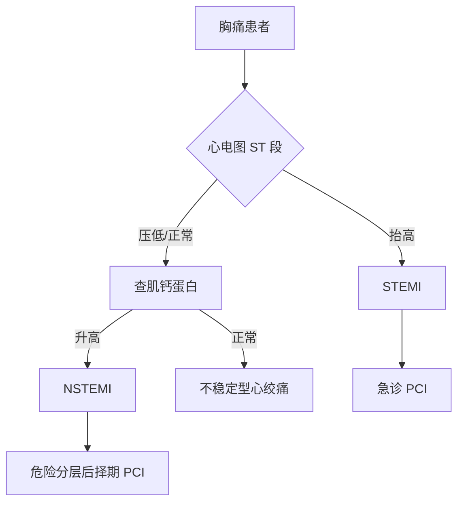

# Obsidian 导出验证样章

> [!info] 这个文件是干什么的
> 它把「Obsidian 渲染 + 导出 PDF」会踩到的**每一类结构**各放一个实例，
> 让你在 3 分钟内用眼睛确认方案是否成立。
> 打开方式：Obsidian 里打开本文件 → 阅读视图（`Ctrl+E`）逐项对照下表。

| 验证项 | 看什么 | 期望结果 |
|---|---|---|
| 中文粗体 | 下面那句**重点加粗** | 明显变重，不发灰 |
| 表格 | 本节表格 | 有边框、表头有底色、斑马纹 |
| 长表格分页 | 第 3 节的 30 行表 | 跨页时表头重复出现 |
| callout | 本块 | 带图标的彩色块 |
| details（open） | 第 4 节 | 内容直接可见 |
| details（无 open） | 第 4 节 | 折叠，点击才展开 |
| mermaid | 第 5 节 | 渲染成流程图，不是代码 |
| 图片（文件名解析） | 第 6 节 | 图片正常显示 |
| 数学公式 | 第 7 节 | 渲染成公式 |

---

## 一、中文粗体补偿

中文没有真正的粗体字重，Chromium 只能「合成加粗」，效果比西文弱很多。
这是「笔记看着发灰、重点不突出」最常见的隐形原因。

开启 snippet 后，`--bold-modifier: 200` 会把粗体再叠一层字重。

- **未补偿时**：这段话里的**关键术语**和普通文字差别很小。
- **已补偿时**：**关键术语**应当明显更重。

对照检查：本行中的 **心输出量** 与普通文字的对比是否足够明显。

## 二、表格

| 药物 | 机制 | 主要适应证 | 关键不良反应 |
|---|---|---|---|
| 硝苯地平 | 阻断 L 型钙通道 | 高血压、变异型心绞痛 | 踝部水肿、反射性心动过速 |
| 美托洛尔 | 阻断 β₁ 受体 | 高血压、心衰、心律失常 | 心动过缓、支气管痉挛 |
| 卡托普利 | 抑制 ACE | 高血压、心衰、糖尿病肾病 | 干咳、高钾血症、血管性水肿 |
| 氢氯噻嗪 | 抑制远曲小管 Na⁺-Cl⁻ 共转运 | 高血压、水肿 | 低钾、高尿酸、高血糖 |
| 螺内酯 | 拮抗醛固酮受体 | 心衰、肝硬化腹水 | 高钾血症、男性乳房发育 |

## 三、长表格跨页测试

下面这张表故意做长。导出 PDF 时观察：**跨页后表头是否重复出现**。

| # | 项目 | 参考值 | 临床意义 |
|---|---|---|---|
| 1 | WBC | 4~10 ×10⁹/L | 升高见于感染、白血病 |
| 2 | RBC（男） | 4.0~5.5 ×10¹²/L | 降低提示贫血 |
| 3 | Hb（男） | 120~160 g/L | 贫血分度依据 |
| 4 | PLT | 100~300 ×10⁹/L | 降低提示出血风险 |
| 5 | 网织红细胞 | 0.5%~1.5% | 反映骨髓造血 |
| 6 | ESR（男） | 0~15 mm/h | 非特异性炎症指标 |
| 7 | CRP | <8 mg/L | 急性期反应蛋白 |
| 8 | ALT | 0~40 U/L | 肝细胞损伤 |
| 9 | AST | 0~40 U/L | 肝/心肌损伤 |
| 10 | ALP | 40~150 U/L | 胆道梗阻、骨病 |
| 11 | GGT | 0~50 U/L | 酒精性肝损敏感 |
| 12 | 总胆红素 | 3.4~17.1 μmol/L | 黄疸鉴别 |
| 13 | 白蛋白 | 40~55 g/L | 营养与肝功能 |
| 14 | 肌酐（男） | 44~133 μmol/L | 肾功能核心指标 |
| 15 | 尿素氮 | 2.9~8.2 mmol/L | 受饮食影响大 |
| 16 | 尿酸（男） | 150~416 μmol/L | 痛风相关 |
| 17 | 血糖（空腹） | 3.9~6.1 mmol/L | 糖尿病诊断 |
| 18 | HbA1c | 4%~6% | 近 3 个月血糖 |
| 19 | 总胆固醇 | <5.2 mmol/L | 动脉粥样硬化风险 |
| 20 | 甘油三酯 | <1.7 mmol/L | 胰腺炎风险 |
| 21 | LDL-C | <3.4 mmol/L | 调脂首要靶点 |
| 22 | HDL-C | >1.0 mmol/L | 保护性因素 |
| 23 | 钾 | 3.5~5.5 mmol/L | 心律失常关键 |
| 24 | 钠 | 135~145 mmol/L | 水电解质平衡 |
| 25 | 氯 | 96~106 mmol/L | 酸碱平衡 |
| 26 | 钙 | 2.11~2.52 mmol/L | 需校正白蛋白 |
| 27 | 磷 | 0.85~1.51 mmol/L | 骨代谢 |
| 28 | 镁 | 0.75~1.02 mmol/L | 低镁致心律失常 |
| 29 | pH（动脉） | 7.35~7.45 | 酸碱失衡判读 |
| 30 | PaO₂ | 80~100 mmHg | 氧合指标 |

## 四、折叠块：details 的两种写法

> [!tip] 为什么不用 `<details>`
> `<details>` 是 HTML，Obsidian 对它的支持有三个坑：
> ① 标签行与首个空行之间的 markdown 不解析；
> ② 默认折叠，导出 PDF 时内容不可见（除非写 `open`）；
> ③ 打印样式无法用 CSS 改变折叠状态。
> **推荐改用 Obsidian 原生 callout 折叠块**，见下方第 5 节。

### 4.1 无 open（导出 PDF 时会折叠，内容看不见）

<details>
<summary>点击展开：急性心梗的心电图演变</summary>

1. 超急性期（数分钟）：T 波高尖
2. 急性期（数小时~数天）：ST 段弓背向上抬高
3. 亚急性期（数天~数周）：ST 段回落，T 波倒置
4. 慢性期（数周~数月）：病理性 Q 波形成

</details>

### 4.2 带 open（导出 PDF 时内容直接可见）

<details open>
<summary>展开：急性心梗的心电图演变（已展开）</summary>

1. 超急性期（数分钟）：T 波高尖
2. 急性期（数小时~数天）：ST 段弓背向上抬高
3. 亚急性期（数天~数周）：ST 段回落，T 波倒置
4. 慢性期（数周~数月）：病理性 Q 波形成

</details>

### 4.3 callout 折叠（推荐写法）

> [!note]- 点击展开：急性心梗的心电图演变
> 1. 超急性期（数分钟）：T 波高尖
> 2. 急性期（数小时~数天）：ST 段弓背向上抬高
> 3. 亚急性期（数天~数周）：ST 段回落，T 波倒置
> 4. 慢性期（数周~数月）：病理性 Q 波形成
>
> 注意 callout 里**可以**用 markdown（粗体、列表、表格都行），
> 这是它比 `<details>` 更值得推荐的根本原因。

## 五、mermaid



## 六、图片

下面两张用**不同的引用语法**，用来确认 Obsidian 的链接解析行为：

语法 A —— 按文件名全局解析（`![[文件名]]`，重命名会断）：

![[p01_109d89e63b7dd8acf1d9ea988aa69669902955d2cd5cf2787298ac7416c02b11.jpg]]

语法 B —— vault 根绝对路径（``，以 `/` 开头表示从 vault 根算起）：


语法 C —— 跨目录相对路径（从本文件所在目录出发，`../` 回退一级）：


> [!warning] 对照结论
> - 语法 A（`![[文件名]]`）能显示 → **文件名兜底解析可用**（本项目图片名带 64 位 hash，实测在 vault 内唯一）。
> - 语法 B（`/` 开头）能显示 → **vault 根绝对路径可用**，适合路径稳定但目录较深的场景。
> - 语法 C（`../` 回退）若破图 → **跨目录相对路径不可靠**，这正是要把 md 与 `images/` 放在同级目录的原因。
>
> 三个测试指向同一结论：**图片与 md 同级是最稳的约定**。

## 七、数学公式

行内公式：心输出量 $CO = HR \times SV$。

块级公式：

$$
\text{MAP} = \frac{\text{SBP} + 2 \times \text{DBP}}{3}
$$

## 八、列表与代码

无序列表：

- 第一层
  - 第二层
    - 第三层

有序列表：

1. 第一步
2. 第二步
3. 第三步

行内代码：`getFirstLinkpathDest()`。

代码块：

```python
def resolve_image(raw: str, md_rel: str, vault: Path, idx: dict) -> tuple[str, str]:
    """模拟 Obsidian 的链接解析顺序：vault 根 → md 同级 → 文件名兜底。"""
    if (vault / raw).is_file():
        return "ok-vault", raw
    if (vault / md_rel).parent.joinpath(raw).is_file():
        return "ok-mdrel", raw
    hits = idx.get(Path(raw).name, [])
    return ("ok-byname", hits[0]) if len(hits) == 1 else ("broken", raw)
```

---

# 第二个 H1：验证章节分页

因为 frontmatter 里写了 `cssclasses: [mgw-book]`，
导出 PDF 时**这个 H1 应当从新的一页开始**。

如果它没有另起一页，说明：
- snippet 没启用，或
- `cssclasses` 没写对（必须是 frontmatter 的顶层键，值是数组）。

## 分页验证检查清单

1. 第一个 H1（本文件标题）**不应**多出一张空白首页
2. 本 H1（第二个）**应当**另起一页
3. 上一节末尾的长表格若跨页，表头应重复
4. 本段落若靠近页尾，不应被拆成「一行在页尾、两行在页首」
