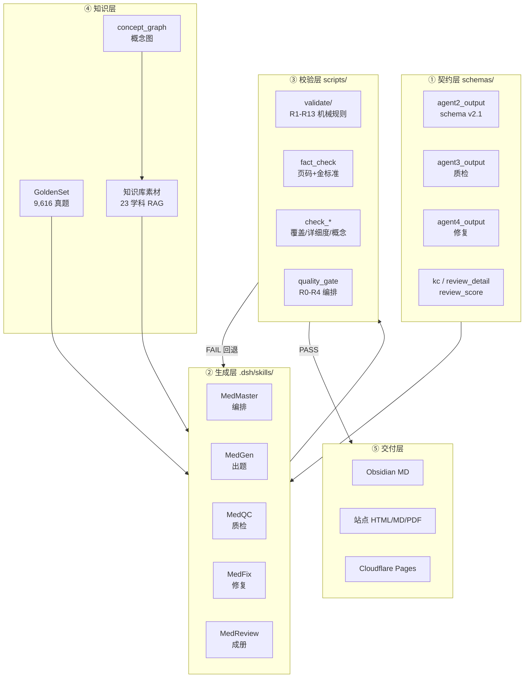

# MedAgentWork 技术报告

> 版本：v1.0　|　编制日期：2026-10-30　|　编制基线：commit `2026-10-27` 主线（234 次提交）
> 适用读者：接手本项目的工程师 / Agent 编排者 / 需要评估质量体系的可信度审查方
> 本报告的所有数字均为**当日实测**，采集命令随文标注；不做估算、不引旧文档口径。

---

## 0. 摘要

MedAgentWork 是一个**用多 Agent 管线批量生产医学复习资料与题库**的工程系统，同时是一个**已上线的静态站点**（Cloudflare Pages）和一套**可实施的质量门禁体系**。

它的核心主张不是「让模型写得更准」，而是：

> **不赌模型零失误，只赌管线兜得住。** 模型的自由度用契约收窄，结果用确定性脚本兜底，每一步留痕可回放。

三条工程主线构成了这个系统的实质：

| 主线 | 一句话 | 落地物 |
|---|---|---|
| **契约先行** | 每个 Agent 的输入输出写成 JSON Schema，摄入即校验，不合格不入库 | `schemas/*.json`、`ingest.py`、`save.py` |
| **门禁强制** | 状态转换前必须跑确定性校验；SKIPPED ≠ PASS；不达标不发布 | `gate_check.py`、`quality_gate.py`、`quality_policy.json` |
| **证据可查** | 每个结论要能回答「凭什么」：页码反查、金标准比对、锚点原文、边的 evidence | `fact_check.py`、`check_keypoint_coverage.py`、`concept_graph.json` |

当日实测的系统规模：

| 维度 | 数值 | 来源 |
|---|---:|---|
| 题库注册题量 | **6,490** 题 / 32 个批次 | `question_bank/registry_meta.json` |
| 自动化脚本 | **105** 个 Python 文件 / **52,531** 行 | `find scripts -name "*.py" \| xargs wc -l` |
| 测试 | 22 个文件 / **181** 个用例；**179 通过 + 2 跳过** | `Python312 -m pytest tests/ -q` |
| 金标准真题 | **9,616** 条（上册 5,168 + 下册 4,448） | `GoldenSet/structured/` |
| 知识库索引 | **23** 个学科 / **26** 个索引 / **82,877** chunks | `知识库素材/index_store/index_manifest.json` |
| 概念图 | **133** 节点 / **518** measures 边 / **131** prereq / **36** ref | `question_bank/concept_graph.json` |
| 笔记库 | **307** 篇 Obsidian MD / 17 篇 MOC | `Obsidian产物/`、`_MOC/` |
| 站点体量 | `index.html` 127 KB；上架资源 222 MB | `du -sh 大四上 大三下 assets` |

---

## 1. 问题定义与设计约束

### 1.1 要解决的问题

为临床医学专业（大三下 + 大四上，共 15 门课）生产三类学习材料：

1. **题库**——带解析、带溯源、带学习价值层的多选题；
2. **押题卷**——按考频与难度配平组卷，供刷题软件导入；
3. **复习资料**——针对教师划定的重点逐条展开，读一遍能独立答题。

表面是内容生产，实质是**三个不可回避的工程问题**：

- **LLM 输出不可信但可用**。同一 Prompt 跑两次，选项长度、答案分布、解析口径都会漂。靠「提示词写好一点」是概率赌博。
- **医学内容错不起**。数值、诊断标准、剂量错一个字就是错的，而模型恰恰最爱在这些地方"流畅地编"。
- **批量生产必须可复现**。第 40 批和第 43 批必须是同一把尺子量出来的，否则跨批次比较无意义。

### 1.2 环境约束（真实存在，影响架构）

| 约束 | 表现 | 架构后果 |
|---|---|---|
| 中国大陆网络 | GitHub/OpenAI/HuggingFace 直连不稳 | RAG 走本地模型（bge-m3），依赖走国内镜像，二进制工具用 Python 替代 |
| Windows + 中文路径 | GBK 编码、反斜杠转义、CRLF | 全脚本强制 `encoding='utf-8'` + `sys.stdout.reconfigure`；路径统一正斜杠 |
| 单人维护 | 无专职测试/运维 | 测试必须零依赖可跑（`run_tests.py`）；门禁必须一条命令 |
| 无 PDF 生成权 | 站点 PDF 一律人工导出 | 脚本只产 MD/HTML；`verify_produce_rules.py` 断言 PDF 无 `HeadlessChrome` 指纹 |

---

## 2. 总体架构

### 2.1 五层结构



设计要点：**层与层之间只通过文件与 JSON 契约通信**。Agent 之间不共享内存、不互相调用，因此任一层可以单独替换、单独测试、单独回放。

### 2.2 目录即协议

目录结构不是收纳习惯，而是**阶段协议**。五个产物目录对应管线的五个阶段，`save.py` / `ingest.py` 用「前置阶段产出不存在则拒绝入库」来强制顺序：

```
输入素材/  →  中间产物/{batch}  →  质检报告/{batch}  →  最终产物/{batch}  →  复习资料/
   ↑ 原件         ↑ MedGen           ↑ MedQC             ↑ MedFix           ↑ MedReview
                              GoldenSet/ ← 仅用户手动签收，脚本一律拒写
```

配套七条铁律（根目录白名单、报告自动分类、统一归档、无副本、输出路径锁定、缓存隔离、文档版本管理）在 `CONTEXT.md` 中固化，并由 `maintenance.py` 自动巡检。

---

## 3. 数据契约层

### 3.1 Schema 清单与版本策略

| Schema | 管什么 | 版本关键点 |
|---|---|---|
| `agent2_output.schema.json` | MedGen 产出的题库 | **v2.1 起 `concepts` 必填**（HC-27），用 if/then 条件必填只对 2.1 生效 |
| `agent3_output.schema.json` | MedQC 质检报告 | 问题编号 + 严重级 + 证据字段 |
| `agent4_output.schema.json` | MedFix 修复版 + 追溯日志 | 每条修改必须挂 `issue_id` |
| `kc.schema.json` | 概念卡（KC） | `display_id` 是唯一可信的模块来源 |
| `review_detail.schema.json` | 复习资料详细度 | 九槽位 × 三级掌握度 |
| `review_score.schema.json` | 12 维文档评分卡 | 关键维度必须 ≥3.5 |
| `item_v2.draft.schema.json` | 学习价值层草案 | 生产契约仍以 agent2 的 `learning_value` 为准 |

**兼容策略是「版本开关 + 不追溯」**：`schema_version=2.0` 的历史批次冻结，新批次强制 2.1。这避免了「新标准上线 → 全库重跑 → 旧结论全变」的连锁灾难。

### 3.2 一个真实的结构性缺陷（值得写进报告）

`jsonschema` 不是本机默认依赖。`ingest.py` 的 schema 校验原本写成：

```python
try:
    import jsonschema
except ImportError:
    return []          # ← 静默放行，等于没有校验
```

这是**契约系统最危险的失效模式**：校验存在、日志干净、实际什么都没查。修复方式不是「记得装库」，而是补一条零依赖的 `_fallback_checks`（`stage=agent2` 时手写 concepts 结构校验），并额外提供 `check_source_concepts.py` 作为独立门禁。

> **教训**：任何「可选依赖决定是否校验」的设计，默认行为必须 fail-closed，不能 fail-open。

---

## 4. 生成层：五阶段管线

### 4.1 角色与职责边界

| 角色 | 职责 | 输入 | 输出 | 禁止 |
|---|---|---|---|---|
| **MedMaster** | 编排 + 门禁执行 + 回显意图 | 用户指令 | 下游调用指令、门禁报告 | 自己写题目 |
| **MedGen** | 按教材+检索片段出题 | 输入素材、RAG 片段、真题候选 | `中间产物/{batch}/` | 直接写最终产物 |
| **MedQC** | 质检打分 + 问题清单 | 中间产物 + GoldenSet | `质检报告/{batch}/` | 修改题目 |
| **MedFix** | 按问题编号修复 + 追溯 | 中间产物 + 质检报告 | `最终产物/{batch}/` | 无依据的手改 |
| **MedReview** | 成册复习资料 | 修复后题库 + RAG | `复习资料/` | 越过锚点概括原文 |

**HC-12（Orchestrator-as-Enforcer）** 是这套分工的支点：编排者不许"相信下游自觉"，每次状态转换前必须跑确定性校验。这条规则是被 5 起管线绕过事件（batch005/006/011/014 等）逼出来的。

### 4.2 状态机与门禁

`workflow_state.json` 是唯一状态源（HC-17：禁止手改，只能走 `scripts/workflow_state.py`）。阶段顺序：

```
agent2_done → agent3_done → agent4_done → [learning_value] → final
                                              ↑ schema v2 批次自动插入
```

`gate_check.py` 实现阶段门禁 + `halt` 信号；`quality_gate.py` 在其上再包一层 R0–R4 全流程门禁：

| 阶段 | 含义 | 典型检查 |
|---|---|---|
| R0 | 需求评审 | 必需输入存在、批次基线冻结 |
| R1 | 开发实现 | 基线清单完整性 |
| R2 | 测试验证 | KC 映射率、学习价值层、评分卡、详细度、概念图、源标注 |
| R3 | 发布上线 | 产物形态、站点新鲜性、站点链接 |
| R4 | 运行复盘 | 发布后一致性 |

**聚合规则**（`aggregate()`）：`enforce` 模式下任一 required 检查 FAIL → 退出码 1；`advisory` 模式下 FAIL 降级为 WARN、退出码 0。**任何情况下 SKIP 都不等于 PASS**——这条写在 `quality_policy.json` 的注释里，也写在门禁报告的字段里。

一次真实的 R3 报告（`reports/gate/quality_gate_batch043_r3_20261027T003323.json`）：

```
status: WARN   profile: release_teacher_keypoint   mode: enforce
PASS  r1.baseline           基线冻结校验 PASS
PASS  r2.kc_registry        映射 200/200；重点 61/61
PASS  r2.item_learning_value PASS；source=100.0% anchor=100.0%
WARN  r2.scorecard          overall=4.75；warnings=12
SKIP  r2.review_items       未生成 review_items.jsonl（D3 未在范围内）
PASS  r3.produce_rules      产物形态门禁 PASS
PASS  r3.site_freshness     站点一致性 PASS
PASS  r3.site_links         站点链接 PASS
```

注意这条报告的**诚实度**：一条 WARN（评分卡 12 条警告）、一条 SKIP（范围外）都原样留在报告里，没有为了"全绿好看"而抹掉。WARN 需写豁免理由（`quality_gate_batch043_waiver.md`），BLOCKED 禁止发布。

---

## 5. 质量工程体系

这是整个项目投入最重的部分。可以分成**四道防线**，由弱到强：

### 5.1 第一道：机械规则（不需要模型）

`scripts/validate/` 把「好选项长什么样」拆成可判定的规则，共 13 条主规则 + 补充规则：

| 规则 | 检测什么 | 由来 |
|---|---|---|
| R2 | 正确选项显著长于干扰项 | 模型天然爱把正确答案写详细 |
| R6 | 数值干扰项与正确值差距 ≤5 倍 | 否则一眼排除，失去区分度 |
| R9 | 数值缺单位 | 医学数值缺单位 = 无效题 |
| R10/R11 | NBME 8 项选项设计线索 | 绝对词、1.5x 长度、语法不一致、数值未排序 |
| R12 | 无意义括号后缀（"（相关表现）"） | 模型为凑长度生成的填充物 |
| B1 | 共用备选答案组结构 | B1 型题特有 |
| JS1/S3/S4 | 静态结构与长度一致性 | 防止选项长度振荡 |

规则的演化本身就是一部教训史。**HC-14** 记录了最典型的一次：早期用「选项字数 4–15 字」约束，结果模型在 3.9 字 ↔ 18.9 字之间反复摇摆了 3 个批次（batch007→010）。改为**结构模板**约束（5 个选项共享同一语法骨架，如都是「[部位]+[疾病名]」）后一次收敛。

> **教训**：对 LLM 约束"数值范围"会引发振荡，约束"结构模式"才会稳定。

### 5.2 第二道：事实反查

`scripts/fact_check.py` 做两件事：

- **页码反查**（`pages`）：题目声称的教材页码里，是否真能找到该知识点；
- **金标准比对**（`golden`）：与 `GoldenSet/` 的 9,616 条真题比对术语与数值一致性。

引用不合格不降级、直接 FAIL——这是"来源不合格即拒绝"的硬线。

### 5.3 第三道：结构契约（详细度 / 学习价值 / 概念标注）

#### HC-26 复习资料详细度

把"写得好"翻译成可数的槽位。九问：定位 / 机制 / 识别 / 诊断 / 处置 / 鉴别 / 易错 / 记忆 / 自测。

| 掌握级 | 最低字符 | 最少单元 | 附加要求 |
|---|---:|---:|---|
| 掌握 | ≥900 | ≥12 | 九槽位 + 案例 100% |
| 熟悉 | ≥550 | ≥7 | — |
| 了解 | ≥250 | ≥4 | — |

另有卡片达标率、自测答案覆盖、模块八块完整率三项全局指标（release 档分别 100% / 100% / 100%）。

#### HC-24 题目学习价值层

每道题不只给答案，还要给：逐项覆盖（每个干扰项错在哪）、错误认知（学生为什么会选它）、原文精确引用、锚点核验、反选极性。校验器 `check_learning_value.py` 要求 FAIL=0 才可交付。

#### HC-27 概念标注（本项目最有方法论价值的一条）

规定**每道题在生成时就要声明它测到哪几个概念**，而不是事后从解析文本反推。

字段：

```json
{"role": "primary|differential|related",
 "keypoint": "第N条",
 "title": "概念名",
 "evidence": "为什么这题测到它（≥8 字）"}
```

硬约束：恰好 1 条 primary 且其 `keypoint` 等于本题 `keypoint_ref`；A2/A3/A4/X 型 ≥2 条。

**为什么必须在生成期给？** 事后推断在"一题一锚点"的题库上封顶 5%——因为一道题只挂了一个锚点，反推只能推回那一个。两个学科同一套推断算法的实测差距很说明问题：

| 学科 | 多标签率 | 原因 |
|---|---:|---|
| 急诊（batch043） | 4.9% | 48 卡对 61 锚点近 1:1，题目一题一锚点，解析不复用标题 |
| ENT（batch040） | 55% | 有 42 条同锚点共属，天然可多标签 |

要把急诊提到 60%，只能改 schema 让生成期声明，不能在事后造边。

### 5.4 第四道：人工签收

`GoldenSet/` 是全系统唯一写保护区：`save.py`、`ingest.py` 及所有脚本一律拒写，只允许用户手动加入。这是"机器闭环 + 人类把关"的交界点。

---

## 6. 知识层

### 6.1 个性化学科 RAG

**23 个学科不能共用一套检索参数**，这是从实践中得出的结论而不是设计洁癖。每科独立配置：`chunk_size`、`top_n`、混合检索开关与权重、语义保护规则。

| 学科 | chunk | top_n | hybrid | kw 权重 | 保护规则数 |
|---|---:|---:|:---:|---:|---:|
| 内科学 | 800 | 7 | ✓ | 0.3 | 2 |
| 中医学 | 500 | 5 | ✓ | **0.6** | 4 |
| 神经病学 | 800 | 5 | ✓ | **0.5** | 3 |
| 中医心理学 | 500 | 5 | ✓ | 0.45 | **5** |
| 医患沟通 | 800 | 3 | — | — | 3 |

`kw` 权重差异有实质原因：中医的方剂组成、证型名称高度依赖精确词面匹配，语义检索会把「桂枝汤」和「麻黄汤」拉得很近；而内科学的机制描述适合语义检索。

**混合检索原理**：

```
Stage 1  query → embed(bge-m3) → cosine → top-20
         query → 关键词 tokens → Jaccard + coverage → keyword scores
         blended = (1-kw)·cosine + kw·keyword → 重排 → top-20
Stage 2  rerank(bge-reranker-v2-m3) → top-N（≥threshold）
```

**成本降级**是刻意设计的：`--no-rerank` 跳过付费 rerank（batch027 曾因余额不足 402 中断），`--no-cache` 关磁盘缓存。降级不能让管线停下，但要让降级**可见**。

实测索引规模：26 个索引条目 / 82,877 chunks / 模型 `BAAI/bge-m3`。

### 6.2 概念层（Concept Graph）

把题库从"一堆题"变成"一张概念网络"，产物 `question_bank/concept_graph.json`：

| 组成 | 规模 | 语义 |
|---|---:|---|
| 节点 KC | 133（ENT 85 + 急诊 48） | 概念卡 |
| `measures` | 518 | 题 × KC，**每条带 evidence** |
| `prereq` | 131 | KC → KC 单向 DAG |
| `ref` | 36 | KC ↔ KC 无向（同锚点/同页） |
| `module_prereq` | 13 | 模块级硬门控链 |

**前置边分两层，这一点极易被误用**：

- 卡级 `prereq` 实际是一条全序链，深度 84 —— 它只是**阅读顺序**，不是硬前置；
- 真正的门控在 `module_prereq`，模块链深度 7 —— 这才是"学 M03 之前必须学完 M01/M02"。

把阅读顺序当硬前置，会让学习器在第一个节点就锁死。

**建图顺序是固定的**（顺序错则边错）：

```
label_concepts.py            → concept_labels.jsonl（优先读 HC-27 源标注）
build_concept_graph.py --labels → 重建 measures 边（用 primary_evidence 作边证据）
check_concept_graph.py       → C1–C7 门禁
build_concept_cards.py       → Obsidian 概念卡 + 索引 + MOC 回链
render_concept_atlas.py      → 单文件概念地图 HTML
```

**边必须能回答"凭什么连"**：答不出证据就不建这条边。宁可图稀疏，不可图失信。

### 6.3 真题语料工程（HC-18 / HC-22 / HC-23）

双族配额：考研族 20% + 执业医师族 20%，各带 15%–25% 合格带。

金标准库现状：

| 素材 | 规模 | 内容 |
|---|---:|---|
| `GS_上册_2024.json` | 5,168 | 1994–2024 真题试卷（无答案），B 型题组共享选项已绑定 |
| `GS_下册_2025_1994.json` | 4,448 | 贺银成精析（含答案/解析），按 `gs_id` 与上册配对 |
| 答案覆盖 | 4,765/5,168 ≈ **92.2%** | 扫描版绿色标记 + PDF 标准答案 + 人工转录 |

**执业医师语料的分流是硬规则**（49 册 / 2,286 页扫描件）：

| 册型 | 工具 | 原因 |
|---|---|---|
| 单栏册（2007–2016 / 2022–2024，44 册） | 本地 RapidOCR | MinerU 会**整行吞掉 `【答案】`** |
| 双栏册（2017–2021，5 册） | MinerU API | RapidOCR 把**左右栏并成一行**，无法还原 |

反着用必错。质量门禁：单栏册有效率 ≥95%，双栏册 ≥70%（MinerU 丢行属已知损耗）。

**减量规则（HC-23 配套）**：候选不足时记 `quota_status=reduced`（按量减量）或 `cancelled`（取消该族），**不阻断批次**，缺口由原创补齐并如实上报。这条规则的价值在于：配额是质量目标，不该成为管线死锁点。

---

## 7. 交付层

### 7.1 产物形态契约

`docs/产物格式规范.md` 是"生产线 → 站点"的唯一形态契约，由 `verify_produce_rules.py` 强制执行：

| 产物 | 交付形态 | 允许扩展名 | PDF |
|---|---|---|---|
| 押题卷 | **仅 MD**（题型归一：单选题/多选题/判断题） | `.md` | 人工 |
| 题库 | MD + HTML | `.md` `.html` | 人工 |
| 复习资料 | MD + HTML（2026-10-22 起只出 MD） | `.md` `.html` | 人工 |

**"任何脚本不得生成站点 PDF"** 这条禁令来自一次真实事故：2026-09-12 `export_review_pdfs.py` 把用户 09-01 的人工导出版覆盖掉了，站点上挂了一周的脚本打印件。现在的强制点有三处：

1. `--out-dir` 落在站点目录 → 硬拒（exit 2）；
2. 每个 PDF 断言 `/Creator` 不含 `HeadlessChrome`；
3. 体积 ≤25 MiB。

> 判别为何不用 `/Producer=Skia/PDF`：Chrome 打印对话框和 Obsidian 导出同样是 Chromium `printToPdf`，人工导出版也是 Skia。指纹要挑**只有无人值守打印才有**的那个。

### 7.2 站点工程

纯静态 + 单个 Pages Function，无第三方脚本。

| 组件 | 实现 |
|---|---|
| 托管 | Cloudflare Pages（`wrangler pages deploy`，Git 集成 + CI 双通道） |
| 访问计数 | `functions/api/visits.js` + KV binding `VISITS`，站长 `?noself=1` 免计 |
| 刷题路由 | `functions/drill/[[path]].js` |
| 离线 | `sw.js` v4：导航 network-first、静态资源 stale-while-revalidate、**PDF 一律不缓存** |
| 缓存策略 | `_headers` 对 `/assets/intro/*` 7 天 |
| 前端 | 单文件 `index.html`（127 KB），玻璃拟态 + 粒子星域，`mdToHtml v2` 运行时渲染 MD |

**部署白名单**是安全要点，不是洁癖：`wrangler pages deploy` 不认根目录 `.assetsignore`（那是 Workers 静态资产的机制）。若直接以仓库根为输出目录，`scripts/`、`question_bank/`、`中间产物/`、`复习资料/` 会**全部公开**。CI 与本地脚本共用同一份白名单，并在部署前 `ls -1 _stage` 留证。

**链接门禁（fail-closed）**：`scripts/check_site_links.mjs` 把 `index.html` 里每个按钮的真实请求路径解析出来逐个验证文件存在。必要性：Cloudflare Pages 上坏链返回的是 **200 + 首页 HTML**，只看状态码永远抓不到。2026-09-27 大四上分区因路径重复拼前缀导致 10 个下载按钮失效，就是这么漏出去的。

### 7.3 视频产线

首屏 58 秒介绍片 + 三支 38–42 秒科普短片，全部程序化生成而非人工剪辑：

```
index.html（window.__seek(ms) 可定位时间轴）
   → Playwright 逐帧截图 @30fps
   → ffmpeg 编码（H.264 High + AAC）
   → 双画幅 1920×1080 / 1080×1350
```

`audio.html` 用 OfflineAudioContext 合成音轨（低频铺底 + 和弦垫 + 转场铃），零外部素材。因为时间轴可定位，转场与动效**完全可复现**，改一幕只需重渲该帧区间（`--start/--end`）。

前端懒加载做得比较彻底：`<video>` 无 `src`、`preload="none"`，点击封面才注入地址；Playwright 实测点击前 MP4 请求数为 0。

---

## 8. 知识组织层（Obsidian）

站点面向"刷题"，Obsidian 面向"读"。库根 = 整个工作区，笔记视图由 `.obsidian/app.json` 的 `userIgnoreFilters`（89 条）控制——**被排除的文件仍在磁盘上，只是不进搜索/图谱/反链**。

导航三层：

```
_MOC/_MedAgentWork知识图谱.md（总览 15 科）
  → _MOC/<学科>.md（学科 MOC，17 篇）
    → 笔记（Obsidian产物/ 307 篇）
另：_MOC/按用途导航.md 按 复习/题库/素材/归档 四层横切
```

审计工具：`vault_audit.py`（断链/孤儿/同名歧义/目录分布，自动读排除规则）、`check_obsidian.py --all`（PDF 导出门禁）。

两个踩过的坑已写进规范：

- **Obsidian 不支持文件夹链接**，`[[目录名]]` 恒为死链——需要指目录就写行内代码路径；
- 表格内 wikilink 别名必须写 `\|`，否则表格断裂（审计脚本已适配该转义）。

---

## 9. 度量现状

### 9.1 题库结构（6,490 题）

| 题型 | 数量 | 占比 |
|---|---:|---:|
| A1 | 3,031 | 46.7% |
| A2 | 1,475 | 22.7% |
| X（多选） | 845 | 13.0% |
| B1 | 514 | 7.9% |
| A3 | 320 | 4.9% |
| 判断 | 161 | 2.5% |
| A4 | 103 | 1.6% |
| 案例 | 40 | 0.6% |

Bloom 分布：理解 2,196 / 记忆 1,834 / 应用 1,419 / 分析 310。目标比例 30/40/25/5（HC-7），实际**理解偏高、应用偏低**——这是已知偏差，`bloom_sampler.py` 在生成过程中每 50 题采样一次，偏差 >15% 触发 halt 修正。

⚠️ **数据质量问题**：Bloom 字段存在中英文两套键并存（`理解` 2,196 + `comprehension` 219；`记忆` 1,834 + `memory` 210），说明早期批次未统一枚举，统计时需先归一。

### 9.2 批次状态

`workflow_state.json` 实测：**25 个 APPROVED**、3 个 SUPERSEDED、其余为过程态。批次编号已推进到 batch044。

### 9.3 已交付内容

| 类别 | 规模 |
|---|---|
| 大四上复习资料 PDF | 11 份（8 科教学版 + 急诊/ENT 教师重点版 + 妇产深度版） |
| 大四上题库 PDF | 11 份 |
| 大三下复习资料 | 7 科 MD（4 科含 HTML） |
| 大三下押题卷 | 5 套（HTML，v1 遗留形态） |
| 教师重点蓝图版 | 2 科：ENT 85 卡 / 132 锚点 / 125 条全覆盖（88,062 字）；急诊 48 卡 / 61 锚点（66,947 字） |

---

## 10. 关键工程决策复盘

这一节记录**做错过的判断**，因为正确决策往往只是运气好，错误决策才有信息量。

### 10.1 批次 039 主动撤回 199 题

发布前发现题目与并集后的语料存在系统性问题，选择整批撤回而非逐题修补。代价是当期交付延期，收益是保住了"发布即合格"的口径。

> **判断**：撤回比修补便宜。逐题修补会让"这一批到底有没有问题"变成无法回答的问题。

### 10.2 `SKIPPED` 必须显式，且不等于 PASS

早期门禁在缺少输入时直接返回 PASS，导致"没检查"和"检查通过"在报告里长得一样。现在三者严格区分：PASS / WARN / BLOCKED / SKIPPED。

> **判断**：门禁系统的可信度取决于它敢不敢说"我没查"。

### 10.3 CI 的 ruff 从未绿过，于是降级为告警

`ruff check scripts/` 有 305 条、`ruff format --check` 有 79 个文件待重排。更糟的是它排在 `Run tests` **之前**，一挂就把真正有价值的测试整步跳过——实测该测试步骤那时从未执行过。

处置：lint 改 `continue-on-error: true`，把测试放出来；规则集锁定/清债/重排三条路另行决策。

> **判断**：一个永远不会绿的 gate 不是 gate，是噪音。先让有信息量的检查跑起来。副作用是现在 CI 日志里会有一堆 `I001/UP009` 注解但 job 仍 success，容易被误读为失败（已写入备忘）。

### 10.4 `module` 字段是坏的

急诊 48 张概念卡的 `module` 字段**全部为 `M00`**，真实模块只存在于 `display_id`（`K-M01-001`）。建图时若信字段，全库会塌成一个模块。

处置：`build_concept_graph.py` 强制从 `display_id` 重新解析。ENT 注册表正常，所以这个 bug 只在急诊出现——**单科测试通不出这类问题**。

### 10.5 押题卷 455 题拒绝做概念映射

5 个前缀（`NK/WK/SJ/JS/YH`）在 6,490 条注册表中命中 **0**；题目对象只有 `qid/type/stem/options/answer/explanation/source/bloom/system`，无模块、无 KC、无锚点。

处置：本期不做。无 KC 可挂、无锚点可比，硬匹配等于编造。

> **判断**：承认"这块接不上"比产出一张看着完整的假图更有价值。

### 10.6 R2 选项长度：从参数化到结构模板

见 §5.1。三个批次的振荡换来的结论：**约束结构，不约束数值**。

---

## 11. 已知不足与技术债

按影响排序，均为实测确认而非推测：

| # | 问题 | 影响 | 建议 |
|---|---|---|---|
| T1 | 本地默认 `python` 是 3.13 无 numpy/jsonschema，`run_tests.py` 有 3 个文件导入失败 | 本地测试显示 120 通过 + 3 错误，与 CI 的 179 通过不一致 | 在 `run_tests.py` 里显式检测并提示用 Python312；或在 `CONTEXT.md` 顶部加一行"测试必须用 Python312" |
| T2 | Bloom 字段中英混用 | 统计口径漂移 | 加一条迁移脚本归一 + 门禁断言枚举值 |
| T3 | 押题卷与题库完全不通 | 无法交叉引用、无法做概念覆盖分析 | 等 5 科补齐 KC 后再做映射 |
| T4 | 概念图只覆盖 2 科 | 其余 21 科无概念层 | 复制 ENT/急诊 流程，需先补 `kc_registry` |
| T5 | 急诊多标签率 4.9% | 概念图在急诊偏稀疏 | schema v2.1 已在 batch044 生效，后续批次自然提升，不需事后造边 |
| T6 | GoldenSet 5 条图片断链 | PDF 导出时图缺失 | 写保护区，须人工修（`真题下册.md` 的 `images/` 相对路径指向 `Obsidian产物/真题下册/images/`） |
| T7 | `docs/` 已 19 篇，超出"≤5 活跃"的自定规则 | 文档检索成本上升 | 本轮已产出本报告，建议下轮把方案类文档归档，仅留 5 篇索引 |
| T8 | ruff 305 条 + 79 文件待重排 | lint 无信号价值 | 锁 ruff 版本 → 一次性 `format` → 逐步清规则 |
| T9 | 押题卷 5 套仍是 HTML（v1 遗留形态） | 与"押题卷=MD"契约不一致 | 用 `paper_builder.py` 重出 MD，HTML 下线 |

---

## 12. 演进路线建议

按投入产出排序，不按工作量：

**短期（1 个批次内可完成）**

1. 修 T1：把"测试必须用 Python312"变成脚本内的显式检查，而不是文档里的一行字。
2. 修 T2：Bloom 枚举归一 + 门禁断言，结束统计口径的双轨。
3. 修 T9：押题卷重出 MD，清掉 v1 遗留 HTML 分支。

**中期（2–3 个批次）**

4. 概念层扩科：把 ENT/急诊 的 `kc_registry → label → graph → cards` 流程复制到内科学、外科学（这两科题量最大，收益最高）。
5. 清 ruff 债：锁版本 → 全量 format → 按规则分批修复，让 lint 恢复信号价值。
6. `docs/` 归档：方案类文档进 `archive/docs/`，`docs/` 只留 5 篇索引。

**长期（方向性）**

7. 间隔重复闭环：`spaced_schedule.py` 已有 SM-2 调度与 Anki 导出，但站点学习器的 `mastery/last_review/interval/due` 尚未写入。打通后，概念图才能从"知识地图"变成"学习路径"。
8. 押题卷 ↔ 题库打通：需要先给押题卷补模块与 KC，是概念层扩科的延伸而非独立任务。

---

## 13. 附录

### 13.1 命令速查

```bash
# 测试（必须 Python312）
"C:/Users/38063/AppData/Local/Programs/Python/Python312/python.exe" -m pytest tests/ -q

# 全流程门禁
python scripts/quality_gate.py --stage r2 --batch batch044 --profile pilot --mode advisory
python scripts/quality_gate.py --stage r3 --batch batch044 --profile release_teacher_keypoint --mode enforce

# 阶段门禁
python gate_check.py --batch batch044 --stage auto
python gate_check.py --batch batch044 --stage learning_value

# 契约校验
python scripts/quality_policy.py --validate
python scripts/check_source_concepts.py --file 中间产物/batch044/ALL_questions.json --batch batch044
python scripts/check_learning_value.py --file 最终产物/batch044/ALL_questions_FIXED.json
python scripts/check_review_detail.py --md <MD> --mode auto --profile release_teacher_keypoint

# 概念层
python scripts/label_concepts.py --subject 急诊
python scripts/build_concept_graph.py --labels
python scripts/check_concept_graph.py

# 复习资料门禁
python scripts/check_keypoint_coverage.py --keypoints <锚定清单> --md <主复习资料>

# 站点
node scripts/check_site_links.mjs index.html
powershell scripts\deploy_site.ps1
```

### 13.2 门禁报告字段

```json
{"schema_version": 1, "batch": "...", "stage": "r3", "profile": "...", "mode": "enforce",
 "generated_at": "...", "status": "PASS|WARN|BLOCKED|SKIPPED",
 "checks": [{"id": "...", "status": "...", "required": true, "reason": "...", "details": {}}],
 "blocking": [], "warnings": [], "policy_version": "1.2.0"}
```

### 13.3 关键文件索引

| 文件 | 作用 |
|---|---|
| `CONTEXT.md` | 域上下文、网络约束、七条铁律、RAG 配置速查 |
| `SOUL.md` | 五角色人格与 HC-5~HC-27 硬约束全文 |
| `docs/质量管控规范.md` | HC-25 流程标准（阈值表、适用范围矩阵） |
| `docs/产物格式规范.md` | 产物形态唯一契约 |
| `docs/复习资料详细度标准.md` | HC-26 九槽位定义 |
| `docs/概念层改造方案_v1.0.md` | 概念图设计（含 F1–F3 三个实测发现） |
| `scripts/quality_policy.json` | 阈值单一事实来源（v1.2.0） |
| `question_bank/registry_meta.json` | 题库统计真身 |
| `workflow_state.json` | 批次状态机 |

### 13.4 数字口径声明

本报告中所有数字的采集时间均为 2026-10-30 12:45–12:55（GMT+8），采集方式为直接读取源文件或运行脚本来，不引用任何旧文档中的转述值。以下三处存在口径差异，已在正文标注：

- 题库总数 6,490 来自 `registry_meta.json` 的 `stats.total`；`workflow_state.json` 记录的批次数与之不同（前者按题、后者按批次），不可直接相除求均值。
- 测试数 179 通过 + 2 跳过为 **Python312 解释器**实测；默认 `python`（3.13）因缺依赖会报 3 个导入错误（见 T1）。
- 概念图 `subjects[].stats.questions` 为 190 + 200 = 390，而对应两批合计 400 题，差额为未成功映射到 KC 的题目（`check_concept_graph.py` 的 C8 会单独报出）。
