# 口腔科学 高效复习手册（教材浓缩型 v5.2 · 无题目版）

> <b>来源</b>：《口腔科学（第10版）》（郭传瑸、程斌 主编，张志愿 主审，人民卫生出版社「十四五」规划教材，2024）为唯一正文来源；贺银成考研西综讲义（外科学·外科感染·口腔颌面部蜂窝织炎）作交叉补充（正文行内标注「贺银成讲义补充」）；教学大纲按 2026-2027-1 秋季学期课表（武汉科技大学附属武昌医院，临床医学 2023 级 2304 班，第 12-15 周）讲授章节收敛为 7 个模块。
> <b>版本与目标</b>：v5.2 教材浓缩型分层复习手册，面向临床医学专业期末综合复习与执业医师基础阶段；以「理解机制、对比鉴别、建立谱系」为核心，重点对齐诊断标准 / 分级 / 分期 / 首选处理等高频考点。
> <b>无题目版说明</b>：本版为纯知识浓缩版，<b>不含任何习题、自测、真题或主动回忆区</b>；所载均为知识载体（记忆口诀、对比表、鉴别决策树、因果关系图、跨模块概念地图），用于建立与巩固知识体系，而非刷题。

## 科目导航：口腔科学怎么学？

<b>① 一句话核心逻辑链</b>

口腔科学＝<b>牙源性主线</b>（龋病 → 牙髓炎 → 根尖周炎 → 间隙感染/颌骨骨髓炎，M02→M03→M07 顺链而下）＋ <b>外科急症线</b>（麻醉 → 拔牙 → 损伤急救，M06→M07）＋ <b>窗口学科线</b>（黏膜病、涎腺病，M04/M08）。

- <b>牙源性主线</b>：龋病（M02）是几乎一切口腔感染的上游——向下经牙髓→根尖周（M02），经牙周→牙周炎（M03），两者最终都汇聚为颌面部感染（M07）；「危险三角区」与口底蜂窝织炎是两条致死性传播路径。
- <b>外科急症线</b>：麻醉（M06）是拔牙与手术的前提，拔牙适应证禁忌证（M06）是外科思维的第一课，损伤急救（窒息→止血→骨折固定，M07）是「抢救先于诊断」的落地。
- <b>窗口学科线</b>：口腔黏膜（RAU/白斑，M04）与涎腺疾病（M08）构成黏膜-腺体主线，各具特征性体征与治疗。

<b>② 命题规律（6 条）</b>

1. <b>数值/标准「直给即考点」</b>：牙位记录（FDI 两位数）、龋病深浅分类、牙周炎分期分级（CAL 1-2/3-4/≥5mm）、拔牙禁忌数值（Hb&gt;80g/L、血压≤140/90、血糖&lt;8.88mmol/L）、下颌下腺结石 85% 等。
2. <b>「最 / 首选」考点</b>：龋病是口腔第一大常见病；牙周炎是成人失牙首位原因；智牙冠周炎 18～25 岁；急性化脓性腮腺炎金葡菌；多形性腺瘤是最常见涎腺良性肿瘤；舌下腺肿瘤多为腺样囊性癌。
3. <b>A2 病例题「数据链」</b>：题干给「症状＋体征＋数值」→ 考诊断 → 再考处理（如拔牙后 2～3 天剧痛、空槽恶臭 → 干槽症 → 双氧水冲洗＋碘仿纱条；进食时下颌下腺肿痛 → 涎石病 → 禁造影）。
4. <b>鉴别诊断「排队」</b>：可复性 vs 不可复性牙髓炎、龈炎 vs 牙周炎（附着丧失）、RAU vs 癌性溃疡（2 周不愈活检）、化脓性 vs 腐败坏死性感染（捻发音）、中枢性 vs 周围性面瘫（额纹）——均靠<b>关键体征或数值</b>区分。
5. <b>解剖决定病理（机制多选）</b>：危险三角区（面静脉无瓣膜）、下颌下腺结石（黏滞＋钙高＋逆重力）、Le Fort 三型骨折线、咀嚼肌牵拉决定骨折移位。
6. <b>内外科交叉</b>：口腔与全身双向影响（糖尿病第六并发症、心血管独立危险因素、早产 7 倍）——「双学科」重叠处常出复合题。

<b>③ 复习路径（3 条）</b>

- <b>路径 A · 牙源性主线</b>：M02 → M03 → M07（龋病→牙髓→根尖→牙周→间隙感染），期末外科急症重点路径。
- <b>路径 B · 外科急症线</b>：M06 → M07 → M08（麻醉→拔牙→损伤急救→涎腺外科），第 14-15 周讲授章节主线。
- <b>路径 C · 窗口学科线</b>：M01 → M04 → M08（解剖基础→黏膜→涎腺），临床交叉题与常识路径。

每条路径都以 M01（解剖生理）为共同基础，建议先通读 M01，再按需选择专题路径。

<b>④ 避坑提示（5 条）</b>

1. <b>「牙痛」不一定是牙病</b>：牙髓炎疼痛不能定位、夜间加剧；无病灶牙且疼痛规律不符合牙髓炎特征者，警惕非牙源性来源。
2. <b>感染两条致死路径</b>：危险三角区感染<b>忌挤压热敷切开</b>；口底蜂窝织炎<b>早防窒息（预防性气管切开、T 形切口）</b>。
3. <b>「造影」三禁忌</b>：急性化脓性腮腺炎禁造影（对比剂外溢）、已确诊涎石禁造影（结石后推）、疑脑脊液漏禁鼻腔填塞（颅内感染）。
4. <b>拔牙禁忌看数值</b>：血压≥180/110 暂缓、血糖≥8.88mmol/L 暂缓、放疗后 3～5 年避免拔牙、孕 4～6 月相对安全——数值门槛是 A1 高频。
5. <b>癌前概念别混</b>：癌前病损＝白斑（癌变率 0.13%～17.5%）、红斑；癌前状态＝黏膜下纤维性变等——「病损是形态、状态是背景」。

## 使用指南

<b>分层阅读策略（三色）</b>

- 🔴 <b>掌握级</b>：高频、必考——诊断标准 / 分级 / 分期 / 首选处理 / 关键数值。详读到<b>能默写</b>，每个 🔴 都配「🧬 第一性原理」与「🔬 展开」区，是拿分核心，务必吃透。
- 🟡 <b>熟悉级</b>：中频考点 / 机制 / 鉴别。读懂机制、会对比，选择题与病例题常见，不需要逐字背诵。
- 🟢 <b>了解级</b>：低频 / 常识 / 少见病。快速浏览留印象，多选题或病例题偶尔涉及，不背细节。

<b>v5.2 深度体系标识表</b>

| 标识 | 维度 | 名称 | 含义 | 出现位置 |
|---|---|---|---|---|
| 🧬 | D1 | 第一性原理 | 从<b>正常解剖/生理</b>推演到<b>异常</b>的「为什么」，含因果转折 | 每个 🔴 考点 |
| 🔬 | D1+ | 展开区 | 考点补充细节与临床落地 | 每个 🔴 考点之后 |
| 🔗 | D2 | 因果链 | 机制链路 ASCII 图，箭头标因果，★ 标关键临床转折点 | 每模块 ≥1 张 |
| 📐 | D3 | 疾病谱系 / 对比 | 疾病谱系总览图与模块内数据对比表 | 头部谱系总览 + 模块内对比速查 |
| 🌳 | D4 | 鉴别决策树 | ≥3 种鉴别诊断时的 ASCII 决策树流程 | 模块内鉴别场景 |
| 🗺️ | D5 | 跨模块概念地图 | 模块间概念联系与通路 | 尾部概念地图 |

> [!NOTE] 关于「无题目版」
> 本手册严格无题目：不含选择题/病例题/简答题/名词解释，也不含「🔄 主动回忆区」；正文只保留知识载体（讲解/表/ASCII 图/决策树/概念地图/口诀）。刷题请配合 batch037 题库（单独交付）。

> [!TIP] 插图说明
> 正文插图以占位符形式出现，占位符格式为「图号＋图注＋images_webp 路径」三要素（例如：图1「FDI 牙位记录法（示意）」对应 images_webp/m01_fdi.webp），与《口腔科学_配图清单.md》逐图一一对应；生图由豆包按 medillustration 流程执行，完成后回填 images_webp 目录。

## 📐 疾病谱系总览（D3）

```text
【口腔疾病谱系：从牙体到全身】

牙体硬组织 ──► 龋病(浅/中/深) ──► 充填/再矿化 (M02)
  │
  ▼
牙髓 ──► 可复性/不可复性牙髓炎 ──► 根管治疗 (M02)
  │
  ├─► 根尖周炎(急/慢) ──► 根尖脓肿 ──► 间隙感染 ──► 口底蜂窝织炎 ★

牙周组织 ──► 牙龈炎 ──► 牙周炎(分期Ⅰ-Ⅳ/分级A-C) ──► 失牙 (M03)

口腔黏膜 ──► RAU / 白斑 (M04)

涎腺 ──► 炎症(急性化脓性/慢性两型) / 涎石 / 舍格伦综合征 / 肿瘤 (M08)

外科急症 ──► 局麻 ─► 拔牙(适应证禁忌证/干槽症) (M06)
         └─► 损伤急救(窒息/止血) ─► 颌骨骨折(LeFort三型) (M07)
```

★ = 两条致死性传播路径：危险三角区→海绵窦血栓性静脉炎；间隙感染→口底蜂窝织炎→窒息。

## 🧭 模块速览地图

| 模块 | 内容 | 教学状态 | 重点等级 | 核心考点一句话 |
|------|------|---------|---------|--------------|
| M01 | 口腔颌面解剖生理与检查 | 第12周讲授 | 🔴9 🟡3 🟢1 | FDI 牙位、咀嚼肌分群、危险三角区、面神经五支、三大唾液腺 |
| M02 | 牙体牙髓病 | 第13周讲授 | 🔴10 🟡1 🟢0 | 龋病四联、深浅龋、牙髓炎四特征、根尖周炎分期、根管治疗 |
| M03 | 牙周疾病 | 第13周讲授 | 🔴8 🟡2 🟢0 | 附着丧失分界龈炎牙周炎、分期分级、五阶段治疗、坏死性牙周病 |
| M04 | 口腔黏膜常见疾病 | 第13周讲授 | 🔴4 🟡0 🟢0 | RAU 三型、白斑癌前病变 |
| M06 | 口腔临床麻醉与牙拔除术 | 第14周讲授 | 🔴8 🟡1 🟢0 | 局麻药选择、下牙槽神经阻滞、拔牙禁忌数值、干槽症 |
| M07 | 口腔颌面部感染与损伤 | 第14-15周讲授 | 🔴9 🟡1 🟢0 | 冠周炎、间隙感染、口底蜂窝织炎、窒息急救、Le Fort 三型 |
| M08 | 唾液腺疾病与颌面部肿瘤 | 第15周讲授(涎腺) | 🔴6 🟡2 🟢0 | 急性化脓性腮腺炎、涎石 85%、舍格伦、多形性腺瘤交界性 |

> [!INFO] 学习顺序建议
> 讲授章节（M01/M02/M03/M04/M06/M07/M08）优先精读；期末冲刺按「路径 A（牙源性主线）＋路径 B（外科急症）＋三色标识」组合复习。

---

## 模块1：口腔颌面解剖生理与口腔检查

> [!INFO] 模块信息
> <b>重点等级</b>：🔴掌握 9 个（牙体与牙周组织、乳恒牙与牙位记录、上颌骨、下颌骨、咀嚼肌与表情肌、颌面血管、三叉神经、面神经、唾液腺）｜🟡熟悉 3 个（口腔分区与标志、常规检查法、影像学检查）｜🟢了解 1 个（绪论）
> <b>预计题型</b>：A1（单选）、A2（病例单选，解剖标志定位）、B1（配伍，神经分支-损伤表现）
> <b>关联模块</b>：本模块为全科目解剖基础——模块2（牙体牙髓）、模块6（麻醉与拔牙）、模块7（感染损伤）均直接依赖本模块神经血管与颌骨知识
> <b>谱系位置</b>：正常结构与检查 → 是一切口腔疾病的起点；本模块本身疾病严重度低，但解剖盲区是后续各模块丢分主因
> <b>预计阅读</b>：约 45 分钟

---

### 🧩 前置知识检查

> [!NOTE] 前置知识
> 开始本模块前，应具备：①头部颈部的分区概念（颅骨、颌面骨、颈部）与脑神经基本知识（三叉神经第Ⅴ对、面神经第Ⅶ对）；②「牙体由釉质、牙本质、牙骨质、牙髓组成」的解剖常识；③牙列（上、下牙弓）的基本概念。若以上有模糊处，先回看解剖学教材相关章节，再进入本模块。

### 🎯 高收益摘要

> [!SUCCESS] 本模块核心
> 1. <b>牙体三层硬组织＋牙髓</b>：釉质最硬在最外层、牙本质构成主体、牙骨质包根、牙髓在髓腔内——牙髓炎症「压力剧痛」机制由此而来。
> 2. <b>乳牙 20 颗 2 岁半齐，恒牙 28～32 颗 6 岁起替</b>：FDI 两位数牙位记录（十位=象限，个位=牙位）是病历与考试必考。
> 3. <b>上颌骨「一体四突」＋支柱式结构</b>，三条 LeFort 薄弱线对应骨折分型；<b>下颌骨薄弱部位</b>：正中联合、颏孔区、下颌角、髁突颈。
> 4. <b>咀嚼肌闭口三肌（咬肌、颞肌、翼内肌）vs 开口四肌</b>（二腹肌、下颌舌骨肌、颏舌骨肌、翼外肌）——运动神经全来自三叉神经下颌支。
> 5. <b>危险三角区</b>（鼻根至两侧口角）：面静脉无瓣膜，感染可逆行至海绵窦。
> 6. <b>三叉神经管感觉、面神经管表情肌运动</b>：面神经五支「颞、颧、颊、下颌缘、颈」损伤各有典型表现。
> 7. <b>三大唾液腺</b>：腮腺（最大、纯浆液、面神经穿行）、下颌下腺（浆液为主、导管结石好发）、舌下腺（最小、黏液为主）。

### 📋 结构化笔记

#### 🔴 考点 1：牙的组成与牙体、牙周组织

<b>定义</b>：牙由<b>牙冠、牙根、牙颈</b>三部分组成；牙体组织包括<b>釉质、牙本质、牙骨质</b>三种钙化硬组织和<b>牙髓</b>软组织；牙周组织（牙周支持组织）包括<b>牙槽骨、牙周膜、牙龈及牙骨质</b>。（教材P9-10）

💡<b>为什么重要</b>：牙体组织特性直接决定临床表现——釉质最硬但无感觉神经，龋病早期不痛；牙髓发炎剧痛但无「红肿热」；牙骨质可新生修复。这四条是 A1/A2 高频考点。

🧬 第一性原理：牙是「硬组织包软组织」的密闭腔器。釉质为高度钙化的上皮源性组织（人体最硬，约 96% 无机物），牙本质为间充质源性（含成牙本质细胞突起，是痛觉感受器），牙骨质为无哈弗斯管的钙化结缔组织，牙髓为唯一软组织。髓腔（冠部髓室＋根部根管）是封闭空间，唯一出口是狭窄的根尖孔——血管神经由此进出。这一「密闭腔＋单一出口」结构是所有牙髓疾病临床表现的根源。

#### 🔬 展开：牙根数目与形态（拔牙、根管治疗的解剖基础）

上、下前牙和第一、第二前磨牙通常单根，但<b>上颌第一前磨牙多为双根</b>；磨牙多根——<b>上颌第一、第二磨牙为三根</b>（近中颊根、远中颊根、腭根），<b>下颌第一、第二磨牙为双根</b>（近中根、远中根，下颌第一磨牙偶见远中根再分颊舌根）；<b>上、下颌第三磨牙根变异多，常呈融合根</b>。所有牙根近中根尖部多弯向远中。（教材P9）

> [!TIP] 记忆
> 「上前磨牙分叉早，上磨三根下磨双，智齿融合最无常」——上颌第一前磨牙双根是解剖学经典考点，拔牙时需分根处理。

<b>牙体组织对比</b>：

| 组织 | 位置 | 硬度/特点 | 临床意义 |
|------|------|----------|---------|
| 釉质 | 牙冠最外层 | 人体最硬组织，半透明乳白，无神经 | 严重磨耗时透出牙本质呈淡黄 |
| 牙本质 | 构成牙主体 | 硬度低于釉质，含成牙本质细胞突起 | 受刺激引起酸痛（痛觉感受器） |
| 牙骨质 | 牙根表面 | 似骨但<b>无哈弗斯管</b> | 可新生修复，损伤后可再生 |
| 牙髓 | 髓腔内 | 疏松结缔组织，神经为<b>无髓鞘纤维</b> | 炎症时压力升高→剧痛，血供经窄根尖孔 |

> [!WARNING] 陷阱
> ①「牙骨质无哈弗斯管」是鉴别牙骨质与骨组织的金句；②牙髓血管从狭窄根尖孔进出——牙髓炎一旦发生，髓腔压力升高→循环障碍→牙髓坏死，牙变色变脆；③牙冠由釉质覆盖、牙根由牙骨质覆盖，「釉质=牙冠、牙骨质=牙根」不要记反。

#### 🔴 考点 2：乳牙、恒牙与临床牙位记录

<b>定义</b>：人一生有两副牙——<b>乳牙 20 颗</b>（上下左右各 5：乳中切牙、乳侧切牙、乳尖牙、第一乳磨牙、第二乳磨牙），<b>恒牙 28～32 颗</b>（上下左右各 7～8，含第三磨牙/智齿）。（教材P12-13）

💡<b>为什么重要</b>：乳恒牙数目、萌出时间、替换顺序和 FDI 牙位记录法是病历书写与考试必考项，也是儿童口腔保健章节的基础。

🧬 第一性原理：牙列是按「切牙-尖牙-前磨牙-磨牙」功能梯度排列的：切牙切割、尖牙撕裂、前磨牙与磨牙研磨。乳牙列无前磨牙（被乳磨牙替代），恒牙列第二磨牙后方还有第三磨牙（智齿，17～26 岁萌出，变异多、易阻生）。

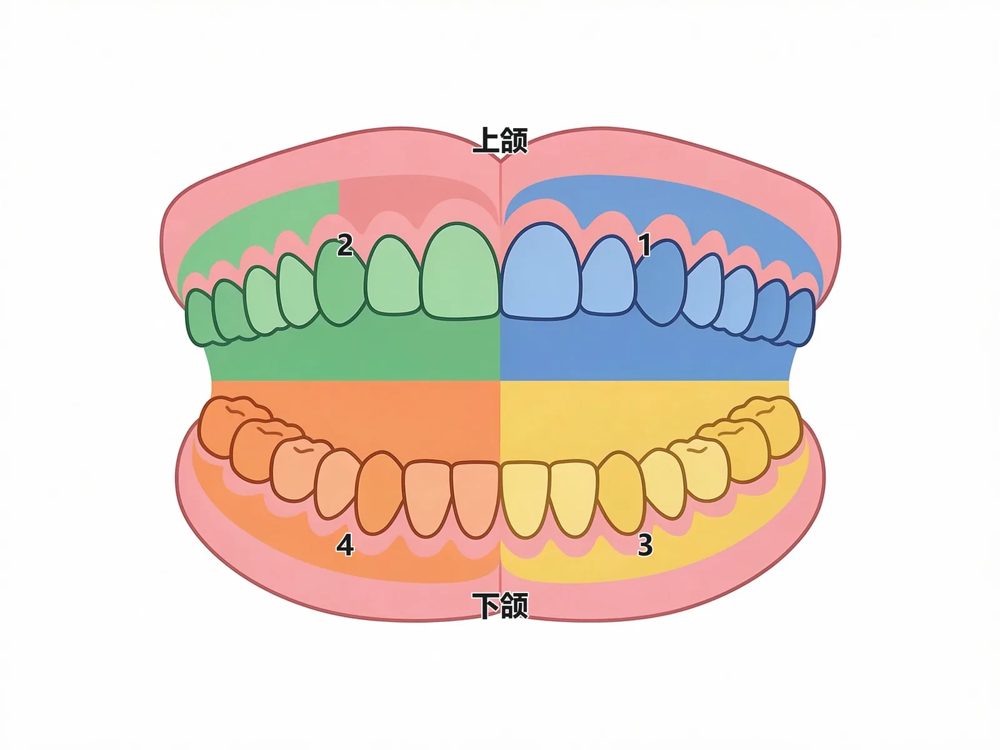

#### 🔬 展开：萌出时间与混合牙列期

乳牙自出生后 <b>6～8 个月</b>开始萌出乳中切牙，依次乳侧切牙（8～10 月）、第一乳磨牙（12～16 月）、乳尖牙（16～20 月）、第二乳磨牙（24～30 月），<b>2 岁半左右全部萌出</b>。恒牙一般 6 岁左右在第二乳磨牙后方萌出<b>第一恒磨牙（六龄牙）</b>，同时乳中切牙脱落、恒中切牙萌出；第三磨牙 17～26 岁萌出。6～12 岁乳恒牙交替，口内既有乳牙又有恒牙，称<b>混合牙列期</b>；同名牙左右同期萌出，下颌牙早于上颌牙，女性早于男性。（教材P12-14）

> [!TIP] 记忆
> 乳牙萌出顺序歌：「中切侧切一乳磨，尖牙最后二乳磨」；乳牙萌出月龄可记「6、8、12、16、24」＋半年递增节奏。恒牙「六龄牙」是最重要的第一恒磨牙，窝沟封闭即针对它。

<b>牙位记录（FDI 两位数系统）</b>：十位数表示象限，个位数表示牙位——<b>恒牙：右上 1、左上 2、左下 3、右下 4</b>（例：右上颌侧切牙=12，左下颌第二磨牙=37）；<b>乳牙：右上 5、左上 6、左下 7、右下 8</b>（例：左上颌乳尖牙=63，右下颌第二乳磨牙=85）。部位记录法以「+」分四区，横线上方为上颌、纵线左侧代表<b>患者右侧</b>。（教材P13-14）

> [!WARNING] 陷阱
> ①部位记录法中「纵线左侧=患者右侧」——是「患者」的右侧，不是检查者的右侧，看图时最容易错；②FDI 恒牙 1-4、乳牙 5-8 的象限编号要分开记；③切勿把刚萌出的恒牙误认为乳牙拔除——乳牙牙冠较小、色较白、牙颈部和咬合面较恒牙缩窄（教材P14）。

#### 🔴 考点 3：上颌骨解剖特点与 LeFort 薄弱线

<b>定义</b>：上颌骨为面中份最大的骨骼、颅面部第二大骨，由<b>一体（上颌骨体）四突（额突、颧突、牙槽突、腭突）</b>构成；骨体为四壁一腔（前壁、后壁、上壁、内壁＋上颌窦腔）。（教材P16-17）

💡<b>为什么重要</b>：上颌窦与上颌后牙根尖的毗邻关系（牙源性上颌窦炎）、LeFort 骨折三型是口腔颌面外科高频考点；上颌骨「支柱式结构」解释其骨折移位特点。

🧬 第一性原理：上颌骨与多数邻骨相连＋中央为空腔（上颌窦），形成<b>支柱式结构</b>——外力经多骨传导分散而不易骨折；一旦超过承受极限，则沿<b>解剖薄弱线</b>发生骨折，即 LeFort Ⅰ/Ⅱ/Ⅲ 型。因无强大肌群附着，上颌骨骨折段移位与外力方向一致；因骨质疏松、血供丰富，骨折愈合快、少发颌骨骨髓炎。

#### 🔬 展开：上颌窦的临床意义与 LeFort 三型

<b>上颌窦</b>：锥形空腔，开口于中鼻道；上颌窦底与上颌后牙根尖紧密相连，有时仅隔黏膜——上颌前磨牙及磨牙根尖感染易穿破窦底黏膜致<b>牙源性上颌窦炎</b>；拔上颌后牙断根时勿将断根推入上颌窦。上颌窦前壁尖牙窝处骨质菲薄（约 1.1mm），手术常经此进入上颌窦。（教材P16-17）

<b>LeFort 骨折分型</b>（沿上颌骨三条薄弱线）：

| 分型 | 薄弱线走行 | 骨折段特征 |
|------|-----------|-----------|
| LeFort Ⅰ型 | 梨状孔下部→牙槽突底→上颌结节→蝶骨翼突 | 低位骨折（牙槽突水平） |
| LeFort Ⅱ型 | 鼻骨、泪骨→眶底→颧上颌缝→蝶骨翼突 | 面中份骨折，<b>不含颧骨</b>（锥形骨折） |
| LeFort Ⅲ型 | 鼻骨、泪骨→眶底→颧额缝→蝶骨翼突 | 面中份骨折<b>含颧骨</b>，「颅面分离」 |

> [!TIP] 记忆
> Ⅰ 低、Ⅱ 锥、Ⅲ 分离：Ⅰ 型最轻在牙槽突，Ⅲ 型最重「颅面分离」。三型均起于鼻区/梨状孔附近、止于蝶骨翼突。

#### 🔴 考点 4：下颌骨解剖特点与薄弱部位

<b>定义</b>：下颌骨是颌面部<b>唯一可活动且最坚实</b>的骨骼，呈马蹄形，由水平的下颌体与垂直的下颌支组成；下颌支上方有喙突（冠突）与髁突（与颞骨关节窝构成颞下颌关节）。（教材P18-19）

💡<b>为什么重要</b>：下颌骨薄弱部位=骨折好发部位，与咀嚼肌牵引共同决定骨折移位；下颌骨血供较少、骨皮质致密，愈合慢、骨髓炎多于上颌骨。

🧬 第一性原理：下颌骨周围有强大咀嚼肌群附着（咬肌、颞肌、翼内肌等），骨折后骨折段受肌收缩牵拉而不稳定、易错位；同时骨质薄弱区（正中联合、颏孔区、下颌角、髁突颈）应力集中，是外力打击时断裂的优先位点。

#### 🔬 展开：下颌骨薄弱部位与临床意义

下颌骨薄弱部位为正中联合、颏孔区、下颌角、髁突颈部——外伤时骨折好发于这些部位（与模块7骨折好发部位直接呼应）；下颌管走行于下颌体与下颌支内，内含下牙槽神经血管，是拔牙与骨折麻木的解剖基础；下颌骨骨质致密、血供较差，化脓性骨髓炎好发。

> [!WARNING] 陷阱
> ①下颌骨「正中联合、颏孔区、下颌角、髁突颈」四个薄弱部位——常考「哪处骨折最常见/最易发生」；②下颌骨骨折愈合<b>慢</b>（血供少）、骨髓炎<b>多</b>（肌筋膜包绕引流不畅），与上颌骨相反——上颌骨愈合快、骨髓炎少；③翼外肌、翼内肌均参与前伸与侧向运动，不只管开口。

#### 🔴 考点 5：咀嚼肌群与表情肌群

<b>定义</b>：咀嚼肌群较粗大、位置深，分<b>闭口（升颌）肌群：咬肌、颞肌、翼内肌</b>；<b>开口（降颌）肌群：二腹肌、下颌舌骨肌、颏舌骨肌、翼外肌</b>，均由<b>三叉神经下颌支</b>支配运动。表情肌群薄而短小、止于皮肤，由<b>面神经</b>支配。（教材P19-20）

💡<b>为什么重要</b>：开口/闭口肌群归属是高频配伍题；表情肌与皮肤紧密相连——面部外伤须逐层缝合以防内陷瘢痕；面神经损伤→表情肌瘫痪。

🧬 第一性原理：咀嚼肌以「功能分群」理解——凡是「把下颌抬起」的（咬肌、颞肌、翼内肌）都是闭口肌；凡是「把下颌降下或把舌骨提起」的（二腹肌、下颌舌骨肌、颏舌骨肌）及翼外肌是开口肌。翼外肌特殊：上头起自蝶骨大翼颞下嵴、下头起自翼外板外面，止于关节盘与髁突颈——两侧同时收缩前伸下颌、单侧收缩侧向运动，是唯一「前伸主导」的咀嚼肌。

<b>闭口 vs 开口肌群对比</b>：

| 分组 | 肌肉 | 起点-止点要点 | 作用 |
|------|------|--------------|------|
| 闭口 | 咬肌 | 颧弓下缘→下颌角及下颌支外侧面 | 牵下颌向上前 |
| 闭口 | 颞肌 | 颞窝→喙突 | 牵下颌向上、微向后 |
| 闭口 | 翼内肌 | 翼突外板内面、上颌结节→下颌角内侧面 | 上提下颌，协助前伸、侧向 |
| 开口 | 二腹肌 | 前腹下颌二腹肌窝、后腹乳突切迹→舌骨 | 提舌骨或降下颌 |
| 开口 | 下颌舌骨肌 | 下颌舌骨肌线→舌骨体 | 构成肌性口底，提口底 |
| 开口 | 颏舌骨肌 | 颏棘→舌骨体 | 提舌骨向前、降下颌 |
| 开口 | 翼外肌 | 蝶骨大翼、翼外板→关节盘、髁突 | 前伸、侧向运动 |

#### 🔬 展开：咀嚼肌功能与骨折移位

闭口肌群（咬肌、颞肌、翼内肌）与开口肌群（二腹肌、下颌舌骨肌、颏舌骨肌、翼外肌）的力量平衡决定下颌骨骨折段的移位方向（模块7）；翼外肌牵拉髁突向前内，是髁突骨折移位的原因；翼静脉丛位于颞肌与翼内肌之间、与海绵窦相通，是深部感染的通道。

#### 🔴 考点 6：颌面部血管与危险三角区

<b>定义</b>：颌面部血供主要来自<b>颈外动脉分支</b>——舌动脉、面动脉（颌外动脉）、上颌动脉（颌内动脉）、颞浅动脉；静脉分深浅两网（浅：面前静脉、面后静脉；深：翼静脉丛）。<b>危险三角区</b>：鼻根至两侧口角的三角区。（教材P21-22）

💡<b>为什么重要</b>：「危险三角区感染→海绵窦血栓性静脉炎」是经典 A2 病例题；压迫止血须压迫<b>供血动脉近心端</b>；翼静脉丛穿刺出血（上颌结节麻醉并发症）在模块6展开。

🧬 第一性原理：面部静脉特点是<b>静脉瓣较少</b>，肌肉收缩或挤压时血液易反流。面前静脉可经内眦静脉和翼静脉丛<b>两个途径</b>通向颅内海绵窦；翼静脉丛还可经卵圆孔、破裂孔与海绵窦相通。因此「危险三角区」感染（尤其被挤压）可逆行入颅——处理原则是<b>严禁挤压</b>、足量抗菌治疗。

#### 🔬 展开：危险三角区与颅内感染

面静脉在口角以上缺乏瓣膜，血液可逆流：内眦静脉→眼上静脉→海绵窦，翼静脉丛亦与海绵窦相通；故鼻根至两侧口角连线构成的危险三角区感染（上唇、鼻部疖痈）可致海绵窦血栓性静脉炎（模块7）；严重颌面部出血时可结扎颈外动脉。

> [!WARNING] 陷阱
> ①「压迫止血需压迫动脉近心端」——不是出血点处压迫，面颊部软组织出血可于咬肌前缘与下颌骨下缘交点处压迫面动脉；②危险三角区感染的处理核心是「不挤压、不热敷（早期）」，考试常以错误处理方式为干扰项。

#### 🔴 考点 7：三叉神经分支（口颌麻醉相关的神经解剖）

<b>定义</b>：三叉神经为第Ⅴ对脑神经、脑神经中最大者，<b>眼支、上颌支为纯感觉，下颌支为混合神经</b>（含咀嚼肌运动纤维）。与麻醉密切相关：上颌支分<b>蝶腭神经（鼻腭神经、腭前/中/后神经）、上牙槽前/中/后神经</b>；下颌支分<b>下牙槽神经、舌神经、颊神经</b>。（教材P23-25）

💡<b>为什么重要</b>：神经分支-分布区域-麻醉标志的对应关系是模块6「局麻」的直接基础，也是本模块最常考的解剖内容。

🧬 第一性原理：神经分布「按牙位分区」记忆——上颌：上牙槽后神经管磨牙（上颌第三磨牙＋上颌窦黏膜，在第一磨牙近中颊根与中神经交叉）、上牙槽中神经管前磨牙＋第一磨牙近中颊根、上牙槽前神经管切牙与尖牙；腭侧：鼻腭神经管切牙尖牙腭侧（自切牙孔穿出）、腭前神经管磨牙前磨牙腭侧（自腭大孔穿出）。下颌：下牙槽神经经下颌孔入下颌管、出颏孔后为<b>颏神经</b>（分布于前磨牙以前牙龈、下唇）；舌神经分布于<b>舌前 2/3</b>、下颌舌侧牙龈和口底黏膜；颊神经为下颌神经前股唯一感觉神经。

> [!TIP] 记忆
> 翼下颌间隙内三神经排列（由前外到后）：<b>颊神经在前外侧、舌神经居中、下牙槽神经居后</b>——「颊舌牙」三字顺序即下牙槽神经阻滞麻醉的解剖依据。

#### 🔬 展开：三叉神经与麻醉、神经痛的对应

下颌支为混合神经（含咀嚼肌运动纤维），是口颌麻醉的重点：上牙槽后神经、眶下神经、腭前神经、鼻腭神经、舌神经、下牙槽神经、颊神经分别对应各牙位与软组织的阻滞麻醉（模块6）。

#### 🔴 考点 8：面神经五支及损伤表现

<b>定义</b>：面神经为第Ⅶ对脑神经、混合神经（主要是运动神经），出茎乳孔后进入腮腺，在腮腺内分为<b>颞支、颧支、颊支、下颌缘支、颈支</b>五支，支配面部表情肌。（教材P25-26）

💡<b>为什么重要</b>：各支损伤的典型表现是 A1/A2 高频配伍题；面神经在腮腺内走行也是腮腺手术「保护面神经」的解剖依据。

🧬 第一性原理：五支从腮腺边缘呈扇形穿出、紧贴咬肌筋膜表面分布到表情肌——「哪一支伤、哪块肌瘫」决定了体征：颞支→额肌（额纹消失）；颧支→眼轮匝肌（眼睑不能闭合）；颊支→颊肌、口轮匝肌等（鼻唇沟变平、鼓腮漏气）；下颌缘支→下唇诸肌（口角偏斜）；颈支→颈阔肌（影响小）。

<b>面神经分支损伤表现速查</b>：

| 分支 | 支配肌肉 | 损伤表现 |
|------|---------|---------|
| 颞支 | 额肌 | 额纹消失 |
| 颧支 | 眼轮匝肌等 | 眼睑不能闭合 |
| 颊支 | 颊肌、口轮匝肌、笑肌等 | 鼻唇沟变平、鼓腮漏气 |
| 下颌缘支 | 下唇诸肌 | 口角偏斜（80%位于下颌下缘上方，下颌下区切口应在下颌下缘下 1.5～2cm） |
| 颈支 | 颈阔肌 | 功能影响小 |

> [!TIP] 记忆
> 面神经五支自上而下「颞、颧、颊、下颌缘、颈」——记「太阳穴→颧骨→脸颊→下巴→脖子」，对应额纹、闭眼、鼓腮、口角、颈阔肌五项体征。

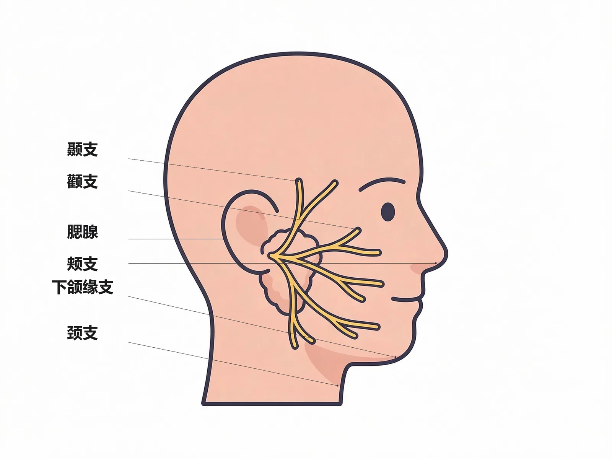

#### 🔬 展开：面神经与腮腺手术

面神经出茎乳孔后穿行腮腺分为颞支、颧支、颊支、下颌缘支、颈支，支配全部表情肌；腮腺手术须保护面神经；下颌缘支在咬肌间隙切口下方走行，切口不当可致口角歪斜（模块7）。

#### 🔴 考点 9：三大唾液腺

<b>定义</b>：大唾液腺为左右对称的<b>腮腺、下颌下腺、舌下腺</b>三对，加上遍布唇颊腭舌的小黏液腺。（教材P26）

💡<b>为什么重要</b>：三大腺体分泌性质、导管开口与疾病倾向（涎石、囊肿）是模块8「唾液腺疾病」的基础；腮腺内面神经穿行是面神经解剖的延伸考点。

🧬 第一性原理：按「分泌类型＋导管特点」理解——<b>腮腺最大、分泌纯浆液</b>，导管开口平对上颌第二磨牙颊黏膜（腮腺导管口），实质内有面神经分支穿过（浅叶/深叶分界）；<b>下颌下腺分泌浆液为主、含少量黏液</b>，位于下颌下三角，导管长而平缓、开口于舌下阜，<b>导管结石好发</b>；<b>舌下腺最小、分泌黏液为主</b>，小导管多、分泌液黏稠，易堵塞形成<b>无上皮衬里的潴留性囊肿</b>。

#### 🔬 展开：唾液腺解剖要点

腮腺导管开口正对上颌第二磨牙颊黏膜（涎瘘与导管损伤的定位标志）；下颌下腺导管开口于舌下肉阜，自下向上走行、长而曲折，是结石好发的解剖原因（模块8）；舌下腺导管多而细小，直接开口于舌下襞。

> [!WARNING] 陷阱
> ①「腮腺分泌液为纯浆液、舌下腺以黏液为主」——分泌性质不要记反；②下颌下腺导管结石好发（导管长、分泌液较黏稠、走行上倾）；③腮腺脓肿切开引流时须注意面神经分支走行。

#### 🟡 考点 10：口腔分区与重要解剖标志

口腔以牙槽骨和牙为分界，分为<b>口腔前庭</b>（牙列外侧与唇颊之间，马蹄形潜在腔隙）与<b>固有口腔</b>（牙列内侧，含舌、腭、口底）。（教材P6）

重要标志（A1 高频）：<b>腮腺导管口</b>——平对上颌第二磨牙牙冠的颊黏膜；<b>翼下颌皱襞</b>——下牙槽神经阻滞麻醉参考标志；<b>颊脂垫尖</b>——下牙槽神经阻滞麻醉进针点标志；<b>颏孔</b>——颏神经麻醉进针部位（第二前磨牙或第一、二前磨牙之间下方）；<b>眶下孔</b>——眶下神经麻醉进针部位；<b>切牙乳头</b>（深面为切牙孔）——鼻腭神经麻醉标志，从侧缘刺入；<b>腭大孔</b>——腭前神经麻醉标志；<b>腭小凹</b>——全口义齿基托后缘参考标志；<b>舌下阜</b>——下颌下腺管与舌下腺管共同开口。（教材P7-8、P15）

> [!NOTE] 扩展
> 龈沟为游离龈与牙根颈部间的沟状空隙，<b>正常深度不超过 2mm</b>；龈乳头位于两邻牙颈部之间，是龈炎最易出血部位。腭裂导致鼻漏气、过高鼻音（「腭裂语音」）。舌系带过短的真性判断：5 岁后仍卷舌音（如「2」音）发不准、舌尖不能触及腭部。

#### 🟡 考点 11：口腔颌面部常规检查法

常用器械：<b>镊子、探针、口镜</b>。常规检查法：<b>问诊</b>（主诉、现病史、既往史、家族史——重点询问心脏病、高血压、糖尿病、血友病、肝炎梅毒、药物过敏、抗凝药、双膦酸盐史）、<b>视诊、探诊</b>（龋洞、敏感区、牙周袋深度、龈下牙石）、<b>叩诊</b>（垂直叩诊查根尖区病变，先叩正常牙后叩患牙）、<b>触诊、嗅诊</b>（坏疽牙髓有腐臭味）、<b>咬诊</b>（查早接触）。（教材P28-30）

牙松动度分三度（A1 必考）：<b>Ⅰ度</b>：唇（颊）舌向活动幅度 <b>≤1mm</b>；<b>Ⅱ度</b>：1～2mm 且伴近远中向活动；<b>Ⅲ度</b>：>2mm 且伴近远中及垂直向多方向活动。（教材P29）

> [!NOTE] 扩展
> 特殊检查：牙周探诊与牙周袋测量——<b>附着水平 = 牙周袋深度 − 龈缘至釉牙骨质界距离</b>；牙髓活力测试——正常牙髓对 20～50℃ 温度刺激无反应，冷试时先下颌后上颌、先后牙后前牙，并以邻牙或对侧同名牙作对照；唾液腺分泌定量——正常 24 小时唾液总量 1000～1500ml，90% 来自腮腺和下颌下腺，舌下腺仅 3%～5%。（教材P31-32）

#### 🟡 考点 12：影像学检查选择

| 检查 | 用途要点 | 教材页码 |
|------|---------|---------|
| X 线牙片（根尖片） | 最常用，显示牙体、髓腔、根管、根尖周组织（1～3 颗牙） | P32 |
| 全景 X 线片（曲面体层） | 一次显示全口牙及双侧颌骨、上颌窦、颞下颌关节，利于左右对比 | P33 |
| X 线头影测量 | 正畸、正颌外科常用（正、侧位头颅片） | P33 |
| X 线造影 | 腮腺及下颌下腺造影、颞下颌关节造影最常见 | P33 |
| CT | 骨内肿瘤信息准确，三维重建用于颌面骨折 | P34 |
| CBCT（牙科 CT） | 种植定位、埋伏牙、根管数目、颞下颌关节；扫描快、剂量小；软组织显示不如多排 CT | P34 |
| MRI | 软组织显示优于 CT，无需对比剂即显示血管，用于软组织肿瘤 | P34-35 |
| 超声 | 口底、腮腺、颈部深部肿物，CDFI 判断血供 | P35 |
| PET-CT/PET-MRI | 判断恶性肿瘤性质与转移 | P35 |

> [!TIP] 记忆
> 「牙片看根尖、全景看全局、CBCT 看三维、MRI 看软组」；活检是肿瘤诊断「金标准」，但高度怀疑恶性黑色素瘤不宜常规活检，血管畸形、血管瘤、颈动脉体瘤<b>禁忌活检</b>（教材P35）。

#### 🟢 考点 13：绪论（口腔医学简介）

WHO 将龋病确定为继癌症和心血管疾病之后<b>第三种需重点防治的非传染性疾病</b>；第四次全国口腔健康流行病学调查（2017）：5 岁年龄组乳牙患龋率 71.9%，12 岁恒牙患龋率 38.5%，65～74 岁 98.0%；15 岁牙周健康率 34.8%，35～44 岁仅 9.1%。我国口腔医学史上「四大发明」：<b>砷剂治疗牙髓炎（张仲景）、银汞合金充填（唐代「银膏」）、牙刷（959 年辽代骨制牙刷）、义齿（宋代）</b>。（教材P1-3）

### 📊 对比速查

<b>乳牙与恒牙对比</b>：

| 项目 | 乳牙 | 恒牙 |
|------|------|------|
| 数目 | 20 颗 | 28～32 颗 |
| 萌出开始 | 出生后 6～8 个月 | 6 岁左右（第一磨牙「六龄牙」） |
| 萌出完成 | 2 岁半左右 | 第三磨牙 17～26 岁 |
| 替换 | 6～12 岁逐渐脱落（混合牙列期） | 终生一副 |
| 牙冠特点 | 较小、色较白、牙颈部与咬合面较缩窄 | 较大、色微黄 |

<b>三大唾液腺对比</b>：

| 腺体 | 大小 | 分泌类型 | 导管开口 | 疾病倾向 |
|------|------|---------|----------|---------|
| 腮腺 | 最大 | 纯浆液 | 平对上颌第二磨牙颊黏膜 | 面神经穿行、脓肿分隔 |
| 下颌下腺 | 中等（核桃形） | 浆液为主、少量黏液 | 舌下阜 | 导管结石好发→涎腺炎 |
| 舌下腺 | 最小 | 黏液为主、少量浆液 | 直接开口口底或与下颌下腺管相通 | 黏稠堵塞→潴留性囊肿 |

### 🔗 因果链流程图（D2）

```text
【口腔颌面部解剖特点 → 临床意义】因果链

位置显露 ──► 易受外伤、疾病易早期发现、易早治疗
              
血供丰富 ──► 抗感染能力强、伤口愈合快
   │             │
   └──► 组织疏松 ──► 受伤后出血多、肿胀明显 ──► 压迫止血须压动脉近心端
   
面静脉瓣少 ──► 血液易反流 ──► 危险三角区(鼻根-两侧口角)感染
   │                                   │
   └──► 内眦静脉/翼静脉丛两途径 ──► 海绵窦血栓性静脉炎 ★(严重颅内并发症)
   
牙髓密闭腔 ──► 炎症压力升高 ──► 剧痛但无红、肿、热 ★(牙髓炎特征)
   │
   └──► 血供经狭窄根尖孔 ──► 循环障碍 ──► 牙髓坏死 ──► 牙变色、变脆
   
下颌骨薄弱部位(正中联合/颏孔区/下颌角/髁突颈) ──► 应力集中 ──► 骨折好发
   │                                              │
   └──► 咀嚼肌牵引 ──► 骨折段不稳定、易错位 ──► 需坚固内固定
```

★ 标注临床关键转折点：危险三角区感染「不挤压」与牙髓炎「压力性剧痛」是两条最常考的临床逻辑。

### 🌳 鉴别诊断决策树（D4）

<b>面神经损伤定位鉴别树</b>：

```text
外伤/手术后面部表情异常？
│
├─ 额纹消失 ─────────────► 颞支损伤（额肌）
│
├─ 眼睑不能闭合 ──────────► 颧支损伤（眼轮匝肌）
│
├─ 鼻唇沟变平、鼓腮漏气 ──► 颊支损伤（颊肌、口轮匝肌）
│
├─ 口角偏斜 ─────────────► 下颌缘支损伤（下唇诸肌）
│                          （下颌下区切口避开：下颌下缘下1.5-2cm）
│
└─ 颈阔肌功能障碍(影响小) ► 颈支损伤
```

### ⚠️ 常见陷阱

1. <b>牙位记录左右搞反</b>：部位记录法纵线左侧代表<b>患者</b>右侧；FDI 十位 1/2/3/4（恒牙）、5/6/7/8（乳牙）象限编号要分清。
2. <b>牙根数目记错</b>：上颌第一前磨牙多为<b>双根</b>；上颌磨牙<b>三根</b>（含腭根）、下颌磨牙<b>双根</b>；第三磨牙融合根变异多。
3. <b>「釉质=牙冠、牙骨质=牙根」混淆</b>：牙冠表面是釉质、牙根表面是牙骨质；釉质为人体最硬组织、无神经，龋病早期不痛。
4. <b>牙骨质有哈弗斯管</b>（错）：牙骨质与骨相似但<b>无哈弗斯管</b>。
5. <b>面神经＝纯运动</b>（错）：面神经是混合神经，主要是运动神经，伴味觉（鼓索）与分泌纤维；舌前 2/3 感觉由舌神经（三叉神经下颌支）传导、味觉由面神经鼓索传导。
6. <b>危险三角区感染处理</b>：严禁挤压、早期不热敷，否则感染逆行至海绵窦。
7. <b>压动脉远端止血</b>（错）：压迫止血须压<b>近心端</b>。
8. <b>口腔前庭与固有口腔分界</b>：以牙槽骨和牙为界，不是以牙龈为界。

### 💡 记忆口诀

1. <b>牙位 FDI</b>：「恒牙右上 1 左上 2，左下 3 右下 4；乳牙 5 6 7 8 接后头」。
2. <b>乳牙萌出</b>：「六个月中切，二岁半二十颗」。
3. <b>恒牙六龄</b>：「六岁六龄牙，十七廿六长智齿」。
4. <b>闭口三、开口四</b>：「闭口咬颞翼，开口二下颏（二腹肌、下颌舌骨肌、颏舌骨肌）加翼外」。
5. <b>面神经五支</b>：「颞颧颊下颈，额纹闭眼鼓腮口角颈」。
6. <b>三叉神经分布</b>：「眼眶上、上颌出圆孔、下颌出卵圆；翼下颌间隙颊前舌中牙后」。
7. <b>唾液腺</b>：「腮大浆、下浆黏少、舌下黏最小」；「导管开口：腮对二磨颊、下腺舌下阜」。

### 📌 本章小结

> [!INFO] 本章小结
> 模块1 是口腔科学的「解剖地基」：牙体三层硬组织与牙髓的密闭腔结构解释了牙髓炎「压力剧痛」；乳恒牙数目、萌出与 FDI 牙位记录是病历与考试高频；上颌骨支柱式结构与 LeFort 三线、下颌骨四薄弱部位决定骨折特点；咀嚼肌闭口/开口分群、三叉神经分布与面神经五支损伤表现是麻醉、感染、损伤模块的直接前导；三大唾液腺分泌性质与导管走向是唾液腺疾病模块的伏笔。
>
> <b>🧬 本章核心洞察</b>：口腔颌面部的一切临床规律都能从「解剖结构→功能/病理」这条因果链推出——学本模块时优先建立「结构决定临床表现」的思维，而不是死记孤立解剖名词。

### 🔗 深度链接

- 牙髓炎「压力剧痛、无红肿热」的病理机制 → <b>模块2 牙体牙髓病</b>
- 下牙槽神经阻滞麻醉的解剖依据（翼下颌皱襞、颊脂垫尖、颊舌牙三神经排列） → <b>模块6 口腔麻醉与牙拔除术</b>
- 危险三角区感染扩散与间隙感染 → <b>模块7 口腔颌面部感染</b>
- 颌骨薄弱线与 LeFort 骨折分型 → <b>模块7 口腔颌面部损伤</b>
- 三大唾液腺疾病（腮腺炎、涎石、黏液囊肿） → <b>模块8 唾液腺疾病</b>

---

## 模块2：牙体牙髓病

> [!INFO] 模块信息
> <b>重点等级</b>：🔴掌握 10 个（四联因素、龋病分类与深浅龋、龋病治疗预防、牙髓炎分型与鉴别、急性牙髓炎四特征、慢性牙髓炎三型、牙髓坏死与逆行性牙髓炎、急性根尖周炎、慢性根尖周炎、根管治疗术）｜🟡熟悉 1 个（牙痛的应急治疗）｜🟢了解 0 个
> <b>预计题型</b>：A1（龋病分类/深浅龋特征/根尖周炎X线）、A2（牙痛病例诊断）、B1（症状-诊断配伍）
> <b>关联模块</b>：模块1 牙体组织解剖（本模块基础）→ 模块3（牙周病与根尖周病的鉴别）、模块4（黏膜溃疡与牙痛鉴别）、模块6（麻醉）、模块7（间隙感染来源于根尖周脓肿）
> <b>谱系位置</b>：龋病→牙髓炎→根尖周炎是口腔最常见的疾病演进链，是期末考试与执医的核心考点区
> <b>预计阅读</b>：约 60 分钟

---

### 🧩 前置知识检查

> [!NOTE] 前置知识
> ①牙体组织层次（釉质→牙本质→牙髓）与髓腔解剖（模块1）；②牙位记录（FDI）用于患牙定位；③牙髓活力测试、叩诊、X 线牙片的判读（模块1 检查法）；④「釉质无神经、牙本质含痛觉感受器、牙髓无髓鞘纤维」——理解龋病各阶段疼痛差异的基础。

### 🎯 高收益摘要

> [!SUCCESS] 本模块核心
> 1. <b>龋病四联因素＝微生物＋食物＋宿主＋时间</b>；临界 pH 5.5 以下持续脱矿成洞。
> 2. <b>浅龋无症状、中龋酸甜刺激痛、深龋冷热刺激痛（去除后消失）</b>——龋深决定症状。
> 3. <b>可复性牙髓炎＝刺激痛无自发痛；不可复性牙髓炎＝自发痛</b>——「有无自发痛」是分水岭。
> 4. <b>急性牙髓炎四特征</b>：自发性阵发性痛、夜间痛、温度刺激加剧（化脓时热痛冷缓解）、<b>不能自行定位</b>。
> 5. <b>急性根尖周炎牙髓活力测试无反应＋叩痛明显＋咬合痛</b>；化脓三阶段：根尖周脓肿→骨膜下脓肿→黏膜下脓肿。
> 6. <b>慢性根尖周炎 X 线四型</b>：肉芽肿（<1cm 圆清）、慢性脓肿（云雾状）、囊肿（白线环绕）、致密性骨炎（阻射）。
> 7. <b>根管治疗</b>三步：根管预备（工作长度＝至根尖止点，距根尖孔 0.5～1mm）→ 根管消毒（氢氧化钙）→ 根管充填（牙胶尖＋封闭剂）。
> 8. <b>牙痛应急</b>：急性牙髓炎开髓摘髓、急性根尖周炎开髓引流、骨膜下/黏膜下脓肿切开排脓。

### 📋 结构化笔记

#### 🔴 考点 1：龋病病因——四联因素学说与口腔微生态学说

<b>定义</b>：龋病是<b>口腔微生物、食物、宿主和时间</b>四个因素相互作用所致的牙体硬组织慢性进行性破坏性疾病；只有四因素同时存在才能发生龋病。（教材P63-64）

💡<b>为什么重要</b>：四联因素是龋病预防的理论核心——「针对任一因素干预即可防龋」（控制菌斑、限糖、增强宿主抗龋力）是高频考点。

🧬 第一性原理：龋病本质是「牙面菌斑内细菌代谢产酸→牙面局部 pH 持续降至<b>临界值 5.5 以下</b>→釉质脱矿与再矿化平衡被打破→硬组织持续脱矿→龋洞」。细菌必须先黏附牙面形成<b>牙菌斑生物膜</b>才能致龋；与龋病相关的细菌（变异链球菌、乳杆菌、放线菌属）具有强黏附力、产酸耐酸力、合成胞内外多糖的能力；食物因素主要为碳水化合物（致龋性与种类、性状、黏度、进食频率、摄入量相关）；宿主因素包括牙形态结构、排列、唾液流速流量与缓冲能力、全身状况。

#### 🔬 展开：龋病进展的「四要素→脱矿」因果链条

四联因素中<b>时间</b>是常被忽略的因素——从细菌黏附成膜，到产酸、酸停留、脱矿，龋病发生需要一定时间，这也是「少吃糖、少次进食」预防龋病的机制基础（进食频率比总量更关键）。猖獗龋（猛性龋）是急性龋的特殊类型，常见于<b>头颈部放疗后（放射性龋）</b>及唾液分泌减少的干燥综合征等患者——多数牙短期内同时患龋、进展迅速。（教材P64）

> [!WARNING] 陷阱
> ①「致龋性最强的糖」考查时注意是蔗糖（含在碳水化合物中），考试常考「进食<b>频率</b>比总量更重要」；②临界 pH 为 5.5，不是 7.0；③细菌必须先成膜（菌斑生物膜）才能致龋——漱口去不掉菌斑即此理。

#### 🔴 考点 2：龋病临床分类与浅、中、深龋

<b>定义</b>：按病变深度分为<b>浅龋（釉质龋/牙骨质龋或牙本质龋）、中龋（牙本质浅层）、深龋（牙本质深层）</b>；按进展速度分急性龋（湿性，浅棕色质软进展快）与慢性龋（干性，黑褐色进展慢）、静止龋、继发龋；按解剖部位分窝沟龋、平滑面龋、根面龋、线形釉质龋、隐匿性龋。（教材P64-65）

💡<b>为什么重要</b>：深浅龋的症状-体征对应关系是 A1/A2 必考——「龋深决定症状」。

🧬 第一性原理：龋损深度决定刺激是否到达痛觉感受器（牙本质中成牙本质细胞突起）：釉质无神经→浅龋无症状；达牙本质浅层→酸甜及冷刺激敏感（冷刺激尤为显著）；达牙本质深层→食物嵌塞及冷热刺激痛。注意平滑面龋呈三角形、<b>底朝釉质表面尖向牙本质</b>，窝沟龋相反（底朝牙本质尖朝釉质表面）；隐匿性龋在完整釉质下方潜行破坏，临床上易漏诊。

<b>浅中深龋对比</b>：

| 项目 | 浅龋 | 中龋 | 深龋 |
|------|------|------|------|
| 病变深度 | 釉质（或牙骨质/牙本质浅层） | 牙本质浅层 | 牙本质深层 |
| 色泽 | 白垩色/黄褐斑（平滑面）或变黑（窝沟） | 黄褐或深褐色 | 黄褐或深褐色 |
| 形态 | 多无龋洞 | 龋洞形成，牙体缺损明显 | 龋洞深大 |
| 症状 | 无自觉症状 | 酸甜刺激敏感，冷刺激显著，去除立即消失 | 食物嵌塞或冷热刺激痛，去除立即消失 |
| X 线 | 隐蔽部位龋损可显示 | 低密度影达牙本质浅层 | 低密度影达牙本质深层 |

> [!TIP] 记忆
> 「浅无感、中酸甜、深冷热」——三层症状递进记忆。深龋「刺激去除后疼痛立即消失」是与牙髓炎鉴别的关键句（牙髓炎刺激去除后疼痛持续）。

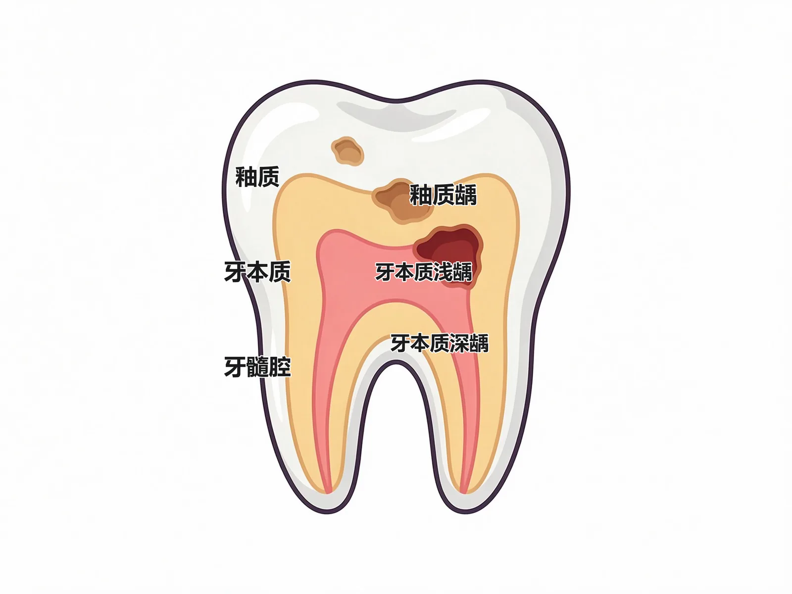

#### 🔬 展开：龋病好发部位

龋病好发牙位依次为下颌第一磨牙、上颌第一磨牙、下颌第二磨牙；好发部位为𬌗面窝沟、邻面、牙颈部；窝沟龋多于平滑面龋；深龋近髓时可有冷热刺激敏感，X 线片用于确定龋损深度与范围。

#### 🔴 考点 3：龋病的治疗与预防

<b>定义</b>：龋病治疗目的是终止龋损发展、修复牙体形态功能——早期龋行<b>再矿化治疗</b>或<b>预防性树脂充填</b>；已形成龋洞行<b>充填修复治疗</b>；预防以<b>窝沟封闭、氟化物、控制菌斑与糖</b>为主。（教材P78-79）

💡<b>为什么重要</b>：窝洞分类（Black 五类）与充填治疗原则是执医高频；预防措施呼应模块1 保健内容。

🧬 第一性原理：充填治疗的核心是「去净龋损、保护牙髓、尽量保留健康牙体组织」＋预备<b>抗力形</b>（使修复体与余留牙在咬合力下不折裂：洞深足够、盒状洞形、外形线圆缓避开尖嵴）与<b>固位形</b>（防止充填体脱落：侧壁摩擦、倒凹固位、鸠尾固位、梯形固位）。窝洞按 G.V. Black 分类：<b>Ⅰ类</b>＝点隙裂沟（磨前磨牙𬌗面洞、上前牙腭面洞等）；<b>Ⅱ类</b>＝后牙邻面洞；<b>Ⅲ类</b>＝前牙邻面未累及切角；<b>Ⅳ类</b>＝前牙邻面累及切角；<b>Ⅴ类</b>＝所有牙颊舌面颈 1/3。术区隔离以<b>橡皮障最有效</b>；深窝洞需垫底（厚度 &gt;0.5mm，常用玻璃离子、氧化锌丁香油酚粘固剂等）。

#### 🔬 展开：窝洞结构术语

窝洞基本结构：<b>侧壁</b>（与牙面垂直）、<b>髓壁</b>（洞底覆盖牙髓，与牙长轴平行者称轴壁）、<b>线角</b>（两壁相交）、<b>点角</b>（三壁相交）、<b>洞缘</b>。记忆：「侧壁竖、髓壁底、两线三点」。（教材P78）

> [!TIP] 记忆
> 窝洞五类歌：「一类点隙二类邻（后牙），三类前邻不切角，四类前邻带切角，五类颈 1/3 颊舌面」。

#### 🔴 考点 4：牙髓病病因与「可复性 vs 不可复性」总纲

<b>定义</b>：牙髓病包括牙髓炎、牙髓坏死、牙髓退行性改变及牙内吸收；<b>可复性牙髓炎</b>为以血管扩张充血为主的初期炎症，去除刺激后牙髓可恢复；<b>不可复性牙髓炎</b>最终结局为全部牙髓坏死，只能摘除牙髓。（教材P73-74）

💡<b>为什么重要</b>：「有无自发痛」是分型分水岭，是牙髓病章节最重要的诊断逻辑。

🧬 第一性原理：牙髓病因以<b>微生物因素为主</b>（深龋、重度磨耗、创伤破坏釉质/牙骨质完整性后，微生物经牙本质小管、牙髓暴露、牙周袋或血源性感染进入），另有机理——物理因素（备洞产热、异种金属修复体电流）、化学因素（充填材料、酚类消毒剂刺激）、免疫因素。可复性＝炎症局限可逆（血管扩张充血）；不可复性＝炎症弥漫不可逆（终将坏死）——治疗方向因此截然不同。

<b>可复性 vs 不可复性牙髓炎对比</b>：

| 项目 | 可复性牙髓炎 | 不可复性牙髓炎（急性） |
|------|-------------|---------------------|
| 自发痛 | <b>无</b> | <b>有（自发性阵发性）</b> |
| 刺激痛 | 冷热酸甜瞬间痛，去除立即消失 | 温度刺激加剧，去除后疼痛持续 |
| 夜间痛 | 无 | 明显（夜间加剧） |
| 定位 | 可定位 | <b>不能自行定位</b>（放射性牵涉） |
| 治疗 | 去除刺激＋安抚/间接盖髓，牙髓可恢复 | 摘除牙髓（根管治疗） |

#### 🔬 展开：牙髓炎病理进展

牙髓炎由浅入深：充血（可复性）→浆液性→化脓性→坏死（不可复性）；温度测试中可复性牙髓炎冷热刺激一过性敏感，不可复性为持续性疼痛或激发痛；电活力测试辅助判断牙髓活力，死髓牙无反应。

#### 🔴 考点 5：急性牙髓炎四特征

<b>定义</b>：急性牙髓炎（含慢性牙髓炎急性发作）的疼痛具有<b>自发性阵发性痛、夜间痛、温度刺激加剧疼痛、疼痛不能自行定位</b>四大特征。（教材P74）

💡<b>为什么重要</b>：A2 病例题「牙痛患者如何定位患牙」的核心考点——急性牙髓炎不能定位是特征而非缺陷。

🧬 第一性原理：牙髓神经为无髓鞘纤维、传导快且阈值低；髓腔为密闭腔，炎症渗出使腔内压力升高→压迫神经→剧烈疼痛。夜间痛与平卧时头位降低、髓腔压力增高有关；化脓时（牙髓部分坏死）表现为<b>热刺激疼痛加剧、冷刺激缓解</b>（含漱冷水可暂时镇痛——热胀冷缩改变压力）；疼痛沿三叉神经分布区放射性牵涉，但<b>不会放射至对侧</b>。早期炎症未波及根尖周膜时无叩诊不适；晚期波及根尖部牙周膜时出现垂直向叩诊不适。

#### 🔬 展开：疼痛不能定位的机制

牙髓神经缺乏本体感受器，故疼痛不能自行定位，常牵涉至同侧耳颞、面颊部；夜间痛与体位改变致髓腔内压升高有关；温度刺激加剧疼痛、去除刺激后疼痛持续——与三叉神经痛「夜间减轻、有扳机点」形成鉴别要点。

> [!WARNING] 陷阱
> ①「化脓性牙髓炎：热痛冷缓解」——与深龋「冷热均刺激痛但去除即消失」不同；②急性牙髓炎患者<b>不能指出患牙</b>，医生需靠冷热测试逐个排查（先下颌后上颌、先后牙后前牙）；③叩诊痛明显提示已向根尖周发展，不再单纯是牙髓炎。

#### 🔴 考点 6：慢性牙髓炎三型

<b>定义</b>：慢性牙髓炎为临床上最常见的一类牙髓炎，分<b>慢性闭锁性、慢性溃疡性、慢性增生性</b>三型；一般无剧烈自发痛，病程长，<b>可自行定位</b>。（教材P74-75）

💡<b>为什么重要</b>：三型各有特征性体征（有无穿髓孔、有无牙髓息肉）是 A1 配伍考点。

🧬 第一性原理：慢性炎症的「出路决定表现」——闭锁性：牙髓未暴露，探诊迟钝、活力测试迟缓反应；溃疡性：深龋穿髓孔形成，<b>浅探不痛、深探剧痛且渗血</b>；增生性：多见于青少年，牙髓组织增生形成<b>红色牙髓息肉</b>，探诊不痛但极易出血。三者共同点：可定位、长期冷热刺激痛史。

> [!TIP] 记忆
> 「闭锁迟钝溃疡痛，增生息肉青少年」——闭锁性无穿髓孔、溃疡性有穿髓孔、增生性有息肉。

#### 🔬 展开：三型鉴别要点

慢性闭锁性牙髓炎：探诊不痛、无明显穿髓孔；慢性溃疡性牙髓炎：探诊剧痛、穿髓孔暴露牙髓；慢性增生性牙髓炎：青少年多见、穿髓孔大、牙髓息肉充满龋洞，探之不痛易出血；三型均可急性发作。

#### 🔴 考点 7：牙髓坏死与逆行性牙髓炎

<b>定义</b>：<b>牙髓坏死</b>多由各型牙髓炎发展而来，患牙一般无自觉症状、牙冠变色（暗黄或灰色）、探诊及温度测试无反应、牙髓活力测试无反应；<b>逆行性牙髓炎</b>感染来源于深牙周袋，细菌毒素经根尖孔、侧支根管或牙本质小管逆行进入牙髓。（教材P75-76）

💡<b>为什么重要</b>：逆行性牙髓炎「牙体完整却牙髓发炎」是典型病例，与模块3 牙周病形成跨模块连接。

🧬 第一性原理：逆行性牙髓炎的关键证据链：长期牙周炎病史→深达根尖区牙周袋或严重根分叉病变→牙体完整、无深龋→近期出现牙髓炎症状。诊断三要素：<b>有牙周炎病史、未查及牙体硬组织疾病、出现牙髓炎症状</b>。牙髓坏死诊断四要素：无自觉症状、牙冠变色、活力测试无反应、X 线根尖周无明显异常。

#### 🔬 展开：牙髓坏死与逆行感染的机制

牙髓坏死多由牙髓炎发展而来：牙冠变色（暗黄/灰色）、温度与电活力测试无反应、可继发根尖周炎；逆行性牙髓炎为牙周感染经根尖孔逆行进入牙髓（牙周-牙髓联合病变），患牙多同时有深牙周袋与牙髓症状。

> [!WARNING] 陷阱
> ①牙髓坏死 X 线「根尖周影像无明显异常」——异常说明已进展为根尖周炎；②牙髓坏死牙冠变色的机制是牙髓血供中断→牙本质失去营养→透出暗色。

#### 🔴 考点 8：急性根尖周炎（浆液性与化脓性三阶段）

<b>定义</b>：急性根尖周炎是从根尖部牙周膜浆液性炎症到化脓性炎症的病理过程，分为<b>急性浆液性根尖周炎</b>和<b>急性化脓性根尖周炎</b>（根尖周脓肿→骨膜下脓肿→黏膜下脓肿）。（教材P76-77）

💡<b>为什么重要</b>：三阶段递进的临床表现与处理（何时切开排脓）是 A2 高频病例考点。

🧬 第一性原理：根尖周病与牙髓病通过<b>根尖孔</b>相连——牙髓病变产物、细菌及毒素经根尖孔扩散至根尖周组织。浆液期：根尖周膜充血水肿→患牙浮出感、咬合痛、自发性持续性钝痛、<b>叩痛（+）、牙髓活力测试无反应</b>。化脓期随脓液集聚位置由深到浅分为三阶段：①根尖周脓肿（脓在根尖周，牙龈潮红无肿胀，持续跳痛、伸长感加重、不敢咬合）；②骨膜下脓肿（脓积聚骨膜下，搏动性跳痛最剧烈、患牙高起松动、<b>移行沟变平</b>、全身症状）；③黏膜下脓肿（脓达黏膜下，胀痛减轻、半球状隆起、<b>波动感明显</b>、表浅易破溃）。

<b>急性化脓性根尖周炎三阶段对比</b>：

| 阶段 | 疼痛 | 肿胀 | 波动感 | 全身症状 |
|------|------|------|--------|---------|
| 根尖周脓肿 | 剧烈持续跳痛、不敢咬合 | 根尖部牙龈潮红、无明显肿胀 | 无 | 轻微 |
| 骨膜下脓肿 | 搏动性跳痛最剧烈、轻触即痛 | 牙龈红肿、移行沟变平 | 深部有波动感 | 体温升高、乏力 |
| 黏膜下脓肿 | 自发性胀痛及咬合痛减轻 | 根尖区黏膜半球状隆起、已局限 | 波动感明显、表浅 | 缓解 |

> [!TIP] 记忆
> 「疼痛最剧是骨膜下，波动最显是黏膜下」——骨膜下脓肿是切开排脓的关键判断点（脓未达黏膜下切开引流不畅，已达则波动感明显）。

#### 🔬 展开：根尖周脓液的排脓途径

排脓途径有四：经根管（最易引流）、经牙周袋（牙周-牙髓联合）、穿破骨膜至黏膜下（龈沟或腭侧形成脓肿）、穿破骨膜至皮下形成面部间隙感染（模块7）；叩痛（+）、牙齿浮起感、松动是典型体征。

#### 🔴 考点 9：慢性根尖周炎四型与 X 线鉴别

<b>定义</b>：慢性根尖周炎分<b>根尖周肉芽肿、慢性根尖周脓肿、根尖周囊肿、根尖周致密性骨炎</b>四型，一般无明显自觉症状，X 线片显示根尖区骨质破坏影像是确诊依据。（教材P77）

💡<b>为什么重要</b>：四型 X 线影像鉴别是放射学相关高频考点。

🧬 第一性原理：四型是同一慢性炎症的不同病理结局——肉芽肿（炎症肉芽组织，边界清）；慢性脓肿（坏死液化，边界不清）；囊肿（含胆固醇结晶囊液，周围骨质被压迫形成致密白线）；致密性骨炎（骨反应性增生，阻射影）。临床大囊肿触诊有<b>乒乓球样感</b>。

<b>慢性根尖周炎 X 线鉴别</b>：

| 类型 | X 线影像 | 特点 |
|------|---------|------|
| 根尖周肉芽肿 | 圆形透射影，<b>边界清晰</b>，直径一般 ≤1cm | 周围骨质正常或稍致密 |
| 慢性根尖周脓肿 | 透射区<b>边界不清、形状不规则</b> | 周围骨质疏松，呈云雾状 |
| 根尖周囊肿 | 较大圆形透射区，<b>边界清楚</b>，有阻射白线环绕 | 触诊乒乓球样感 |
| 致密性骨炎 | 根尖部局限性<b>骨质致密阻射影</b> | 无透射区 |

#### 🔬 展开：四型 X 线影像鉴别

根尖周肉芽肿：根尖区边界清楚的小透影区；慢性根尖周脓肿：边界不清、呈弥散状；根尖周囊肿：大而圆、周边见致密骨白线；根尖周致密性骨炎：骨密度增高影。X 线是确诊慢性根尖周炎的依据。

> [!WARNING] 陷阱
> ①「肉芽肿边界清（≤1cm）、脓肿边界不清云雾状」最易记反——肉芽肿是增生为主所以清、脓肿是破坏为主所以糊；②有窦道（牙龈脓包）提示慢性根尖周脓肿（有窦型），不是急性；③慢性根尖周炎牙髓活力测试同样无反应。

#### 🔴 考点 10：根管治疗术

<b>定义</b>：根管治疗术是目前治疗牙髓根尖周病最有效、最常用的技术，通过根管<b>预备、消毒、充填</b>三步达到控制感染、促进根尖周病变愈合的目的。（教材P80-81）

💡<b>为什么重要</b>：适应证、三步流程与工作长度确定是执医高频。

🧬 第一性原理：根管治疗本质是「清除根管内感染源＋严密封闭根管系统防止再感染」。<b>适应证</b>：不可复性牙髓炎、牙髓坏死、牙内吸收、根尖周炎、外伤牙/移植牙/再植牙、需牙髓治疗的非龋性疾病（重度釉质发育不全、重度磨耗、牙隐裂）、修复需要。步骤：①根管预备＝开髓（建立直线通路）＋测量<b>工作长度</b>（从冠部参照点到<b>根尖牙本质牙骨质界</b>的距离，该处为根管最狭窄处即根尖止点，一般距根尖孔 0.5～1mm；方法：X 线片法、电测法）＋根管扩大成形＋冲洗；②根管消毒＝根管封药（氢氧化钙、氯己定）；③根管充填＝牙胶尖＋根管封闭剂，常用侧方加压充填法、垂直加压充填法。

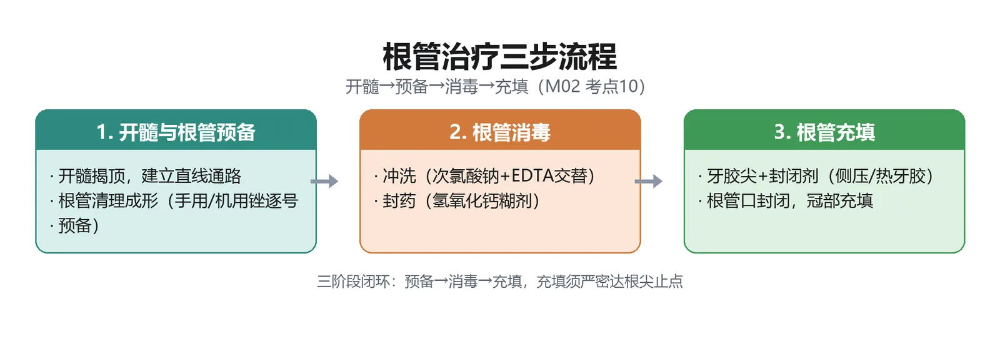

#### 🔬 展开：根管治疗步骤与疗效

根管治疗三步：根管预备（开髓、清理、成形）、根管消毒（药物消毒）、根管充填（牙胶尖＋封闭剂严密充填至恰填）；可一次或分次完成；治疗后牙痛消失、窦道愈合、X 线示根充完善为成功标准。

> [!NOTE] 扩展
> 活髓保存术：<b>直接盖髓术</b>适用于根尖孔未发育完全的年轻恒牙机械性/外伤性露髓，或根尖已发育完全者穿髓直径 ≤0.5mm 的机械性/外伤性露髓——<b>龋源性露髓及不可复性牙髓炎、根尖周炎患牙不适合</b>；盖髓剂常用氢氧化钙、MTA。<b>牙髓切断术</b>适用于根尖未发育完成的年轻恒牙。<b>根尖诱导成形术</b>用于牙根未形成即发生牙髓严重病变的年轻恒牙，氢氧化钙为首选诱导药物。显微根管治疗用于钙化根管疏通、变异根管（C 形等）治疗、分离器械取出等。（教材P80-81）

> [!TIP] 记忆
> 根管治疗三字诀：「备（预备）—消（消毒）—充（充填）」；工作长度「止点距根尖孔 0.5～1mm」。

#### 🟡 考点 11：牙痛的应急治疗

急性牙髓炎：局麻下<b>开髓摘除牙髓</b>，无菌小棉球暂封；急性根尖周炎：局麻下开髓、<b>疏通根尖孔引流</b>，脓液持续溢出则开放髓腔 1～2 天后复诊；骨膜下或黏膜下脓肿期：局麻下<b>切开排脓</b>；外伤性根尖周炎：降低咬合（调𬌗）；配合抗炎镇痛。（教材P79-80）

> [!NOTE] 扩展
> 牙痛须警惕非牙源性牙痛：心绞痛、甲状腺炎、颈椎病等远隔器官牵涉痛，三叉神经痛（神经性），偏头痛（血管神经性）——盲目开始不可逆牙科治疗会造成新损害（教材P82）。

### 📊 对比速查

<b>龋病→牙髓炎→根尖周炎症状演进</b>：

| 阶段 | 自发痛 | 温度测试 | 叩诊 | 牙髓活力测试 | 定位 |
|------|--------|---------|------|-------------|------|
| 深龋 | 无 | 刺激痛、去除即消 | 无 | 正常 | 可定位 |
| 可复性牙髓炎 | 无 | 一过性敏感 | 无 | 正常/敏感 | 可定位 |
| 急性牙髓炎 | <b>有（阵发性）</b> | 激发痛持续 | 早期无、晚期叩痛 | 敏感 | <b>不能定位</b> |
| 牙髓坏死 | 无 | 无反应 | 无/不适 | <b>无反应</b> | 可定位 |
| 急性根尖周炎 | 有（持续性钝痛/跳痛） | 无反应 | <b>叩痛明显</b> | <b>无反应</b> | 可定位（咬合痛） |

### 🔗 因果链流程图（D2）

```text
【龋病 → 牙髓炎 → 根尖周炎】疾病演进因果链

菌斑生物膜(变异链球菌等)黏附牙面
        │
        ▼
细菌代谢蔗糖产酸 ──► 牙面局部pH持续<5.5 ★(临界点)
        │
        ▼
釉质脱矿＞再矿化 ──► 白垩斑 ──► 浅龋(无症状)
        │
        ▼
龋损达牙本质浅层 ──► 中龋(酸甜刺激痛)
        │
        ▼
龋损达牙本质深层 ──► 深龋(冷热刺激痛，去除即消)
        │
        ▼
微生物经牙本质小管侵入牙髓 ──► 可复性牙髓炎(刺激痛，无自发痛)
        │                                   │
        │                        未治疗/刺激持续
        │                                   ▼
        │                   不可复性牙髓炎(自发阵发痛/夜间痛/不定位)
        │                                   │
        │                    化脓 ──► 热痛冷缓解 ★(含冷水镇痛)
        │                                   ▼
        ▼                   牙髓坏死(活力测试无反应)
经根尖孔扩散 ──► 急性根尖周炎(叩痛/咬合痛) ──► 脓肿形成(根尖周→骨膜下→黏膜下)
        │                                   │
        │                    骨膜下脓肿 ──► 切开排脓/开髓引流
        ▼
慢性根尖周炎(肉芽肿/脓肿/囊肿/致密性骨炎) ──► 根管治疗(预备-消毒-充填)
```

★ 临床关键转折点：pH 5.5 临界值与「热痛冷缓解」是龋病病因与牙髓炎诊断的两条核心判断线。

### 🌳 鉴别诊断决策树（D4）

<b>牙痛鉴别诊断树</b>：

```text
牙痛患者
│
├─ 有自发痛？
│   ├─ 否 ──► 刺激痛且去除即消？
│   │         ├─ 是(近髓病损) ──► 可复性牙髓炎 / 深龋
│   │         └─ 否/酸痛敏感 ──► 牙本质敏感症 / 楔状缺损
│   │
│   └─ 是 ──► 能自行定位？
│             ├─ 否(放射/牵涉、夜间痛) ──► 急性牙髓炎 ★
│             │         └─ 热痛冷缓解？ ──► 是：牙髓化脓/部分坏死
│             │
│             └─ 能 ──► 叩诊/咬合痛明显？
│                         ├─ 是 ──► 急性根尖周炎(牙髓活力测试无反应)
│                         │         └─ 肿胀？ ──► 骨膜下/黏膜下脓肿
│                         ├─ 否但牙体完整、有深牙周袋 ──► 逆行性牙髓炎
│                         └─ 否、长期冷热刺激痛史 ──► 慢性牙髓炎
│                                              └─ 有穿髓孔?→溃疡性
│                                                有息肉?→增生性(青少年)
│
└─ 非牙源性？(三叉神经痛/心绞痛/偏头痛) ──► 专科转诊，忌盲目开髓
```

### ⚠️ 常见陷阱

1. <b>深浅龋症状记混</b>：浅龋「无自觉症状」；中龋「酸甜敏感」；深龋「冷热刺激痛但去除后立即消失」——「立即消失」是与牙髓炎的鉴别点。
2. <b>可复性 vs 不可复性</b>：分水岭是「有无自发痛」——可复性无自发痛、不可复性有自发痛。
3. <b>急性牙髓炎不能定位</b>：不能因此怀疑诊断，反而要用温度测试逐个排查；且疼痛不放射至对侧。
4. <b>化脓性牙髓炎温度反应记反</b>：化脓/部分坏死时<b>热痛、冷缓解</b>（含漱冷水镇痛）。
5. <b>急性根尖周炎牙髓活力测试</b>：无反应（牙髓已坏死）——但乳牙或年轻恒牙可有反应甚至疼痛。
6. <b>骨膜下 vs 黏膜下脓肿</b>：疼痛最剧烈、移行沟变平是骨膜下；波动感明显、胀痛减轻是黏膜下。
7. <b>慢性根尖周炎 X 线</b>：肉芽肿边界清 ≤1cm；慢性脓肿边界不清云雾状；囊肿边界清＋阻射白线；致密性骨炎是阻射影（无透射）。
8. <b>直接盖髓适应证</b>：只用于机械性/外伤性露髓且穿髓 ≤0.5mm（或年轻恒牙）——<b>龋源性露髓不行</b>。
9. <b>牙外伤完全脱位</b>：30 分钟内再植；<b>切忌干燥保存</b>（放舌下/牛奶/生理盐水）。
10. <b>氟牙症对酸抵抗力增强</b>、楔状缺损主因是<b>横刷</b>、畸形中央尖在下颌第二前磨牙——三处常识性反直觉考点。

### 💡 记忆口诀

1. <b>四联因素</b>：「微生物、食物、宿主、时间——细菌有糖有时间就致龋」。
2. <b>临界 pH</b>：「pH 5.5，脱矿开关」。
3. <b>深浅龋</b>：「浅无感、中酸甜、深冷热，去除即消是深龋」。
4. <b>急性牙髓炎</b>：「自发阵发夜加重，冷热加剧不定位；化脓热痛冷缓解，含口冷水暂安宁」。
5. <b>根尖周炎三阶段</b>：「根尖脓肿不敢咬，骨膜下脓肿痛最凶（移行沟平），黏膜下脓肿波动明」。
6. <b>慢性根尖 X 线</b>：「肉芽圆清小一寸，脓肿模糊似云雾，囊肿白线大圆影，骨炎致密阻射影」。
7. <b>窝洞五类</b>：「一隙二邻三不角，四带切角五颈一」。
8. <b>根管治疗</b>：「预备消毒加充填，工作长度到止点（距根尖孔 0.5～1mm）」。

### 📌 本章小结

> [!INFO] 本章小结
> 模块2 是口腔科学的核心考点区：龋病「四联因素＋pH 5.5」解释病因，「浅中深龋」决定症状；牙髓病以「自发痛」为分水岭分出可复性/不可复性，急性牙髓炎四特征（自发、夜间、温度、不定位）与化脓期「热痛冷缓解」是病例题核心；根尖周病通过根尖孔承接牙髓感染，急性三阶段（脓肿→骨膜下→黏膜下）与慢性四型 X 线鉴别是诊断重点；根管治疗「预备-消毒-充填」是牙髓根尖周病的标准疗法。
>
> <b>🧬 本章核心洞察</b>：牙体牙髓病是一条「结构性因果链」——密闭髓腔 + 根尖孔通道决定了从龋到根尖周炎的全部临床表现与治疗逻辑；诊断时牢牢抓住「自发痛、定位性、温度反应、叩诊、活力测试、X 线」六把尺子逐层递进。

### 🔗 深度链接

- 牙体组织解剖与牙髓活力测试 → <b>模块1 口腔颌面解剖生理与口腔检查</b>
- 牙周袋→逆行性牙髓炎（牙周-牙髓联合病变） → <b>模块3 牙周疾病</b>
- 根尖周脓肿扩散→间隙感染 → <b>模块7 口腔颌面部感染</b>

---

## 模块3：牙周疾病

> [!INFO] 模块信息
> <b>重点等级</b>：🔴掌握 8 个（牙周健康指标、龈炎 vs 牙周炎鉴别、慢性龈炎、特殊类型龈炎、牙周炎病因、牙周炎分期分级、牙周炎诊断、牙周炎治疗）｜🟡熟悉 2 个（坏死性牙周病、牙龈瘤与其他牙龈增生性疾病）｜🟢了解 0 个
> <b>预计题型</b>：A1（分期/分级数值、鉴别点）、A2（牙龈出血病例）、B1（药物-牙龈肥大配伍）
> <b>关联模块</b>：模块1 牙周组织解剖（基础）→ 模块2（逆行性牙髓炎＝牙周-牙髓联合病变）
> <b>谱系位置</b>：牙周疾病是成人牙齿丧失的首位原因，患病率 50% 以上——期末与执医双重点
> <b>预计阅读</b>：约 45 分钟

---

### 🧩 前置知识检查

> [!NOTE] 前置知识
> ①牙周组织组成（牙龈、牙周膜、牙槽骨、牙骨质——模块1）；②龈沟正常深度 ≤2mm、附着水平测量法（模块1 检查法）；③菌斑生物膜概念与牙石分类（模块1 保健）；④「有无附着丧失」是本模块的核心判别词。

### 🎯 高收益摘要

> [!SUCCESS] 本模块核心
> 1. <b>牙周健康四指标</b>：探诊出血（BOP）、探诊深度（PD）、附着丧失（AL）、影像学骨丧失。
> 2. <b>牙龈炎 vs 牙周炎分水岭＝有无附着丧失</b>：龈炎只累及牙龈、有假性牙周袋；牙周炎有真性牙周袋＋附着丧失＋牙槽骨吸收。
> 3. <b>慢性龈炎</b>：菌斑为始动因子，前牙区显著，探诊出血，患病率 60%～90%。
> 4. <b>牙周炎＝成人失牙首位原因</b>：菌斑始动＋宿主免疫反应，牙龈卟啉单胞菌、伴放线聚集杆菌等为关键致病菌。
> 5. <b>分期看严重度（Ⅰ～Ⅳ）、分级看进展速度（A/B/C）</b>：Ⅰ期 CAL 1～2mm、Ⅱ期 3～4mm、Ⅲ/Ⅳ期 ≥5mm；分级以 5 年骨丧失或骨丧失%/年龄（&lt;0.25/0.25～1/&gt;1）为准，吸烟、糖尿病可上调分级。
> 6. <b>治疗五阶段</b>：菌斑危险因素控制→龈下刮治根面平整→牙周手术（≥6mm 深袋翻瓣）→牙周支持照护→多学科联合。
> 7. <b>坏死性龈炎</b>：梭形杆菌＋螺旋体，青壮年吸烟男性，龈乳头火山口状坏死、腐败性口臭，1%～3% 过氧化氢＋甲硝唑。

### 📋 结构化笔记

#### 🔴 考点 1：牙周健康评价指标与「龈炎 vs 牙周炎」

<b>定义</b>：评价牙周健康与疾病状态的核心指标是<b>探诊出血（BOP）、探诊深度（PD）、附着丧失（AL）和影像学骨丧失</b>；牙龈炎与牙周炎的鉴别核心是<b>有无附着丧失</b>——牙龈炎病损局限于牙龈，龈沟加深但<b>无附着丧失和牙槽骨吸收</b>（假性牙周袋）；牙周炎则有真性牙周袋形成、附着丧失与牙槽骨吸收。（教材P83-84）

💡<b>为什么重要</b>：「附着丧失＝龈炎与牙周炎的分界线」是本章最重要的诊断逻辑，A1/A2 必考。

🧬 第一性原理：炎症的「深度」决定病名——牙龈炎时炎症局限于游离龈与龈乳头，结合上皮仍附着于釉牙骨质界，龈沟加深（&gt;3mm）只是牙龈肿胀造成的<b>假性牙周袋</b>，无骨吸收；当炎症向深部发展、结合上皮向根方增殖、胶原纤维水解，则出现<b>真性牙周袋＋附着丧失＋牙槽骨吸收</b>，即牙周炎。流行病学判牙龈健康：探诊出血位点 &lt;10% 且 PD≤3mm；临床牙龈健康允许 1～2 个位点轻微出血。

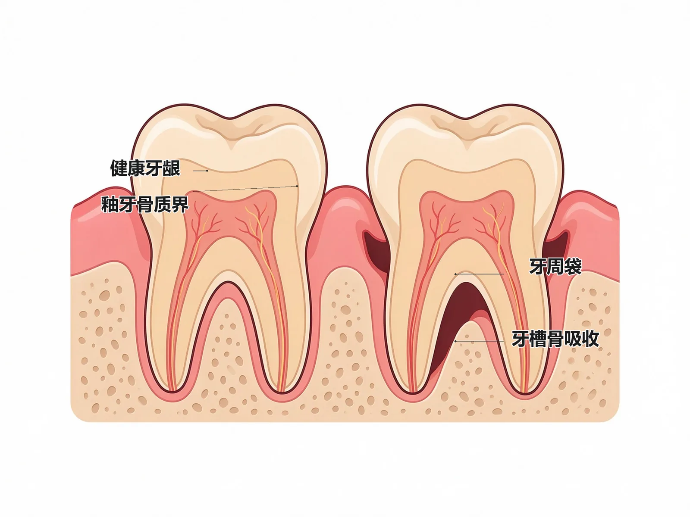

#### 🔬 展开：临床指标要点

探诊出血（BOP）反映炎症活动；探诊深度（PD）＞3mm 为可疑、＞5mm 为真性牙周袋；附着丧失（AL）是不可逆指标，临床附着丧失（CAL）＝PD－游离龈缘至釉牙骨质界距离；X 线骨丧失程度用于分期。

> [!WARNING] 陷阱
> ①「假性牙周袋」龈沟底仍在釉牙骨质界、无附着丧失——只是牙龈肿胀加深；②严格意义的临床牙周健康＝无 BOP、无红肿、无症状且无附着丧失与骨丧失，但治疗后稳定的牙周炎患者仍属「临床牙周健康」范畴且需定期支持照护防复发。

#### 🔴 考点 2：慢性龈炎

<b>定义</b>：慢性龈炎（边缘性龈炎/单纯性龈炎）是菌斑性龈炎中最常见类型，病损主要位于<b>游离龈和龈乳头</b>，人群患病率可达 60%～90%。（教材P83-84）

💡<b>为什么重要</b>：最常见牙龈病，几乎人人一生中都会发生；是牙周炎的前驱——部分慢性龈炎可发展为牙周炎。

🧬 第一性原理：龈缘附近牙面堆积的<b>牙菌斑是始动因子</b>（菌斑＝基质包裹、互相黏附或黏附牙面的软而未矿化的细菌性群体）；龈炎时菌斑中革兰氏阴性菌比例明显增高（产黑色素拟杆菌、梭形杆菌、螺旋体升高，球菌下降）。牙石、食物嵌塞、不良修复体为促发因素。临床表现：牙龈出血（刷牙/咬硬物时，一般无自发性出血）、口臭；游离龈与龈乳头鲜红/暗红；龈缘变厚、龈乳头圆钝肥大、点彩消失表面光亮；质地松软脆弱；轻探即出血；龈沟液量增多；龈沟深达 3mm 以上形成假性牙周袋。<b>诊断关键：有上述表现但无附着丧失</b>。

#### 🔬 展开：慢性龈炎治疗

通过<b>洁治术</b>彻底清除牙菌斑和牙石、去除不良修复体等滞留因素；炎症较重者配合局部药物（1%～3% 过氧化氢、0.12%～0.2% 氯己定、碘制剂）；增生明显者行牙龈成形术；强调口腔卫生宣教与定期复查，防止复发。（教材P84）

> [!TIP] 记忆
> 龈炎诊治三句话：「菌斑是祸首，洁治是主力，无附着丧失可治愈」。

#### 🔴 考点 3：特殊类型龈炎（青春期、妊娠期、药物性）

<b>定义</b>：青春期龈炎（内分泌影响，女性稍多）、妊娠期龈炎（妊娠 2～3 个月出现症状、<b>8 个月达高峰</b>、分娩后约 2 个月减轻）、药物性牙龈肥大（长期服用苯妥英钠、环孢素、钙通道阻滞剂等）。（教材P84-86）

💡<b>为什么重要</b>：三型「菌斑仍是主要病因＋内分泌/药物放大炎症反应」的共性逻辑是 A1 配伍题核心。

🧬 第一性原理：三者均以菌斑为直接病因，但叠加「放大因素」——青春期性激素改变使牙龈对菌斑反应增强（前牙唇侧龈乳头球状突起、龈袋形成但无附着水平变化）；妊娠期雌激素（孕酮）升高加重炎症（<b>龈下菌斑中间普雷沃菌明显增多</b>为优势菌，分娩后回落；个别龈乳头瘤样肥大即<b>妊娠期龈瘤</b>，直径一般不超过 2cm，分娩后自行缩小、须去除刺激物才完全消失）；药物性牙龈肥大（苯妥英钠者 40%～50% 发生，年轻人多于老年人，用药后 3 个月内发生，只发生于有牙区、拔牙后自行消退，牙龈呈桑葚状/分叶状、淡粉红坚韧、不易出血、无附着丧失）。妊娠期龈瘤手术时机尽量选在<b>妊娠第 4～6 个月</b>。

<b>常见龈炎对比</b>：

| 类型 | 关键诱因 | 好发部位 | 特征 |
|------|---------|---------|------|
| 慢性龈炎 | 菌斑（始动因子） | 前牙区（下前牙最显著） | 探诊出血、假性牙周袋 |
| 青春期龈炎 | 菌斑＋性激素 | 前牙唇侧龈乳头 | 反应超过刺激程度 |
| 妊娠期龈炎 | 菌斑＋孕酮升高 | 前牙区；龈瘤于下前牙唇侧 | 8 个月高峰，产后 2 个月减轻 |
| 药物性牙龈肥大 | 苯妥英钠/环孢素/硝苯地平 | 前牙区、有牙区 | 桑葚状坚韧增生，无附着丧失 |

#### 🔬 展开：三型龈炎要点

青春期龈炎：菌斑刺激＋性激素水平变化，青春期后可自愈；妊娠期龈炎：妊娠 2～3 个月出现、8 个月达高峰、分娩后约 2 个月减轻，龈乳头可形成妊娠瘤（分娩后可缩小）；药物性牙龈肥大：苯妥英钠、环孢素、硝苯地平引起，停药或换药＋牙周基础治疗。

> [!WARNING] 陷阱
> ①苯妥英钠是<b>抗癫痫药</b>（不是镇静药）——「苯妥英钠＋牙龈肥大」必须记住；②药物性牙龈肥大「只发生于有牙区、拔牙后自行消退」；③妊娠期龈炎与长期服激素类避孕药表现类似。

#### 🔴 考点 4：牙周炎病因与发病机制

<b>定义</b>：牙周炎是由<b>菌斑微生物</b>引起的累及牙龈、牙周膜、牙槽骨和牙骨质四种牙周支持组织的感染性、破坏性疾病；<b>患病率 50% 以上，是成人丧失牙齿的首位原因</b>。（教材P87）

💡<b>为什么重要</b>：病因链条「菌斑→龈下菌群失调→宿主免疫反应→组织破坏」是理解治疗分阶段（先控菌斑再手术）的基础。

🧬 第一性原理：菌斑是始动因素；随微生物数量增加与毒性增强，龈下菌斑中牙周致病菌（<b>牙龈卟啉单胞菌、伴放线聚集杆菌、福赛斯坦纳菌、螺旋体</b>）大量滋生→胶原破坏、结合上皮向根方增殖、牙周袋形成、牙槽骨吸收。宿主免疫反应扮演关键角色：中性粒细胞与单核巨噬细胞对细菌的<b>过度反应</b>形成过量细胞因子与炎症介质，加重组织破坏；部分患者存在家族性中性粒细胞趋化/吞噬功能缺陷。危险因素：遗传、性激素、吸烟、精神压力、糖尿病等。

#### 🔬 展开：牙周致病菌与免疫破坏

菌斑生物膜是始动因素，主要致病菌为红色复合体（牙龈卟啉单胞菌、福赛坦氏菌、齿垢密螺旋体）；免疫炎症反应（中性粒细胞、巨噬细胞、细胞因子、基质金属蛋白酶）导致胶原破坏与牙槽骨吸收；吸烟、糖尿病为重要危险因素。

> [!NOTE] 扩展
> 侵袭性牙周炎曾独立分型（青少年、30 岁以下、短期内严重附着丧失与骨破坏），因缺乏与慢性牙周炎的显著差别证据，现<b>统称牙周炎</b>——旧教材概念在考试中仍可能出现，需知道其临床特征。

#### 🔴 考点 5：牙周炎临床表现与分型

<b>定义</b>：牙周炎临床表现为<b>牙周袋形成、附着丧失和牙槽骨吸收</b>，晚期出现牙齿松动、病理性移位、根分叉病变，甚至急性牙周脓肿、牙齿脱落；按受累位点比例分为局限型（&lt;30%）与广泛型（≥30%）。（教材P87）

💡<b>为什么重要</b>：「三大临床表现」与分期数值是数值型 A1 考点。

🧬 第一性原理：临床表现是病因链的终点——袋内壁炎症→胶原水解→结合上皮根方增殖→附着丧失；牙槽骨吸收→牙周膜支持力下降→松动、移位、根分叉暴露。分型以「全口牙中附着丧失和骨吸收位点数比例 30%」为界。

#### 🔬 展开：分型要点

按受累位点比例分局限型（≤30%）与广泛型；最常见为慢性牙周炎（成人）；侵袭性牙周炎多见于年轻患者、骨丧失进展快；牙周脓肿需与牙槽脓肿鉴别（感染来源、深牙周袋 vs 根尖病变、X 线表现不同）。

#### 🔴 考点 6：牙周炎分期与分级

<b>定义</b>：<b>分期（Ⅰ～Ⅳ期）</b>反映疾病严重程度与治疗复杂性，参考临床附着丧失（CAL）、影像学骨丧失、探诊深度（PD）、根分叉病变、松动度与失牙数；<b>分级（A/B/C 级）</b>反映疾病进展速度与危险因素，参考 5 年骨丧失/CAL、骨丧失量（%）与年龄比、吸烟、糖尿病。（教材P87-89）

💡<b>为什么重要</b>：分期分级标准是本模块数值考点最密集处，执医与期末均高频。

🧬 第一性原理：「分期看现状、分级看趋势」——分期衡量已有破坏的严重度（CAL 1～2mm=Ⅰ期、3～4mm=Ⅱ期、≥5mm=Ⅲ/Ⅳ期），分级衡量未来进展风险（骨丧失%/年龄 &lt;0.25=A 级慢、0.25～1=B 级中、&gt;1=C 级快）。危险因素可上调分级：吸烟 &lt;10 支/天 A→B，≥10 支/天 A/B→C；糖尿病 HbA1c&lt;7.0% A→B，≥7.0% A/B→C。

<b>牙周炎分期速查</b>：

| 分期 | 邻面 CAL 最重位点 | 影像学骨丧失 | 最大 PD | 因牙周炎失牙 |
|------|------------------|-------------|---------|-------------|
| Ⅰ期 | 1～2mm | 牙根冠方 1/3（&lt;15%） | ≤4mm | 无 |
| Ⅱ期 | 3～4mm | 牙根冠方 1/3（15%～33%） | ≤5mm | 无 |
| Ⅲ期 | ≥5mm | 牙根中 1/3 及以上（&gt;33%） | ≥6mm | ≤4 颗 |
| Ⅳ期 | ≥5mm | 重度破坏 | Ⅲ期基础上＋咀嚼障碍/继发𬌗创伤（松动≥Ⅱ度）/余留牙&lt;20 颗 | ≥5 颗 |

<b>牙周炎分级速查</b>：

| 分级 | 5 年骨丧失/CAL | 骨丧失量(%)/年龄 | 吸烟 | 糖尿病 |
|------|---------------|-----------------|------|--------|
| A 级（缓慢） | 无丧失 | &lt;0.25 | 无 | 无/血糖正常 |
| B 级（中速） | &lt;2mm | 0.25～1.0 | &lt;10 支/天 | HbA1c&lt;7.0% |
| C 级（快速） | ≥2mm | &gt;1.0 | ≥10 支/天 | HbA1c≥7.0% |

> [!TIP] 记忆
> 分期「Ⅰ轻（1-2）、Ⅱ中（3-4）、Ⅲ重（5 起、失牙≤4）、Ⅳ极重（失牙≥5）」；分级「A 慢 B 中 C 快，骨失%/年龄 0.25、1.0 两道坎」。

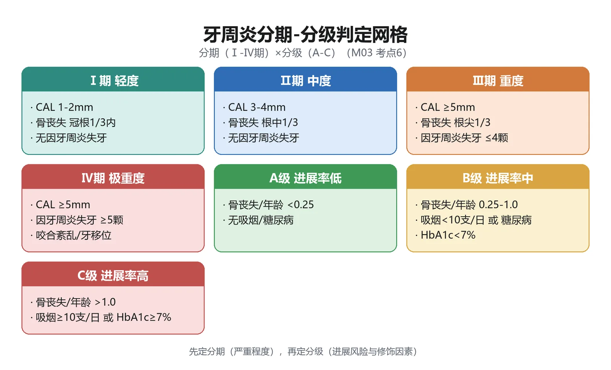

#### 🔬 展开：分期分级判定规则

分期（Ⅰ～Ⅳ）依据 CAL 与影像学骨丧失（Ⅰ期 1～2mm、Ⅱ期 3～4mm、Ⅲ期≥5mm）及治疗复杂性；分级（A/B/C）依据骨丧失%/年龄比、吸烟与糖尿病（HbA1c＞7% 上调一级）；分级用于风险评估而非严重度描述。

#### 🔴 考点 7：牙周炎诊断标准

<b>定义</b>：牙周炎临床诊断标准：<b>≥2 颗不相邻牙齿存在邻面临床附着丧失</b>，或<b>≥2 颗牙齿的颊侧或舌侧附着丧失 ≥3mm 且伴有 PD≥3mm 的牙周袋</b>；须排除非牙周原因导致的附着丧失（创伤性牙龈退缩、颈部龋坏、第三磨牙阻生/拔除后第二磨牙远中附着丧失、经牙周途径排脓的根尖周病、牙根纵裂等）。（教材P89）

#### 🔬 展开：诊断标准细节

牙周炎诊断需至少 2 颗不相邻牙齿存在邻面 CAL，或颊舌侧 AL≥3mm 且 PD≥3mm；同时满足方可诊断；反映全身疾病的牙周炎需标注原发疾病（如糖尿病相关牙周炎）；与单纯龈炎（无附着丧失）鉴别是核心。

> [!WARNING] 陷阱
> ①「≥2 颗<b>不相邻</b>牙」——相邻牙的附着丧失不算（可能为创伤等局部原因）；②牙根纵裂、颈部龋等可致假性附着丧失，须排除。

#### 🔴 考点 8：牙周炎治疗原则与五阶段

<b>定义</b>：治疗目标是彻底清除菌斑、牙石等病原刺激物，消除牙龈炎症，使牙周袋变浅、改善附着水平，争取组织再生并长期稳定；治疗分<b>五阶段</b>进行。（教材P89-90）

💡<b>为什么重要</b>：五阶段顺序与「≥6mm 深袋行翻瓣术」指征是治疗相关高频考点。

🧬 第一性原理：治疗遵循「先病因控制、后手术修复」的阶梯逻辑——第一阶段：菌斑与危险因素控制（口腔卫生宣教、龈上洁治、控糖戒烟）；第二阶段：减少/清除龈下菌斑牙石（<b>龈下刮治和根面平整</b>——刮除根面含内毒素的病变牙骨质，利于新附着）；第三阶段：针对炎症控制不佳位点（重复刮治、<b>牙周翻瓣术</b>、切除/再生手术；4～5mm 袋重复刮治、<b>≥6mm 深袋翻瓣</b>；引导组织再生术促进新牙骨质/牙周膜/牙槽骨形成）；第四阶段：<b>牙周支持照护</b>（定期复查维护，防复发——效果长期保持的关键）；第五阶段：多学科联合（种植、修复、正畸）。

> [!TIP] 记忆
> 治疗五阶段：「控（菌斑危险因素）→刮（龈下刮治根面平整）→术（翻瓣/再生）→护（支持照护）→合（多学科）」。

#### 🔬 展开：五阶段治疗内容

第一阶段基础治疗（菌斑控制、洁治、龈下刮治与根面平整、调𬌗）；第二阶段牙周手术（翻瓣、植骨、引导性组织再生）；第三阶段修复治疗（固定/活动修复、𬌗重建）；第四阶段维持期（定期复查维护）；第五阶段全身治疗（抗生素、相关疾病控制）。

#### 🟡 考点 9：坏死性牙周病

<b>定义</b>：坏死性牙周病分<b>坏死性龈炎（NG）、坏死性牙周炎（NP）、坏死性口炎（NS）</b>；由多种微生物引起的机会性感染，关键病原为<b>梭形杆菌与螺旋体</b>（Plaut-Vincent 证实），常发生于免疫缺陷（HIV/AIDS）、营养不良、精神压力大、烟酒嗜好人群。（教材P90-91）

💡<b>为什么重要</b>：特征性表现（火山口状坏死、腐败性口臭）与治疗（过氧化氢、甲硝唑）是 A1 高频。

🧬 第一性原理：宿主局部抵抗力降低时微生物毒力因子加速组织病损。坏死性龈炎好发于<b>青壮年男性吸烟者</b>，起病急（数天至 1～2 周），特征为<b>龈乳头和龈缘坏死</b>——龈乳头顶端坏死性溃疡、中央凹下如<b>火山口状</b>、覆盖灰白色坏死物，龈缘虫蚀状、灰褐色假膜，极易出血甚至自发性出血，<b>典型腐败性口臭</b>，一般不波及附着龈；重症有低热、下颌下淋巴结肿大。未及时治疗可延及深层牙周组织→坏死性牙周炎；波及唇颊黏膜→坏死性口炎；抵抗力极低时合并产气荚膜杆菌感染可成<b>「走马牙疳」（noma）</b>，面颊坏死穿孔、全身中毒甚至死亡。鉴别：慢性龈炎、疱疹性龈炎/口炎、<b>急性白血病</b>。

> [!NOTE] 扩展
> 治疗：急性期轻轻去除坏死组织与大块龈上牙石，<b>1%～3% 过氧化氢</b>局部擦拭冲洗含漱（去除坏死组织、抑制厌氧菌），重症口服<b>甲硝唑/替硝唑</b>，全身支持（维生素 C、蛋白质）；急性期后行洁治刮治等基础治疗防复发。

#### 🟡 考点 10：牙龈瘤与其他牙龈增生性疾病

<b>牙龈瘤</b>：炎症反应性瘤样增生物，来源于牙周膜及牙龈结缔组织，<b>非真性肿瘤</b>，但切除后易复发；女性较多，好发于唇颊侧龈乳头、单个牙；圆球/椭圆形、可分叶、可有蒂，直径几毫米至 1～2cm；X 线可见骨质吸收、牙周膜间隙增宽。病理分四型：<b>纤维型龈瘤、钙化成纤维细胞性肉芽肿、血管型龈瘤（化脓性肉芽肿）、巨细胞肉芽肿</b>。治疗：基础治疗＋手术彻底切除（瘤体连同骨膜切除、磨削表层骨皮质、刮除相应牙周膜），复发多者拔除患牙。（教材P86-87）

<b>遗传性牙龈纤维瘤病</b>：罕见的弥漫性纤维结缔组织增生，幼儿发病、恒牙萌出后明显；牙龈覆盖部分或整个牙冠，颜色正常、坚韧、光滑、点彩明显、不易出血；以上颌磨牙腭侧最严重；治疗以牙龈成形术为主，青春期后进行，易复发。（教材P86）

<b>牙龈增生性疾病鉴别</b>：

| 疾病 | 年龄/人群 | 形态特点 | 出血倾向 | 处理核心 |
|------|----------|---------|---------|---------|
| 慢性龈炎增生 | 各年龄 | 龈缘变厚、乳头圆钝 | 轻探出血 | 洁治 |
| 青春期龈炎 | 青春期 | 唇侧乳头球状突起 | 探诊易出血 | 洁治＋宣教 |
| 妊娠期龈瘤 | 妊娠期 | 扁圆/分叶状、可有蒂 | 易出血 | 4～6 月手术切除 |
| 药物性牙龈肥大 | 服药者（苯妥英钠等） | 桑葚状/分叶状、坚韧 | 不易出血 | 停药/换药＋手术 |
| 遗传性牙龈纤维瘤病 | 幼儿起 | 覆盖牙冠、色正常坚韧 | 不易出血 | 牙龈成形术（青春期后） |
| 牙龈瘤 | 中青年女性 | 单个牙、圆球/分叶、有蒂 | 较大者可出血 | 彻底切除＋刮牙周膜 |

### 📊 对比速查

<b>牙龈炎 vs 牙周炎</b>：

| 项目 | 牙龈炎 | 牙周炎 |
|------|--------|--------|
| 病损范围 | 局限于牙龈（游离龈、龈乳头） | 累及四种牙周支持组织 |
| 牙周袋 | 假性牙周袋（龈沟底在釉牙骨质界） | 真性牙周袋（结合上皮根方增殖） |
| 附着丧失 | <b>无</b> | <b>有</b> |
| 牙槽骨吸收 | 无 | 有（水平型/垂直型） |
| 牙松动 | 无 | 晚期松动、移位 |
| 预后 | 洁治后多可恢复 | 需系统治疗＋长期支持照护 |

### 🔗 因果链流程图（D2）

```text
【菌斑 → 龈炎 → 牙周炎 → 失牙】因果链

龈缘菌斑堆积(始动因子)
   │
   ▼
牙龈炎症(红/肿/出血/龈沟液↑) ──► 慢性龈炎(无附着丧失)
   │
   │  菌群失调：革兰阴性菌↑(牙龈卟啉单胞菌、伴放线聚集杆菌、螺旋体)
   │
   ▼
结合上皮向根方增殖 ──► 真性牙周袋形成
   │
   ▼
胶原纤维水解 ──► 附着丧失(CAL)
   │
   ▼
牙槽骨吸收(水平型/垂直型) ──► 临床诊断牙周炎 ★(≥2颗不相邻牙邻面CAL
   │                                或颊舌侧AL≥3mm且PD≥3mm)
   │
   ▼
牙周膜支持力下降 ──► 牙齿松动、病理性移位、根分叉病变
   │
   ▼
晚期：急性牙周脓肿 ──► 牙齿脱落 ★(成人失牙首位原因)
   │
   ▼
分期(Ⅰ-Ⅳ期严重度) + 分级(A/B/C进展速度) ──► 个性化治疗
   │
   ▼
五阶段治疗：控→刮→术→护→合
```

★ 临床关键转折点：附着丧失的出现标志着从「可逆的龈炎」进入「不可逆的牙周炎」。

### 🌳 鉴别诊断决策树（D4）

<b>牙龈增生/肿大鉴别树</b>：

```text
牙龈增生肿大
│
├─ 有服药史(苯妥英钠/环孢素/硝苯地平) ──► 药物性牙龈肥大
│
├─ 妊娠期(2-3月起、8月高峰) ──► 妊娠期龈炎 / 妊娠期龈瘤(下前牙唇侧乳头)
│
├─ 青春期(前牙唇侧、反应超刺激程度) ──► 青春期龈炎
│
├─ 幼儿起病、覆盖牙冠、色正常坚韧 ──► 遗传性牙龈纤维瘤病
│
├─ 单个牙、圆球/分叶、有蒂、中青年女性 ──► 牙龈瘤(非真性肿瘤)
│
└─ 无特殊诱因、前牙区、探诊出血 ──► 慢性龈炎
        └─ 有假性牙周袋无附着丧失 → 龈炎
          有真性牙周袋+附着丧失+骨吸收 → 牙周炎 ★
```

### ⚠️ 常见陷阱

1. <b>龈炎有「袋」≠牙周炎</b>：假性牙周袋（无附着丧失）仍是龈炎——「有无附着丧失」是分界线。
2. <b>牙周炎诊断标准</b>：≥2 颗<b>不相邻</b>牙邻面 CAL，或 ≥2 颗牙颊舌侧 AL≥3mm 且 PD≥3mm；排除创伤性退缩、颈部龋、根纵裂等假性附着丧失。
3. <b>分期与分级混淆</b>：分期=严重度（Ⅰ～Ⅳ，CAL 1-2/3-4/≥5mm），分级=进展速度（A/B/C，骨丧失%/年龄 0.25、1.0）；吸烟 &lt;10 支/天 A→B，≥10 支/天 A/B→C。
4. <b>妊娠期龈炎高峰</b>：8 个月达高峰（不是 3 个月）；手术时机选 4～6 个月。
5. <b>药物性牙龈肥大药物记混</b>：苯妥英钠（抗癫痫）、环孢素（免疫抑制剂）、硝苯地平/维拉帕米（钙通道阻滞剂）。
6. <b>牙龈瘤是「非真性肿瘤」</b>，但切除后易复发——需刮除牙周膜组织防复发。
7. <b>坏死性龈炎</b>：火山口状坏死＋腐败性口臭＋青壮年吸烟男性；须与急性白血病鉴别（勿盲目活检/手术）。
8. <b>「走马牙疳」</b>是坏死性口炎极端型（产气荚膜杆菌），不是普通坏死性龈炎。

### 💡 记忆口诀

1. <b>牙周健康指标</b>：「BOP 出血 PD 深，AL 附着骨丧失」。
2. <b>龈炎 vs 牙周炎</b>：「有无附着是关键，假袋真袋分界线」。
3. <b>牙周炎分期</b>：「Ⅰ轻 1-2，Ⅱ中 3-4，Ⅲ重 5 起失牙≤4，Ⅳ极重失牙≥5」。
4. <b>牙周炎分级</b>：「A 慢 B 中 C 快，0.25 与 1.0 两道坎；吸烟加级糖加级」。
5. <b>药物性牙龈肥大</b>：「苯妥环孢硝苯平，有牙区里长不停，停药换药再手术」。
6. <b>坏死性龈炎</b>：「梭螺感染火山口，腐臭出血青壮男，双氧水洗甲硝唑」。
7. <b>治疗五阶段</b>：「控刮术护合，先病因后手术」。

### 📌 本章小结

> [!INFO] 本章小结
> 模块3 围绕「菌斑→炎症→附着丧失→失牙」主线：牙周健康四指标（BOP/PD/AL/骨丧失）是评估语言；龈炎与牙周炎以附着丧失为界；慢性龈炎最常见、可逆；特殊类型龈炎（青春期/妊娠期/药物性）均以菌斑为直接病因、被内分泌或药物放大；牙周炎是成人失牙首位原因，分期看严重度（Ⅰ～Ⅳ）、分级看进展（A/B/C）；治疗按「控-刮-术-护-合」五阶段推进，支持照护是疗效长期保持的关键；坏死性龈炎以火山口状坏死与腐败性口臭为特征。
>
> <b>🧬 本章核心洞察</b>：牙周病的本质是「菌斑生物膜引发的宿主免疫过度反应性破坏」——诊断紧扣附着丧失，治疗紧扣菌斑控制；把「可逆（龈炎）与不可逆（牙周炎）」的分界刻在脑子里，是本章全部考点的纲。

### 🔗 深度链接

- 牙周组织解剖与探诊测量 → <b>模块1 口腔颌面解剖生理与口腔检查</b>
- 深牙周袋→逆行性牙髓炎（牙周-牙髓联合病变） → <b>模块2 牙体牙髓病</b>
- 牙周脓肿与间隙感染的关系 → <b>模块7 口腔颌面部感染</b>

---

## 模块4：口腔黏膜常见疾病

> [!INFO] 模块信息
> <b>重点等级</b>：🔴掌握 4 个（RAU 定义与特征、RAU 三型鉴别、RAU 与癌性溃疡鉴别、口腔白斑病）｜🟡熟悉 0 个｜🟢了解 0 个
> <b>预计题型</b>：A1（分型特征/药物选择）、A2（黏膜病损病例鉴别）、B1（病损-疾病配伍）
> <b>关联模块</b>：模块1 口腔黏膜解剖（角化/非角化分区）→ 模块2（牙痛与黏膜病鉴别）、模块3（坏死性龈炎与黏膜坏死）、模块8（唾液腺疾病与舍格伦综合征）
> <b>谱系位置</b>：黏膜病是全身疾病的窗口之一——白斑为口腔癌前病变，需警惕癌变
> <b>预计阅读</b>：约 25 分钟

---

### 🧩 前置知识检查

> [!NOTE] 前置知识
> ①口腔黏膜角化与未角化分区：附着龈、硬腭为角化黏膜；唇、舌、颊、软腭为非角化/角化差黏膜（RAU 好发区由此而来，模块1）；②黏膜病损基本描述术语：斑、丘疹、疱、糜烂、溃疡、假膜、角化；③黏膜病损的形态学观察要点。

### 🎯 高收益摘要

> [!SUCCESS] 本模块核心
> 1. <b>RAU＝最常见口腔黏膜溃疡病</b>：周期性、复发性、自限性；「红、黄、凹、痛」四特征；轻型（5～10mm、10～14 天愈合、不留瘢痕）、重型（腺周口疮，&gt;10mm、弹坑状、留瘢痕）、疱疹样（小而多、满天星）。
> 2. <b>大而深、长期不愈的溃疡→警惕癌性溃疡，须活检</b>。
> 3. <b>口腔白斑病＝癌前病变</b>：白色损害<b>不能擦去</b>；颊黏膜最多见；非均质型（颗粒/疣状/溃疡）癌变倾向更高；癌变率 0.13%～17.5%；戒烟酒、去刺激、手术切除活检。
### 📋 结构化笔记

#### 🔴 考点 1：复发性阿弗他溃疡（RAU）总论

<b>定义</b>：复发性阿弗他溃疡（RAU）是最常见的口腔黏膜溃疡类疾病，人群患病率 10%～25%，具有<b>周期性、复发性、自限性</b>三大特点，诊断依据病史特点与临床特征<b>「红、黄、凹、痛」</b>（边缘红、表面黄白色假膜、中央凹陷、灼痛）。（教材P95）

💡<b>为什么重要</b>：本模块最核心考点——三大特点＋四字特征＋三型鉴别是 A1/A2 必考。

🧬 第一性原理：RAU 病因不明、多因素综合作用（免疫、遗传、系统性疾病、环境）。其发病规律可概括为「上皮的局限性坏死性炎症」——初起黏膜充血水肿（粟粒状红点）→浅表溃疡形成→约 5 天开始愈合、10～14 天愈合。好发于<b>非角化或角化差的黏膜（唇、舌、颊、软腭）</b>，而<b>附着龈、硬腭等角化黏膜很少发病</b>——这是 RAU 的重要特征。

> [!TIP] 记忆
> RAU 诊断四字诀：「红（边缘充血）、黄（假膜）、凹（中央凹陷）、痛（灼痛）」＋「周期、复发、自限」三大特点。

#### 🔬 展开：RAU 病因与病程

病因与免疫（细胞免疫为主）、遗传、环境（精神压力、创伤、食物过敏）相关；溃疡呈「红（充血缘）黄（假膜）凹（凹陷）痛（灼痛）」四特征；自限性，轻型 7～14 天愈合；周期性复发是诊断要点。

#### 🔴 考点 2：RAU 三型鉴别

<b>定义</b>：RAU 临床分<b>轻型、重型、疱疹样</b>三型；轻型初发多为此型，重型又称复发性坏死性黏膜腺周围炎（腺周口疮），疱疹样又称口炎型口疮。（教材P95-96）

💡<b>为什么重要</b>：三型的溃疡大小、数目、愈合与瘢痕差异是配伍题核心。

🧬 第一性原理：三型是「溃疡深度与数目」两个维度的极端——轻型小而浅散在（3～5 个，≤10 个）；重型大而深（单个为主，1～2 个，深及黏膜下层至肌层，似弹坑，疼痛重、愈合慢、<b>留瘢痕</b>甚至致舌尖腭垂缺损畸形）；疱疹样小（约 2mm）而多（可达数十个，满天星样散在，可融合）。共同的诊断价值在于：重型需警惕癌变可能。

<b>RAU 三型对比</b>：

| 项目 | 轻型 | 重型（腺周口疮） | 疱疹样（口炎型口疮） |
|------|------|----------------|--------------------|
| 溃疡大小 | 直径 5～10mm | &gt;10mm、深似弹坑 | 约 2mm（≤5mm） |
| 数目 | 3～5 个（≤10 个） | 1～2 个 | 数十个（满天星） |
| 深度 | 浅表 | 黏膜下层至肌层 | 浅表、可融合成片 |
| 愈合 | 10～14 天 | 月余至数月 | 较快 |
| 瘢痕 | <b>不留瘢痕</b> | <b>留瘢痕</b>、可致组织缺损 | 一般不留 |
| 全身症状 | 无明显 | 低热、乏力、淋巴结肿痛 | 头痛、低热、唾液分泌增加 |

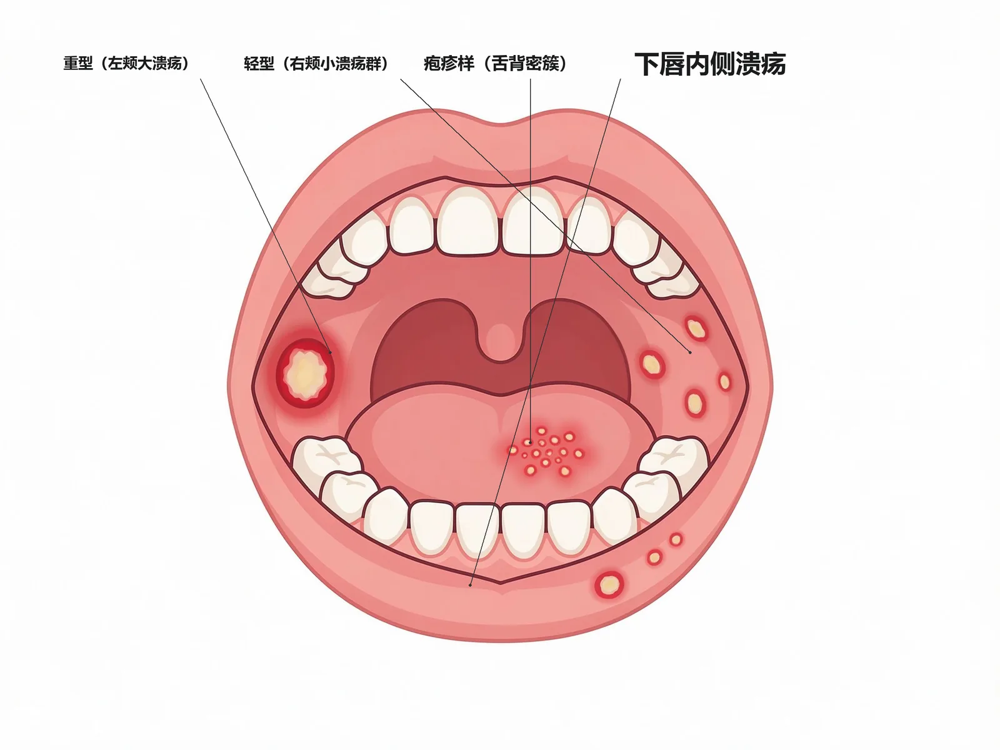

#### 🔬 展开：三型细节

轻型：最常见，直径＜10mm，散在 1～5 个，愈后不留瘢痕；重型（腺周口疮）：大而深（可达 1～2cm）、愈合慢留瘢痕、好发于唇内侧与口角区；疱疹样：数十个 1～2mm 小溃疡、密集成簇、可融合，好发于舌背与口底。

> [!WARNING] 陷阱
> ①轻型「最多不超过 10 个」、愈合不留瘢痕；重型愈后留瘢痕甚至组织缺损——「轻型瘢痕无、重型瘢痕有」；②重型好发于口角、有向口腔后部移行趋势，影响言语吞咽。

#### 🔴 考点 3：RAU 与癌性溃疡的鉴别（活检指征）

<b>定义</b>：对大而深且长期不愈的溃疡，应警惕癌性溃疡的可能，<b>需做活检以明确诊断</b>。（教材P95）

💡<b>为什么重要</b>：「长期不愈＋进行性增大＋基底硬」是癌性溃疡报警信号，活检是金标准——A2 病例题常考。

🧬 第一性原理：良性溃疡（RAU）有自限性、愈合周期规律（10～14 天）、疼痛明显；癌性溃疡则持续不愈、基底硬、边缘不整隆起、可无痛或痛感轻且进行性增大。判断要点：溃疡部位、大小、深度、基底质地、愈合趋势与活检病理。

#### 🔬 展开：癌性溃疡特征

癌性溃疡：边缘不规整隆起呈菜花状、基底硬结浸润、疼痛不明显、经久不愈（＞2 周）、好发于舌缘/口底等创伤区；凡溃疡超过 2 周不愈或形态可疑者应活检确诊；RAU 与结核性溃疡、创伤性溃疡也需鉴别。

> [!WARNING] 陷阱
> ①「溃疡长期不愈（&gt;2～3 周）且基底硬」＝癌性溃疡报警，不是 RAU 重型可以解释的；②RAU 诊断一般不须实验室检查与活检，但可疑癌变时必须活检。

#### 🔴 考点 4：口腔白斑病（OLK）

<b>定义</b>：口腔白斑病是口腔黏膜上以白色为主的损害，<b>不能擦去</b>，不能以临床和组织病理学方法诊断为其他可定义的疾病，<b>属于癌前病变/潜在恶性疾病</b>；不包括去除局部因素（吸烟、摩擦等）后可消退的单纯性过角化病。（教材P97-98）

💡<b>为什么重要</b>：白斑是最重要的口腔癌前病变，分型与癌变风险是考试重点。

🧬 第一性原理：白斑病因包括吸烟（关系密切）、嗜酒、嚼槟榔、白念珠菌感染（白念白斑易癌变）及局部刺激（锐尖利缘、残根残冠、牙石）。好发<b>中老年男性、40 岁以上</b>，部位以<b>颊黏膜最多、舌次之</b>。分型：<b>均质型</b>（斑块型、皱纹纸型——口底舌腹好发）与<b>非均质型</b>（颗粒型——口角区多见且多可查到白念珠菌、疣状型、溃疡型）——非均质型癌变倾向更高。癌变率 0.13%～17.5%。

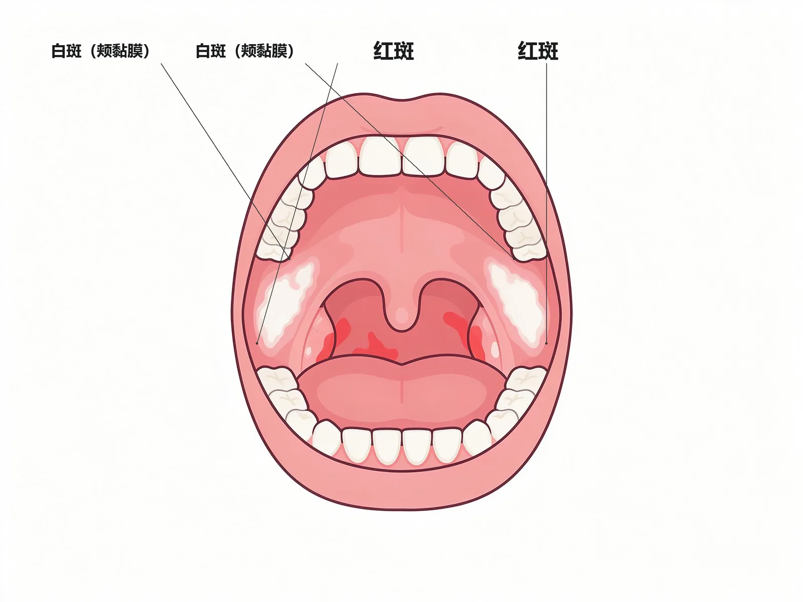

#### 🔬 展开：白斑分型与癌变

分均质型（斑块状、皱纹纸样）与非均质型（疣状、结节状、颗粒状，癌变风险更高）；白斑是癌前病损，癌变率 0.13%～17.5%；不能擦去是与白色念珠菌白斑等假膜性病变的鉴别点；治疗：戒烟、去除刺激、维 A 酸或手术切除＋活检。

> [!NOTE] 扩展
> 治疗：去除刺激因素（戒烟酒、停嚼槟榔、去残根残冠）；非充血糜烂病损用 0.1%～0.3% 维 A 酸软膏；<b>溃疡型、疣状型、颗粒型白斑应手术切除全部病变并活检</b>；治疗中出现增生、硬结、溃疡改变应及时手术切除活检。

> [!WARNING] 陷阱
> ①「白斑不能擦去」vs 鹅口疮假膜「可擦去」——最常考的鉴别点；②非均质型（颗粒/疣状/溃疡）癌变倾向高于均质型；③白念白斑（伴白念珠菌感染的白斑）易癌变。

### 📊 对比速查

<b>口腔常见白色病损鉴别</b>：

| 疾病 | 颜色形态 | 可否擦去 | 部位 | 性质 |
|------|---------|---------|------|------|
| 口腔白斑病 | 白色/灰白斑块，均质或颗粒/疣状/溃疡 | <b>不能擦去</b> | 颊黏膜最多、舌次之 | 癌前病变 |
| 白色角化症 | 灰白/浅白边界不清、表面平滑 | 去刺激后可消退 | 颊唇舌、硬腭（烟碱性） | 良性角化 |

<b>RAU vs 癌性溃疡</b>：

| 项目 | RAU（轻型/重型） | 癌性溃疡 |
|------|------------------|----------|
| 病程 | 有自限性（10～14 天或数月） | 长期不愈、进行性增大 |
| 基底 | 软（重型稍硬但边缘整齐清晰） | <b>基底硬</b>、边缘不整隆起 |
| 疼痛 | 明显灼痛 | 可无痛或痛感轻 |
| 愈合 | 可自愈（重型留瘢痕） | 不愈合 |
| 处理 | 对症治疗；可疑时活检 | <b>活检确诊</b> |

### 🔗 因果链流程图（D2）

```text
【口腔黏膜病损 → 诊断线索链】

黏膜病损
│
├─ 白色损害（不能擦去）
│   └─ 斑块(颊部/吸烟) ──► 白斑(癌前病变)
│           └─ 非均质型(颗粒/疣状/溃疡) ──► 癌变风险↑ ★
│
└─ 溃疡/糜烂
    ├─ 红黄凹痛+周期复发自限 ──► RAU(角化黏膜少发)
    │       ├─ 大而深弹坑 ──► 重型(腺周口疮,留瘢痕)
    │       └─ 小而多满天星 ──► 疱疹样
    │
    ├─ 大而深长期不愈+基底硬 ──► 癌性溃疡? ──► 活检 ★
    └─ 有明确刺激因素(残根/不良修复体/咬伤) ──► 创伤性溃疡
```

★ 临床关键转折点：「可擦去/不可擦去」与「长期不愈+基底硬→活检」是黏膜病诊断的两条核心分界线。

### 🌳 鉴别诊断决策树（D4）

<b>口腔黏膜溃疡鉴别树</b>：

```text
口腔溃疡/糜烂
│
├─ 反复发作+自限性+红黄凹痛 ──► RAU
│   ├─ 直径5-10mm、3-5个、不留瘢痕 ──► 轻型
│   ├─ 大而深>10mm、1-2个、弹坑状、留瘢痕 ──► 重型(腺周口疮)
│   └─ 小而多(数十个)、满天星 ──► 疱疹样
│
├─ 长期不愈(>2-3周)+基底硬+边缘不整 ──► 警惕癌性溃疡 ──► 活检 ★
│
├─ 有明确刺激因素(残根/不良修复体/咬伤) ──► 创伤性溃疡(去除刺激后愈合)

```

### ⚠️ 常见陷阱

1. <b>RAU 好发部位</b>：非角化黏膜（唇舌颊软腭）——附着龈、硬腭等角化黏膜很少发病。
2. <b>轻型不留瘢痕、重型留瘢痕</b>：重型（腺周口疮）深及肌层，愈后留瘢痕甚至组织缺损畸形。
3. <b>白斑「不能擦去」vs 鹅口疮「可擦去」</b>：最常考的鉴别点；白斑去除刺激因素（吸烟）后不消退（消退者归单纯性过角化）。
4. <b>白斑癌变风险</b>：癌变率 0.13%～17.5%；非均质型（颗粒/疣状/溃疡）癌变倾向更高；白念白斑易癌变；溃疡型、疣状型、颗粒型应手术切除全部病变并活检。

### 💡 记忆口诀

1. <b>RAU 特征</b>：「周期复发加自限，红黄凹痛记心间；角化黏膜很少发，唇舌颊软是好区」。
2. <b>RAU 三型</b>：「轻型 5-10 不留疤，重型弹坑留瘢痕，疱疹样小满天星」。
3. <b>白色病损</b>：「白斑擦不去、角化去刺激就消」。

### 📌 本章小结

> [!INFO] 本章小结
> 模块4 以「溃疡、白色病损」两类黏膜损害为主线：RAU 是溃疡类最常见疾病，靠「红黄凹痛＋周期复发自限」诊断，三型以大小深浅分界；白斑是核心癌前病变，「不能擦去」是其关键鉴别点，非均质型与白念白斑癌变风险高、需手术切除活检。
>
> <b>🧬 本章核心洞察</b>：黏膜病诊断的关键在于「形态特征＋可否擦去＋愈合规律」三个维度的组合判别——把「白斑擦不去、RAU 红黄凹痛」作为尺子，加上「长期不愈基底硬＝活检」的报警线，即可覆盖本章绝大多数考点。

### 🔗 深度链接

- 黏膜角化/非角化分区与检查法 → <b>模块1 口腔颌面解剖生理与口腔检查</b>
- 坏死性龈炎与黏膜坏死性病损鉴别 → <b>模块3 牙周疾病</b>
- 舍格伦综合征（口干、涎腺肿大）与黏膜病鉴别 → <b>模块8 唾液腺疾病</b>
- 白斑为癌前病损，随访监测癌变（本模块）

---

## 模块6：口腔临床麻醉与牙拔除术

> [!INFO] 模块信息
> <b>重点等级</b>：🔴掌握 8 个（常用局麻药、局麻方法与下牙槽神经阻滞、局麻并发症、拔牙适应证、拔牙禁忌证、拔牙基本步骤与用力方式、阻生牙拔除、拔牙并发症（含干槽症））｜🟡熟悉 1 个（拔牙创愈合与各类牙拔除）｜🟢了解 0 个
> <b>预计题型</b>：A1（数值/适应证禁忌证）、A2（拔牙禁忌评估）、B1（神经-麻醉范围配伍）
> <b>关联模块</b>：模块1（三叉神经分支与颌面解剖是阻滞麻醉基础）→ 模块2（牙髓炎应急处理与开髓）、模块7（冠周炎与间隙感染是阻生牙拔除的指征）
> <b>谱系位置</b>：麻醉与拔牙是口腔外科的门户操作——第14周讲授章节，期末考试外科部分核心
> <b>预计阅读</b>：约 60 分钟

---

### 🧩 前置知识检查

> [!NOTE] 前置知识
> ①三叉神经上颌支、下颌支行程与分支（上牙槽后/中/前神经、眶下神经、腭前神经、鼻腭神经、下牙槽神经、舌神经、颊神经——模块1）；②牙体解剖（根数、根形：上颌前牙单根圆锥形、上颌前磨牙扁根、上颌磨牙三根、下颌磨牙双根——模块1）；③血液与凝血基础、妊娠分期、糖尿病血糖控制（内科学常识）。

### 🎯 高收益摘要

> [!SUCCESS] 本模块核心
> 1. <b>局麻药分酯类与酰胺类</b>：普鲁卡因（酯类，易过敏已少用）、丁卡因（酯类，毒性大仅表面麻醉）；<b>利多卡因（酰胺类，临床最常用）</b>、布比卡因（长效 3～4 倍、维持 6 小时以上）、阿替卡因（起效快、渗透强、4 岁以上儿童可用）。
> 2. <b>局麻三方法</b>：表面麻醉（丁卡因/2%～4% 利多卡因）、浸润麻醉（骨膜上浸润最常用，1%～2% 利多卡因）、<b>阻滞麻醉（下牙槽神经阻滞＝翼下颌注射法最关键）</b>。
> 3. <b>局麻全身并发症</b>：晕厥（一时性中枢缺血，头低位）、过敏（酯类多见，肾上腺素急救）、中毒（药量过大/误入血管，回抽无血再注射）；局部：血肿（翼静脉丛）、暂时性面瘫（麻药注入腮腺）。
> 4. <b>拔牙适应证 10 条</b>：严重龋病、严重牙周病（Ⅲ度松动）、根尖周病、多生/错位/埋伏牙、阻生牙（反复冠周炎）、外伤、乳牙滞留、治疗需要、病灶牙等——适应证相对，能保留者尽量保留。
> 5. <b>拔牙禁忌证关键数值</b>：血红蛋白&gt;80g/L；血压≤140/90（至少≤160/100）；空腹血糖&lt;8.88mmol/L；甲亢基础代谢率&lt;+20%、脉率≤100 次/分；妊娠前 3 后 3 个月禁拔（4～6 月安全）；放疗前 7～10 天拔牙、放疗后 3～5 年慎重。
> 6. <b>拔牙三力</b>：摇动（扁根牙/多根牙）、扭转（<b>仅圆锥形上颌前牙</b>）、牵引（最后一步）；上颌前磨牙与磨牙禁旋转力。
> 7. <b>干槽症</b>：下颌后牙（尤其下颌阻生第三磨牙）拔后 2～3 天剧烈放射痛、牙槽窝空虚腐败恶臭；3% 过氧化氢清洗＋碘仿纱条填塞。
> 8. <b>拔牙创愈合</b>：15 分钟血凝块→7 天肉芽→1～2 个月变平→3～6 个月骨结构；义齿修复宜在拔牙后 2 个月。

### 📋 结构化笔记

#### 🔴 考点 1：常用局部麻醉药

<b>定义</b>：局麻药按化学结构分<b>酯类</b>（普鲁卡因、丁卡因）与<b>酰胺类</b>（利多卡因、布比卡因、阿替卡因）；目前临床常用的是酰胺类。（教材P55-56）

💡<b>为什么重要</b>：各药的特性（最常用/长效/表面麻醉专用）是 A1 配伍高频考点。

🧬 第一性原理：局麻药通过阻断神经细胞膜钠通道、阻止动作电位产生与传导而麻醉——「剂量-毒性」与「结构-代谢」决定临床应用：酯类易水解产生对氨基苯甲酸致过敏（普鲁卡因因严重过敏已很少应用）；酰胺类在肝代谢。利多卡因起效快、弥散广、穿透性强、无明显扩张血管作用，且有<b>抗室性心律失常</b>作用，是临床<b>应用最多的局麻药</b>（1%～2% 浸润/阻滞，2%～4% 表面麻醉）；布比卡因作用强（利多卡因 3～4 倍）、维持 6 小时以上，0.5% 常加少量肾上腺素用于耗时久的手术；阿替卡因起效快、渗透性强、毒副作用小，适用于成人及<b>4 岁以上儿童</b>。临床常在局麻药中加入适量血管收缩剂（肾上腺素）——减少术区出血、延长麻醉时间；但局麻不适用于不合作患者及局部有炎症部位。

<b>常用局麻药对比</b>：

| 药物 | 类别 | 特点 | 主要用途 |
|------|------|------|---------|
| 普鲁卡因 | 酯类 | 易致严重过敏，已很少用 | — |
| 丁卡因 | 酯类 | 作用迅速、穿透力强、<b>毒性大</b> | <b>表面麻醉</b> |
| 利多卡因 | 酰胺类 | 起效快、弥散广、有抗心律失常作用 | <b>最常用</b>；浸润/阻滞/表面 |
| 布比卡因 | 酰胺类 | 作用强 3～4 倍、维持 6 小时以上 | 耗时久的手术、术后镇痛 |
| 阿替卡因 | 酰胺类 | 起效快、渗透强、毒副作用小 | 成人及 4 岁以上儿童 |

#### 🔬 展开：局麻药比较与肾上腺素

利多卡因（酰胺类）2% 最常用，含肾上腺素（1:10 万～1:20 万）可延长麻醉时间、减少出血；阿替卡因 4% 渗透力强；普鲁卡因（酯类）过敏多见、现已少用；丁卡因毒性大仅作表面麻醉；布比卡因长效；肾上腺素禁忌：甲亢、高血压、心脏病患者。

> [!WARNING] 陷阱
> ①丁卡因毒性大→只能表面麻醉；②布比卡因是「长效」（6 小时以上）不是「速效」；③利多卡因既是局麻药又是抗心律失常药——心律失常患者可选。

#### 🔴 考点 2：口腔局部麻醉方法与下牙槽神经阻滞

<b>定义</b>：局麻方法分<b>表面麻醉、浸润麻醉（皮丘/骨膜上浸润/牙周膜注射/计算机控制）、阻滞麻醉</b>；下牙槽神经阻滞麻醉（翼下颌注射法）是下颌牙拔除最常用的关键麻醉。（教材P56-58）

💡<b>为什么重要</b>：各神经麻醉的进针标志与麻醉范围是 B1 配伍与 A2 病例考点。

🧬 第一性原理：三种方法按「麻醉层次」递进——表面麻醉仅麻痹末梢（适用表浅黏膜下脓肿切开、松动牙拔除、咽部检查）；浸润麻醉作用于神经末梢（骨膜上浸润法适用于上、下颌牙槽突前份疏松多孔骨区，进针距龈缘约 1cm、针与黏膜 45°；牙周膜注射法损伤小，<b>适用于血友病等出血倾向患者</b>及麻醉欠佳时的补充）；阻滞麻醉将药注射于神经干/分支周围，<b>药量少、范围广、作用深、维持长</b>，可远离病变部位注射，尤适用于感染患者。

<b>关键阻滞麻醉要点</b>：

| 麻醉 | 注射标志/方法 | 麻醉范围 | 注意事项 |
|------|--------------|----------|---------|
| 上牙槽后神经（上颌结节注射） | 上颌第二磨牙远中颊侧前庭沟，针与牙长轴 45° 向后上内，深约 2cm | 除上颌第一磨牙近中颊根外的同侧磨牙 | 勿过深刺破<b>翼静脉丛</b>致血肿 |
| 眶下神经（眶下孔注射） | 眶下缘中点下方 0.5～1cm；口外鼻翼旁 1cm | 同侧切牙至前磨牙等 | 勿过深损伤眼球 |
| 腭前神经（腭大孔注射） | 腭大孔表面标志稍前处 | 同侧磨牙前磨牙腭侧 | 药量过多致软腭腭垂麻痹恶心 |
| 鼻腭神经（腭前孔注射） | 切牙孔（左右尖牙连线与腭中缝交点） | 两侧尖牙连线前方腭侧 | 组织致密、防针脱落 |
| <b>下牙槽神经（翼下颌注射）</b> | 翼下颌皱襞中点外侧 0.3～0.4cm 或颊脂垫尖，深 2～2.5cm 达下颌神经沟 | 同侧下颌骨、下颌牙、下唇（<b>下唇麻木</b>） | 回抽无血再注射，防注入血管 |
| 舌神经 | 下牙槽神经注射后退出 1cm 再注 1ml | 同侧舌前 2/3、舌侧牙龈 | 舌烧灼肿胀麻木 |
| 颊神经 | 退针至肌层黏膜下注射 | 下颌磨牙颊侧牙龈、颊部 | 可远中前庭沟浸润替代 |

> [!TIP] 记忆
> 「下牙槽神经翼下颌，皱襞中点外侧 0.3～0.4，颊脂垫尖 45° 角，下唇麻木算麻到」——下唇麻木是下牙槽神经阻滞成功的标志。

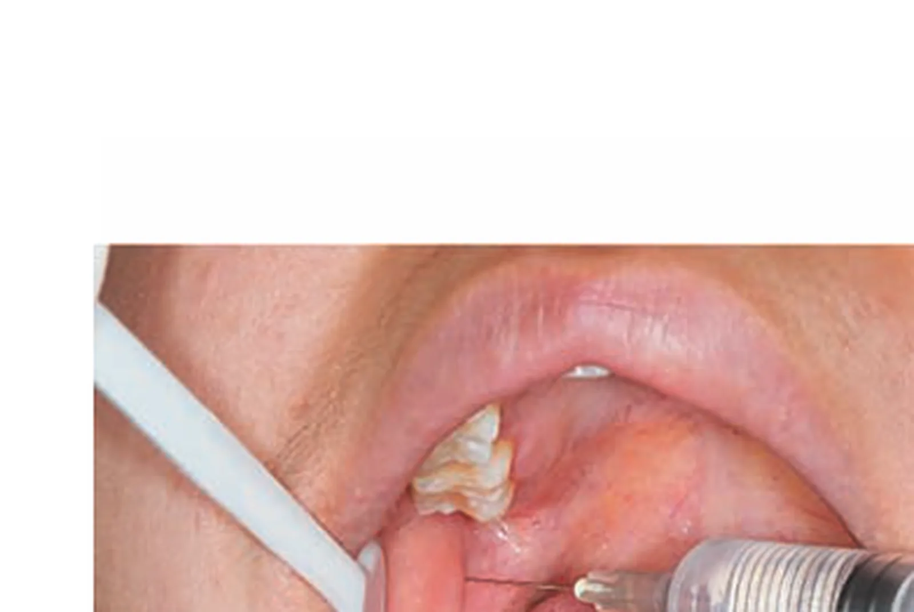

#### 🔬 展开：各阻滞麻醉要点

上牙槽后神经阻滞（上颌结节后方进针，避免刺伤翼静脉丛致血肿）；眶下神经阻滞（眶下孔）；腭大孔、鼻腭神经阻滞（腭部）；下牙槽神经阻滞（翼下颌皱襞外侧、下颌孔上方约 1cm 进针，麻醉下颌牙及同侧下唇，以下唇麻木为成功标志）；颊神经、舌神经多同时麻醉。

#### 🔴 考点 3：局麻并发症（全身与局部）

<b>定义</b>：局麻全身并发症有<b>晕厥、过敏反应、中毒</b>；局部并发症有注射区疼痛水肿、血肿、感染、注射针折断、暂时性面瘫、暂时性牙关紧闭、暂时性复视或失明等。（教材P58-60）

💡<b>为什么重要</b>：三者的诱因、表现与急救处理是 A1/A2 高频，尤其「晕厥 vs 中毒」鉴别。

🧬 第一性原理：按病理机制区分——<b>晕厥</b>＝一时性中枢缺血（精神紧张、恐惧、饥饿、疲劳诱发），前驱头晕胸闷恶心，面色苍白冷汗脉快弱，处理：停止注射、放平椅位<b>头低位</b>、松解衣领、吸氧；<b>过敏反应</b>＝免疫介导（酯类多见），即刻反应似中毒（烦躁胸闷惊厥昏迷），严重者<b>注射肾上腺素</b>，惊厥用地西泮 10～20mg 或硫喷妥钠；<b>中毒</b>＝单位时间内入血药量超过分解速度（药量过大或误入血管），分兴奋型（烦躁多语抽搐惊厥）与抑制型（脉细弱血压下降），防治关键是<b>回抽无血再缓慢注射</b>、熟悉一次最大剂量。<b>局部血肿</b>多见于上牙槽后神经阻滞刺破翼静脉丛（压迫止血、冷敷、48 小时后热敷）；<b>暂时性面瘫</b>因针尖越过下颌切迹将药注入腮腺麻醉面神经（眼睑不能闭合、口角下垂，药物作用消失自行恢复）。

#### 🔬 展开：并发症鉴别与处理

晕厥：迷走反射、面色苍白冷汗脉缓，头低脚高位、吸氧；过敏反应：皮疹荨麻疹→过敏性休克，肾上腺素肌注；中毒：过量或注入血管内，先兴奋（抽搐惊厥）后抑制，镇静、吸氧、维持呼吸循环；局部：血肿、感染、神经损伤（暂时性面瘫多因注射过深过后）。

> [!WARNING] 陷阱
> ①晕厥＝头低位、吸氧；过敏严重＝肾上腺素；中毒＝立即停止注射＋对症抢救——急救要点不可混；②血肿好发于「上牙槽后神经阻滞（翼静脉丛）」，不是下牙槽神经阻滞；③面瘫是因注入腮腺，不是损伤神经干。

#### 🔴 考点 4：拔牙适应证

<b>定义</b>：拔牙适应证是<b>相对的</b>——过去很多拔牙适应证现在可保留，应严格掌握。主要适应证：严重龋病（冠严重破坏不能修复）、严重牙周病（<b>Ⅲ度松动</b>、牙周溢脓）、根尖周病（无法根管治疗保留）、多生牙/错位牙/埋伏牙、阻生牙（反复冠周炎或致邻牙根吸收）、牙外伤（冠折达根无法修复）、乳牙滞留、治疗需要（正畸减数、放疗前预防）、病灶牙、其他（美观经济要求）。（教材P167）

💡<b>为什么重要</b>：适应证 10 条与「相对性」原则是 A1 常考；注意与「可保留」情形对照。

🧬 第一性原理：拔牙的决策逻辑是「保留价值 vs 破坏风险」——能通过根管治疗、修复、正畸保留者尽量保留；拔除的牙应确实成为「病灶」（造成感染、创伤、拥挤、妨碍治疗）。如牙隐裂、纵折、外伤根横折现在也可尝试保留（牙髓治疗后修复），不再一律拔除。

#### 🔬 展开：适应证细节

①牙体病损过大无法修复（残冠残根）；②根尖周病无法根管治疗或根管治疗失败；③牙周病致Ⅲ度松动；④牙外伤冠根折无法保留；⑤阻生牙反复引起冠周炎；⑥多生牙、错位牙、迟萌牙影响邻牙；⑦乳牙滞留妨碍恒牙萌出；⑧病灶牙（感染性心内膜炎、放疗、器官移植前预防性拔除）。

#### 🔴 考点 5：拔牙禁忌证（全身状态评估）

<b>定义</b>：禁忌证亦为相对——经治疗控制后可成为适应证，但严重疾病未控制时不能拔牙。涉及血液、心血管、内分泌、肝肾、妊娠、急性炎症、肿瘤放疗、抗凝、激素、神经精神等系统。（教材P167-168）

💡<b>为什么重要</b>：各系统「可拔/禁拔」的数值边界是 A1 数值题核心。

🧬 第一性原理：拔牙禁忌的病理学本质是「出血风险＋感染风险＋应激风险」——血液系统（血红蛋白&gt;80g/L 可拔；<b>急性白血病、再生障碍性贫血避免拔牙</b>；血友病等控制后慎重并继续治疗）；心血管（<b>血压控制在≤140/90，至少≤160/100</b>；近期心梗、心绞痛频繁、心功能 Ⅲ～Ⅳ 级禁忌；风心/先心<b>术前术后用抗生素</b>防感染性心内膜炎；冠心病心电监护）；糖尿病（<b>空腹血糖&lt;8.88mmol/L 且无酸中毒</b>方可拔，术前术后抗生素）；甲亢（<b>基础代谢率&lt;+20%、脉率≤100 次/分</b>，防甲状腺危象）；肝脏（急性肝炎不能拔，慢性肝炎给维生素 K、C 加止血药）；月经期暂缓；<b>妊娠前 3 与后 3 个月禁拔（4～6 个月安全）</b>；急性炎症期酌情（急性蜂窝织炎复杂牙暂缓；下颌第三磨牙急性冠周炎、腐败坏死性龈炎、急性传染性口炎暂缓）；恶性肿瘤范围内牙与肿瘤一同切除，<b>放疗前 7～10 天拔牙、放疗时及放疗后 3～5 年慎重</b>（防放射性颌骨骨髓炎）；长期抗凝（<b>不主张停药</b>，局部缝合填塞加压控制出血）；长期激素（术后 20 小时左右是危象最危险期，术前加大激素用量）。

<b>拔牙禁忌证关键数值速查</b>：

| 系统 | 可拔条件 | 禁忌情形 |
|------|---------|---------|
| 血液 | 血红蛋白&gt;80g/L | 急性白血病、再障；血友病未控制 |
| 心血管 | 血压≤140/90（至少≤160/100） | 重度高血压、近期心梗、心功能Ⅲ～Ⅳ级 |
| 糖尿病 | 空腹血糖&lt;8.88mmol/L、无酸中毒 | 血糖未控制 |
| 甲亢 | 基础代谢率&lt;+20%、脉率≤100 次/分 | 未控制（防甲状腺危象） |
| 妊娠 | 第 4～6 个月可拔 | 前 3 后 3 个月（防流产早产） |
| 放疗 | 放疗前 7～10 天拔 | 放疗时及放疗后 3～5 年慎重 |

#### 🔬 展开：禁忌证数值速查

贫血 Hb＞80g/L 方可拔牙；高血压：血压≤140/90mmHg 可拔，≥180/110mmHg 暂缓；糖尿病：空腹血糖＜8.88mmol/L（160mg/dl）且无酮症；甲亢：脉率≤100 次/分、基础代谢率+20% 以下；心脏病：6 个月内心肌梗死、不稳定心绞痛、心力衰竭者禁拔；孕妇 4～6 个月相对安全期；放疗后 3～5 年内避免拔牙。

> [!WARNING] 陷阱
> ①糖尿病血糖界值 8.88mmol/L、甲亢脉率 100 次/分、血压 140/90（至少 160/100）——三组数值最常考；②「风心/先心拔牙用抗生素」目的是防感染性心内膜炎；③长期抗凝患者「不主张停药」（停药栓塞风险更大），改为局部止血；④激素患者术后 20 小时是危象最危险期。

#### 🔴 考点 6：拔牙基本步骤与用力方式

<b>定义</b>：拔牙基本步骤：<b>分离牙龈→挺松患牙→安放牙钳→拔除患牙（摇动、扭转、牵引三力）→拔牙创处理</b>；一般每次只拔一个象限，先拔下颌后拔上颌、先拔后牙再拔前牙。（教材P169-170）

💡<b>为什么重要</b>：三力的适用牙型是 A1 高频；步骤顺序是 A2 病例操作题。

🧬 第一性原理：拔牙的物理本质是「扩大牙槽窝、撕裂牙周膜、克服阻力」。<b>摇动</b>适用于扁根牙（下颌前牙、前磨牙）与多根磨牙，向唇颊舌腭侧缓慢摇动，向阻力小方向多用力；<b>扭转</b><b>只适用于圆锥形根的上颌前牙</b>，沿长轴左右旋转撕裂牙周韧带——误用于扁根/多根牙会断根；<b>牵引</b>是牙松动后的最后步骤，向阻力小方向缓慢拔出。牙挺使用三注意：<b>不能以邻牙为支点</b>、颊舌侧骨板不作支点、手指保护周围组织。拔牙创处理：检查患牙完整、清理牙槽窝（刮除肉芽组织、碎骨片）、修整骨嵴、缝合（一般无须缝合）、放纱布棉卷压迫止血<b>30 分钟</b>。

#### 🔬 展开：拔牙三力运用

摇动力（颊舌向反复摇动，最常用、适用于多数牙）；扭转力（沿牙长轴旋转，仅适用于上前牙与牙根呈圆锥形者）；牵引力（沿牙长轴或阻力最小方向拔出）；牙钳握持须支点稳固、保护邻牙与对颌牙；拔牙后搔刮牙槽窝、压迫复位。

> [!NOTE] 扩展
> 拔牙后注意事项：当天不漱口刷牙、不用舌舔吸吮伤口（防血凝块脱落）；进半流质软食不热；少量渗血正常，大量鲜血及时就诊；术后 2～3 天再发疼痛并加重提示继发感染。

#### 🔴 考点 7：阻生牙拔除（下颌第三磨牙）

<b>定义</b>：阻生牙是因邻牙、骨或软组织阻碍而只能部分萌出或完全不能萌出的牙；<b>下颌第三磨牙（智牙）最易阻生</b>。分类：按深度分<b>高位、中位、低位</b>（骨埋伏）；按长轴与第二磨牙关系分<b>垂直、水平、近中、远中、颊向、舌向、倒置阻生</b>。（教材P172-174）

💡<b>为什么重要</b>：分类方法与阻力分析是本章外科操作核心考点。

🧬 第一性原理：阻生牙拔除前必须做<b>阻力分析</b>——软组织阻力（𬌗面覆盖超 1/2 需切开分离）、骨阻力（低位者冠部骨阻力大需去骨）、牙根阻力（根形变异）、邻牙阻力（第二磨牙）。拔除方法：麻醉（下牙槽神经＋舌神经＋颊神经阻滞，周围软组织加含肾上腺素局麻药减少出血）→切开翻瓣（远中切口＋颊侧切口）→<b>去骨（动力系统，少去骨多分牙）</b>→分牙（涡轮机劈开，解除邻牙阻力）→挺出→缝合（不宜过严密，留引流）。解剖风险：舌侧骨板薄（断根可推入舌下/下颌下间隙）、下方为<b>下颌管</b>（损伤下牙槽神经致下唇麻木）、内侧舌神经。适应证还包括预防性拔除（备孕前、防邻牙破坏、防拥挤、去 TMD 病因）。

#### 🔬 展开：阻生牙分类与阻力分析

分类：按倾斜方向（垂直、近中、水平、远中）与位置（高位、低位、颊舌向移位）；阻力来源：冠部阻力（骨阻力、软组织阻力）、根部阻力（根形态）与邻牙阻力；解除阻力方法：劈开、去骨、涡轮钻分割；术中防下牙槽神经损伤与上颌窦穿通。

#### 🔴 考点 8：拔牙并发症（术中与术后）

<b>定义</b>：术中并发症：软组织损伤（牙龈撕裂最常见）、牙根折断（龋坏/根尖弯曲/根分叉大/操作不当）、牙槽骨损伤（上颌前牙唇侧骨板薄、上颌结节、下颌第三磨牙舌侧骨板）、<b>口腔上颌窦交通</b>、出血、神经损伤、颞下颌关节脱位、下颌骨骨折、邻牙损伤；术后并发症：<b>拔牙后出血、拔牙创感染（急性感染/干槽症/慢性感染）</b>。（教材P176-178）

💡<b>为什么重要</b>：口腔上颌窦交通与干槽症是术后并发症两大核心考点。

🧬 第一性原理：口腔上颌窦交通——上颌第二前磨牙及第一、二磨牙根尖距上颌窦底很近，断根取根易推入上颌窦；怀疑时<b>令患者鼻腔鼓气</b>测试；穿孔&lt;0.2cm 按常规处理压迫止血自然愈合，嘱避免鼻腔鼓气和用吸管吸饮；未愈合半年后修补。<b>拔牙后出血</b>：吐出纱卷后仍出血不止或第 2 天再出血为拔牙后出血，分原发（当时未停）与继发（第 2 天）；处理先清除高出牙槽窝血凝块、冲洗、局部止血，明胶海绵或碘仿纱条填塞，全身因素会诊。

<b>拔牙创感染三型对比</b>：

| 项目 | 急性感染 | 干槽症 | 慢性感染 |
|------|---------|--------|---------|
| 发生时间 | 拔牙后第 2 天 | 拔牙后 <b>2～3 天</b> | 迁延不愈 |
| 疼痛 | 局部/面部疼痛、肿胀、开口受限 | <b>剧烈疼痛</b>，向耳颞部、下颌下区放射，镇痛药无效 | 多无明显疼痛 |
| 局部表现 | 红肿热痛 | <b>牙槽窝空虚</b>或腐败血凝块、灰白色坏死物、<b>恶臭</b>、探针触骨面锐痛 | 小创口不愈、少量脓液、肉芽增生 |
| 治疗 | 抗生素 | <b>3% 过氧化氢清洗＋碘仿纱条填塞</b>（可加丁香油、康复新液），8～10 天取出 | 清理牙槽窝、去除异物、抗生素 |
| 好发 | 创伤大/有感染灶/糖尿病 | <b>下颌后牙尤其下颌阻生第三磨牙</b> | 异物遗留 |

> [!TIP] 记忆
> 干槽症三特征：「2～3 天剧痛放射、牙槽窝空虚、腐败恶臭」；治疗「双氧水洗、碘仿条填」。

#### 🔬 展开：并发症细节

术中：断根（根尖弯曲/脆弱）、邻牙与对颌牙损伤、牙槽突骨折、上颌窦穿通（鼻腔鼓气试验）、下牙槽神经损伤（下唇麻木多可恢复）；术后：出血（压迫/碘仿纱条填塞）、干槽症（拔牙后 2～3 天剧痛、牙槽窝空虚恶臭，3% 双氧水冲洗＋碘仿纱条）、感染、皮下气肿。

#### 🟡 考点 9：拔牙创愈合与各类牙拔除

<b>定义</b>：拔牙后牙槽窝内充满血液，<b>约 15 分钟形成血凝块</b>（保护创口、防感染、促愈合的关键）；<b>7 天左右肉芽组织形成、1～2 个月牙槽窝变平、3～6 个月出现正常骨结构</b>；义齿修复应在拔牙后 2 个月进行。（教材P176）

💡<b>为什么重要</b>：愈合时间表是数值 A1 高频。

🧬 第一性原理：血凝块是愈合的「脚手架」——脱落或无血凝块会延迟愈合并致感染；新骨在肉芽组织基础上改建成熟，故修复时机须等骨创稳定（2 个月）。各类牙拔除要点：上颌前牙（单根圆锥形、唇侧骨板薄，可摇动＋扭转）；上颌前磨牙（扁根、近根尖分颊腭 2 根，<b>避免旋转力</b>易断根）；上颌磨牙（<b>3 根</b>：颊侧 2 细根＋腭侧粗大根，<b>不能用旋转力</b>）；上颌第三磨牙（锥形融合根、后方无牙阻挡较易拔）；下颌前牙（切牙扁根短细、尖牙圆锥形粗大）；下颌磨牙（2 根为主、颊侧骨板厚实需较大摇动力）；下颌第三磨牙（舌侧骨板薄、变异大）；<b>乳牙（拔后不搔刮牙槽窝，防损伤恒牙胚；牙根已吸收呈锯齿状勿误为断根）</b>。

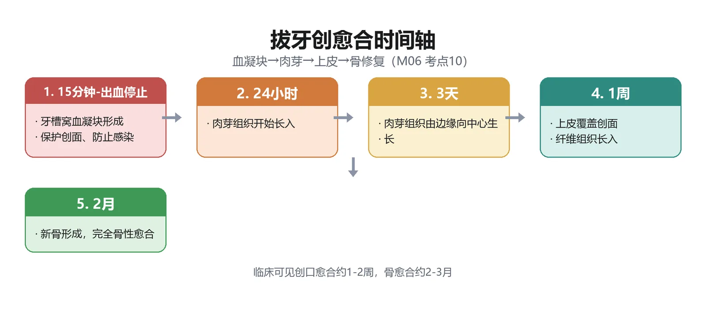

> [!WARNING] 陷阱
> ①「扭转只适用于上颌前牙（圆锥形根）」；上颌前磨牙、磨牙禁旋转力；②乳牙拔除不搔刮牙槽窝；③断根&lt;5mm、根周无炎症、取出困难可留槽内观察（原则应立即取出）。

### 📊 对比速查

<b>局麻方法对比</b>：

| 项目 | 表面麻醉 | 浸润麻醉 | 阻滞麻醉 |
|------|---------|---------|---------|
| 作用层次 | 末梢神经（黏膜表面） | 神经末梢（组织内） | 神经干/分支周围 |
| 药量/范围 | 少、局限 | 中、局部 | <b>少、范围广、作用深</b> |
| 适应证 | 表浅脓肿切开、松动牙、咽部检查 | 软组织与牙槽突手术 | 拔牙（尤其下颌）、感染远离病灶 |
| 代表 | 1% 丁卡因、2%～4% 利多卡因 | 骨膜上浸润、牙周膜注射 | 下牙槽神经阻滞等 |

### 🔗 因果链流程图（D2）

```text
【拔牙后疼痛/出血并发症 → 鉴别与处理】因果链

拔牙操作(分离牙龈→挺松→安放牙钳→摇动/扭转/牵引→拔牙创处理)
│
├─ 血凝块形成(15分钟) ★ 保护创口防感染
│   ├─ 血凝块脱落(舔吸/漱口/过热食) ──► 牙槽窝空虚
│   │       ├─ 第2天出血 ──► 继发性出血 ──► 清血凝块→冲洗→填塞(明胶海绵/碘仿纱条)
│   │       └─ 2-3天后剧痛+空槽+恶臭 ──► 干槽症 ★
│   │               └─ 治疗：3%过氧化氢清洗→碘仿纱条填塞(8-10天取出)
│   └─ 血凝块正常机化
│       ├─ 7天 ──► 肉芽组织形成
│       ├─ 1-2个月 ──► 牙槽窝变平 ──► 义齿修复时机(2个月) ★
│       └─ 3-6个月 ──► 正常骨结构
│
├─ 断根 ──► 取根(根钳/根挺/翻瓣去骨) ──► 推入上颌窦? ──► 鼻腔鼓气测试
│       └─ 穿孔<0.2cm → 自然愈合(避免鼓气/吸管) ; 未愈合 → 半年修补
│
└─ 邻牙/骨板损伤 ──► 复位缝合/取出游离骨片
```

★ 临床关键转折点：血凝块「在则愈合、脱则干槽」；2～3 天剧痛是干槽症报警线。

### 🌳 鉴别诊断决策树（D4）

<b>拔牙禁忌评估与术后疼痛鉴别树</b>：

```text
拔牙前评估
│
├─ 全身状况
│   ├─ 急性白血病/再障 ──► 避免拔牙
│   ├─ 血红蛋白≤80g/L ──► 治疗后再拔
│   ├─ 血压>160/100、近期心梗、心功能Ⅲ-Ⅳ ──► 暂缓
│   ├─ 空腹血糖≥8.88mmol/L、甲亢BMR≥+20%或脉率>100 ──► 控制后拔
│   ├─ 妊娠前3/后3个月 ──► 延期(4-6月可拔)
│   ├─ 放疗中或放疗后3-5年内 ──► 慎重拔牙
│   └─ 抗凝治疗 ──► 不主张停药，局部止血
│
└─ 拔牙后疼痛
    ├─ 麻醉过后疼痛、2-3天渐消 ──► 正常创伤反应
    ├─ 2-3天后剧痛+放射耳颞部+空槽恶臭 ──► 干槽症 ★(双氧水+碘仿纱条)
    ├─ 第2天红肿热痛+开口受限 ──► 急性感染(抗生素)
    ├─ 经久不愈小创口+脓液 ──► 慢性感染(清创去异物)
    └─ 大量出血不止 ──► 拔牙后出血(原发/继发→填塞止血)
```

### ⚠️ 常见陷阱

1. <b>局麻药类别记混</b>：丁卡因（酯类、毒性大）只能表面麻醉；普鲁卡因易过敏已少用；利多卡因是酰胺类最常用。
2. <b>布比卡因</b>：作用强 3～4 倍、维持 6 小时以上——「长效」不是「速效」。
3. <b>下牙槽神经阻滞</b>：翼下颌皱襞中点外侧 0.3～0.4cm 或颊脂垫尖；下唇麻木是成功标志；回抽无血再注射。
4. <b>上牙槽后神经麻醉范围</b>：不含上颌第一磨牙近中颊根（由上牙槽中神经支配，需补充颊侧浸润）。
5. <b>晕厥 vs 中毒 vs 过敏</b>：晕厥头低位吸氧；过敏严重注射肾上腺素；中毒立即停止注射、对症抢救。
6. <b>暂时性面瘫</b>：麻药注入腮腺（针越过下颌切迹），眼睑不能闭合口角下垂，可自行恢复。
7. <b>血肿</b>：上牙槽后神经阻滞刺破翼静脉丛——压迫止血冷敷、48 小时后热敷。
8. <b>拔牙禁忌数值</b>：Hb&gt;80g/L、血压≤140/90（至少 160/100）、血糖&lt;8.88mmol/L、甲亢脉率≤100——四个数记住。
9. <b>扭转力只用于上颌前牙</b>（圆锥形根）；上颌前磨牙、磨牙禁旋转力；乳牙拔后不搔刮牙槽窝。
10. <b>干槽症</b>：2～3 天剧痛放射＋空槽＋恶臭，好发下颌阻生第三磨牙；治疗 3% 过氧化氢＋碘仿纱条。
11. <b>断根处理</b>：原则立即取出；≤5mm 无炎症取出困难可留；上颌后牙取根勿垂直加力（防推入上颌窦）。

### 💡 记忆口诀

1. <b>局麻药</b>：「丁卡表面毒性大，利多卡因最常用，布比长效六小时，阿替起效四岁上」。
2. <b>下牙槽神经</b>：「翼下颌皱襞外侧 0.4，颊脂垫尖 45 度，两厘米到神经沟，下唇麻木成功了」。
3. <b>局麻并发症</b>：「晕厥头低给吸氧，过敏严重用肾上腺素，中毒回抽慢注射」。
4. <b>拔牙三力</b>：「摇动扁根多根牙，扭转只给上前牙，牵引最后向小阻」。
5. <b>禁忌数值</b>：「八十血红一百六压，八点八八血糖下，甲亢脉率一百内，孕前三后三莫拔」。
6. <b>干槽症</b>：「二三天后剧痛来，空槽恶臭探骨面；双氧水洗碘仿填」。
7. <b>愈合时间</b>：「十五分钟血凝块，七天肉芽两月平，三月半年骨成形，两月之后好修复」。

### 📌 本章小结

> [!INFO] 本章小结
> 模块6 由麻醉与拔牙两大外科基础组成：麻醉部分掌握「酰胺类主流、阻滞麻醉关键、晕厥过敏中毒鉴别」；拔牙部分掌握「适应证相对、禁忌证数值、三力应用、阻生牙阻力分析、干槽症诊治」。局麻与拔牙互为前提——麻醉成功是拔牙顺利的第一步，下牙槽神经阻滞是下颌后牙（含阻生第三磨牙）的核心技术。
>
> <b>🧬 本章核心洞察</b>：麻醉与拔牙的本质都是「风险评估＋解剖掌控」——阻滞麻醉考的是三叉神经解剖（模块1），拔牙考的是牙根形态与全身状况；把「数值边界（血压/血糖/脉率/血红蛋白）＋解剖边界（翼静脉丛、上颌窦、下颌管）＋时间边界（孕 4-6 月、放疗前 7-10 天、拔后 2-3 天干槽症报警线）」三条边界刻进脑子，即可覆盖本章绝大多数考点。

### 🔗 深度链接

- 三叉神经分支与牙根形态（麻醉与拔牙的解剖基础） → <b>模块1 口腔颌面解剖生理与口腔检查</b>
- 急性牙髓炎应急开髓（局麻应用场景） → <b>模块2 牙体牙髓病</b>
- 下颌第三磨牙冠周炎与间隙感染（阻生牙并发症的延伸） → <b>模块7 口腔颌面部感染</b>

---

## 模块7：口腔颌面部感染与损伤

> [!INFO] 模块信息
> <b>重点等级</b>：🔴掌握 9 个（感染特点与危险三角区、智牙冠周炎、间隙感染与切开引流、口底蜂窝织炎与各间隙感染、损伤特点与急救总则、窒息急救、止血方法、上下颌骨骨折与 Le Fort 分型、骨折复位固定）｜🟡熟悉 1 个（软组织损伤处理）｜🟢了解 0 个
> <b>预计题型</b>：A1（分类/数值/指征）、A2（创伤急救病例）、B1（间隙-感染来源配伍）
> <b>关联模块</b>：模块1（面神经、三叉神经与颌面解剖）、模块2（根尖周炎是牙源性感染源头）、模块6（阻生牙与拔牙禁忌、麻醉并发症）
> <b>谱系位置</b>：第14-15周讲授章节——感染与损伤是口腔外科两大急症主题，期末外科部分核心
> <b>预计阅读</b>：约 70 分钟

---

### 🧩 前置知识检查

> [!NOTE] 前置知识
> ①颌面解剖：咬肌/翼内肌/翼外肌、下颌骨薄弱部位、面部静脉与海绵窦（模块1）；②根尖周炎与阻生牙（模块2、6）；③拔牙禁忌证（模块6）与放疗史（放疗后 3～5 年慎拔牙呼应放射性骨髓炎）；④急救基本知识（ABC、气管切开、破伤风预防）。

### 🎯 高收益摘要

> [!SUCCESS] 本模块核心
> 1. <b>牙源性感染占口腔颌面部感染绝大多数</b>；「危险三角区」（鼻根至两侧口角连线）感染可循面静脉→海绵窦引起血栓性静脉炎。
> 2. <b>智牙冠周炎</b>：18～25 岁，盲袋＋食物残渣，跳痛放射耳颞区、开口受限；急性期 3% 过氧化氢＋生理盐水冲洗、脓肿切开引流，慢性期去病因（龈瓣切除或拔牙）。
> 3. <b>间隙感染</b>：蜂窝织炎（弥散期）vs 脓肿（局限期）；切开引流 6 指征（牙源性 3～4 天/淋巴源性 5～7 天高热不退、肿胀跳痛、波动感或穿刺脓液、影像脓腔、腐败坏死性早期广泛切开、引流不畅）；口底蜂窝织炎防窒息（T 形切口）。
> 4. <b>颌面损伤特点</b>：血供丰富（48 小时清创后仍可初期缝合）、腔窦多易感染、<b>咬合错乱是颌骨骨折的重要诊断依据</b>、易窒息、常合并颅脑损伤。
> 5. <b>窒息急救</b>：阻塞性（异物/组织移位/气道狭窄/活瓣样）vs 吸入性；舌后坠牵舌固定、上颌骨折托起、环甲膜穿刺、气管切开。
> 6. <b>Le Fort 三型</b>：Ⅰ低位水平（梨状孔下缘根尖下）、Ⅱ中位锥形（鼻骨泪骨眶底）、Ⅲ高位颅面分离；下颌骨好发：正中联合、颏孔区、下颌角、髁突颈部。
> 7. <b>颌骨骨折复位固定</b>：上颌 2 周内、下颌 3 周内；上颌固定 3～4 周、下颌 4～6 周；坚固内固定最常用（上颌微型钛板 0.4～0.6mm、下颌小型钛板 1.0mm）。

### 📋 结构化笔记

#### 🔴 考点 1：口腔颌面部感染的特点

<b>定义</b>：口腔颌面部感染是致病微生物入侵引起软硬组织局部乃至全身的病理反应过程；<b>牙源性感染占绝大多数</b>；致病菌以金黄色葡萄球菌和溶血性链球菌为主，与腔窦相通的感染多为需氧菌与厌氧菌的混合感染。（教材P179-180）

💡<b>为什么重要</b>：感染五大特点中的「危险三角区」与「牙源性」是 A1 必考。

🧬 第一性原理：五个解剖特点决定感染的特殊性：①口腔鼻腔鼻窦与外界相通、细菌常驻；②<b>牙源性感染是口腔颌面部独有的感染</b>（龋病牙髓炎牙周病经根尖与牙周组织向颌骨及颌周蔓延）；③颌面部潜在间隙多、相邻间隙连接薄弱，感染易迅速扩散（可沿颈部间隙下行至纵隔→纵隔脓肿致死）；④血循环丰富＋面部静脉<b>瓣膜稀少或缺如</b>，内眦静脉和翼静脉丛直接与海绵窦相通——<b>从鼻根到两侧口角连线形成的三角区</b>（危险三角区）感染可致海绵窦血栓性静脉炎、脑膜炎、脑脓肿；⑤汗腺毛囊皮脂腺丰富，易经破损皮肤感染。感染性质多为化脓性；腐败坏死性感染偶见（厌氧菌）。

#### 🔬 展开：感染来源与菌群

感染来源：牙源性（最多）、腺源性（淋巴结炎）、血源性、损伤性；致病菌以金葡菌与溶血性链球菌为主，与腔窦相通者多为需氧菌与厌氧菌混合感染；全身抵抗力低下（糖尿病、放疗、免疫缺陷）者易发生腐败坏死性感染。

> [!WARNING] 陷阱
> ①「危险三角区＝鼻根至两侧口角连线」——上唇、鼻部感染最危险；②静脉瓣膜稀少→血液可逆流至颅内，故颜面部疖痈忌挤压；③牙源性为主——根尖周炎（模块2）是源头。

#### 🔴 考点 2：智牙冠周炎

<b>定义</b>：下颌第三磨牙冠周炎（智牙冠周炎）是发生在萌出不全或萌出受阻的第三磨牙牙冠周围软组织的炎症，常见于<b>18～25 岁青年</b>。（教材P180-181）

💡<b>为什么重要</b>：临床表现、并发症扩散途径与治疗是本章高频考点。

🧬 第一性原理：进化致下颌骨体部缩短→第三磨牙阻生→牙冠被龈瓣覆盖形成<b>盲袋</b>→食物残渣滞留、温湿度利于细菌繁殖→萌出压力及对颌咬伤致局部血供障碍→抵抗力下降时急性发作；<b>以垂直位软组织阻生最常见</b>。临床表现：早期磨牙后区不适，加重时自发性跳痛放射至耳颞区，炎症波及咀嚼肌出现<b>开口受限</b>，口腔清洁差口臭，全身不适发热；检查见牙冠周围红肿、探针触及牙冠、脓性分泌物或冠周脓肿。并发症＝感染向颌周间隙扩散的五条途径：①向前经外斜线在第一磨牙颊侧前庭沟形成脓肿（易误诊为第一磨牙根尖感染）；②向咬肌前缘与颊肌后缘之间→颊部脓肿；③沿下颌支外侧→<b>咬肌间隙脓肿或边缘性骨髓炎</b>；④沿下颌支内侧→<b>翼下颌间隙、咽旁间隙</b>；⑤向下颌体内侧→<b>下颌下间隙及口底蜂窝织炎</b>。

#### 🔬 展开：冠周炎治疗细节

急性期：3% 过氧化氢与生理盐水交替冲洗盲袋、全身抗生素（头孢＋甲硝唑）、冠周脓肿切开引流；慢性期：龈瓣盲袋切除或拔除病灶牙；并发面颊瘘者拔牙后多自行愈合；反复发作或低位阻生应尽早拔除。

> [!NOTE] 扩展
> 治疗：急性期抗炎镇痛、建立引流（3% 过氧化氢与生理盐水交替冲洗盲袋；冠周脓肿切开置橡皮条引流；波及间隙则作间隙切开引流）；慢性期去病因——龈瓣盲袋切除或拔除病灶牙；并发面颊瘘者拔牙后多能自行愈合。

> [!TIP] 记忆
> 冠周炎扩散五途径口诀：「前庭成瘘误诊磨牙，颊部脓肿咬肌缘，支外侧咬肌、支内侧翼咽，体侧下颌下口底」——中心词「前、颊、咬肌、翼咽、口底」。

#### 🔴 考点 3：颌面部间隙感染与切开引流

<b>定义</b>：颌面部间隙感染（颌周蜂窝织炎）是颌面和口咽区潜在间隙化脓性炎症的总称；弥散期为蜂窝织炎、局限期为脓肿；<b>最常见病因为牙源性</b>（冠周炎、根尖周炎、骨髓炎），其次为淋巴源性（腺源性，婴幼儿多见）；病原菌以溶血性链球菌为主。（教材P182-183）

💡<b>为什么重要</b>：切开引流六指征是本章数值考点核心；化脓性 vs 腐败坏死性的鉴别也是 A1 常考。

🧬 第一性原理：化脓性感染表现为红肿热痛功能障碍，脓液黄稠/桃花色；<b>腐败坏死性感染</b>软组织广泛水肿、<b>皮下气肿可触及捻发音</b>、脓液稀薄暗灰色恶臭，全身中毒重、体温白细胞可低于正常。治疗三原则：全身（头孢菌素类、青霉素、喹诺酮类，静脉足量足程；疑厌氧菌加硝基咪唑类；可短期用糖皮质激素）＋呼吸道管理（口底、咽旁感染易呼吸困难，早期广泛切开减压，必要时气管切开）＋局部（脓肿形成及时切开引流）。

<b>切开引流指征（6 条）</b>：①牙源性感染 3～4 天后或淋巴源性 5～7 天后，经抗生素治疗仍高热不退、白细胞及中性粒细胞明显增高；②局部肿胀、跳痛、压痛明显；③局部凹陷性水肿，有波动感或穿刺抽出脓液；④影像学证实已形成脓腔；⑤<b>腐败坏死性感染和肿胀范围广泛、局部张力大影响呼吸者，应早期广泛切开引流</b>；⑥脓肿已穿破但引流不畅。

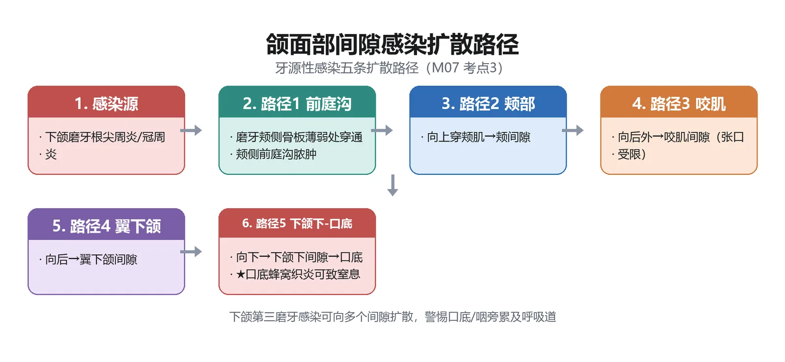

#### 🔬 展开：蜂窝织炎 vs 脓肿与引流原则

蜂窝织炎：弥散期，局部硬肿、凹陷性水肿、无波动；脓肿：局限期，有波动感或穿刺抽出脓液；深部间隙（咬肌、翼下颌）波动不可靠，需穿刺或 B 超定位；切开引流原则：低位、顺皮纹、避开重要神经血管，置引流条保持通畅。

> [!WARNING] 陷阱
> ①牙源性 3～4 天 / 淋巴源性 5～7 天——两组时间数值常考；②「波动感」只对浅层间隙可靠，深层间隙（咬肌间隙）即使脓肿形成也难扪及波动感，须靠穿刺；③腐败坏死性感染「体温和白细胞总数有时低于正常」——不是发热越高越重。

#### 🔴 考点 4：口底蜂窝织炎与各主要间隙感染

<b>定义</b>：口底蜂窝织炎是口底弥散性多间隙感染，包括<b>双侧下颌下、双侧舌下和颏下共 5 个间隙</b>；腐败坏死性口底蜂窝织炎称<b>路德维希咽峡炎（Ludwig angina）</b>，临床表现最严重。（教材P185）

💡<b>为什么重要</b>：「牛颈状」体征、窒息风险与 T 形切口是外科急症考点。

🧬 第一性原理：口底蜂窝织炎来源：下颌牙根尖周炎或冠周炎扩散、口咽部软组织损伤、扁桃体炎淋巴结炎扩散。化脓性：高热寒战，口底抬高、舌抬高舌尖夹于上下前牙间，影响语言吞咽；早期硬压痛、渐软可扪波动，<b>下颌下缘消失、颈部变粗呈牛颈状</b>。腐败坏死性：全身中毒重、体温不高、脉搏快弱血压下降（中毒性休克），局部坚硬如木板、触诊捻发感、口底舌抬高半开口，<b>累及舌根压迫会厌可致窒息</b>。治疗：防治窒息与中毒性休克（早期预防性气管切开）、大剂量抗生素＋激素＋输血、<b>尽早广泛切开引流（下颌角至对侧下颌角弧形切口＋颏部纵切口，呈「T」或「⊥」形）</b>。

<b>主要间隙感染速查</b>：

| 间隙 | 解剖位置 | 主要感染来源 | 特征性表现 | 切开引流要点 |
|------|---------|-------------|-----------|-------------|
| 眶下间隙 | 眼眶下方、上颌骨前壁与表情肌之间（含尖牙窝） | <b>上颌前牙与第一前磨牙根尖感染</b> | 眶下区红肿、眼睑水肿睁眼困难、鼻唇沟变浅 | 前庭沟底横行切口至骨面 |
| 咬肌间隙 | 咬肌与下颌支外侧骨板之间 | <b>下颌第三磨牙冠周炎</b> | 下颌角区红肿、<b>严重开口受限、无波动感</b>（咬肌肥厚）；瘘管探查粗涩→边缘性骨髓炎 | 下颌角下缘下 1.5～2cm 弧形切口，勿伤面神经下颌缘支 |
| 翼下颌间隙 | 翼内肌与下颌支内侧骨板之间（位置深） | 下颌第三磨牙根尖感染/冠周炎、<b>医源性（下牙槽神经阻滞麻醉）</b> | <b>首先表现为开口受限</b>、面部无肿胀、张口下颌偏向患侧 | 口内翼下颌皱襞外侧纵切口或口外下颌角入路 |
| 下颌下间隙 | 下颌下三角 | 下颌磨牙根尖感染、冠周炎（成人）；淋巴结炎（婴幼儿淋巴源性） | 下颌下区肿胀、凹陷性水肿，早期即有脓肿可扪及波动感 | 下颌下缘下 1.5～2cm 平行切口，保护面神经下颌缘支 |
| 口底蜂窝织炎 | 双侧下颌下+舌下+颏下 5 间隙 | 下颌牙根尖周炎、冠周炎、口咽损伤、淋巴结炎 | <b>舌抬高、牛颈状、捻发感（腐败坏死性）、窒息</b> | 「T」/「⊥」形广泛切开 |

> [!TIP] 记忆
> 「咬肌间隙无波动（咬肌厚），翼下颌间隙开口难（位置深），口底蜂窝牛颈状（五间隙）」——三个特征体征一句话记住。

#### 🔬 展开：窒息预防与切口设计

腐败坏死性口底蜂窝织炎（路德维希咽峡炎）应早期预防性气管切开；切开引流采用「T」形切口（下颌角至对侧下颌角弧形切口＋颏部纵切口）；大剂量抗生素＋糖皮质激素＋输血防治中毒性休克；咬肌间隙切口在下颌角下缘下 1.5～2cm，避开面神经下颌缘支。

#### 🔴 考点 5：口腔颌面部损伤的特点与急救总则

<b>定义</b>：口腔颌面部损伤常见（交通事故、工伤、运动损伤等）；救治遵循<b>功能与外形并重</b>原则；<b>抢救先于诊断</b>，首先抢救窒息、大出血及内脏破裂等危及生命的损伤。（教材P191-193）

💡<b>为什么重要</b>：损伤八大特点是诊断与处理原则的基础，A1 常考。

🧬 第一性原理：八个解剖特点→对应处理原则：①血供丰富抗感染强——<b>伤后 48 小时或更长时间无化脓感染仍可清创后初期缝合</b>，但出血多、肿胀早而明显（口底咽旁舌根可阻塞呼吸道致窒息）；②腔窦多——伤口常与腔窦相通易感染，清创应尽早关闭；③颌骨上有牙——骨折移位引起<b>咬合关系错乱（诊断颌骨骨折的重要依据）</b>，治疗以恢复正常咬合为主要标准，牙可作为固定基础；高速撞击中打折的牙与碎骨片成为「<b>二次弹片</b>」加重损伤；④消化道入口——注意营养与口腔卫生；⑤呼吸道入口——抢救首先保持呼吸道通畅防窒息；⑥鼻唇舌睑颊部开放伤处理不当致畸形——尽量保留可能存活组织、精确对位缝合；⑦腮腺（涎腺瘘）、面神经（面瘫）、三叉神经（麻木）；⑧紧邻颅脑——常合并颅脑损伤（颅骨骨折、脑震荡、脑挫裂伤、颅内血肿、颈椎骨折；颅底骨折可致<b>脑脊液鼻漏和耳漏</b>）。急救程序：先意识瞳孔生命体征→保持呼吸道通畅→止血→包扎→运送→防治感染（尽早清创、抗生素、泥土污染注射破伤风抗毒素）。

#### 🔬 展开：损伤特殊处理原则

伤后 48 小时无化脓仍可行初期缝合；咬合错乱是颌骨骨折诊断依据、治疗以恢复咬合为标准；高速损伤中打折的牙与碎骨片成为二次弹片；与腔窦相通的伤口尽早清创关闭；有脑脊液漏者禁鼻腔填塞与插管，预防颅内感染。

#### 🔴 考点 6：窒息的急救处理

<b>定义</b>：窒息分<b>阻塞性窒息</b>（异物阻塞、组织移位、气道狭窄、活瓣样阻塞）与<b>吸入性窒息</b>（昏迷伤员吸入血液、唾液、呕吐物或异物）。（教材P192-193）

💡<b>为什么重要</b>：窒息分类与逐类急救措施是急救核心考点。

🧬 第一性原理：阻塞性四亚型各有急救法：①异物阻塞（血凝块骨碎片牙碎片）→立即掏出或吸出堵塞物、侧卧或俯卧清除分泌物；②<b>组织移位</b>——下颌骨颏部粉碎性/双侧骨折时舌受降颌肌群（二腹肌、颏舌骨肌、下颌舌骨肌）牵拉向后下方移位压迫会厌（舌后坠）→撬开牙列、<b>用舌钳或巾钳牵舌向外</b>，在舌尖后 2cm 处用大圆针粗丝线穿过全层舌组织牵出固定于绷带或衣物；上颌骨开放性横断骨折向下后方移位堵塞咽腔→手法复位、就地取材用夹板木棍经上颌磨牙托起上颌骨并固定在头部绷带上；③气道狭窄（血肿、组织肿胀、吸入灼热气体致气管内壁水肿）→安置鼻咽导管/口咽导管，紧急时用粗针头由<b>环甲膜</b>刺入或环甲膜切开，条件具备再气管切开；④活瓣样阻塞→将下垂黏膜瓣缝回或剪掉。<b>吸入性窒息</b>→立即气管切开或气管内插管，迅速反复彻底吸出气管内分泌物。窒息前驱表现：烦躁不安、出汗、鼻翼扇动、吸气长于呼气、喉鸣；严重时口唇发绀、「<b>三凹」体征</b>（吸气时胸骨上窝、锁骨上窝、肋间隙深陷）。

> [!TIP] 记忆
> 「异物掏出、舌坠牵舌、上颌托起、狭窄置管（环甲膜穿刺）、活瓣缝回、吸入性气管切开」——六类阻塞一表清。

#### 🔬 展开：窒息分类与急救程序

阻塞性四亚型各有针对性处理（异物掏出、舌后坠牵舌固定、上颌骨折托起、气道狭窄置管/环甲膜穿刺、活瓣样缝回）；吸入性窒息需气管切开并反复吸出气管内分泌物；前驱表现：烦躁、出汗、鼻翼扇动、吸气长于呼气、喉鸣；急救遵循 ABC 程序、抢救先于诊断。

#### 🔴 考点 7：止血方法

<b>定义</b>：止血方法包括<b>压迫止血（指压、包扎、填塞）、结扎止血、药物止血</b>；动脉出血鲜红喷射、静脉出血暗红涌出。（教材P193-194）

💡<b>为什么重要</b>：三个指压部位与「颈总动脉压迫时限」是 A1 数值考点。

🧬 第一性原理：指压止血是紧急临时方法——<b>颞浅动脉（耳屏前压于颧弓根部）</b>减少头顶颞部出血；<b>面动脉（咬肌前缘压于下颌骨）</b>减少颜面部出血；<b>颈总动脉（胸锁乳突肌前缘与舌骨大角交界处稍下方压于第 6 颈椎横突）</b>减少头颈部大出血——<b>压迫时间一般不超过 5 分钟、禁止双侧同时压迫</b>（可致心动过缓、心律失常、脑缺血）。包扎止血适用于头皮颜面毛细血管和小动静出血；填塞止血用于有组织缺损和洞穿性创口者（颈部口底填塞注意防压迫气管窒息；鼻道出血无脑脊液漏时用油纱布/碘仿纱条填塞，效果不好加用鼻后孔止血法）；结扎止血效果确切（严重出血可结扎<b>颈外动脉</b>）。

#### 🔬 展开：止血细节

指压止血三部位：颞浅动脉（耳屏前压于颧弓根部）、面动脉（咬肌前缘压于下颌骨下缘）、颈总动脉（胸锁乳突肌前缘压于第 6 颈椎横突，不超过 5 分钟、禁双侧同时）；填塞止血：口底颈部防压迫气管、鼻道在排除脑脊液漏后用碘仿纱条；结扎止血：颌面部严重出血结扎颈外动脉。

> [!WARNING] 陷阱
> ①颈总动脉压迫「≤5 分钟、禁双侧同时」——数值必须记住；②鼻道填塞前须明确<b>无脑脊液漏</b>（有脑脊液漏时填塞可致颅内感染）；③结扎颈外动脉（不是颈内动脉）用于颌面部严重出血。

#### 🟡 考点 8：软组织损伤的处理

<b>定义</b>：软组织损伤分闭合性（擦伤、挫伤、蜇伤）与开放性（挫裂伤、刺伤、切割伤、撕裂伤、砍伤、咬伤、烧伤、火器伤）；颌面部血供丰富、愈合快，<b>早期缝合、一期缝合适应证更广</b>。（教材P197-199）

💡<b>为什么重要</b>：各型伤口特点与清创原则、特殊部位缝合要点是 A2 病例考点。

🧬 第一性原理：按「伤口形态→清创策略」记忆——擦伤（表皮破损、附沙砾，清洗防感染、多可暴露自愈）；挫伤（无开放伤口的软组织损伤、瘀斑血肿，<b>早期冷敷、3 天左右止血后热敷</b>，大血肿抽吸后加压包扎）；蜇伤（蜂蝎毒刺，镊子取刺＋5%～10% 氨水涂搽中和毒素）；挫裂伤（创缘不整齐、裂开较大，刮除坏死组织、修整创缘、减张缝合）；刺伤（小入口深盲管，彻底清创取异物、防继发感染，颈部大血管附近异物防继发出血）；切割伤（边缘整齐，<b>面神经分支或腮腺导管切断应尽早吻合</b>）；撕裂伤（组织撕裂撕脱，及时清创复位缝合，可吻合血管者即刻再植）；咬伤（创缘有咬痕，彻底清洗湿敷；眼睑耳鼻唇舌咬伤即使大部分游离也应尽量缝回原位；完全离体组织最大径&lt;2cm 时伤后 6 小时内可用庆大霉素稀释液浸泡 30 分钟再缝合；犬咬伤注射狂犬疫苗）；烧伤（头面部水肿严重 48 小时最明显；Ⅱ度暴露疗法；Ⅲ度待肉芽后刃厚皮片移植；固定头颈部仰伸位防颏颈挛缩）。

<b>特殊部位处理要点</b>：颊部（尽早关闭伤口防开口受限；贯通伤先缝黏膜消除口内外贯通）；唇部（<b>先缝口轮匝肌恢复连续性</b>，再按唇弓唇峰对位缝合；缺损大切忌强行拉拢）；舌部（<b>保持纵向长度</b>、大针粗线、进针距创缘 5mm 以上、多带深层组织褥式缝合；舌腹创面避免与口底牙龈粘连）；腭部（缺损致口鼻腔相通时转移邻近黏骨膜瓣关闭）；腮腺导管损伤（导管开口插入腰穿管吻合断端，保持 10 天左右；有缺损取静脉再造或结扎腺体侧）；面神经损伤（无张力吻合；有缺损取<b>耳大神经</b>移植）。

> [!WARNING] 陷阱
> ①舌部缝合「保持纵向长度、大针粗线、距创缘 5mm」——防功能障碍；②唇部先缝口轮匝肌；③咬伤完全离体组织再植条件：最大径&lt;2cm、无感染、伤后 6 小时内、庆大霉素浸泡 30 分钟；④火器伤清创切除坏死组织<b>不超过创缘外 5mm</b>（与普通创伤不同），伤后 2～3 天无感染再初期缝合。

#### 🔴 考点 9：上颌骨骨折（Le Fort 分类）与下颌骨骨折

<b>定义</b>：上颌骨骨折按 Le Fort 分为<b>Ⅰ型（低位/水平）、Ⅱ型（中位/锥形）、Ⅲ型（高位/颅面分离）</b>；下颌骨骨折好发部位为<b>正中联合、颏孔区、下颌角、髁突颈部</b>。（教材P202-205）

💡<b>为什么重要</b>：Le Fort 三型骨折线走行与下颌骨好发部位、移位机制是本章外科核心考点。

🧬 第一性原理：Le Fort Ⅰ型：骨折线从<b>梨状孔下缘经根尖下水平向后过颧牙槽嵴至上颌结节上方</b>（低位水平）；Ⅱ型：经<b>鼻骨、泪骨、眶底、颧上颌缝区</b>达翼上颌缝（中位锥形）；Ⅲ型：经鼻骨泪骨眶内外下壁、颧额缝颧颞缝向后下止于翼上颌缝，<b>完全性颅面分离</b>（高位）。上颌骨骨折临床表现：骨折段移位（翼内肌牵拉后份下移→后牙早接触、前牙开𬌗）、<b>眶周淤血「眼镜」症状</b>（眼睑水肿皮下淤血青紫）、复视（眶底下陷眼球移位）、颅脑损伤（脑脊液鼻漏耳漏——筛板骨折或颅前窝颅中窝骨折体征）。下颌骨骨折移位由<b>咀嚼肌牵拉</b>决定：颏部正中单发无明显错位、双发时颏舌肌颏舌骨肌牵拉骨折片向下后移位、粉碎性时下颌舌骨肌牵拉两侧段向中线移位（后两者均可致<b>舌后坠</b>）；颏孔区骨折——<b>短骨折段（附着升颌肌：咬肌翼内肌颞肌）向上向内移位，长骨折段（降颌肌群）向下向后移位</b>；下颌角骨折——骨折线位于咬肌翼内肌附着之内可不移位，之前则短段向上；髁突骨折——翼外肌牵拉髁突向前内移位，双侧低位骨折后牙早接触前牙开𬌗。

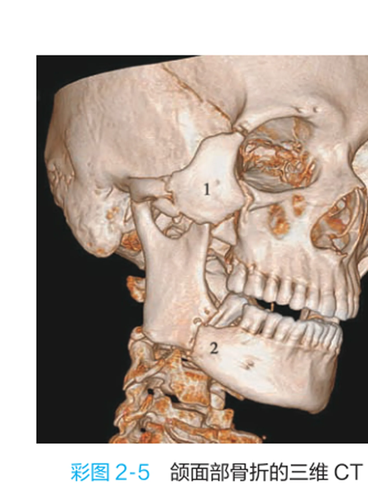

#### 🔬 展开：骨折移位机制

上颌骨：翼内肌牵拉骨折段向后下移位→后牙早接触、前牙开𬌗；下颌骨：颏孔区骨折短骨折段受升颌肌群牵拉向上向内、长骨折段受降颌肌群牵拉向下向后；髁突骨折受翼外肌牵拉向前内移位；咀嚼肌牵拉方向是判断移位与复位的基础。

> [!NOTE] 扩展
> 诊断依靠致伤原因＋临床表现＋影像（X 线平片、全景片、CBCT/CT 三维重建）；髁突骨折加拍颞下颌关节片；合并严重颅脑损伤忌过多搬动。

#### 🔴 考点 10：颌骨骨折的复位与固定

<b>定义</b>：治疗原则是<b>尽早复位和固定，恢复正常咬合与面型对称</b>；上颌骨骨折复位固定应争取<b>2 周内</b>、下颌骨<b>3 周内</b>（上颌血供丰富愈合快）；固定时间上颌 3～4 周、下颌 4～6 周。（教材P205-207）

💡<b>为什么重要</b>：复位固定方法谱系与时间数值是 A1 核心。

🧬 第一性原理：复位分手法复位与手术复位；固定分外固定与内固定。<b>牙间结扎固定</b>（操作简单、适用于伤情重出血严重者）；<b>单颌牙弓夹板固定</b>（最适用于牙折与牙槽突骨折）；<b>颌间固定</b>（最常用的外固定方法之一，以未骨折颌骨为基固定骨折颌骨、恢复咬合；方法：小环结扎（8 字结扎，适用新鲜易复位骨折）、带钩牙弓夹板颌间弹性牵引（恢复咬合最准确稳固、适用已纤维愈合者；昏迷者不宜）、正畸带钩托槽颌间固定、颌间牵引钉（作用点在颌骨上））；<b>切开复位坚固内固定</b>（目前最广泛：金属接骨板螺钉，上颌骨用<b>微型钛板 0.4～0.6mm</b>、下颌骨用<b>小型钛板 1.0mm</b>；术前术后配合颌间弹性牵引确立咬合）。髁突骨折：成角 &lt;30°、囊内骨折→闭合性颌间固定 2～3 周；成角&gt;45°、髁突头移位脱位、升支高度降低&gt;5mm、陈旧性→手术切开钛板坚固内固定；粉碎性复位困难可行髁突摘除；<b>处理后重视早期张口训练防关节强直</b>。儿童颌骨骨折：尽早复位（不超过 1 周）、咬合恢复不必严格（恒牙萌出可自行调整）、尽可能保守、避免损伤恒牙胚。

#### 🔬 展开：固定方法细节

颌间固定：小环结扎（8 字结扎）、带钩牙弓夹板弹性牵引（恢复咬合最准确）、颌间牵引钉；坚固内固定：上颌用微型钛板 0.4～0.6mm、下颌用小型钛板 1.0mm；髁突骨折成角＜30°闭合性固定 2～3 周、＞45°或移位者手术；儿童骨折 1 周内复位、尽量保守并保护恒牙胚。

> [!WARNING] 陷阱
> ①上颌 2 周/下颌 3 周复位、上颌 3～4 周/下颌 4～6 周固定——两对时间常考；②微型钛板（0.4～0.6mm）用于上颌、小型钛板（1.0mm）用于下颌；③髁突骨折成角阈值：闭合性 &lt;30°、手术 &gt;45°；④儿童骨折「咬合不必严格恢复」——与成人原则不同。

### 📊 对比速查

<b>化脓性 vs 腐败坏死性感染</b>：

| 项目 | 化脓性感染 | 腐败坏死性感染 |
|------|-----------|---------------|
| 局部表现 | 红、肿、热、痛、功能障碍 | 广泛水肿、<b>皮下气肿捻发音</b> |
| 脓液 | 黄色稠脓或桃花色 | 稀薄、暗灰色、<b>恶臭</b> |
| 全身 | 高热寒战、白细胞升高 | 中毒重、<b>体温白细胞可低于正常</b>、休克 |
| 病原 | 金葡菌、溶血性链球菌为主 | 厌氧菌（混合） |

<b>上颌骨 Le Fort 三型</b>：

| 分型 | 名称 | 骨折线走行 | 临床要点 |
|------|------|-----------|---------|
| Ⅰ型 | 低位/水平 | 梨状孔下缘→根尖下→颧牙槽嵴→上颌结节上方 | 硬腭中缝可裂开 |
| Ⅱ型 | 中位/锥形 | 鼻骨→泪骨→眶底→颧上颌缝→翼上颌缝 | 锥形骨折 |
| Ⅲ型 | 高位/颅面分离 | 鼻骨泪骨→眶内外下壁→颧额缝颧颞缝→翼上颌缝 | <b>完全颅面分离</b>、复视 |

### 🔗 因果链流程图（D2）

```text
【牙源性感染 → 间隙扩散 → 全身危象】因果链

龋病/牙髓炎/牙周病(模块2/3)
│
▼
根尖周炎 / 智牙冠周炎(盲袋)
│
▼
脓液穿破骨皮质 ──► 颌周潜在间隙感染(蜂窝织炎→脓肿)
│
├─ 向前 ──► 第一磨牙颊侧前庭沟脓肿(易误诊)
├─ 颊侧 ──► 颊部脓肿 ──► 经久不愈瘘管
├─ 下颌支外侧 ──► 咬肌间隙脓肿 ──► 边缘性骨髓炎
├─ 下颌支内侧 ──► 翼下颌/咽旁间隙
└─ 下颌体内侧 ──► 下颌下间隙 ──► 口底蜂窝织炎 ★(5间隙/牛颈状/窒息)
        │
        ▼
切开引流(6指征: 3-4天/5-7天+肿胀跳痛+波动/穿刺脓液...)
        │
        ▼
面静脉(危险三角区) ──► 海绵窦血栓性静脉炎 ★(感染忌挤压)
```

★ 临床关键转折点：冠周炎/根尖周炎→间隙感染→口底蜂窝织炎（窒息）与危险三角区→海绵窦是两条致死性传播路径。

### 🌳 鉴别诊断决策树（D4）

<b>颌面部创伤急救优先树</b>：

```text
颌面部创伤伤员
│
├─ 1. 呼吸道(窒息?) ★ 抢救先于诊断
│   ├─ 异物阻塞 ──► 掏出/吸出
│   ├─ 舌后坠 ──► 牵舌固定(粗丝线穿舌)
│   ├─ 上颌骨折下坠 ──► 手法复位托起固定
│   ├─ 口底肿胀狭窄 ──► 置通气管/环甲膜穿刺→气管切开
│   ├─ 活瓣样阻塞 ──► 缝回/剪除黏膜瓣
│   └─ 吸入性 ──► 气管切开+吸出
│
├─ 2. 出血?
│   ├─ 动脉喷射 ──► 指压(颞浅/面动脉/颈总动脉≤5min)→结扎
│   ├─ 静脉/毛细血管 ──► 包扎/填塞
│   └─ 鼻出血 ──► 无脑脊液漏时碘仿纱条填塞
│
├─ 3. 全身评估(意识/瞳孔/生命体征)
│   ├─ 颅脑损伤? ──► 脑脊液鼻漏耳漏 → 禁鼻腔插管/填塞
│   └─ 颈椎损伤? ──► 搬运制动,插管防颈髓损伤
│
├─ 4. 清创缝合
│   ├─ 48小时内无化脓 ──► 初期缝合
│
└─ 5. 防治感染 ──► 抗生素+破伤风抗毒素(泥土污染)
```

### ⚠️ 常见陷阱

1. <b>危险三角区</b>＝鼻根至两侧口角连线；面静脉瓣膜稀少→感染逆流入海绵窦→血栓性静脉炎。
2. <b>冠周炎扩散途径</b>：咬肌间隙（支外侧）、翼下颌/咽旁（支内侧）、口底（体侧）——方向别记反。
3. <b>切开引流时间</b>：牙源性 3～4 天、淋巴源性 5～7 天；腐败坏死性感染「早期广泛切开」。
4. <b>咬肌间隙无波动感</b>（咬肌肥厚）——须靠穿刺；勿伤面神经下颌缘支。
5. <b>口底蜂窝织炎</b>：5 间隙（双侧下颌下＋双侧舌下＋颏下）、牛颈状、窒息；T 形切口。
6. <b>损伤特点</b>：48 小时无化脓仍可初期缝合；咬合错乱是颌骨骨折诊断依据；二次弹片。
7. <b>窒息</b>：三凹体征（胸骨上窝、锁骨上窝、肋间隙）；舌后坠牵舌；环甲膜穿刺；吸入性气管切开。
8. <b>止血</b>：颈总动脉压迫 ≤5 分钟、禁双侧同时；鼻道填塞前排除脑脊液漏。
9. <b>Le Fort 三型</b>：Ⅰ低位、Ⅱ中位锥形、Ⅲ颅面分离——骨折线走行别混。
10. <b>颌骨骨折时间</b>：复位上颌 2 周/下颌 3 周；固定上颌 3～4 周/下颌 4～6 周；儿童复位 ≤1 周。

### 💡 记忆口诀

1. <b>感染特点</b>：「牙源性为主，腔窦相通，间隙易扩，血循丰富危险三角，皮脂腺多」。
2. <b>冠周炎</b>：「盲袋食物残渣，18-25 跳痛开口难；双氧水洗、脓肿切、慢性去因拔牙完」。
3. <b>切开引流指征</b>：「3-4 牙源 5-7 淋，热不退来肿跳痛；波动穿刺影像脓，腐败坏死早切开」。
4. <b>口底蜂窝</b>：「五间隙牛颈状，舌抬窒息防，T 形切口早引流」。
5. <b>损伤特点</b>：「血供抗感染强，腔窦易感染，咬合错乱查骨折，窒息颅脑须先防」。
6. <b>窒息</b>：「异物掏、舌坠牵、上颌托、狭窄刺（环甲膜）、活瓣缝、吸入切」。
7. <b>Le Fort</b>：「Ⅰ梨状孔根尖下，Ⅱ鼻泪眶底锥形走，Ⅲ颅面分离最凶险」。
8. <b>骨折时间</b>：「上二下三复位早，上三下四固定牢」。

### 📌 本章小结

> [!INFO] 本章小结
> 模块7 两大主题：感染与损伤。感染线「牙源性→间隙→全身危象」——掌握冠周炎、五大间隙（重点咬肌/翼下颌/口底）、切开引流六指征与危险三角区防颅内感染；损伤线「急救（窒息→止血→包扎→运送→防感染）→软组织清创→牙与颌骨骨折」——掌握窒息六类急救、指压止血三部位、Le Fort 三型、下颌骨骨折好发部位与移位机制、复位固定时间。
>
> <b>🧬 本章核心洞察</b>：感染与损伤共同的底层逻辑是「解剖决定病理」——间隙解剖决定感染扩散方向（模块1 咬肌翼内外肌与面静脉），薄弱骨区与咀嚼肌牵拉决定骨折类型与移位；急救的核心是「呼吸道优先＋抢救先于诊断」。把「危险三角区、口底蜂窝织炎、干槽症（模块6）、Le Fort 三型」这条外科主线串起来，即覆盖本章全部考点。

### 🔗 深度链接

- 咬肌/翼内肌翼外肌、面静脉与海绵窦、三叉神经（间隙与骨折的解剖基础） → <b>模块1 口腔颌面解剖生理与口腔检查</b>
- 根尖周炎是牙源性感染源头 → <b>模块2 牙体牙髓病</b>
- 阻生牙拔除与放疗后拔牙禁忌 → <b>模块6 口腔临床麻醉与牙拔除术</b>
- 涎腺肿瘤切除与面神经保护（损伤修复的延伸） → <b>模块8 唾液腺常见疾病</b>

---

## 模块8：唾液腺常见疾病

> [!INFO] 模块信息
> <b>重点等级</b>：🔴掌握 6 个（急性化脓性腮腺炎、慢性复发性与慢性阻塞性腮腺炎、唾液腺结石病、舍格伦综合征、涎腺良性肿瘤、涎腺恶性肿瘤）｜🟡熟悉 2 个（黏液囊肿与舌下腺囊肿、涎腺造影特征对比）｜🟢了解 0 个
> <b>预计题型</b>：A1（病因/造影特征/百分比数值）、A2（腮腺肿胀病例）、B1（肿瘤-特征配伍）
> <b>关联模块</b>：模块1（腮腺导管、面神经与解剖）、模块4（黏膜病与癌前病变）、模块7（感染与损伤的修复重建）
> <b>谱系位置</b>：第15周讲授章节——第16章涎腺疾病为讲授重点（期末外科部分必考）；第17章口腔颌面部肿瘤未讲授，本模块仅保留涎腺肿瘤
> <b>预计阅读</b>：约 40 分钟

---

### 🧩 前置知识检查

> [!NOTE] 前置知识
> ①腮腺解剖：腮腺导管开口（正对上颌第二磨牙颊黏膜）、面神经穿行腮腺（模块1）；②危险三角区与感染扩散（模块7）；③口腔黏膜白斑等癌前病变（模块4）；④拔牙禁忌与放疗后处理（模块6、7）。

### 🎯 高收益摘要

> [!SUCCESS] 本模块核心
> 1. <b>涎腺炎症以腮腺最常见</b>（其次下颌下腺，舌下腺及小涎腺极少见）；急性化脓性腮腺炎病原菌以<b>金黄色葡萄球菌</b>为主，核心机制是<b>脱水→唾液分泌减少→导管逆行性感染</b>（术后腮腺炎）。
> 2. <b>慢性复发性腮腺炎</b>（儿童 5 岁左右最常见，末梢导管点状/球状扩张，青春期后自愈）vs <b>慢性阻塞性腮腺炎</b>（导管口狭窄/结石阻塞，腊肠样改变，进食综合征）——造影特征是鉴别关键。
> 3. <b>唾液腺结石病 85% 发生于下颌下腺</b>（黏蛋白黏滞＋钙含量高＋导管逆重力走行）；进食时肿胀疼痛、停食后复原；已确诊不作造影（防结石被推向后方）。
> 4. <b>舍格伦综合征</b>（干燥综合征）：自身免疫病，中年以上女性，口干眼干＋涎腺泪腺肿大＋结缔组织病；抗 SS-A/SS-B 抗体、唇腺活检确诊；对症治疗。
> 5. <b>涎腺肿瘤良性占 75%</b>（多形性腺瘤、沃辛瘤最常见）；<b>多形性腺瘤是交界性肿瘤</b>（包膜不完整、剜除易种植复发、可恶变）；沃辛瘤 99mTc「热结节」。
> 6. <b>涎腺恶性肿瘤 25%</b>（黏液表皮样癌、腺样囊性癌最常见）；腺样囊性癌易沿神经扩散、<b>血行转移率高达 40%（肺最多）</b>，颈淋巴结转移率低。
### 📋 结构化笔记

#### 🔴 考点 1：急性化脓性腮腺炎

<b>定义</b>：急性化脓性腮腺炎以往常见于腹部大手术后（称<b>手术后腮腺炎</b>），病原菌以<b>金黄色葡萄球菌</b>为主，其次为链球菌；多系慢性腮腺炎急性发作或邻近组织炎症扩散。（教材P210-211）

💡<b>为什么重要</b>：病因机制（逆行性感染）、临床表现特征与切开引流指征是本章 A1 高频考点。

🧬 第一性原理：严重全身疾病/腹部大手术→禁食脱水、进食咀嚼减少→<b>唾液分泌减少、机械性冲洗作用降低</b>→口腔致病菌经腮腺导管口<b>逆行侵入</b>。临床表现：常单侧受累；以耳垂为中心肿胀明显、<b>耳垂被上抬</b>；导管口红肿、轻按摩可见脓液溢出；由于腮腺咬肌筋膜致密且腮腺为多小叶结构，<b>脓肿多为散在多发性、未穿破前不易扪及波动感</b>（呈硬性浸润块）；全身中毒症状明显（体温可高达 40℃以上、白细胞增高核左移）。诊断：依靠病史与临床检查，<b>急性期不宜行腮腺造影</b>（对比剂可透过肿胀薄弱的导管壁外溢）。治疗：纠正脱水电解质紊乱＋大剂量青霉素或头孢菌素（抗革兰氏阳性球菌）＋保守治疗促分泌（酸性饮料、口含维生素C、口服<b>1% 毛果芸香碱</b>）＋切开引流（指征：明显凹陷性水肿＋跳痛及局限压痛点；穿刺抽出脓液或导管口排脓；全身中毒明显——耳屏至下颌角切口，向不同方向分离多小叶脓腔）。

#### 🔬 展开：腮腺炎治疗细节

纠正脱水与电解质紊乱、大剂量青霉素或头孢菌素；1% 毛果芸香碱口服或酸性饮料促唾液分泌；切开引流指征：凹陷性水肿＋跳痛及局限压痛、穿刺抽出脓液或导管口排脓、全身中毒明显——切口自耳屏前至下颌角，向不同方向分离各小叶脓腔；急性期禁行腮腺造影。

> [!NOTE] 扩展
> 鉴别诊断：<b>流行性腮腺炎</b>——儿童多见、有传染接触史、常双侧、一次感染终身免疫、<b>导管口无红肿、分泌清亮无脓</b>、血淋巴细胞增高、急性期血尿淀粉酶升高；<b>咬肌间隙感染</b>——牙源性（阻生智牙冠周炎）、肿胀中心及压痛点位于<b>下颌角部</b>、开口受限明显、导管口无红肿。

> [!WARNING] 陷阱
> ①金葡菌为主——不是溶血性链球菌（间隙感染是链球菌为主，别混）；②「耳垂上抬」是腮腺炎特征体征；③急性化脓性腮腺炎禁行腮腺造影；④切开引流需分开各腺小叶脓腔——多发性脓肿。

#### 🔴 考点 2：慢性复发性腮腺炎与慢性阻塞性腮腺炎

<b>定义</b>：慢性复发性腮腺炎可见于儿童和成人——<b>儿童以 5 岁左右最常见</b>（男性多于女性），为逆行性感染所致；成人型由儿童迁延而来。慢性阻塞性腮腺炎（腮腺管炎）多由局部原因（导管口狭窄、结石、异物）所致。（教材P212-213）

💡<b>为什么重要</b>：两病造影特征（末梢点状球状 vs 主导管腊肠样）是鉴别诊断核心，A1 必考。

🧬 第一性原理：复发性＝<b>末梢导管</b>病变——腮腺造影显示<b>末梢导管呈点状、球状扩张</b>，排空迟缓，主导管及腺内导管无明显异常；儿童大多青春期后自愈，治疗以增强抵抗力、防继发感染为主（多饮水、按摩腺体、嚼无糖口香糖），造影本身也有治疗作用。阻塞性＝<b>导管系统</b>病变——主导管、叶间、小叶间导管部分狭窄部分扩张，呈<b>腊肠样改变</b>；约半数患者肿胀与进食有关（进食综合征，mealtime syndrome），挤压可见「雪花样」或黏稠蛋清样唾液、黏液栓；治疗以去病因为主（去除结石、钝头探针扩张导管口、自后向前按摩、唾液腺镜冲洗灌注），无效者行<b>保留面神经的腮腺腺叶切除术</b>。

<b>两病鉴别</b>：

| 项目 | 慢性复发性腮腺炎 | 慢性阻塞性腮腺炎 |
|------|-----------------|-----------------|
| 发病 | 儿童（5 岁左右）或成人迁延 | 中年居多，单侧或双侧 |
| 病因 | 先天结构异常/免疫缺陷、逆行感染 | 导管口狭窄、结石、异物 |
| 与进食关系 | 不明显 | 约半数进食综合征 |
| 造影特征 | <b>末梢导管点状、球状扩张</b>，主导管正常 | <b>主导管及叶间小叶间导管腊肠样改变</b> |
| 转归 | 儿童青春期后自愈 | 去除病因后可愈，无效手术 |
| 需鉴别 | 流行性腮腺炎（儿童）、干燥综合征（成人） | 成人复发性腮腺炎、干燥综合征继发感染 |

#### 🔬 展开：两型治疗对比

慢性复发性：儿童增强抵抗力、多饮水、按摩腺体、嚼无糖口香糖、防继发感染，青春期多自愈（造影兼有治疗作用）；慢性阻塞性：去除结石、钝头探针扩张导管口、自后向前按摩、唾液腺镜冲洗，无效者行保留面神经的腮腺腺叶切除术。

> [!WARNING] 陷阱
> ①「点状球状＝末梢（复发性）」「腊肠样＝主导管系统（阻塞性）」——造影特征与病变部位对应；②成人复发性腮腺炎与干燥综合征鉴别：干燥综合征见于中年女性、有口干眼干及结缔组织病、主导管扩张不整呈<b>葱皮样或花边样</b>改变。

#### 🔴 考点 3：唾液腺结石病与下颌下腺炎

<b>定义</b>：唾液腺结石病是腺体或导管内发生钙化性团块引起的病变，<b>85% 左右发生于下颌下腺</b>（其次腮腺，舌下腺很少见），多见于 20～40 岁。（教材P213-214）

💡<b>为什么重要</b>：好发部位机制（三个解剖原因）与检查方法选择是 A1 核心。

🧬 第一性原理：下颌下腺好发结石的三个原因：①混合腺分泌唾液<b>富含黏蛋白、较黏滞</b>，钙含量高出 2 倍，钙盐易沉积；②下颌下腺管<b>自下向上走行</b>，分泌液逆重力方向流动；③导管长、口底后部有弯曲、全程曲折→唾液易淤滞。临床表现：<b>进食时腺体肿大胀痛、停止进食后自行复原</b>（阻塞严重者可持续数小时至数天）；导管口黏膜红肿、挤压可见脓性分泌物；双手触诊可扪及导管内硬块。检查：<b>下颌横断片</b>适用于导管前部结石、<b>下颌下腺侧位片</b>适用于导管后部及腺体内结石；超声和 CT 诊断率高；钙化程度低的<b>阴性结石 X 线平片难以显示</b>；<b>已确诊结石者一般不作唾液腺造影</b>（以免将结石推向导管后部或腺体内）。鉴别：舌下腺肿瘤（无导管阻塞症状、X 线无阳性结石）、下颌下腺肿瘤（进行性肿大、无进食肿胀发作史）、下颌下间隙感染（有牙病史可查及病源牙、肿胀硬性浸润）。治疗：小结石保守（口含枸橼酸棉签/维生素C 促分泌自行排出）；第二磨牙以前部位结石行口内导管切开取石；导管后部、腺门及部分腺内结石行<b>唾液腺内镜取石</b>；无效或腺体失去功能者行下颌下腺切除术。

#### 🔬 展开：结石治疗细节

小结石保守：口含枸橼酸棉签或维生素 C 促分泌自行排出；导管前部（第二磨牙以前）结石口内导管切开取石；导管后部、腺门及部分腺内结石行唾液腺内镜取石；无效或腺体失去功能行下颌下腺切除术；已确诊结石者一般不作造影（防结石被推向深部）。

> [!WARNING] 陷阱
> ①「85% 下颌下腺」+ 三个解剖原因——数据与机制常考；②已确诊结石禁做造影（与急性腮腺炎禁造影同理，防止病损加重）；③下颌横断片（前部）vs 侧位片（后部/腺内）——检查部位别记反。

#### 🔴 考点 4：舍格伦综合征（干燥综合征）

<b>定义</b>：舍格伦综合征是一种自身免疫性疾病，特征为<b>外分泌腺进行性破坏</b>导致黏膜及结膜干燥，伴各种自身免疫性病征；仅累及外分泌腺为原发性，伴类风湿关节炎等为继发性。（教材P214-215）

💡<b>为什么重要</b>：临床三联征（口干眼干＋腺体肿大＋结缔组织病）、诊断方法与治疗是本章常考点。

🧬 第一性原理：多见于<b>中年以上女性</b>；免疫细胞浸润攻击腺体→腺泡萎缩、唾液泪液分泌减少。临床表现：口干（口底唾液池消失、唇舌黏膜发红、言语咀嚼吞咽困难）、<b>涎腺肿大以腮腺最常见</b>（弥漫性肿大、边界不清；类肿瘤型可扪及结节）、<b>眼干</b>（干燥性角结膜炎：异物感烧灼感畏光；泪腺外侧肿大明显呈<b>三角眼</b>）；约半数伴类风湿关节炎、约 10% 伴系统性红斑狼疮。诊断：<b>希尔默试验</b>（泪液分泌降低）、荧光素染色、全唾液流率测定、核素功能测定、腮腺造影（末梢导管扩张、排空减退）、实验室（血沉加快、γ-球蛋白增高、IgG 明显增高、<b>抗 SS-A/SS-B 抗体</b>阳性）、<b>唇腺活检</b>（小叶内淋巴细胞浆细胞浸润、腺实质萎缩、导管扩张）——诊断金标准。治疗：对症为主——人工泪液（硅酮栓泪点封闭）、人工唾液、茴三硫等催唾剂；免疫调节剂胸腺素；伴结缔组织病或类肿瘤型用免疫抑制剂（羟氯喹、泼尼松）；类肿瘤型可手术切除受累腺体防恶变。

#### 🔬 展开：诊断与治疗

诊断：Schirmer 试验（泪液分泌降低）、荧光素染色、全唾液流率测定、腮腺造影末梢导管扩张排空减退、抗 SS-A/SS-B 抗体阳性、唇腺活检（小叶内淋巴细胞浆细胞浸润）为金标准；治疗：人工泪液与泪点封闭、人工唾液、茴三硫催唾、胸腺素免疫调节，类肿瘤型用羟氯喹/泼尼松或手术切除。

> [!WARNING] 陷阱
> ①「中年女性＋口干眼干＋腮腺肿大」三联征；②与成人复发性腮腺炎鉴别看造影：干燥综合征末梢点状球状扩张＋主导管不整（葱皮样/花边样）；③唇腺活检是重要诊断手段（而非必须切除整个涎腺）。

#### 🔴 考点 5：涎腺良性肿瘤——多形性腺瘤与沃辛瘤

<b>定义</b>：涎腺肿瘤中良性占 <b>75%</b> 左右，以<b>多形性腺瘤及沃辛瘤</b>最常见。（教材P216-217）

💡<b>为什么重要</b>：多形性腺瘤的「交界性肿瘤」特性与治疗原则是本章最重要的考点。

🧬 第一性原理：<b>多形性腺瘤（混合瘤）</b>：生物学特性不同于一般良性肿瘤——<b>包膜可能不完整</b>、包膜中可见瘤细胞，剜除术或术中破裂<b>极易种植性复发</b>，部分病例可恶变，故属「<b>交界性肿瘤</b>」。最常见于腮腺（其次下颌下腺，舌下腺极少见）；小涎腺以<b>腭部最常见</b>；30～50 岁、女性多于男性；生长缓慢、界限清楚、结节状可活动；<b>突然生长加速伴疼痛、面神经麻痹多为恶变</b>。诊断：B 超/CT/MRI；<b>大涎腺肿瘤不宜作切取活检</b>（致肿瘤细胞种植）。治疗：手术切除——<b>不能作单纯肿瘤摘除（剜除术），应在肿瘤外正常腺体组织内切除</b>；腮腺手术保留面神经。<b>沃辛瘤（腺淋巴瘤）</b>：多见于<b>男性 40～70 岁</b>，常有<b>吸烟史</b>，肿块<b>时大时小消长史</b>；绝大多数位于<b>腮腺后下极</b>；圆形卵圆形、表面光滑、质软有囊性感；常多发性（约 12% 双侧）；<b>99mTc 核素显像呈「热」结节</b>（摄取浓聚）具特征性；术后再出现肿瘤多为多发而非复发。治疗：连同肿瘤及周围 0.5cm 以上正常腮腺行<b>部分腮腺切除术</b>（保留腮腺导管及大部分功能），并切除后下极周围淋巴结。

#### 🔬 展开：治疗细节

多形性腺瘤：肿瘤外正常腺体组织内切除（不能剜除）、保留面神经；大涎腺不宜切取活检（种植风险）；术中破裂或残留包膜可致种植性复发。沃辛瘤：肿瘤连同周围 0.5cm 以上正常腮腺行部分腮腺切除术并切除后下极周围淋巴结；术后再出现肿瘤多为多发而非复发。

> [!WARNING] 陷阱
> ①多形性腺瘤＝交界性肿瘤；「剜除→种植复发」；②沃辛瘤＝男性＋吸烟＋消长史＋后下极＋热结节——五个特征一句话；③切取活检禁忌针对大涎腺（种植风险）。

#### 🔴 考点 6：涎腺恶性肿瘤——黏液表皮样癌与腺样囊性癌

<b>定义</b>：涎腺恶性肿瘤约占涎腺肿瘤 25%，以<b>黏液表皮样癌和腺样囊性癌</b>最常见。（教材P217-218）

💡<b>为什么重要</b>：腺样囊性癌「三高一低」（沿神经扩散、血行转移率高、侵袭性强、颈淋巴结转移率低）是高频考点。

🧬 第一性原理：<b>黏液表皮样癌</b>：分高分化与低分化——高分化（低度恶性）：无痛性肿块生长缓慢、边界可清、<b>面神经受累出现面瘫</b>、<b>颈淋巴结转移率低、血行转移少见</b>；治疗尽量保留面神经（除非神经穿入或紧密粘连），切除彻底可不加术后放疗，<b>不必作选择性颈淋巴清扫</b>。低分化（高度恶性）：生长快、有疼痛、边界不清粘连、<b>颈淋巴结转移率高、可血行转移</b>、术后易复发；宜加术后放疗＋<b>选择性颈淋巴清扫</b>。<b>腺样囊性癌（圆柱瘤）</b>：最常见于<b>腭部小涎腺及腮腺</b>；<b>发生于舌下腺的肿瘤多为腺样囊性癌</b>；<b>易沿神经扩散</b>（局部疼痛、面瘫、舌麻木或舌下神经麻痹）；侵袭性极强、与周围组织无界限；<b>易侵入血管，血行转移率高达 40%，转移部位以肺最多见</b>；<b>颈淋巴结转移率低</b>。治疗：手术切除——<b>扩大手术正常周界</b>，术中冷冻切片检查确定切缘；术后常配合放疗；术后可化疗减少血行转移。

#### 🔬 展开：治疗与预后

腺样囊性癌：扩大手术正常周界＋术中冷冻切片确定切缘，术后常规放疗，可加化疗降低血行转移；黏液表皮样癌高分化：切除彻底可不加放疗、不必选择性颈清；低分化：术后放疗＋选择性颈淋巴清扫。腺样囊性癌血行转移 40%（肺最多）、颈转移率低。

> [!NOTE] 扩展
> 记忆锚点：「腺样囊性癌——爱沿神经跑、爱往肺里跑（血行 40%）、不爱淋巴结跑」；「黏液表皮样癌——高分低恶（保留面神经、不颈清）、低分高恶（颈清＋放疗）」。

> [!WARNING] 陷阱
> ①腺样囊性癌「血行转移 40%（肺）＋颈转移低」——与鳞癌（颈转移为主）相反；②舌下腺肿瘤多为腺样囊性癌；③低分化黏液表皮样癌需选择性颈清。

#### 🟡 考点 7：黏液囊肿与舌下腺囊肿

<b>定义</b>：黏液囊肿是最常见的唾液腺瘤样病变；分<b>外渗性</b>（占 80% 以上，创伤致导管破裂黏液外渗，<b>无上皮衬里</b>）与<b>潴留性</b>（导管阻塞，<b>有上皮衬里</b>）两类。（教材P215-216）

💡<b>为什么重要</b>：分类机制与舌下腺囊肿三型是 A1 常考点。

🧬 第一性原理：黏液囊肿好发于<b>下唇及舌尖腹侧</b>——黏膜下浅蓝色半透明小泡、质软有弹性，咬伤破裂流出蛋清样透明黏液后消失、愈合后再形成。舌下腺囊肿常见于青少年，三型：①<b>单纯型</b>（占大多数，舌下区浅紫蓝色、扪之柔软有波动感，大者可将舌抬起状似「重舌」）；②<b>口外型（潜突型）</b>（下颌下区肿物、口底表现不明显、与皮肤无粘连不可压缩）；③<b>哑铃型</b>（口内舌下区＋口外下颌下区均见肿物）。鉴别：<b>口底皮样囊肿</b>（口底正中、面团样柔韧感无波动、表面颜色与黏膜相似非浅紫蓝）；<b>下颌下区囊性水瘤</b>（婴幼儿、内容稀薄淡黄清亮、涂片见淋巴细胞）。治疗：小涎腺黏液囊肿<b>手术完整切除（囊肿连同表面部分黏膜）</b>；舌下腺囊肿——<b>半数以上可自行消退</b>，小单纯型可先观察；长期不消退及口外型/哑铃型行<b>舌下腺切除术</b>（仅切除舌下腺即可，残留部分囊壁不复发）。

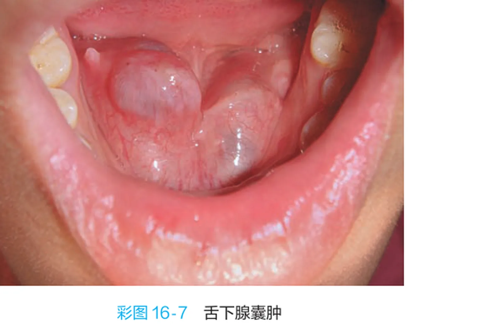

> [!WARNING] 陷阱
> ①外渗性无上皮衬里（80%以上）vs 潴留性有上皮衬里；②舌下腺囊肿治疗「只切舌下腺、不剥囊壁」；③与口底皮样囊肿鉴别看质地（面团样）与颜色（非浅紫蓝）。

#### 🟡 考点 8：涎腺造影特征对比速查

| 疾病 | 造影特征 | 鉴别要点 |
|------|---------|---------|
| 慢性复发性腮腺炎 | <b>末梢导管点状、球状扩张</b> | 主导管及腺内导管无明显异常 |
| 慢性阻塞性腮腺炎 | <b>主导管、叶间、小叶间导管腊肠样改变</b> | 导管系统狭窄与扩张并存 |
| 干燥综合征 | 末梢导管扩张、排空功能减退；主导管<b>葱皮样/花边样</b>改变 | 中年女性、口干眼干、结缔组织病 |
| 唾液腺结石病 | 结石处<b>圆形、卵圆形或梭形充盈缺损</b> | <b>已确诊者不作造影</b>（防结石后移） |
| 急性化脓性腮腺炎 | <b>禁行腮腺造影</b> | 对比剂可外溢至腺体外组织 |

### 📊 对比速查

<b>涎腺良性 vs 恶性肿瘤</b>：

| 项目 | 良性（75%） | 恶性（25%） |
|------|------------|------------|
| 最常见类型 | 多形性腺瘤、沃辛瘤 | 黏液表皮样癌、腺样囊性癌 |
| 生长 | 缓慢、多无自觉症状 | 较快、可有疼痛 |
| 边界/质地 | 界限清、可活动（多形性腺瘤结节状） | 界限不清、粘连（腺样囊性癌与周围无界限） |
| 神经 | 一般不受累（沃辛瘤在腮腺后下极） | 易侵犯面神经（面瘫）、腺样囊性癌沿神经扩散 |
| 转移 | 无 | 腺样囊性癌血行转移 40%（肺）；低分化黏液表皮样癌颈转移高 |
| 治疗 | 正常腺体内切除（不能剜除） | 扩大切除＋放疗±化疗；低分化加颈清 |

<b>多形性腺瘤 vs 沃辛瘤</b>：

| 项目 | 多形性腺瘤（混合瘤） | 沃辛瘤（腺淋巴瘤） |
|------|-------------------|-------------------|
| 人群 | 30～50 岁，女性多于男性 | 40～70 岁男性，常有吸烟史 |
| 部位 | 腮腺最多（其次下颌下腺）；小涎腺以腭部最多 | <b>腮腺后下极</b>，可双侧（约 12%）/多发 |
| 特性 | 交界性肿瘤：包膜不完整、种植复发、可恶变 | 消长史、囊性感 |
| 检查 | B 超/CT/MRI；大涎腺忌切取活检 | <b>99mTc 核素显像「热」结节</b> |
| 治疗 | 肿瘤外正常腺体组织内切除，保留面神经 | 肿瘤及周围 0.5cm 正常腮腺的部分腮腺切除 |

### 🔗 因果链流程图（D2）

```text
【唾液分泌减少 → 逆行感染 → 腮腺炎 → 并发症】因果链

脱水/禁食/大手术后(唾液分泌减少, 机械冲洗作用降低)
│
▼
口腔致病菌(金葡菌为主)经腮腺导管口逆行侵入
│
▼
急性化脓性腮腺炎(耳垂为中心肿胀/耳垂上抬/导管口溢脓)
│
├─ 未控制 ──► 腺体化脓坏死 ──► 多发性小叶脓肿
│       │                     └─ 腮腺咬肌筋膜致密 → 不易扪及波动感
│       ▼
│   切开引流(凹陷性水肿+跳痛+穿刺脓液+全身中毒)
│
├─ 慢性化 ──► 慢性复发性腮腺炎(末梢导管点状球状扩张)
│       └─ 儿童5岁最常见 ──► 青春期后自愈
│
└─ 导管因素 ──► 慢性阻塞性腮腺炎(导管口狭窄/结石)
        └─ 腊肠样改变/进食综合征 ──► 去病因(结石/扩张导管口)→无效手术

【涎腺导管阻塞 → 结石 → 炎症】因果链

下颌下腺(黏蛋白黏滞+钙高2倍+导管逆重力走行)
│
▼
导管阻塞 ──► 进食时腺体肿大胀痛 → 停食复原
│
▼
继发感染 ──► 慢性下颌下腺炎(硬结性肿块)
│
▼
炎症扩散 ──► 下颌下间隙感染(模块7)
```

### 🌳 鉴别诊断决策树（D4）

<b>涎腺肿大鉴别树</b>：

```text
涎腺肿大
│
├─ 急性发作?
│   ├─ 儿童+双侧+传染接触史+导管口无红肿 → 流行性腮腺炎(终身免疫)
│   ├─ 术后/脱水史+单侧+耳垂上抬+导管口溢脓 → 急性化脓性腮腺炎(禁造影)
│   └─ 下颌角肿胀+开口受限+牙源性 → 咬肌间隙感染(模块7)
│
├─ 反复肿胀?
│   ├─ 儿童(5岁)末梢导管点状球状扩张 → 慢性复发性腮腺炎(自愈)
│   ├─ 中年+进食相关+导管腊肠样改变 → 慢性阻塞性腮腺炎(去病因)
│   └─ 中年女性+口干眼干+结缔组织病+抗SS-A/SS-B(+) → 舍格伦综合征
│
├─ 进食肿胀+触石感?
│   ├─ 下颌下腺+进食胀痛+双手触诊硬块 → 唾液腺结石病(85%下颌下腺)
│   └─ 停食后不消+进行性肿大 → 下颌下腺肿瘤
│
└─ 无痛性肿块?
    ├─ 结节状+腮腺 → 多形性腺瘤(交界性,忌剜除)
    ├─ 男性吸烟+后下极+囊性+热结节 → 沃辛瘤
    ├─ 半透明浅蓝水疱(下唇/舌腹) → 黏液囊肿
    └─ 舌下区浅紫蓝波动(青少年) → 舌下腺囊肿(单纯/口外/哑铃)
```

### ⚠️ 常见陷阱

1. 急性化脓性腮腺炎病原菌<b>金葡菌为主</b>（间隙感染才是链球菌为主）。
2. 急性化脓性腮腺炎与结石病<b>均禁造影</b>——前者防对比剂外溢、后者防结石后移。
3. 复发性腮腺炎＝<b>末梢</b>导管点状球状扩张；阻塞性＝<b>主导管系统</b>腊肠样改变。
4. 唾液腺结石 <b>85% 下颌下腺</b>（黏蛋白黏滞＋钙高 2 倍＋逆重力走行三个解剖原因）。
5. 舍格伦综合征＝中年女性＋口干眼干＋涎腺肿大＋结缔组织病；抗 SS-A/SS-B 抗体。
6. 多形性腺瘤＝<b>交界性肿瘤</b>：忌剜除、忌切取活检（种植复发），肿瘤外正常腺体内切除。
7. 沃辛瘤五特征：男性＋吸烟＋消长史＋腮腺后下极＋99mTc 热结节。
8. 腺样囊性癌「三高一低」：沿神经扩散、侵袭性强、<b>血行转移 40%（肺）</b>、颈转移低；舌下腺肿瘤多为腺样囊性癌。
9. 癌前病损（白斑/红斑）≠癌前状态（黏膜下纤维性变等）；白斑癌变率 0.13%～17.5%。
10. 舌下腺囊肿治疗只切舌下腺（残留囊壁不复发）；小涎腺黏液囊肿完整切除。
11. 低分化黏液表皮样癌＝高度恶性（颈清＋放疗）；高分化＝低度恶性（保留面神经、不颈清）。

### 💡 记忆口诀

1. <b>涎腺组成</b>：「腮浆、颌下混合、舌下黏液」——腮腺浆液性、下颌下腺以浆为主混合、舌下腺以黏液为主。
2. <b>急性化脓性腮腺炎</b>：「术后脱水冲洗减，金葡逆行导管染；耳垂上抬脓溢口，急性禁造影、切开多小叶」。
3. <b>两种慢性腮腺炎</b>：「复发性末梢点点球，儿童自愈；阻塞性主导管腊肠，中年进食肿」。
4. <b>结石病</b>：「黏滞钙高逆重力，85% 下颌下；进食肿来停食消，前段横断后段侧位片」。
5. <b>舍格伦</b>：「中年女、口干眼干腺肿大，SS-A/SS-B 唇腺查，人工泪液催唾剂」。
6. <b>涎腺肿瘤</b>：「良性七五：多形沃辛；多形交界忌剜除，沃辛男烟后下极热结节；恶性二五：黏液表皮腺样囊，腺样囊性爱跑神经爱跑肺」。

### 📌 本章小结

> [!INFO] 本章小结
> 模块8 主线：涎腺疾病（讲授章节，重点掌握）——炎症（急性化脓性＝逆行性感染、慢性两型靠造影鉴别）、结石病（85% 下颌下腺）、舍格伦综合征（自身免疫三联征）、涎腺肿瘤（多形性腺瘤交界性、沃辛瘤热结节、腺样囊性癌三高一低）与黏液囊肿/舌下腺囊肿。
>
> <b>🧬 本章核心洞察</b>：涎腺疾病的底层逻辑是「分泌-排泄动力学」——唾液分泌减少致逆行感染、导管阻塞致淤滞结石，病变定位（末梢 vs 导管系统）决定造影特征与治疗；涎腺肿瘤的底层逻辑是「生物学特性决定治疗边界」——交界性肿瘤（多形性腺瘤）必须扩大切除防复发，恶性程度决定是否颈清、是否放疗。

### 🔗 深度链接

- 腮腺导管开口、面神经与涎腺解剖 → <b>模块1 口腔颌面解剖生理与口腔检查</b>
- 白斑（癌前病损）在黏膜病中监测癌变 → <b>模块4 口腔黏膜常见疾病</b>
- 放疗前拔牙准备（模块6 拔牙禁忌的延伸） → <b>模块7 口腔颌面部感染与损伤</b>
- 涎腺恶性肿瘤的扩大切除与颈清/放疗（外科主线） → <b>模块7 损伤的修复重建</b>

---

## 🗺️ 跨模块概念地图（D5）

> [!INFO] D5 用途
> 本图为全手册 7 个模块的「概念交通图」：沿牙源性主线、外科急症线、窗口学科线三条通路，把分散在模块内的考点串成一张网，用于考前 1 小时的总览与查漏。

### 通路一：牙源性感染主线（M02 → M03 → M07 → M08）

```text
龋病(M02) ──► 牙髓炎(M02) ──► 根尖周炎(M02)
                                  │
        ┌─────────────────────────┘
        ▼
  牙源性感染(M07)：智牙冠周炎 ──► 间隙感染(眶下/咬肌/翼下颌/下颌下/口底★)
        │                            └─► 口底蜂窝织炎(牛颈状/窒息/T形切口)
        ▼
  涎腺继发：急性化脓性腮腺炎(M08)
```

- <b>跨模块锚点 1</b>：根尖周炎是牙源性感染的「源头水库」——排脓途径直接决定间隙感染方向（模块2↔模块7）。
- <b>跨模块锚点 2</b>：放疗史贯穿「拔牙禁忌（放疗后 3-5 年慎拔，M06）→ 涎腺肿瘤放疗前处理（M08）」。

### 通路二：外科急症线（M06 → M07 → M08）

```text
局麻药(M06) ──► 阻滞麻醉 ──► 并发症(晕厥/过敏/中毒)
     │
     ▼
拔牙(M06)：适应证/禁忌证(数值) ──► 阻生牙(冠周炎·M07) ──► 并发症(干槽症/出血/上颌窦穿通)
     │
     ▼
损伤急救(M07)：窒息(六类) ──► 止血(指压/填塞/结扎) ──► 清创(48h初期缝合) ──► 骨折(LeFort/下颌骨)
     │

```

- <b>跨模块锚点 3</b>：面神经贯穿全科——模块1 五支走行 → 模块6 麻醉/切口避让（下颌缘支）→ 模块7 损伤吻合/移植（耳大神经）。

### 通路三：窗口学科线（M01 → M04 → M08）

```text
口腔黏膜(M04)：RAU / 白斑(癌前病变)
     │
     ├─ 癌前病变 ──► 白斑随访监测癌变(M04)
     ├─ 免疫性 ──► 舍格伦综合征(M08) ──► 干燥综合征(与全身结缔组织病)
     ▼
涎腺疾病(M08)：炎症(急性化脓性/慢性两型) / 涎石 / 舍格伦 / 涎腺肿瘤
```

- <b>跨模块锚点 4</b>：白斑（M04）是核心癌前病损，非均质型癌变风险更高，需定期随访与手术切除活检——防癌变的关口在黏膜层。
- <b>跨模块锚点 5</b>：舍格伦综合征（M08 中年女性口干眼干）是涎腺免疫性疾病的代表——自身免疫与逆行感染均可累及涎腺。

### 模块间概念速查（跨模块高频配伍）

| 概念 | 出现模块 | 关联考点 |
|------|---------|---------|
| 危险三角区 | M01 / M07 | 面静脉无瓣膜 → 感染逆流入颅 → 海绵窦血栓 |
| 面神经 | M01 / M06 / M07 / M08 | 五支 → 切口避让 → 损伤修复 |
| 三叉神经 | M01 / M06 | 分支麻醉定位 |
| 放疗 | M06 / M08 | 拔牙禁忌 → 涎腺肿瘤放疗前处理 |
| 龋病/根尖 | M02 / M07 | 牙源性感染源头 → 间隙感染 |
| 干槽症 | M06 / M07 | 拔牙并发症 → 干槽症处理 |
| 舌下腺 | M01 / M08 | 解剖（导管走行）→ 囊肿/腺样囊性癌 |

---

---

## 附录一：教材知识点页码索引（HC-10/HC-11）

> [!NOTE] 页码说明
> 页码为《口腔科学（第10版）》印刷页（正文内以（教材P##）标注，来源锚点真实可溯）；按模块聚合，供快速翻书定位。

| 模块 | 模块主题 | 正文引用页码 |
|---|---|---|
| M01 | 口腔颌面解剖生理与口腔检查 | P1、P6、P7、P9、P12、P13、P14、P16、P18、P19、P21、P23、P25、P26、P28、P29、P31、P35 |
| M02 | 牙体牙髓病 | P63、P64、P73、P74、P75、P76、P77、P78、P79、P80、P82 |
| M03 | 牙周疾病 | P83、P84、P86、P87、P89、P90、P91 |
| M04 | 口腔黏膜常见疾病 | P95、P96、P97、P98 |
| M06 | 口腔临床麻醉与牙拔除术 | P55、P56、P58、P60、P167、P169、P172、P174、P176 |
| M07 | 口腔颌面部感染与损伤 | P179～183、P185、P191～194、P197～199、P202～207 |
| M08 | 唾液腺常见疾病与口腔颌面部肿瘤 | P210～218 |

---

## 附录二：术语同义异名对照表（HC-9）

> [!NOTE] 使用说明
> 同一术语在不同教材/题库/文献中的常见异名对照，帮助识别「换皮考点」。正文中已按主名引用，遇异名自动联想主名。

| 主名（本手册用） | 同义异名 / 英文 | 模块 |
|-----------------|-----------------|------|
| 牙体组织 | 釉质、牙本质、牙骨质（硬组织）＋牙髓（软组织） | M01 |
| 牙周组织 | 牙周支持组织（牙龈、牙周膜、牙槽骨、牙骨质） | M01/M03 |
| 混合牙列期 | 替牙期（6～12 岁） | M01 |
| 可复性牙髓炎 | 牙髓充血 | M02 |
| 逆行性牙髓炎 | 牙周-牙髓联合病变（牙周途径感染） | M02 |
| 根管治疗术 | RCT（root canal therapy） | M02 |
| 深龋 | 牙本质深层龋（近髓） | M02 |
| 复发性阿弗他溃疡 | RAU / 复发性口腔溃疡 / 口疮 | M04 |
| 口腔白斑病 | OLK / 白斑（癌前病损） | M04 |
| 多形性腺瘤 | 混合瘤（交界性肿瘤） | M08 |
| 沃辛瘤 | 腺淋巴瘤 / Warthin 瘤 | M08 |
| 腺样囊性癌 | 圆柱瘤 | M08 |
| 舍格伦综合征 | 干燥综合征 / Sjögren syndrome | M08 |
| 唾液腺结石病 | 涎石病（85% 下颌下腺） | M08 |
| 舌下腺囊肿口外型 | 潜突型 | M08 |
| 黏液囊肿 | 涎腺瘤样病变（外渗性/潴留性） | M08 |
| 路德维希咽峡炎 | Ludwig angina / 腐败坏死性口底蜂窝织炎 | M07 |
| 危险三角区 | 鼻根至两侧口角连线（海绵窦感染区） | M01/M07 |
| 干槽症 | 纤维蛋白溶解性牙槽炎 | M06 |
| 牙龈瘤 | 非真性肿瘤（炎性增生物） | M03 |
| 牙龈卟啉单胞菌 | P. gingivalis（牙周红色复合体） | M03 |
| 上颌骨骨折 Le Fort Ⅰ型 | 低位水平骨折 | M07 |

（共 22 条，覆盖全部模块高频异名）

---

## 附录三：记忆口诀汇总

> [!TIP] 口诀使用
> 考前 30 分钟速览：全部口诀按模块汇总，配合附录一页码索引定位原文。

### M01 口腔颌面解剖生理与口腔检查

1. <b>牙位 FDI</b>：「恒牙右上 1 左上 2，左下 3 右下 4；乳牙 5 6 7 8 接后头」。
2. <b>乳牙萌出</b>：「六个月中切，二岁半二十颗」。
3. <b>恒牙六龄</b>：「六岁六龄牙，十七廿六长智齿」。
4. <b>闭口三、开口四</b>：「闭口咬颞翼，开口二下颏（二腹肌、下颌舌骨肌、颏舌骨肌）加翼外」。
5. <b>面神经五支</b>：「颞颧颊下颈，额纹闭眼鼓腮口角颈」。
6. <b>三叉神经分布</b>：「眼眶上、上颌出圆孔、下颌出卵圆；翼下颌间隙颊前舌中牙后」。
7. <b>唾液腺</b>：「腮大浆、下浆黏少、舌下黏最小」；「导管开口：腮对二磨颊、下腺舌下阜」。

---

### M02 牙体牙髓病

1. <b>四联因素</b>：「微生物、食物、宿主、时间——细菌有糖有时间就致龋」。
2. <b>临界 pH</b>：「pH 5.5，脱矿开关」。
3. <b>深浅龋</b>：「浅无感、中酸甜、深冷热，去除即消是深龋」。
4. <b>急性牙髓炎</b>：「自发阵发夜加重，冷热加剧不定位；化脓热痛冷缓解，含口冷水暂安宁」。
5. <b>根尖周炎三阶段</b>：「根尖脓肿不敢咬，骨膜下脓肿痛最凶（移行沟平），黏膜下脓肿波动明」。
6. <b>慢性根尖 X 线</b>：「肉芽圆清小一寸，脓肿模糊似云雾，囊肿白线大圆影，骨炎致密阻射影」。
7. <b>窝洞五类</b>：「一隙二邻三不角，四带切角五颈一」。
8. <b>根管治疗</b>：「预备消毒加充填，工作长度到止点（距根尖孔 0.5～1mm）」。

---

### M03 牙周疾病

1. <b>牙周健康指标</b>：「BOP 出血 PD 深，AL 附着骨丧失」。
2. <b>龈炎 vs 牙周炎</b>：「有无附着是关键，假袋真袋分界线」。
3. <b>牙周炎分期</b>：「Ⅰ轻 1-2，Ⅱ中 3-4，Ⅲ重 5 起失牙≤4，Ⅳ极重失牙≥5」。
4. <b>牙周炎分级</b>：「A 慢 B 中 C 快，0.25 与 1.0 两道坎；吸烟加级糖加级」。
5. <b>药物性牙龈肥大</b>：「苯妥环孢硝苯平，有牙区里长不停，停药换药再手术」。
6. <b>坏死性龈炎</b>：「梭螺感染火山口，腐臭出血青壮男，双氧水洗甲硝唑」。
7. <b>治疗五阶段</b>：「控刮术护合，先病因后手术」。

---

### M04 口腔黏膜常见疾病

1. <b>RAU 特征</b>：「周期复发加自限，红黄凹痛记心间；角化黏膜很少发，唇舌颊软是好区」。
2. <b>RAU 三型</b>：「轻型 5-10 不留疤，重型弹坑留瘢痕，疱疹样小满天星」。
3. <b>白色病损</b>：「白斑擦不去、角化去刺激就消」。

---

### M06 口腔临床麻醉与牙拔除术

1. <b>局麻药</b>：「丁卡表面毒性大，利多卡因最常用，布比长效六小时，阿替起效四岁上」。
2. <b>下牙槽神经</b>：「翼下颌皱襞外侧 0.4，颊脂垫尖 45 度，两厘米到神经沟，下唇麻木成功了」。
3. <b>局麻并发症</b>：「晕厥头低给吸氧，过敏严重用肾上腺素，中毒回抽慢注射」。
4. <b>拔牙三力</b>：「摇动扁根多根牙，扭转只给上前牙，牵引最后向小阻」。
5. <b>禁忌数值</b>：「八十血红一百六压，八点八八血糖下，甲亢脉率一百内，孕前三后三莫拔」。
6. <b>干槽症</b>：「二三天后剧痛来，空槽恶臭探骨面；双氧水洗碘仿填」。
7. <b>愈合时间</b>：「十五分钟血凝块，七天肉芽两月平，三月半年骨成形，两月之后好修复」。

---

### M07 口腔颌面部感染与损伤

1. <b>感染特点</b>：「牙源性为主，腔窦相通，间隙易扩，血循丰富危险三角，皮脂腺多」。
2. <b>冠周炎</b>：「盲袋食物残渣，18-25 跳痛开口难；双氧水洗、脓肿切、慢性去因拔牙完」。
3. <b>切开引流指征</b>：「3-4 牙源 5-7 淋，热不退来肿跳痛；波动穿刺影像脓，腐败坏死早切开」。
4. <b>口底蜂窝</b>：「五间隙牛颈状，舌抬窒息防，T 形切口早引流」。
5. <b>损伤特点</b>：「血供抗感染强，腔窦易感染，咬合错乱查骨折，窒息颅脑须先防」。
6. <b>窒息</b>：「异物掏、舌坠牵、上颌托、狭窄刺（环甲膜）、活瓣缝、吸入切」。
7. <b>Le Fort</b>：「Ⅰ梨状孔根尖下，Ⅱ鼻泪眶底锥形走，Ⅲ颅面分离最凶险」。
8. <b>骨折时间</b>：「上二下三复位早，上三下四固定牢」。

---

### M08 唾液腺常见疾病

1. <b>涎腺组成</b>：「腮浆、颌下混合、舌下黏液」——腮腺浆液性、下颌下腺以浆为主混合、舌下腺以黏液为主。
2. <b>急性化脓性腮腺炎</b>：「术后脱水冲洗减，金葡逆行导管染；耳垂上抬脓溢口，急性禁造影、切开多小叶」。
3. <b>两种慢性腮腺炎</b>：「复发性末梢点点球，儿童自愈；阻塞性主导管腊肠，中年进食肿」。
4. <b>结石病</b>：「黏滞钙高逆重力，85% 下颌下；进食肿来停食消，前段横断后段侧位片」。
5. <b>舍格伦</b>：「中年女、口干眼干腺肿大，SS-A/SS-B 唇腺查，人工泪液催唾剂」。
6. <b>涎腺肿瘤</b>：「良性七五：多形沃辛；多形交界忌剜除，沃辛男烟后下极热结节；恶性二五：黏液表皮腺样囊，腺样囊性爱跑神经爱跑肺」。
