# 妇产科学 高效复习手册（教材浓缩型 v5.1 · 无题目版）

> <b>来源</b>：《妇产科学（第10版）》（孔北华、马丁、段涛 主编，人民卫生出版社，2024）为唯一正文来源；贺银成考研西综讲义（生理学·第12章生殖、病理学·第12章生殖系统疾病）作机制/病理/记忆角度的<b>交叉补充</b>（正文行内标注「贺银成讲义补充」）；教学大纲（9 项教学内容）汇总并细分为 14 个模块，划定覆盖范围。
> <b>版本与目标</b>：v5.1 教材浓缩型分层复习手册，面向临床医学专业期末综合复习与执业医师基础阶段；以「理解机制、对比鉴别、建立谱系」为核心，重点对齐诊断标准 / 分级 / 分期 / 首选处理等高频考点。
> <b>无题目版说明</b>：本版为纯知识浓缩版，<b>不含任何习题、自测、真题或主动回忆区</b>；所载均为知识载体（记忆口诀、对比表、鉴别决策树、因果关系图、跨模块概念地图），用于建立与巩固知识体系，而非刷题。

## 科目导航：妇产科学怎么学？

<b>① 一句话核心逻辑链</b>

妇产科学＝<b>产科功能轴</b> ＋ <b>妇科结构轴</b>，两轴通过 <b>H-P-O 轴</b>（下丘脑-垂体-卵巢轴）与<b>雌激素</b>耦合。

- <b>产科＝功能轴</b>：受孕 → 妊娠 → 分娩 → 产褥，是一条「母-胎界面动态平衡」的时间轴，M01→M09 顺轴而下，任何环节失衡即成为并发症。
- <b>妇科＝结构轴</b>：炎症 → 内分泌 → 肿瘤，是一条「器官结构由良到恶」的空间轴，M10→M12 顺轴而上。
- <b>耦合点</b>：H-P-O 轴与性激素既是 M01 的底层语言，又是 M13（生殖内分泌）与 M14（不孕）的枢纽；雌激素同时驱动内膜/卵巢/宫颈/乳腺的增生与癌变。

<b>② 命题规律（6 条）</b>

1. <b>数值/标准/分期「直给即考点」</b>：孕周定义（足月＝满 37 周至＜42 周）、FIGO 宫颈癌分期（ⅠA~ⅣB）、妊娠期高血压诊断（血压≥140/90 mmHg）等。
2. <b>「最 / 首选」考点</b>：宫缩乏力是最常见产后出血病因；头位难产最常见枕后位；女性生殖器最常见的良性肿瘤为子宫肌瘤；输卵管妊娠占异位妊娠约 95%；葡萄胎清宫后<b>必须随访血 hCG</b> 至正常。
3. <b>A2 病例题「数据链」</b>：题干给「孕周＋症状＋体征＋辅助检查」→ 考诊断 → 再考处理，一条链贯穿（如孕 28 周、前置胎盘、无痛性阴道流血 → 禁肛门指检 → 剖宫产）。
4. <b>产科学与内科学交叉</b>：妊娠合并心脏病（心功能分级、危急指征）——「双学科」重叠处常出复合病例题。
5. <b>鉴别诊断「排队」</b>：先兆/难免/不全/完全流产；前置胎盘 vs 胎盘早剥；AUB 的 PALM-COEIN 分类；阴道炎（VVC/BV/滴虫）——均靠<b>特异性体征或化验</b>区分。
6. <b>机制多选（X 型）</b>：H-P-O 轴反馈、胎盘激素（hCG/hPL）功能、分娩四因素、子宫收缩三特性等，考「机制链」而非单一数字。

<b>③ 复习路径（3 条）</b>

- <b>路径 A · 产科功能轴主线</b>：M01 → M02 → M03 → M04 → M05 → M06 → M07 → M08 → M09，沿「受孕→妊娠→分娩→产褥」推进，妊娠并发症/合并症并入。
- <b>路径 B · 妇科结构轴主线</b>：M01 → M10 → M11 → M12，沿「炎症→功能→肿瘤」推进，M14 生育规划作延伸。
- <b>路径 C · 内分泌-生育线</b>：M01 → M13 → M14，内分泌轴→功能性疾病→不孕与生育规划。

每条路径都以 M01（解剖·生殖生理）为共同基础，建议先通读 M01，再按需选择专题路径。

<b>④ 避坑提示（5 条）</b>

1. <b>先兆流产 ≠ 难免流产</b>：处理截然不同——先兆流产可安胎观察，难免/不全/完全流产需终止；切不可把「先兆」一律按「难免」清宫。
2. <b>妊娠期高血压疾病分类，先看血压（≥140/90 mmHg），再按蛋白尿/器官损害/子痫分型</b>；不是一量到高血压就定「子痫前期」。
3. <b>产后出血最常见病因为宫缩乏力（约 70%~80%）</b>，处理首抓「子宫收缩」（按摩、缩宫素、宫腔填塞、手术）。
4. <b>滴虫性阴道炎需夫妻同治（甲硝唑）</b>并复查，否则易复发。
5. <b>葡萄胎清宫后必须随访血 hCG</b>（每周 1 次至阴性，再每 3 个月复查，持续随访），以排除侵蚀性葡萄胎/绒癌。

## 使用指南

<b>分层阅读策略（三色）</b>

- 🔴 <b>掌握级</b>：高频、必考——诊断标准 / 分级 / 分期 / 首选处理 / 关键数值。详读到<b>能默写</b>，每个 🔴 都配「🧬 第一性原理」与「🔬 展开」区，是拿分核心，务必吃透。
- 🟡 <b>熟悉级</b>：中频考点 / 机制 / 鉴别。读懂机制、会对比，选择题与病例题常见，不需要逐字背诵。
- 🟢 <b>了解级</b>：低频 / 常识 / 少见病。快速浏览留印象，多选题或病例题偶尔涉及，不背细节。

<b>v5.1 深度体系标识表</b>

| 标识 | 维度 | 名称 | 含义 | 出现位置 |
|---|---|---|---|---|
| 🧬 | D1 | 第一性原理 | 从<b>正常生理/解剖</b>推演到<b>异常</b>的「为什么」，含因果转折 | 每个 🔴 考点 |
| 🔗 | D2 | 因果链 | 机制链路 ASCII 图，箭头标因果，★ 标关键临床转折点 | 每模块 ≥1 张 |
| 📐 | D3 | 疾病谱系 / 对比 | 疾病谱系总览图（产科·妇科）与模块内数据对比表 | 头部谱系总览 + 模块内对比速查 |
| 🌳 | D4 | 鉴别决策树 | ≥3 种鉴别诊断时的 ASCII 决策树流程 | 模块内鉴别场景 |
| 🗺️ | D5 | 跨模块概念地图 | 模块间概念联系与通路 | 尾部概念地图 |

> [!NOTE] 关于「无题目版」
> 本版为<b>无题目版</b>：以理解 / 对比 / 总结为主要载体，全文不含任何习题、自测区、真题或「主动回忆」。请配合「复习路径」+ 三色分层阅读，把知识点织成体系，而不是靠刷题堆数量。

## 📐 妇产科学疾病谱系总览（D3）

### ① 产科谱系（低危 → 危重）

```
【产科谱系】母儿风险递进轴(正常 → 危重)
┌────────────────────────────┐
│ ① 正常妊娠 (M02)             │
│   受精→着床→胎盘形成，母胎界面稳定 │
└─────────────┬──────────────┘
              │ ★高危因素: 合并内外科疾病 / 不良孕产史
              ▼
┌────────────────────────────┐
│ ② 高危妊娠 (M08)             │
│   妊娠合并症/并发症风险升高      │
└─────────────┬──────────────┘
              │ ★孕周相关病理启动 (M07主章)
              ▼
┌────────────────────────────┐
│ ③ 妊娠并发症 (M07)            │
│   流产/异位妊娠/HDCP/早产/ICP  │
└─────────────┬──────────────┘
              │ ★胎盘定位/附着异常 → 转入胎儿附属物
              ▼
┌────────────────────────────┐
│ ④ 胎儿附属物异常 (M07补充)     │
│   前置胎盘/胎盘早剥/胎膜早破 │
└─────────────┬──────────────┘
              │ ★分娩期机制失控: 宫缩乏力→产后出血; 胎盘早剥→DIC
              ▼
┌────────────────────────────┐
│ ⑤ 分娩期急危重症 (M06)        │
│   产后出血/羊水栓塞/子宫破裂/子痫 │
└─────────────┬──────────────┘
              │ ★失血性休克 / DIC / 酸中毒
              ▼
┌────────────────────────────┐
│ ⑥ 母儿死亡                   │
│   重在预防: 产后出血链/羊水栓塞链/子痫链 │
└────────────────────────────┘
```

> [!INFO] 产科谱系怎么看
> 本谱系沿「功能轴」由正常走向危重，越往下越紧急。关键在于记住<b>每级之间的「转折点」</b>——如血压≥140/90 伴蛋白尿→子痫前期、胎盘早剥→DIC、宫缩乏力→产后出血。这些转折点正是病例题「诊断→处理」的触发点。

### ② 妇科谱系（良 → 恶性）

```
【妇科谱系】结构轴(良 → 恶性)
┌────────────────────────────┐
│ ① 阴道微生态失衡/炎症 (M10)    │
│   微生态紊乱→阴道炎/宫颈炎/PID  │
└─────────────┬──────────────┘
              │ ★阴道炎未控→上行感染(PID)/慢性炎症
              ▼
┌────────────────────────────┐
│ ② 功能性疾病 (M13)            │
│   AUB/绝经综合征          │
└─────────────┬──────────────┘
              │ ★内分泌轴失衡→功能性出血/无排卵
              ▼
┌────────────────────────────┐
│ ③ 良性病变 (M10/M11/M12)      │
│   子宫肌瘤/子宫内膜异位症/良性卵巢肿瘤 │
└─────────────┬──────────────┘
              │ ★持续高危HPV / 内膜增生 → 癌前病变
              ▼
┌────────────────────────────┐
│ ④ 癌前病变 (M11)              │
│   SIL/CIN(宫颈上皮内病变)       │
└─────────────┬──────────────┘
              │ ★确诊肿瘤性病变 → FIGO 分期
              ▼
┌────────────────────────────┐
│ ⑤ 恶性肿瘤 (M11/M12)          │
│   宫颈癌/子宫内膜癌/卵巢癌/妊娠滋养细胞肿瘤 │
└─────────────┬──────────────┘
              │ ★侵袭与转移(直接蔓延/淋巴/血行)
              ▼
┌────────────────────────────┐
│ ⑥ 晚期转移                   │
│   预后差; 重在早筛早诊(三阶梯/肿瘤标志物) │
└────────────────────────────┘
```

> [!INFO] 妇科谱系怎么看
> 本谱系沿「结构轴」由良性走向恶性，越往下越是肿瘤问题。关键在于抓住<b>「癌前病变」</b>的节点——高危 HPV 持续感染→CIN3、滋养层过度浸润→恶性葡萄胎/绒癌。所有早筛手段（宫颈癌三阶梯、肿瘤标志物 CA125/HE4/AFP/hCG）都是为在这一级之前「截住」病变。

## 模块速览地图

| 模块 | 名称 | 教材章节 | 谱系位置 | 与其他模块关键连接 |
|---|---|---|---|---|
| M01 | 女性生殖系统发育与解剖、女性生殖系统生理 | 第2章、第3章 | 全部谱系的底层解剖/生理基础（功能轴与结构轴共同起点） | →M02 妊娠生理；→M10 炎症解剖定位；→M11 肿瘤解剖；→M13 生殖内分泌轴 |
| M02 | 妊娠生理 | 第4章 | 产科功能轴起点（正常妊娠） | →M03 诊断（依据生理变化）；→M04 分娩；→M07 母胎界面异常 |
| M03 | 妊娠诊断、产前检查与孕期保健 | 第5章、第6章 | 产科功能轴：诊断与随访节点 | →M04 胎方位决定分娩机制；→M07 孕周相关病定义 |
| M04 | 正常分娩 | 第12章 | 产科功能轴：正常分娩（低危端） | →M05 正常机制被打破；→M06 分娩机制失控 |
| M05 | 异常分娩 | 第13章 | 产科谱系：正常分娩的偏离（产力/产道/胎儿） | ←M04 分娩四因素；→M06 分娩并发症 |
| M06 | 分娩并发症 | 第14章 | 产科谱系：分娩期急危重症（终点段） | ←M04/M05 机制失控；←M07 高危风险（产后出血链） |
| M07 | 妊娠并发症 | 第8章（主）+第11章（关联补充） | 产科谱系：妊娠并发症 + 胎儿附属物异常（高风险段） | →M06 产后出血因果链；→M08 相互加重；→M09 产褥期衔接 |
| M08 | 妊娠合并内外科疾病 | 第9章 | 产科谱系：高危妊娠（并发内外科） | ↔M07 相互加重；→M09 产褥期衔接 |
| M09 | 产褥期及产褥期疾病 | 第15章 | 产科功能轴：终末段（产褥期） | ←M06/M07 产后出血；←M02 泌乳机制；←M12 hCG 随访 |
| M10 | 妇科炎症与子宫内膜异位症 | 第18、19、20、22章 | 妇科结构轴：微生态失衡→炎症（良性端起点） | ↔M11 HPV 与慢性炎症；→M13 AUB 鉴别 |
| M11 | 子宫颈肿瘤、子宫体肿瘤 | 第26章、第27章 | 妇科结构轴：良性病变→癌前病变→恶性肿瘤（宫颈/宫体） | ↔M12 妇科肿瘤谱系；→M14 肿瘤患者生育规划 |
| M12 | 卵巢肿瘤、妊娠滋养细胞疾病 | 第28章、第29章 | 妇科结构轴：卵巢肿瘤（良→恶）+ 滋养细胞肿瘤 | ↔M11 肿瘤谱系；→M09 hCG 随访；→M13 异常出血鉴别 |
| M13 | 生殖内分泌疾病 | 第31章 | 妇科结构轴：内分泌轴功能性疾病（AUB/绝经综合征） | →M14 排卵障碍致不孕；→M12 异常出血鉴别 |
| M14 | 不孕症、生育规划（计划生育） | 第32章、第33章 | 妇科功能轴：生殖-生育规划末端 | ←M13 排卵障碍；←M11/M12 肿瘤患者生育规划 |
| M15 | 妇科病史及检查 | 第16章 | 妇科临床技能层（病史采集→检查三法） | →M16 盆底评估操作基础；→M10/M11/M13 症状鉴别 |
| M16 | 盆底功能障碍性疾病与盆腔器官脱垂（含压力性尿失禁、生殖道瘘） | 第24章（课表第23章） | 妇科结构轴：支持系统薄弱→脱垂/尿失禁/瘘 | ←M1 骨盆底解剖；←M15 妇科检查；←M02-M07 妊娠分娩损伤 |

## 模块1：女性生殖系统发育与解剖、女性生殖系统生理

> [!INFO] 模块信息
> <b>重点等级</b>：🔴掌握 7 个 / 🟡熟悉 6 组 / 🟢了解 5 个（1 组）
> <b>关联模块</b>：模块2、10、11、13
> <b>谱系位置</b>：全模块底层语言——解剖"定位"、生理"周期"，为妊娠/炎症/肿瘤/内分泌奠基
> <b>预计阅读</b>：约 30 分钟

---

### 🧩 前置知识检查

1. 泌尿与生殖系统同源于间介中胚层，生殖器官发育异常常伴泌尿异常（P19）。
2. 无雄激素环境下，外生殖器自然分化为女性（P7）。
3. 卵巢兼具生殖与内分泌功能，共用同一 H‑P‑O 轴（P24）。

---

### 🎯 高收益摘要

1. 子宫峡部非孕约 <b>1cm</b>、妊娠末期 <b>7～10cm</b> 形成子宫下段（P10）；子宫动脉在宫颈内口水平、宫颈外侧约 <b>1.5～2cm</b> 处<b>横跨输尿管</b>（P14）。
2. 排卵前 E2 <b>≥200pg/ml 持续 48h</b> 诱生 <b>LH/FSH 峰</b>（破裂前约 <b>36h</b>）；排卵在下次月经前 <b>14 日</b>；E2 <b>两高峰</b>、P 仅黄体期<b>一高峰</b>（P25、P27）。
3. 正常周期 <b>21～35 天</b>（均 28）、经期 <b>2～8 天</b>、经量 <b>20～60ml</b>，>80ml 为过多（P32）；月经血含纤维蛋白溶解酶故<b>不凝</b>（P32）。

---

### 📋 结构化笔记

🔴 【掌握级】子宫峡部与子宫下段：子宫体与宫颈间最狭窄部，非孕长约 1cm；上端解剖学内口、下端组织学内口（教材P10）。
💡 剖宫产与软产道的解剖基础。
🧬 第一性原理：峡部是子宫"弹簧段"——妊娠时被重塑疏松变长，转为可切开又不致大出血的子宫下段；无延展力则缺安全切口。
机制要点：肌层中层交叉肌绕血管呈"8"字形，收缩压血管止血，即产后止血机制；收缩乏力→产后出血（模块6）。

#### 🔬 展开：子宫下段与止血
子宫下段薄而疏松、易被前置胎盘/植入累及（模块7）；宫颈为结缔组织、止血弱于宫体。

> [!WARNING] 易错陷阱
> 两内口易混：解剖学内口=宫体→峡部（解剖狭窄），组织学内口=峡部→宫颈（内膜转宫颈黏膜）。

---

🔴 【掌握级】输卵管四部：由内向外为间质部、峡部、壶腹部、伞部（教材P12）。
💡 决定异位妊娠与绝育部位。
🧬 第一性原理：输卵管是"运送受精卵的单向通道"，管腔由内向外渐宽渐弯，越宽越弯的壶腹部最易"卡住"受精卵。
机制要点：全长 8～14cm，壁三层（浆膜、平滑肌、黏膜）；黏膜炎症/粘连致管腔狭窄时途中着床即成输卵管妊娠（模块7）。

#### 🔬 展开：输卵管与异位妊娠
间质部有子宫肌层包绕、破裂更凶险；峡部是绝育理想部位（模块14）。

> [!TIP] 关键数字
> 间质部 1cm（最窄）→峡部 2～3cm（结扎）→壶腹部 5～8cm（受精）→伞部 1～1.5cm（拾卵）。

---

🔴 【掌握级】子宫动脉与输尿管交叉：子宫动脉为髂内动脉前干分支，在宫颈内口水平、宫颈外侧约 1.5～2cm 处横跨输尿管至子宫侧缘（教材P14）。
💡 妇科手术高危区，误伤输尿管可致输尿管瘘。
🧬 第一性原理：子宫动脉"过桥"，桥下就是输尿管——子宫动脉"跨"在输尿管<b>上方</b>；若术中未先游离认清，钳夹易将输尿管一并结扎或切断。

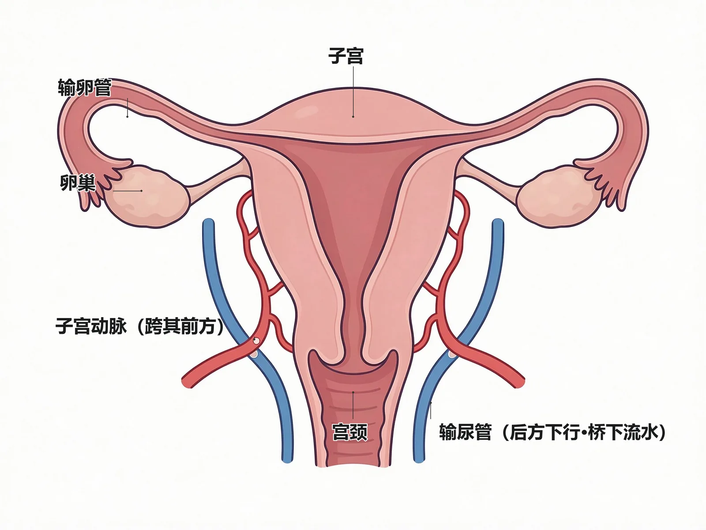

机制要点：输尿管全长约 30cm，在宫颈内口水平外 1.5～2.0cm 于子宫动脉<b>下方</b>穿过入膀胱（P19）；血运来自邻近肾、卵巢、子宫、膀胱血管分支并吻合。

#### 🔬 展开：输尿管血运保护
破坏输尿管血运可致缺血性输尿管瘘，故卵巢血管高位结扎、打开输尿管隧道时须保护。

> [!WARNING] 易错陷阱
> 易记反：子宫动脉在输尿管<b>上方/前面</b>横过；手术先游离抬起动脉、避开其下方输尿管再钳夹。

---

🔴 【掌握级】骨盆分界与骨盆底（盆膈/肛提肌）：以耻骨联合上缘、髂耻缘及骶岬上缘连线分界，上为假骨盆、下为真骨盆（骨产道）（教材P16、P18）。
💡 骨产道与盆腔脏器脱垂的解剖基础。
🧬 第一性原理：骨盆底是"吊床"，肛提肌支持力减弱→前/中/后盆腔分别出现膀胱阴道前壁膨出、子宫穹隆脱垂、直肠阴道后壁膨出；真骨盆上方开放、下方由肌筋膜封闭，胎儿沿骨盆轴经骨性通道娩出。
机制要点：三层——外层（会阴浅筋膜+球海绵体肌/坐骨海绵体肌/会阴浅横肌/肛门外括约肌）、中层（尿生殖膈）、内层（盆膈：肛提肌）；肛提肌分耻尾肌、髂尾肌、坐尾肌（P18）。

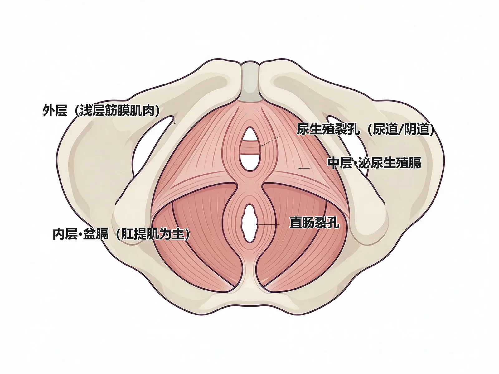

#### 🔬 展开：肛提肌与会阴
耻尾肌分娩易受损致产后膀胱/直肠膨出；坐骨结节前缘连线分骨盆底为前尿生殖三角与后肛门三角；会阴体（会阴中心腱）厚 3～4cm。

> [!SUCCESS] 知识校验
> 骨盆入口、中骨盆（坐骨棘水平）、出口三平面为产科骨盆测量平面；坐骨棘间径 ≥10cm 及骶棘韧带宽度是判断中骨盆是否狭窄的重要指标（P16），在模块4/5 直接复用。

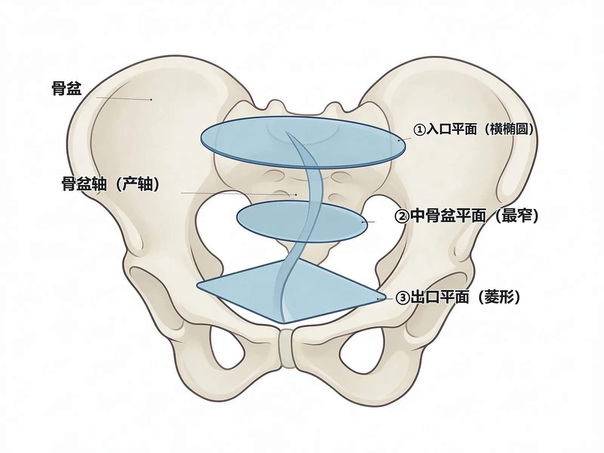

---

🔴 【掌握级】卵巢卵泡发育与排卵：原始卵泡→初级→次级→窦状→排卵前卵泡；经募集、选择一般仅 1 个优势卵泡成熟；排卵由 LH 峰触发，LH 峰出现于卵泡破裂前约 36h（教材P24-25）。
💡 卵泡发育是 HPO 轴的"起点"，排卵机制是生殖内分泌题核心。
🧬 第一性原理：卵泡发育靠 FSH 促颗粒细胞（激活芳香化酶）与 LH 促卵泡膜细胞合成雄激素（E2 前体）协作；募集后 FSH 阈值最低者成优势卵泡（选择）；当 E2≥200pg/ml 并持续 48h，正反馈诱生 LH/FSH 峰而排卵——不到阈值且不持续则排卵哑火。
机制要点：排卵时卵母细胞完成第一次减数分裂、排出第一极体；排卵前卵泡直径 18～23mm；排卵在下次月经前 14 日左右（P25）。

#### 🔬 展开：排卵激素链
E2≥200pg/ml→正反馈→LH/FSH 峰→初级卵母细胞完成第一次减数分裂→排卵前卵泡黄素化产少量孕酮→激活蛋白溶酶、消化卵泡壁成排卵孔（P25）；卵母细胞减数分裂"两级停滞"：初级卵母细胞于前期双线期停滞，排卵前在 LH 峰下完成第一次分裂，第二次分裂于中期停滞、仅受精时完成。

> [!TIP] 关键数值记忆
> E2≥200pg/ml 且持续 48h→正反馈；LH 峰在排卵前 36h；排卵在下次月经前 14 日；成熟卵泡 18～23mm——"200-48-36-14-18"。

---

🔴 【掌握级】子宫内膜周期性变化：内膜分功能层与基底层，功能层受性激素调节发生增殖、分泌、脱落；以 28 日周期分增殖期（5～14日）、分泌期（15～28日）、月经期（1～4日）（教材P29-30）。
💡 与刮宫/子宫出血直接相关，是月经失调的形态学基础。
🧬 第一性原理：E2 促内膜<b>增殖</b>（1～2→12mm），排卵后黄体分泌 P 使内膜转<b>分泌期</b>以利着床；卵子未受精则 P/E2 撤退、螺旋动脉痉挛致内膜<b>脱落</b>成月经——排卵后无足够 P 时内膜停留增殖期、激素一撤更易过量出血。
机制要点：分泌期超微结构特征为巨大线粒体与核仁通道系统（NCS），仅排卵后出现；月经来潮前 24h 内膜缺血坏死释放 PGF2α、内皮素-Ⅰ（P30）。

#### 🔬 展开：分期数字锚点
增殖期早（5～7日，薄 1～2mm）、晚（11～14日，厚 12mm）；分泌期早（15～19日，<b>含糖原核下空泡</b>为特征）、晚（24～28日，海绵状、间质蜕膜样变）。

> [!NOTE] 由内膜反推激素
> 增殖期=雌高（无排卵/卵泡期），分泌期=雌孕齐高（已排卵/黄体期）；内膜有无分泌期即判断有无排卵（模块13）。

---

🔴 【掌握级】月经周期调节（HPO 轴）：月经周期主要受下丘脑-垂体-卵巢轴（HPO）的神经内分泌调节——下丘脑分泌 GnRH、调节腺垂体 FSH/LH、调控卵巢功能；卵巢性激素对下丘脑和垂体有正、负反馈双重调节（教材P33）。
💡 HPO 轴是全部生殖内分泌疾病的"病灶地图"。
🧬 第一性原理：HPO 轴是"油门（正反馈）与刹车（负反馈）"——下丘脑弓状核脉冲式释放 GnRH（约 60～120 分钟一次），经垂体门脉系统调控 FSH/LH；FSH/LH 驱动卵巢分泌雌孕激素，后者再反馈调节下丘脑与垂体；卵泡期早 E2 低浓度行负反馈、晚期达 ≥200pg/ml 并持续 48h 则正反馈诱 LH 峰，黄体期雌孕激素协同负反馈。
机制要点：反馈分长反馈（卵巢激素对下丘脑）、短反馈（垂体激素对下丘脑 GnRH）、超短反馈（GnRH 对自身）；去甲肾上腺素促 GnRH 释放、β-内啡肽与 5-羟色胺抑制；抑制素选择性抑制垂体 FSH（P33）。

#### 🔬 展开：下丘脑-垂体-卵巢四级调节
卵泡期：黄体萎缩后雌孕激素降至最低→解除负反馈→GnRH 分泌、FSH 增→卵泡发育→内膜增殖期。黄体期：排卵后 LH/FSH 急降，黄体分泌 P 与 E2，孕激素促内膜分泌期；排卵后 7～8 日 P 达高峰，若卵子未受精，黄体萎缩→内膜剥脱→月经来潮→解除负反馈→FSH 增、下周期卵泡发育（P34）。

> [!WARNING] 易错陷阱
> <b>早期/中期低-中浓度 E2 行负反馈</b>，<b>晚期高浓度（≥200pg/ml 持续 48h）方为正反馈</b>触发 LH 峰；孕激素排卵前低水平增强正反馈、黄体期高水平为负反馈。

---

🟡 【熟悉级】卵巢结构与形态：卵巢约 4cm×3cm×1cm、重 5～6g（教材P13）；皮质"卵泡库"、髓质"血管库"。子宫为前后略扁倒置梨形，重 50～70g、长 7～8cm、宽 4～5cm、厚 2～3cm、容量 5ml（教材P10）；宫体颈比例青春期前 1∶2、生育期 2∶1、绝经后 1∶1；宫颈管长 2.5～3.0cm；内膜功能层（表面 2/3）随性激素周期性脱落、基底层（靠肌层 1/3）不脱落。<b>绝经后卵巢萎缩变小变硬</b>、不易触及，仍可触及应警惕卵巢肿瘤（模块12）。

🟡 【熟悉级】四对子宫韧带：阔韧带（限子宫两侧倾斜，子宫动静脉与输尿管从基底部穿过）、圆韧带（维持前倾）、主韧带（固定宫颈、防子宫脱垂的主要结构）、骶韧带（向上后牵引宫颈，与圆韧带协同维持前屈前倾）（教材P11）；子宫靠<b>韧带及骨盆底肌筋膜</b>支托，盆底组织破坏即致子宫脱垂；阔韧带上缘内 2/3 包绕输卵管、外 1/3 成骨盆漏斗韧带。

🟡 【熟悉级】外生殖器与前庭大腺：阴阜为耻骨联合前脂肪垫；大阴唇富皮下脂肪、血管淋巴神经，外伤易成血肿且疼痛重；阴蒂与男性阴茎同源、由海绵体构成具勃起性；阴道前庭为菱形区域（教材P8-9）。前庭大腺（巴氏腺）位于大阴唇后部、被球海绵体肌覆盖，腺管口闭塞成前庭大腺囊肿、伴感染成脓肿，正常时不能触及。

🟡 【熟悉级】血管淋巴神经与邻近器官：血供主要来自卵巢动脉、子宫动脉、阴道动脉及阴部内动脉（教材P14）；子宫动脉分上支（子体支 8～11 支弓状动脉）与下支（宫颈-阴道支）。淋巴分外生殖器（腹股沟浅/深淋巴结）与内生殖器两组（髂、骶前、腰淋巴组）（P15）；外生殖器由阴部神经（第 2～4 骶神经）支配，内生殖器由交感/副交感自主神经支配；卵巢静脉<b>左侧直角入左肾静脉</b>易受阻，故<b>左侧盆腔静脉曲张多见</b>（P14）。邻近器官——尿道长 4～5cm、短而直且邻阴道故易感染（压力性尿失禁）；膀胱容量 350～500ml；直肠长 10～14cm；阑尾可累及右附件、妊娠期增大子宫将其推向外上（教材P19）。

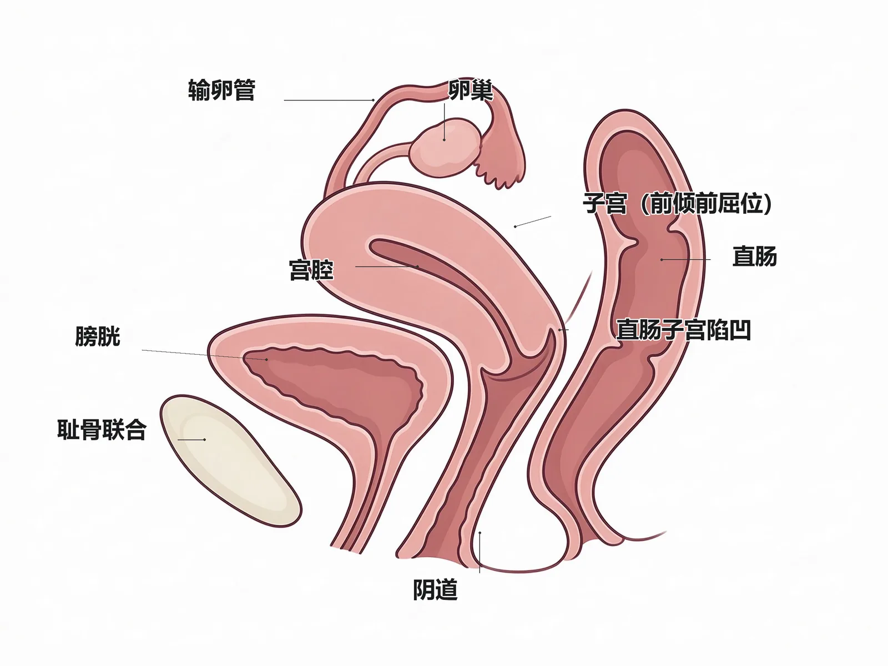

🟡 【熟悉级】性激素合成与两细胞-两促性腺激素学说：卵巢性激素（雌、孕及少量雄激素）均为甾体激素，分孕激素（21C、孕烷核）、雄激素（19C、雄烷核）、雌激素（18C、雌烷核）（教材P27）；LH 与卵泡膜细胞结合使胆固醇形成睾酮和雄烯二酮（E2 前身），进入颗粒细胞后 FSH 激活芳香化酶转为雌二醇/雌酮；LH 刺激下卵泡膜细胞胆固醇经 P450 侧链裂解酶催化形成孕烯醇酮，为性激素合成<b>限速步骤</b>（P27）。两细胞协作、颗粒细胞与内膜细胞被基底膜分隔，故雌激素合成依赖内膜细胞提供雄激素前体。

🟡 【熟悉级】雌、孕激素生理作用与协同拮抗：雌激素促增殖（宫口松、黏液稀薄拉丝、水钠潴留、HDL↑、促乳腺<b>管</b>、协同 FSH）；孕激素在雌激素作用基础上促分泌（宫口闭、黏液黏稠、水钠排泄、基础体温↑0.3～0.5℃、促乳腺<b>腺泡</b>、抑子宫收缩）（教材P27-28）。协同=孕激素在雌激素基础上促生殖器与乳房发育为妊娠准备；拮抗=雌激素促内膜增生修复、孕激素限制内膜增生并促转分泌期（P28）；三组相反可应对比题（促增殖/促分泌、水钠潴留/排泄、促腺管/促腺泡），详见表1。

🟢 【了解级一组】（月经、分期与性腺发育）：月经是伴随卵巢周期的子宫内膜周期性脱落出血，初潮多在 13～14 岁、可 11～15 岁，<b>15 岁后仍未来潮应排查</b>；月经血含纤维蛋白溶解酶故不凝（P32）。人生 7 期——胎儿、新生儿、儿童、青春期（10～19 岁）、性成熟期、绝经过渡期、绝经后期；我国中位绝经年龄 49 岁（P21-23）。性腺发育与性别决定：男性靠 SRY 编码睾丸决定因子（TDF）及抗米勒管激素（AMH），缺乏雄激素与 AMH 时生殖器倾向女性（P7）。其他内分泌腺：HPO 受甲状腺、肾上腺及胰腺功能异常影响均可致月经异常甚至闭经（P34-35），肾上腺皮质是<b>女性雄激素主要来源</b>。骨盆类型（Caldwell 与 Moloy）分女型（最常见、我国 52%～58.9%）、扁平型（23.2%～29%）、类人猿型（14.2%～18%）、男型（漏斗、最易难产、仅 1%～3.7%）（P17）。

---

### 📊 对比速查

<b>表1 雌、孕激素生理作用对比</b>（教材P27-28）

| 靶部位 | 雌激素 | 孕激素 |
|---|---|---|
| 子宫肌层 | 增肌增生肥大、缩宫素敏感↑ | 降兴奋性、抑制收缩 |
| 子宫内膜 | 腺体间质<b>增生</b>修复 | 增殖期→<b>分泌期</b>、备着床 |
| 子宫颈 | 宫口松弛、黏液稀薄拉丝↑ | 宫口闭合、黏液黏稠减少 |
| 输卵管 | 肌层发育、收缩振幅↑ | 收缩振幅↓ |
| 阴道上皮 | 增生角化、糖原↑、酸性 | 加快细胞脱落 |
| 乳腺 | 促乳腺<b>管</b>增生 | 促乳腺<b>腺泡</b>发育 |
| 体温/代谢 | 水钠潴留、HDL↑LDL↓、骨基质↑ | 基础体温↑0.3～0.5℃、排水钠 |

<b>表2 卵巢周期与子宫内膜周期对照</b>（教材P24-30，以 28 日为例）

| 项目 | 卵泡期（1～14日） | 排卵 | 黄体期（15～28日） |
|---|---|---|---|
| 卵巢 | 卵泡发育→成熟（18～23mm） | 排卵（下次月经前 14 日） | 黄体形成→退化 |
| 主要激素 | E2 第一次高峰 | LH/FSH 峰 | P 高峰+E2 第二高峰 |
| 内膜 | 增殖期（5～14日，1～2→12mm） | — | 分泌期（15～28日） |
| 月经期 | — | — | 第1～4日（脱落） |
| 反馈 | E2≥200pg/ml 持续48h→正反馈 | LH 峰触发排卵 | 雌孕激素负反馈抑制 FSH/LH |

<b>表3 子宫内膜分期特点</b>（教材P29-30）

| 分期 | 时间 | 特征 |
|---|---|---|
| 增殖早期 | 第5～7日 | 薄 1～2mm、腺体短直细疏、小动脉直壁薄 |
| 增殖中期 | 第8～10日 | 腺体增多弯曲、间质水肿、螺旋小动脉发育 |
| 增殖晚期 | 第11～14日 | 厚 12mm、腺上皮假复层、水肿明显 |
| 分泌早期 | 第15～19日 | 出现含糖原的<b>核下空泡</b>（特征） |
| 分泌中期 | 第20～23日 | 锯齿状、顶浆分泌、分泌达高峰 |
| 分泌晚期 | 第24～28日 | 海绵状、间质蜕膜样变、螺旋小动脉发达 |

<b>表4 阴道上/中/下段血供与淋巴</b>（教材P14-15）

| 部位 | 动脉 | 淋巴 |
|---|---|---|
| 阴道上段 | 子宫动脉宫颈-阴道支 | 汇入髂内/闭孔淋巴结 |
| 阴道中段 | 阴道动脉 | 汇入髂内/闭孔淋巴结 |
| 阴道下段 | 阴部内动脉、痔中动脉 | 主要汇入腹股沟浅淋巴结 |

> [!INFO] 表格与图的分工
> 表1-表3 给"数值、时间、结构"数据对比；D2 因果链给机制链路；表4 用于手术切除范围与血供淋巴转移定位。

---

### 🔗 因果链（D2）

```
（HPO 轴驱动"排卵→黄体→激素撤退→月经"周而复始）
   下丘脑 GnRH 脉冲式释放
        │ (长反馈:卵巢性激素;短反馈:垂体;超短反馈:GnRH自身)
        ▼
   垂体 FSH/LH 脉冲式分泌
        ▼ ───────────┬────────────────
   FSH: 卵泡发育/颗粒│ LH: 膜细胞合成雄激素(E2底物)
        ▼              ▼
   (E2↑)→颗粒细胞出现LH受体
        │ E2≥200pg/ml 持续48h
        ▼
   正反馈→LH/FSH 排卵峰 ★
        │ (LH峰:排卵前36h;第一极体;排卵孔)
        ▼
   排卵(下次月经前14日)→卵子入输卵管
        │
        ▼
   黄体形成(排后7~8日,P+E2第二峰)→内膜分泌期(15~28日)
        │ 卵子未受精→黄体退化(排后9~10日)
   孕酮+雌激素撤退 ★→螺旋动脉痉挛→月经来潮(1~4日)
        │ (解除负反馈)→FSH↑→下周期卵泡发育(回顶部)
```
> [!INFO] 此图展示机制链路，具体数据见上方「📊 对比速查」表格。★ 为关键转折点：LH 峰（触发排卵）与雌孕激素撤退（触发月经）。

---

### ⚠️ 常见陷阱

1. 基底层<b>不受性激素影响、不脱落</b>，是月经后内膜再生来源；脱落的是功能层（P10）。
2. 子宫动脉在输尿管<b>上方</b>横过，手术先游离动脉再钳夹（P14）。
3. 触发排卵的是<b>LH 峰</b>（由 E2≥200pg/ml 持续 48h 正反馈诱发），而非雌激素或 FSH 直接引起（P25）。
4. 输卵管结扎在<b>峡部</b>、受精在<b>壶腹部</b>（P12）。

---

### 💡 记忆口诀

1. <b>输卵管四部</b>：间（最窄）—峡（结扎）—壶（受精）—伞（拾卵）。
2. <b>雌/孕激素</b>：雌激素"管长"（增生、松弛、水钠潴留）；孕激素"管床"（分泌、闭合、产热、安胎）。

---

### 📌 本章小结

> [!INFO] 本章小结
> - take-home 1：解剖是"定位"——子宫峡部 1cm→7～10cm 子宫下段、输卵管四部、子宫动脉-输尿管交叉、骨盆底肛提肌支撑，决定手术入路与脱垂好发部位。
> - take-home 2：生理是"周期"——卵巢周期（卵泡发育→排卵→黄体）驱动内膜周期（增殖→分泌→月经），核心为 HPO 轴与"两细胞-两促性腺激素"学说。
> - take-home 3：激素是"天平"——雌激素"长"（增生、松弛、水钠潴留）、孕激素"床"（分泌、闭合、产热、抑宫缩），协同又拮抗，失衡即致内膜疾病与月经紊乱。
> <b>🗺 本章核心洞察</b>：妇科疾病皆源于本模块"结构定位"与"周期规律"被打破——HPO 轴是"发动机"，解剖是"机体"；任一环节异常，月经、排卵、妊娠与脏器支持即连锁失常。

---

### 🔗 深度链接

本模块是全部模块的<b>底层语言</b>：解剖定位支撑模块2（受精部位/受精卵运送）、模块10（炎症解剖定位）、模块11（肿瘤解剖部位与淋巴转移路径）；周期规律（HPO 轴、雌孕激素）是模块13（AUB、绝经综合征）与模块14（不孕症：排卵障碍）的机制基础；骨盆与盆腔支持结构在模块4、5 与 7 直接复用。


## 模块2：妊娠生理

> [!INFO] 模块信息
> <b>重点等级</b>：🔴掌握 8 个 / 🟡熟悉 6 组 / 🟢了解 6 个（1 组）
> <b>关联模块</b>：模块1、3、7
> <b>谱系位置</b>：产科"正常妊娠生理"位点——是模块3（诊断）、4（分娩）、7（母胎界面异常）共同的底层语言
> <b>预计阅读</b>：约 12 分钟

---

### 🧩 前置知识检查

1. 月经周期 H‑P‑O 轴、排卵后黄体分泌雌孕激素（模块1）。
2. 次级卵母细胞停滞于二次减数分裂中期，需精子触发才完成分裂（模块1）。
3. 子宫内膜功能层随雌孕激素周期变化，着床依赖其"容受性"（模块1）。

---

### 🎯 高收益摘要

1. 受精在输卵管壶腹部（≤24 小时），精子须获能约 7 小时并顶体反应；着床始于受精后 6-7 日，容受窗口期仅月经周期第 20-24 日（教材P36-37）。
2. 孕周从末次月经第 1 日起算、全程 280 日；10 周内称胚胎、11 周起称胎儿；胎儿体内无纯动脉血，卵圆孔、动脉导管、静脉导管三条分流绕开肺，富氧血优先供肝、心、头、上肢（教材P37-38）。
3. hCG 着床后 1 日测出、8-10 周达峰、产后 2 周消失；hPL 妊娠 5 周测出、晚期高峰、产后 7 小时消失；足月羊水约 800ml（38 周峰值约 1000ml，过期 <300ml），胎儿吞咽为主要吸收途径（教材P41-43）。

---

### 📋 结构化笔记

🔴 【掌握级】受精的定义、部位与时限：获能精子与次级卵母细胞在输卵管内结合形成受精卵，部位在输卵管壶腹部，多在排卵后数小时内，一般不超过 24 小时（教材P36）。
💡 受精是妊娠起点，部位与时限是高频数值考点。
🧬 第一性原理：精子须先"获能"降低顶体膜稳定性、再顶体反应释放顶体酶穿过透明带，卵子又须精子触发才完成二次减数分裂——"获能+顶体反应+卵子二分裂完成"三者缺一不可。
机制要点：顶体反应释放顶体素、玻璃酸酶、酯酶溶解放射冠与透明带；皮质颗粒释放溶酶体酶使透明带结构改变（透明带反应），阻止多精进入。

#### 🔬 展开：受精后早期发育时间轴
受精后 30 小时借输卵管蠕动＋纤毛向宫腔移动并卵裂；50 小时 8 细胞，72 小时 16 细胞桑葚胚，第 4 日入宫腔；第 5-6 日透明带消失、囊胚孵化。

> [!WARNING] 易错陷阱
> 受精部位是"输卵管壶腹部"，着床部位是"子宫内膜"，二者常被互换；受精时限（≤24 小时）与着床时间（受精后 6-7 日）不可混淆。

---

🔴 【掌握级】孕周计算与胚胎、胎儿分界：孕周从末次月经第 1 日起算，比排卵/受精提前 2 周、比着床提前 3 周；全程 280 日/40 周。妊娠 10 周（受精第 8 周）内称胚胎（器官分化期），自 11 周（受精第 9 周）起称胎儿（教材P37）。
💡 孕期用药致畸评估与"孕周相关诊断"都以末次月经为锚。
🧬 第一性原理：末次月经是孕妇可回忆的客观起点，故孕周统以之起算，月经龄与受精龄恒差约 14 天；胚胎期是器官原基形成（畸形高发期）、胎儿期为生长成熟——用药/暴露风险评估看孕周、具体结构看胎儿龄。
机制要点：以 4 周（1 个妊娠月）为孕龄单位。8 周末初具人形、头占近一半、心脏已形成；12 周末约 9cm、外生殖器初辨性别；16 周末约 16cm、可确认性别、出现呼吸运动。

#### 🔬 展开：各孕周身长体重与存活能力
20 周末约 25cm/320g（胎脂、吞咽排尿、体重线性增长）；24 周末约 30cm/630g（出生可呼吸但生存能力极差）；28 周末约 35cm/1000g（可存活但 RDS 高发）；32 周末约 40cm/1700g（存活率较高）；36 周末约 45cm/2500g（存活能力强）；40 周末约 50cm/3400g（成熟、吸吮强）。

> [!WARNING] 易错陷阱
> "24 周可存活但生存能力极差""28 周出生可存活但 RDS 高发""37-42 周为足月成熟儿"——存活"拐点"周别数字常被混用。

---

🔴 【掌握级】胎儿循环特点（三条分流）：胎儿体内无纯动脉血，为动静脉混合血。①胎盘来血分 3 支——一支直接入肝、一支与门静脉汇合入肝、另一支经静脉导管直入下腔静脉（出生后闭锁为静脉韧带）；②卵圆孔正对下腔静脉入口，下腔静脉血绝大部分经卵圆孔入左心房；③肺循环阻力大，肺动脉血绝大部分经动脉导管流入主动脉（教材P38）。
💡 三条分流是胎儿期"避开肺"优先给脑心供氧的核心，也是出生后未闭致先心病的机制基础。
🧬 第一性原理：胎儿期肺不交换气体、肺循环阻力极大，若血全走肺无法给全身供氧，故须三条分流绕开肺；出生后肺一呼吸、阻力降低，捷径逐个关闭，未闭即"左向右分流"先心病。
机制要点：进入肝、心、头及上肢的血含氧量高、营养丰富；注入肺及身体下半部的血含氧量相对较低。

#### 🔬 展开：出生后血液循环的改变
脐静脉→肝圆韧带，其末支静脉导管→静脉韧带；脐动脉+闭锁腹下动脉→脐内侧韧带；动脉导管出生后 2-3 个月完全闭锁为动脉韧带；卵圆孔多在生后 6 个月完全关闭。

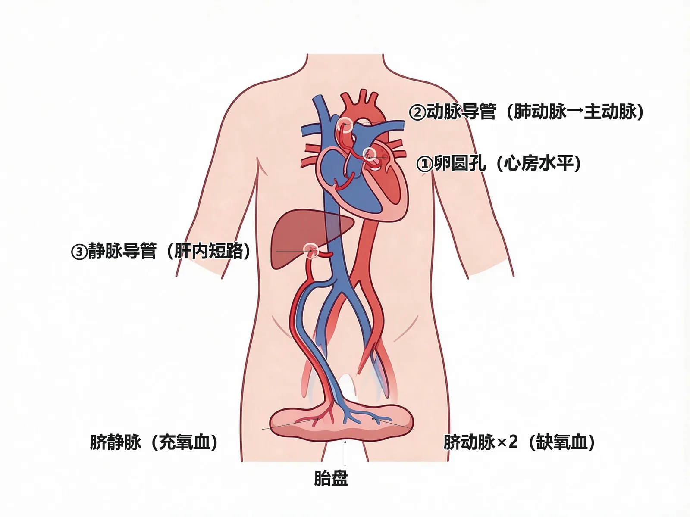

> [!WARNING] 易错陷阱
> 动脉导管→"动脉韧带"（2-3 个月）、静脉导管→"静脉韧带"、脐静脉→"肝圆韧带"、脐动脉+腹下动脉→"脐内侧韧带"——名称与时限极易混。

---

🔴 【掌握级】胎盘的结构组成与绒毛间隙：胎盘由胎儿部分（羊膜+叶状绒毛膜）及母体部分（底蜕膜）构成。叶状绒毛膜是主要结构，绒毛间隙（IVS）内充满母血（子宫螺旋血管直接开口于此），母胎交换在绒毛处进行；足月胎盘绒毛表面积达 12-14m²（教材P40-41）。
💡 "绒毛间隙=母血池、绒毛内=胎儿血管"界定清楚是理解胎盘屏障与循环的前提。
🧬 第一性原理：绒毛从"单纯滋养层"到"有胚外中胚层"再到"有血管"（三级绒毛），三级绒毛血管与脐血管连通后才建立胎儿-胎盘循环；子宫螺旋动脉重塑障碍（不转为低阻力血管）→绒毛间隙血流不足→子痫前期、胎儿生长受限（FGR）——两大并发症共同源头。

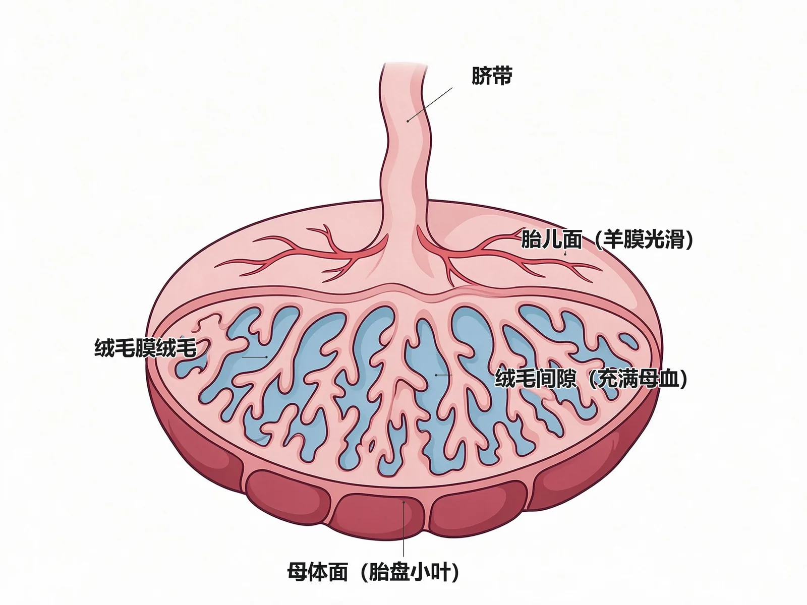

机制要点：叶状绒毛膜历经初级绒毛（合体滋养细胞小梁+细胞滋养细胞中心索）→次级绒毛（胚外中胚层成间质中心索）→三级绒毛（受精后 15-17 日胚胎血管长入）；一个初级绒毛干及分支成 1 个胎儿叶、一个次级绒毛干成 1 个胎儿小叶（教材P40-41）。

#### 🔬 展开：胎盘大体形态与子宫-胎盘循环
足月胎盘重 450-650g、直径 16-20cm、厚 1-3cm；母体面暗红被蜕膜间隔分成约 20 个母体叶。螺旋动脉重塑由间质滋养细胞与血管内滋养细胞完成；正常妊娠重塑率达 96%，重度子痫前期并发 FGR 时仅 10% 完全重塑。

> [!WARNING] 易错陷阱
> "叶状绒毛膜（胎儿侧、主要结构）"与"底蜕膜（母体侧）"部位关系及"绒毛间隙充满的是母血"是高频混淆点——记住"绒毛间隙是母血池、绒毛内是胎儿血管"。

---

🔴 【掌握级】hCG 的分泌规律与功能：hCG 是由 α、β 亚基组成的糖蛋白激素。着床后 1 日可自母体血清测出，妊娠 8-10 周达高峰，以后迅速下降，产后 2 周内消失。功能：①维持月经黄体成妊娠黄体、促甾体激素分泌维持妊娠；②促雄激素芳香化转化为雌激素、刺激孕酮形成；③吸附于滋养细胞表面抑制母体淋巴细胞攻击胚胎；④刺激胎儿睾丸分泌睾酮促男胎分化；⑤与母体甲状腺细胞 TSH 受体结合刺激甲状腺活性（教材P41）。
💡 早孕诊断靠它，滋养细胞疾病（葡萄胎/绒癌）随访也靠它。
🧬 第一性原理：hCG 结构与功能上与 LH 相似，替代 LH 维持黄体使其不退化而成妊娠黄体持续分泌雌孕激素——这是妊娠能"跨过黄体期"的核心；约妊娠 10 周后胎盘接手分泌雌孕激素，hCG 完成任务自身回落；若持续异常升高或下降后复升，提示滋养细胞疾病。
机制要点：测出（着床后 1 日）、高峰（8-10 周）、消失（产后 2 周）构成早孕诊断及滋养细胞疾病随访三关键时间窗。

#### 🔬 展开：hCG 用于早期妊娠与滋养细胞疾病
血/尿 hCG 是早期妊娠最敏感指标；妊娠 12 周后明显下降，若持续升高或下降后复升，提示葡萄胎或妊娠滋养细胞肿瘤（结合超声"落雪征"等，详见模块12）。

> [!WARNING] 易错陷阱
> hCG 高峰在"妊娠 8-10 周"（早孕期），hPL 高峰在"妊娠晚期"——趋势相反最易混；"着床后 1 日可测出"勿与着床时间（受精后 6-7 日）混淆。

---

🔴 【掌握级】hPL 的分泌规律与功能：hPL（人胎盘催乳素）是单链多肽激素。妊娠 5 周即可在母体血浆测出，随妊娠进展持续增加，至妊娠晚期达高峰并维持至分娩，产后迅速下降、产后 7 小时即测不出。功能：①促乳腺腺泡发育、促合成乳白蛋白/乳酪蛋白/乳珠蛋白为泌乳准备；②促胰岛素生成；③脂解提高游离脂肪酸为能源、抑制母体利用葡萄糖、把多余糖运给胎儿（胎儿主要能源）；④抑制母体对胎儿的排斥作用（教材P41-42）。
💡 单侧记"代谢调节因子"即可统领——在母胎代谢再分配中的角色是考点。
🧬 第一性原理：hPL 是"通过母体促进胎儿发育的代谢调节因子"——脂解母体脂肪释游离脂肪酸为能源、抑制母体利用葡萄糖、把糖"省下来"优先运给胎儿；若 hPL 不足→糖供给胎儿减少→胎儿生长受限，若"胰岛素抵抗+糖利用受抑"过度则诱发妊娠期糖尿病。
机制要点：hPL 测出（妊娠 5 周）、高峰（妊娠晚期）、消失（产后 7 小时）是区别于 hCG 的核心时点。

#### 🔬 展开：雌激素、孕激素的分泌规律
雌激素：妊娠早期由卵巢黄体产生，10 周后主要由胎儿-胎盘单位合成；至末期雌三醇为非孕 1000 倍、雌二醇及雌酮为 100 倍，雌三醇是胎儿-胎盘单位功能标志。孕激素：早由卵巢妊娠黄体产生，8-10 周后胎盘合体滋养细胞为主要来源，代谢产物为孕二醇（教材P42）。

> [!WARNING] 易错陷阱
> 雌激素、孕激素早期产生于"卵巢黄体（妊娠黄体）"，10 周（雌激素）/8-10 周（孕激素）后才转由"胎盘"主导——"早卵巢、晚胎盘"；雌三醇（1000 倍）≠雌二醇/雌酮（100 倍）。

---

🔴 【掌握级】脐带结构（1 条脐静脉、2 条脐动脉）：脐带连接胎儿与胎盘，足月长 30-100cm、平均约 55cm、直径 0.8-2.0cm，表面有羊膜覆盖呈灰白色，内有 1 条脐静脉、2 条脐动脉，脐血管周围为含水量丰富的胚外中胚层胶样组织——华通胶（Wharton jelly），有保护脐血管作用（教材P42-43）。
💡 "1 静脉 2 动脉"是必记数字，也是理解脐血流方向与脐带受压致胎儿窘迫的基础。
🧬 第一性原理：1 条脐静脉把富氧+营养血运给胎儿，2 条脐动脉把缺氧+代谢废物血运回胎盘交换——方向与常识相反；脐带受压致血流受阻则母胎交换中断→胎儿缺氧甚至危及生命。
机制要点：脐动脉内为含氧量低、代谢废物浓度高的血；脐静脉内为含氧高、营养丰富的血；脐带是母儿气体交换、营养供应、代谢产物排出的重要通道。

#### 🔬 展开：脐血管与母胎交换的关系
脐动脉内为胎儿缺氧血与代谢废物，流至绒毛毛细血管与绒毛间隙母血交换后，脐静脉将含氧高、营养丰富的血带回胎儿；脐带受压血流受阻可致胎儿缺氧甚至危及生命。

> [!WARNING] 易错陷阱
> 脐带"1 条脐静脉、2 条脐动脉"必记；勿与"胎盘小叶（200 个）、胎儿叶（60-80 个）、母体叶（约 20 个）"混；脐静脉内是含氧高的血（流向胎儿）、脐动脉内是含氧低的血（流回胎盘）。

---

🔴 【掌握级】羊水的量与来源：羊水充满羊膜腔。妊娠 38 周约 1000ml，此后逐渐减少；40 周约 800ml；过期妊娠明显减少，可减至 300ml 以下。来源：①早期主要来自母体血清经胎膜进入羊膜腔的透析液；②妊娠中期以后胎儿尿液为主要来源；③妊娠晚期胎肺参与生成（每日约 350ml 液体从肺泡分泌至羊膜腔）；④羊膜、脐带华通胶及胎儿皮肤渗出（量少）（教材P42-43）。
💡 羊水量是产前超声评估胎儿状况的重要指标，反映胎儿排尿、吞咽功能。
🧬 第一性原理：羊水量平衡依赖胎儿排尿、肺泡液分泌、膜内转运、胎儿吞咽四因素协调，胎儿吞咽为主要吸收途径；胎儿泌尿异常→羊水过少→胎儿肺发育不全，吞咽异常/消化道闭锁→羊水过多。
机制要点：羊水吸收主要经胎儿吞咽（近足月每日约 500-700ml）；另一途径为经羊膜-绒毛膜界面的膜内转运向胎盘血管转移；脐带每小时吸收 40-50ml。

#### 🔬 展开：羊水的性状与功能
足月羊水略混浊不透明，可见胎脂、胎儿脱落上皮、毳毛等；足月比重 1.007-1.025、pH 约 7.20、水分 98%-99%。功能：保护胎儿（缓冲避免挤压、防肢体粘连、避免脐带受压、羊水过少致胎儿肺发育不全）；保护母体（前羊水囊楔形水压扩张宫颈口阴道、破膜后冲洗阴道减少感染）（教材P43）。

> [!WARNING] 易错陷阱
> 羊水量是"38 周约 1000ml 峰值→40 周约 800ml→过期 <300ml"递减，勿记成递增；"胎儿吞咽是主要吸收途径"（每日 500-700ml）勿与"胎儿排尿是主要来源"对调。

---

🟡 【熟悉级】着床与蜕膜三区分：着床是囊胚植入子宫内膜的过程，约在受精后 6-7 日，经定位→黏附→侵入三阶段，滋养细胞分化为外层合体滋养细胞与内层细胞滋养细胞；必须条件为透明带消失、分化出合体滋养细胞、囊胚与子宫内膜同步发育且功能协调、足量雌激素和孕激素（教材P36-37）。着床后子宫内膜基质细胞分化为蜕膜细胞（蜕膜化），按与囊胚关系分底蜕膜（着床部位，与叶状绒毛膜相贴→胎盘母体部分）、包蜕膜（覆盖囊胚）、真蜕膜（覆盖宫腔其余）；妊娠 14-16 周包蜕膜与真蜕膜贴近、宫腔消失（教材P37）。

🟡 【熟悉级】精子获能、顶体反应与透明带反应：获能约需 7 小时，顶体膜胆固醇/磷脂比值及膜电位变化降低膜稳定性；顶体反应为顶体外膜破裂释放顶体酶；透明带反应为皮质颗粒释放溶酶体酶使透明带结构改变、精子受体变性（教材P36）。

🟡 【熟悉级】胎盘屏障与母胎物质交换：胎盘屏障由绒毛毛细血管壁、绒毛间质及滋养细胞层构成，但作用极为有限——各种病毒及大部分药物可通过；细菌、弓形虫、衣原体、梅毒螺旋体不能通过但可破坏绒毛后侵入；母血 IgG 能通过。气体（O2、CO2）简单扩散（CO2 比 O2 快 20 倍）；葡萄糖易化扩散；氨基酸、钙、磷、碘、铁主转运；游离脂肪酸、水、钾、钠、镁及维生素 A、D、E、K 简单扩散；代谢产物经胎盘转输入母血（教材P41-42）。

🟡 【熟悉级】胎肺成熟与胎儿血液系统：胎肺成熟＝结构成熟＋功能成熟，后者由Ⅱ型肺泡细胞板层小体合成肺表面活性物质（卵磷脂＋磷脂酰甘油）决定，能降低肺泡表面张力、助肺泡扩张，测羊水卵磷脂及磷脂酰甘油判断成熟度，糖皮质激素刺激其产生（教材P39）。胎儿血液：红细胞妊娠 5 周卵黄囊造血，足月骨髓产 90% 红细胞，32 周后红细胞生成素大量产生故 32 周后出生红细胞数约 6.0×10¹²/L，红细胞寿命约 90 日；血红蛋白末 4-6 周成人血红蛋白增多、临产时胎儿血红蛋白仅占 25%；白细胞足月可达（15-20）×10⁹/L（教材P38-39）。

🟡 【熟悉级】子宫增大与血液改变：足月子宫 35cm×25cm×22cm、容量约 5000ml、重量约 1100g，肌细胞由 20μm→足月 500μm；子宫血流量早期 50ml/min、足月 450-650ml/min，80%-85% 供胎盘，有效宫缩是产后胎盘剥离面止血主要机制；Braxton Hicks 收缩为早期起不规律无痛性假性宫缩（宫腔内压 5-25mmHg、持续 <30 秒、不伴宫颈扩张）（教材P43-44）。血容量 6-8 周始增、32-34 周达高峰增 40%-45%（约 1450ml），血浆增 1000ml、红细胞增 450ml→生理性稀释；高凝状态：凝血因子Ⅱ、Ⅴ、Ⅶ、Ⅷ、Ⅸ、Ⅹ增，仅Ⅺ及ⅩⅢ减，纤维蛋白原较非孕约增 50%（妊娠晚期 4.5g/L），血栓风险增 5-6 倍、产后 2 周恢复（教材P45-46）。

🟡 【熟悉级】妊娠期各系统变化（循环/内分泌/泌尿/呼吸消化）：循环——心输出量 8-10 周渐增、32-34 周达高峰，左侧卧位较未孕约增 30%，临产第二产程显著增加；血压早中期偏低、24-26 周后轻度升高（收缩压不变、舒张压轻度降、脉压稍增大）；仰卧位子宫压迫下腔静脉致回心血量减少→仰卧位低血压综合征，鼓励侧卧（教材P45）。内分泌——垂体增大、嗜酸性细胞肥大形成"妊娠细胞"，大量雌孕激素负反馈使 FSH/LH 减→无排卵；PRL 足月分娩前达峰约 150μg/L（非孕 10 倍）；甲状腺受 TSH 和 hCG 作用中度增大、TBG 约 20 周达峰使总 T4/T3 升高但不影响游离 T4/T3；肾上腺皮质束状带皮质醇增 3 倍（游离仅 10%）故无亢进表现、球状带醛固酮增 4 倍（游离仅 30%-40%）（教材P46-47）。泌尿——肾略增大，RPF 增约 35%、GFR 增约 50%→尿素肌酐排泄增多、血清浓度低于非孕，约 15% 孕妇饭后生理性糖尿；右侧输尿管常受右旋子宫压迫→右肾盂积水，急性肾盂肾炎右侧居多（教材P46）。呼吸消化——通气量约增 40%，PO2 达 92mmHg、PCO2 降至 32mmHg，上呼吸道黏膜充血水肿易感染；雌激素致牙龈肥厚出血（妊娠龈瘤），孕激素使贲门括约肌松弛→胃烧灼，胆囊排空延长→胆石症，肠蠕动弱→便秘，增大子宫使阑尾体征上移（教材P46-47）。

🟢 【了解级一组】（妊娠期各系统与胎儿发育）：卵巢/输卵管/阴道/外阴——排卵停止，6-7 周前黄体分泌大量雌孕激素、10 周后由胎盘取代；阴道黏膜变软、水肿充血呈紫蓝色（Chadwick 征），阴道上皮糖原增加、乳酸增多、pH 降低利于防感染（教材P44-45）。乳房——雌激素促乳腺腺管、孕激素促腺泡，乳晕加深、皮脂腺肥大形成蒙氏结节；产后胎盘娩出、激素下降＋吸吮则泌乳（教材P45）。皮肤——促黑素细胞激素增多＋大量雌孕激素→乳头、乳晕、腹白线、外阴色素沉着，颧颊部蝶状斑称妊娠黄褐斑；妊娠纹初孕妇紫色、经产妇银色（教材P48）。新陈代谢——基础代谢率晚期可增高 15%-20%；蛋白质正氮平衡，储备不足→血浆蛋白减少→水肿；足月胎儿骨骼储存约 30g 钙（80% 在末 3 个月积累）；妊娠期约需 1000mg 铁（教材P47-48）。胎儿各系统——神经：24-26 周感知声音、28 周对光反应；消化：10-16 周能吞咽羊水，肝内缺酶不能结合游离胆红素、胆红素成胆绿素使胎粪呈黑绿色；泌尿：11-14 周胎肾有排尿功能；内分泌：甲状腺 6 周发育、10-12 周能合成、12 周胰腺分泌胰岛素（教材P39）。骨骼关节——松弛素（relaxin）使骨盆韧带及椎骨关节韧带松弛，部分耻骨联合分离致腰骶疼痛，产后消失；PTH 早期降低、随钙的胎儿运输孕妇钙浓度降低、中晚期升高利于为胎儿供钙（教材P48）。

---

### 📊 对比速查

<b>表1　各孕周胎儿发育关键数值</b>

| 孕周 | 身长 | 体重 | 关键标志 |
|---|---|---|---|
| 8周末 | 初具人形、头占近一半 | — | 心脏已形成 |
| 12周末 | 约9cm | — | 外生殖器初辨性别 |
| 16周末 | 约16cm | 约110g | 可确认性别、出现呼吸运动 |
| 20周末 | 约25cm | 约320g | 胎脂、吞咽排尿、体重线性增长 |
| 24周末 | 约30cm | 约630g | 各脏器发育、出生可呼吸但能力极差 |
| 28周末 | 约35cm | 约1000g | 可存活、早产儿RDS高发 |
| 32周末 | 约40cm | 约1700g | 存活率较高 |
| 36周末 | 约45cm | 约2500g | 指（趾）甲达末端、存活能力强 |
| 40周末 | 约50cm | 约3400g | 成熟、睾丸降入阴囊、吸吮强 |

<b>表2　胎盘主要激素/酶对照</b>

| 物质 | 测出/产生 | 高峰 | 消失/变化 | 主要功能 |
|---|---|---|---|---|
| hCG | 着床后1日 | 妊娠8-10周 | 产后2周消失 | 维持黄体、促睾酮、抑制排异、刺激甲状腺 |
| hPL | 妊娠5周 | 妊娠晚期 | 产后7小时消失 | 促乳腺、促胰岛素、脂解供能、"代谢调节因子" |
| 雌激素 | 早卵巢黄体 | 10周后胎儿-胎盘单位 | 末期雌三醇1000倍 | 促乳腺腺管、子宫、骨代谢 |
| 孕激素 | 早妊娠黄体 | 8-10周后胎盘 | 代谢产物孕二醇 | 维持妊娠、协同雌激素作用 |
| 缩宫素酶 | 随妊娠进展增加 | 妊娠末期 | 胎盘功能不良时降低 | 灭活缩宫素、维持妊娠 |
| HSAP | 16-20周可测 | 随妊娠进展增多 | 产后3-6日消失 | 动态评价胎盘功能 |

<b>表3　胎儿三条分流旁路与出生后闭锁对照</b>

| 旁路 | 连接部位 | 血流/意义 | 出生后闭锁为 | 闭锁时间 |
|---|---|---|---|---|
| 静脉导管 | 脐静脉→下腔静脉近心端 | 富氧血直入下腔静脉 | 静脉韧带 | 出生后（随脐血中断） |
| 卵圆孔 | 右心房→左心房（正对下腔静脉入口） | 下腔静脉富氧血大部分入左心 | 卵圆孔关闭 | 生后约6个月完全关闭 |
| 动脉导管 | 肺动脉→主动脉弓 | 肺循环阻力大→血流入主动脉 | 动脉韧带 | 生后2-3个月完全闭锁 |

> [!INFO] 表格与图的分工
> 表1-表3 给"孕周数值、激素时点、分流旁路"数据对比；下方 D2 因果链给机制链路。

---

### 🔗 因果链（D2）

```
受精（输卵管壶腹部，≤24小时）
   │
   ▼
着床（受精后6-7日，容受窗口期第20-24日）
   │ ★ 若子宫内膜容受性障碍 → 着床失败/不孕、早期流产
   ▼
绒毛形成（初级→次级→三级，受精后15-17日血管长入）
   │
   ▼
子宫螺旋动脉重塑（间质＋血管内滋养细胞）
   │ ★ 若重塑障碍 → 子痫前期、胎儿生长受限（FGR）
   ▼
绒毛间隙充盈母血 → 建立胎儿-胎盘循环
   │
   ▼
母胎气体/营养/代谢物交换（胎盘屏障）
   │
   ▼
胎儿-胎盘合成hCG/hPL/雌孕激素→母体各系统代偿（血容量↑、心排出量↑、高凝）
   │ ★ 雌孕激素"早卵巢、晚胎盘"、hPL脂解供能——失衡→妊娠期糖尿病
   ▼
妊娠维持至足月 → 分娩发动 → 出生后肺呼吸、循环转换（卵圆孔/动脉导管/静脉导管关闭）
```

---

### 🌳 鉴别决策树（D4）

说明：本模块为正常生理，无典型"≥3 鉴别诊断"，此处用决策树辨清胎儿循环三条分流——判断依据是"该血含氧高低、流向哪里、出生后闭锁为何物"。

```
【起点】胎盘来的血液入胎儿体内 → 分3支
   │
   ├─ ① 一支直接入肝 ─────────────┐
   ├─ ② 一支与门静脉汇合入肝 ────┴→ 两支出肝静脉 → 下腔静脉
   └─ ③ 一支经【静脉导管】→ 下腔静脉近心端  ★ 闭锁为静脉韧带
                                            │
【下腔静脉】混合血（脐静脉富氧＋躯干下半低氧）→ 进右心房
   │
   ├─ 正对卵圆孔开口 → 绝大部分经【卵圆孔】→ 左心房
   │                                  ★ 生后约6个月关闭
   │      │
   │      ▼
   │   左心房→左心室→主动脉→全身（肝、心脏、头部、上肢＝高氧高营养）
   │
   └─ 其余入右心室 → 肺动脉（肺循环阻力大）
          │
          └─ 绝大部分经【动脉导管】→ 主动脉  ★ 生后2-3月闭锁为动脉韧带
                 │
                 ▼
              腹下动脉→脐动脉→胎盘（与母血进行气体及物质交换）
```

> [!NOTE] 判断依据
> ①静脉导管绕过肝、让富氧血直入下腔静脉近心端；②卵圆孔正对下腔静脉入口，使富氧血大部分直入左心房→主动脉，优先供应脑、心、头、上肢，故胎儿体内无纯动脉血；③因肺循环阻力大，肺动脉血绝大部分经动脉导管绕过肺入主动脉，注入肺及身体下半部的血含氧较低。

---

### ⚠️ 常见陷阱

1. 受精部位（输卵管壶腹部）≠ 着床部位（子宫内膜）；hCG 高峰（8-10 周）与 hPL 高峰（妊娠晚期）趋势相反。
2. 脐带是"1 条脐静脉（富氧）+2 条脐动脉（缺氧）"，方向与直觉相反。
3. 羊水量是"38 周约 1000ml 峰值→40 周约 800ml→过期 <300ml"递减，勿记成递增；胎儿吞咽是主要吸收途径、胎尿是主要来源。
4. 血容量高峰与心输出量高峰同在妊娠 32-34 周，此期是心脏病孕妇心衰高发期。

---

### 💡 记忆口诀

1. 胎儿循环："两绕肺、偏心脑"——静脉导管、卵圆孔、动脉导管三条分流绕开肺，富氧血优先供养"肝、心、头、上肢"。
2. 胎盘激素："hCG 早峰（8-10 周）、hPL 晚峰（妊娠晚期）"，都出自合体滋养细胞。

---

### 📌 本章小结

> [!SUCCESS] 本章小结
> - take-home 1：妊娠的中心事件是"受精→着床→胎儿-胎盘循环→母体代偿"；着床窗口期（20-24 日）与子宫螺旋动脉重塑障碍分别是"着床失败/早期流产"与"子痫前期/FGR"的机制关口。
> - take-home 2：hCG/hPL/雌孕激素的分泌时点差异是鉴别胎盘功能与滋养细胞疾病的关键——"早卵巢、晚胎盘"与"hCG 早峰、hPL 晚峰"。
> - take-home 3：胎儿循环"无纯动脉血+三条分流绕肺"，出生后肺呼吸启动、肺循环阻力下降→卵圆孔/动脉导管/静脉导管依次关闭；未闭即先天性分流。
> <b>🗺 本章核心洞察</b>：妊娠是一套"胎儿-胎盘-母体"三级协调的生理系统——胎盘既是交换站又是内分泌腺，母体各系统（血容量↑、心排出量↑、生理性高凝、血液稀释）的变化都是为保障母胎交换而做的代偿储备。

---

### 🔗 深度链接

本模块"着床窗口期、蜕膜化、子宫螺旋动脉重塑"直接承接模块1 的月经周期与 H‑P‑O 轴；"孕周计算、子宫大小、胎心与母体生理变化"是模块3（妊娠诊断与产前检查）的诊断基础，模块4（正常分娩）的产力、产道也建立在子宫生理之上；而"子宫螺旋动脉重塑障碍→子痫前期、FGR"正对应模块7（妊娠并发症）的病理机制源头，并向下连接模块9（产褥期）母体循环、血液学的回归重建。


## 模块3：妊娠诊断、产前检查与孕期保健

> [!INFO] 模块信息
> <b>重点等级</b>：🔴掌握 12 个 / 🟡熟悉 10 个 / 🟢了解 5 个｜<b>关联模块</b>：模块2（妊娠生理）、模块4（正常分娩）、模块7（孕周相关病）｜<b>谱系位置</b>：产科安全网之前哨，先定位"是否妊娠、几周、何胎位、是否缺氧"四问｜<b>预计阅读</b>：约 12 分钟

---

### 🧩 前置知识检查

- 排卵与受精：月经中期排卵，受精后 6～7 日着床，滋养层合体滋养细胞分泌 hCG（模块2）。
- H-P-O 轴与子宫峡部：下丘脑-垂体-卵巢轴调控月经；峡部位于宫颈与宫体之间，是黑加征解剖基础（模块1）。

> [!TIP] 为什么先读这里
> 妊娠诊断本质＝用 hCG、超声、宫高这些"妊娠产物"反推"子宫里有一个正在长大的胎儿"。

---

### 🎯 高收益摘要

- 血/尿 hCG 阳性＋超声见胚芽与心管搏动，才确诊正常宫内妊娠；hCG 只证明"有妊娠组织"（教材P50）；停经是最早症状但<b>不特异</b>，过期 10 日以上高度怀疑（教材P49）。
- 黑加征＝妊娠 6～8 周双合诊感宫颈与宫体似不相连、子宫峡部极软（教材P49）。
- 纵产式占 99.75%，胎方位以指示点记名（如枕左前 LOA）；胎心率正常 110～160 次/分；预产期＝LMP 第 1 日月+9/−3、日+7（教材P51、P52、P55）。

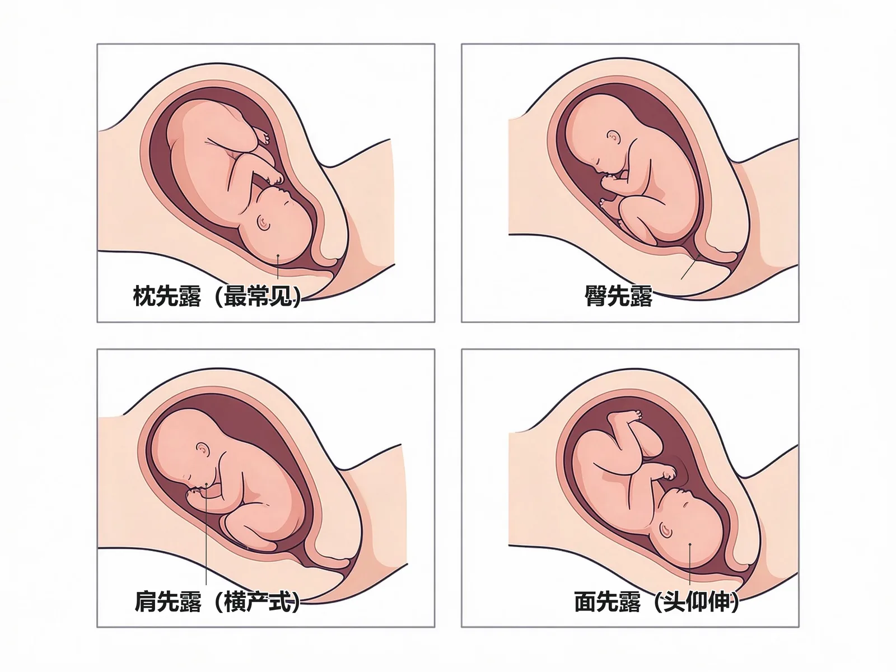

> [!SUCCESS] 能力底线
> 会算预产期、背出构成比、能由 hCG＋超声＋胎心判断宫内活胎——这是本模块最硬的得分点。

---

### 📋 结构化笔记

🔴 【掌握级】<b>早期妊娠确诊标准</b>：本次月经周期有性生活史的生育期女性，出现停经或异常阴道流血均应考虑妊娠；血或尿 hCG 阳性提示妊娠；超声发现宫内孕囊或胚芽可确诊宫内妊娠，见心管搏动提示胚胎存活（教材P50）
💡 为什么重要：把 hCG 阳性与"宫内活胎"区分开。

🧬 第一性原理：受精卵着床后滋养层即分泌 hCG，故血/尿 hCG 是"已妊娠"的最早生化证据，但只证明"存在妊娠组织"；超声见宫内孕囊/胚芽证明"位置在宫内"，见心管搏动才证明"是活的"，三者齐备才构成"正常宫内妊娠"。若妊娠组织在宫外，hCG 照样阳性而超声见不到宫内孕囊，即纠为异位妊娠。

#### 🔬 展开：确诊线的进一步含义
诊断要同时排除"异位妊娠""葡萄胎"等也可 hCG 阳性的疾病，并估计孕龄、判断多胎绒毛膜性。故须 hCG 阳性＋宫内见胚芽＋见心管搏动三要素齐备。

> [!WARNING] 易错陷阱
> 易把"hCG 阳性"直接当成"正常宫内妊娠"——必须超声确认宫内孕囊/胚芽，否则异位妊娠被漏诊。

---

🔴 【掌握级】<b>黑加征（Hegar sign）</b>：妊娠 6～8 周双合诊检查时，自觉宫颈与宫体之间似不相连、感觉断离，为子宫峡部极度柔软所致（教材P49）
💡 为什么重要：妇科检查中最典型的"早孕软性体征"，常单独出题。

🧬 第一性原理：孕后雌激素、孕激素升高，孕激素使子宫峡部明显变软、充血松弛，双合诊会感觉"软得隔开、似不相连"；峡部越软断离感越强，激素不足（流产趋势）则黑加征可阴性。

#### 🔬 展开：软性体征与血运改变
早孕还见阴道黏膜与宫颈阴道部充血呈紫蓝色（雌激素作用）；中晚期峡部渐拉长成子宫下段，是剖宫产切口及前置胎盘定位的解剖基础。

> [!WARNING] 易错陷阱
> 黑加征是"6～8 周"一过性主观体征，不是"宫颈断裂"，不可据此诊断病理情况。

---

🔴 【掌握级】<b>早孕期超声征象</b>：停经 35 日宫内见圆形或椭圆形孕囊（GS）；6 周见胚芽和原始心管搏动；14 周前测顶臀长（CRL）估计孕周；11～13⁺⁶ 周测颈项透明层（NT）及鼻骨（教材P50）
💡 为什么重要：B 超是确定宫内妊娠的主要方法，也是孕龄核对、染色体筛查窗口。

🧬 第一性原理：受精卵按固定时间发育，孕囊先现、随后胚芽、继而心管搏动，超声按这套"钟表"判断孕龄——CRL 最准故 14 周前用它校正预产期；NT 增厚与胎儿非整倍体相关，故在 11～13⁺⁶ 周做染色体筛查。

#### 🔬 展开：早孕超声的目的与时间窗
目的：确定宫内妊娠、排除异位妊娠和滋养细胞疾病、估计孕龄。11～13⁺⁶ 周测 NT＋鼻骨，若增厚或缺如提示非整倍体风险增高，需进一步产前筛查/诊断；疑结构畸形可在 20～24 周系统胎儿超声筛查。

> [!WARNING] 易错陷阱
> 勿把"看到孕囊"等同"宫内活胎"，须同时见胚芽＋心管搏动；CRL 用于 14 周前，之后改用双顶径等综合判断。

---

🔴 【掌握级】<b>胎心率正常范围与听诊定位</b>：胎心音呈双音、似钟表"滴答"；正常 110～160 次/分；12 周多普勒可探测，18～20 周一般听诊器可闻（教材P50、P51）
💡 为什么重要：胎心率是胎儿安危最直接的生命体征，数值与听诊部位均高频。

🧬 第一性原理：胎心搏动频率远超母体心率（110～160）且为双音，以此与母体子宫杂音、腹主动脉音、脐带杂音区分；胎心音在"靠胎背上方的孕妇腹壁"最清晰，故枕先露听脐下、臀先露听脐上、肩先露听近脐部。

#### 🔬 展开：不同胎位听诊部位
枕先露胎心在脐（左右）下方；臀先露在脐（左右）上方；肩先露在近脐部下方最清楚。故听胎心需先明确胎方位。

> [!WARNING] 易错陷阱
> 误将软圆音调为母体腹主动脉搏动（与母体心率一致、较慢）；脐带杂音与胎心率一致但为血流音，需与真胎心双音区分。

---

🔴 【掌握级】<b>子宫增大与孕周关系（宫高、宫底高度）</b>：手测宫底高度或尺测耻上子宫长度估计胎儿大小及孕周；20～24 周增长最快（约 1.6cm/周），36～40 周减慢（约 0.25cm/周），36 周时最高（教材P50）
💡 为什么重要：宫高是每次产检最简单的胎儿大小估测，是判断 FGR/巨大儿的第一线索。

🧬 第一性原理：子宫随妊娠线性增大、宫底逐渐上移；20～24 周胎儿生长最快故宫底增长最快，36 周后胎先露入盆、宫底略下降。宫高与孕周不符提示胎儿过大、羊水过多/过少、FGR，需重核预产期并做超声。

#### 🔬 展开：尺测耻上子宫长度（表5-1）
20 周末约 18（15.3～21.4）cm，24 周末约 24（22.0～25.1）cm，28 周末约 26（22.4～29.0）cm，32 周末约 29（25.3～32.0）cm，36 周末约 32（29.8～34.5）cm，40 周末约 33（30.0～35.3）cm。手测宫底：12 周末耻上 2～3 横指、16 周末脐耻之间、20 周末脐下 1 横指、24 周末脐上 1 横指、28 周末脐上 3 横指、32 周末脐与剑突之间、36 周末剑突下 2 横指、40 周末脐与剑突之间或略高。

> [!WARNING] 易错陷阱
> 宫底高度受单胎/多胎、羊水量影响大；不能只凭一次宫高诊断 FGR 或巨大儿，异常者需超声与重核预产期。

---

🔴 【掌握级】<b>胎动监测阈值</b>：16～20 周可自觉胎动，32～34 周达高峰，38 周后渐减；28 周后正常胎动每小时≥3 次或 2 小时≥10 次（教材P50）；28 周后计数＜6 次/2 小时提示胎儿缺氧可能（教材P59）
💡 为什么重要：胎动是孕妇自我评价胎儿宫内状况最简便经济的方法，两条阈值都要记牢。

🧬 第一性原理：胎动是胎儿自主神经活动的表现，随成熟先增强后（38 周后羊水相对减少、空间受限）缓慢减少，且有睡眠周期；胎动减少是胎儿缺氧/储备下降的最早预警信号，故 28 周后 2 小时＜6 次提示缺氧，应行 NST、BPP 评估。

#### 🔬 展开：两条胎动阈值的用法
①健康状态：28 周后每小时≥3 次或 2 小时≥10 次，供日常计数；②缺氧预警：28 周后 2 小时＜6 次提示缺氧，需胎心监护。两条分别回答"正不正常"与"是否需干预"。

> [!WARNING] 易错陷阱
> 易把"每小时≥3 次"与"＜6 次/2 小时"混用；胎动个体差异大、受睡眠周期影响，单次异常须重复计数并辅以 NST。

---

🔴 【掌握级】<b>胎产式、胎先露、胎方位定义与构成比</b>：胎产式＝胎体纵轴与母体纵轴的关系（平行＝纵产式占 99.75%，垂直＝横产式占 0.25%，交叉＝斜产式，多转纵产式）；胎先露＝最先进入骨盆入口的胎儿部分；胎方位＝先露部指示点与母体骨盆的关系（教材P51、P52）
💡 为什么重要：这三个概念是判断胎位、决定分娩方式的语言基础，构成比数值高频。

🧬 第一性原理：子宫是纵椭圆形，胎儿受其形态（尤其胎头重量）引导，绝大多数取"头朝下、身体纵轴与母体平行"的纵产式，这是自然分娩最省力、最配合产道的姿势（99.75%）；横产式（肩先露）无法自然分娩（0.25%）。逻辑：子宫形状→胎儿姿势→先露部→方位。32 周后姿势相对恒定。

#### 🔬 展开：胎先露的分类
纵产式有头先露和臀先露；横产式为肩先露。头先露按屈伸分枕、前囟、额、面先露；臀先露分混合、单臀、足先露；头/臀先露与胎手足同时入盆称复合先露。28 周前胎位不固定。

> [!WARNING] 易错陷阱
> 勿混淆胎产式（平行/垂直/交叉）与胎先露（谁先入盆）与胎方位（指示点方位）；斜产式多转纵产式，非稳定胎位。

---

🔴 【掌握级】<b>胎方位：指示点与书写</b>：胎方位＝先露部指示点与母体骨盆的关系。枕先露以枕骨、面先露以颏骨、臀先露以骶骨、肩先露以肩胛骨为指示点；枕先露、面先露、臀先露各有 6 种，肩先露有 4 种（教材P52）
💡 为什么重要：胎方位书写（如 LOA）直接决定分娩机制与助产选择。

🧬 第一性原理：指示点落在骨盆哪个方位即命名该胎方位。如胎头枕骨位于母体骨盆左前方称"枕左前"（LOA）——缩写＝部位(O)＋侧别(L/R)＋前后(A/P/T)，据此可由"指示点方位"推出缩写，不必死记 24 个。共 24 种（枕/面/臀各 6＝18，肩 4＝4）。

#### 🔬 展开：常见胎方位（表5-2 节选）
枕左前（LOA）、枕左横（LOT）、枕左后（LOP）、枕右前（ROA）、枕右横（ROT）、枕右后（ROP）；面先露颏左前（LMA）等；臀先露骶左前（LSA）等；肩先露肩左前（LSCA）、肩左后（LSCP）、肩右前（RSCA）、肩右后（RSCP）。LOA 是最常见的枕前位。

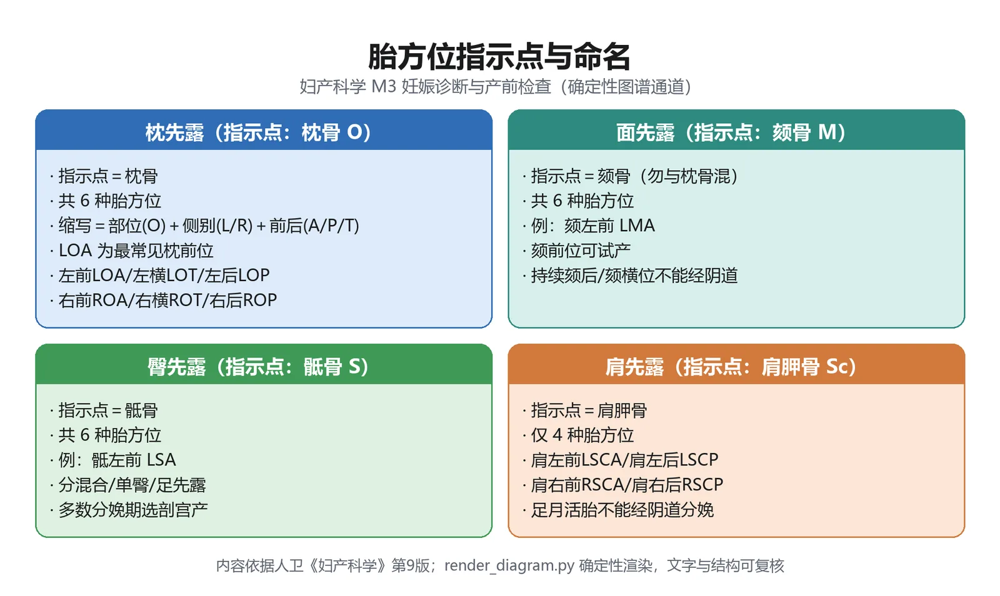


> [!WARNING] 易错陷阱
> 指示点易张冠李戴（面先露用颏骨、肩先露用肩胛骨）；缩写左右（L/R）以母体为准。

---

🔴 【掌握级】<b>预产期（EDC）推算与核对</b>：按末次月经（LMP）第 1 日起算，月份加 9 或减 3、日数加 7（教材P55）
💡 为什么重要：预产期是产检孕周、超声时机、是否过期妊娠（模块7）的总基准。

🧬 第一性原理：妊娠从排卵到分娩约 280 日（40 周），以 LMP 第 1 日为起点（排卵多在 LMP 后 14 日）倒推，故月+9（或−3）、日+7 即得预产期。月经不规律者 LMP 不可靠，以早孕超声为金标准——14 周前用 CRL、之后用双顶径等；LMP 与超声差＞5 日则以超声校正。

#### 🔬 展开：日期不准确妊娠
若 22 周前未超声校正、仅按 LMP 推算，称"日期不准确妊娠（suboptimally dated pregnancy）"；IVF 受孕者按移植胚胎日期反推 LMP。

> [!WARNING] 易错陷阱
> 月经不规律者不能依赖 LMP；若 LMP 与早孕超声差＞5 日必须按超声校正，否则过期妊娠、孕周相关病（模块7）全盘皆错。

---

🔴 【掌握级】<b>产前检查次数与孕周安排</b>：推荐产前检查 7～11 次，有高危因素者可酌情增加；我国《孕前和孕期保健指南（2018）》安排为妊娠 6～13、14～19、20～24、25～28、29～32、33～36、37～41 周（37 周后每周 1 次）（教材P54）
💡 为什么重要：把"多长时间看一次、每次看什么"框定下来，是整个孕期保健的时间骨架。

🧬 第一性原理：不同孕周母儿风险不同、产检频次随孕周加密——早期确认妊娠与高危、中期筛查畸形/糖尿病、晚期监测胎儿与胎位、37 周后临近分娩故每周 1 次。WHO（2016）对无合并症孕妇建议至少 8 次（＜12、20、26、30、34、36、38、40 周）。

#### 🔬 展开：产前检查的内容框架
每次产检含四部分：常规保健（问诊、血压体重、宫底高度、胎心率、胎位）、辅助检查（必查项目适用所有孕妇，备查项目有指征或条件医院开展）、健康教育及指导。必查如血尿常规、血型、肝肾功能、空腹血糖、乙肝表面抗原、梅毒与 HIV 筛查、早孕期超声。第 1 次（6～13 周）建册、定孕周预产期、评估高危因素。

> [!WARNING] 易错陷阱
> 易把 WHO 的"至少 8 次"与我国"推荐 7～11 次＋具体孕周"混为一谈；37 周后是"每周 1 次"。

---

🔴 【掌握级】<b>电子胎心监护（EFM）判读要点</b>：基线变异是最重要的评价指标；正常胎心率基线 110～160 次/分；NST 用于产前监护，OCT 用缩宫素诱导宫缩评估胎盘储备（教材P59、P60）
💡 为什么重要：EFM 是产前/产时评估胎儿宫内安危的核心技术，Ⅲ类监护需立即处理。

🧬 第一性原理：胎心受自主神经调控表现"基线"＋"变异/加速/减速"。基线变异反映中枢对胎心的精细调节，变异越好提示供氧越充足、消失/减小提示缺氧；加速提示胎儿对自身活动的交感应答（先兆良好）；减速是宫缩致胎盘血流减少、一过性缺氧的表现，晚期减速提示胎盘灌注不足。

#### 🔬 展开：EFM 评价指标与三类减速
指标：基线（10 分内波动 5 次/分内的平均心率）、基线变异（消失/微小≤5 次/分、中等 6～25 次/分、显著＞25 次/分；中等为正常）、加速（≥32 周≥15 次/分持续≥15 秒；＜32 周≥10 次/分持续≥10 秒）。三类减速：早期减速（最低点与宫缩峰值同时出现）→良性；晚期减速（最低点落后宫缩峰值）→胎盘灌注不足；变异减速（下降≥15 次/分、≥15 秒＜2 分钟、无规律、双肩峰）→脐带受压。

> [!WARNING] 易错陷阱
> 把"早期减速"误当危险信号（多为胎头受压、良性）；把"NST 正常"当"无缺氧"（假阳性高，异常才有意义，需综合 BPP）；别用母体脉搏读胎心。

---

🔴 【掌握级】<b>妊娠期合理用药与孕龄</b>：用药原则——有明确指征、选用相对安全药物、尽量单独用药、选用结论肯定的药物、严格掌握剂量与用药时间并及时停药、妊娠早期若病情允许尽量推迟到中晚期（教材P65）；受精后 3～8 周为致畸高度敏感期（教材P66）
💡 为什么重要：致畸敏感期与用药原则是孕妇用药的核心禁令与依据。

🧬 第一性原理：胚胎发育按"全或无→器官分化→生长成熟"三阶段。受精后 2 周内细胞未定向分化，药物影响为"全或无"（全＝流产，无＝不畸形）；3～8 周器官定向分化对致畸因子最敏感（神经 15～25 日、心脏 21～40 日、肢体眼 24～46 日），此期用药易致形态畸形；9 周～足月为生长成熟期，用药多表现为生长受限、低体重和功能行为异常。

#### 🔬 展开：FDA 妊娠分类及其局限
FDA 分 5 类：A（未发现对胎儿有害）、B（危害证据不足）、C（动物致畸但无人类对照）、D（对胎儿有害但临床急需、无替代药）、X（明显致畸，妊娠禁用）。局限：仅约 40% 药物纳入，60% 以上为 C 类，且未提供孕周、剂量证据；2008 年提出废弃、改为"知情告知"（胎儿风险总结、临床考虑、数据）。

> [!WARNING] 易错陷阱
> 勿把"3～8 周致畸敏感期"记成"整个孕早期"，或把"2 周内全或无"误用于 3 周以后；勿一怀孕就停用一切必需药。

---

🟡 【熟悉级】<b>早孕反应、停经与乳房变化</b>：停经是最早症状但不特异（过期 10 日以上高度怀疑）；早孕反应于停经 6 周左右出现（畏寒、头晕、流涎、乏力、嗜睡、食欲缺乏、喜食酸物、厌恶油腻、恶心晨吐、情绪改变），多在停经 12 周左右自行消失；尿频为前倾增大子宫压迫膀胱；乳房胀痛、乳晕着色加深、蒙氏结节（教材P49）。机制：停经源于排卵后受精、黄体持续并分泌 hCG 维持妊娠；早孕反应与血 hCG 升高有关；雌激素使乳晕着色。妊娠剧吐是加重态，出现不能进食、体重下降、电解质紊乱即按"妊娠剧吐"处理。

---

🟡 【熟悉级】<b>胎体触诊、中晚期监测与四步触诊法（Leopold）</b>：20 周后经腹壁能触到胎体，24 周后能区分胎头（圆而硬、浮球感）、胎背（宽而平坦）、胎臀（宽而软、不规则）、肢体（小、可活动）；中期每次产检测宫底高度、听胎心率，20～24 周系统超声筛查结构畸形（教材P50、P51、P59）。四步触诊（教材P57）：孕妇排尿后仰卧，检查者站其右侧，前 3 步面向头侧、第 4 步面向足端；第 1 步置宫底测高度辨头/臀，第 2 步置腹两侧辨胎背与肢体，第 3 步握耻上先露辨是否衔接（浮动＝未入盆、不能推动＝已衔接），第 4 步向骨盆入口深压核对入盆。中晚期超声可显示胎数、胎产式、胎先露、胎方位、胎盘位置与宫颈内口关系、羊水量，并测双顶径、头围、腹围、股骨长估计体重。

> [!WARNING] 易错陷阱
> 四步触诊第 4 步要"面向孕妇足端"；"衔接"的标准是胎先露不能推动（第 3 步）。

---

🟡 【熟悉级】<b>骨盆测量正常值</b>：内测量——对角径（DC）12.5～13.0cm（减 1.5～2.0cm 为真结合径/骨盆入口前后径）、坐骨棘间径约 10cm、坐骨切迹（骶棘韧带）容 3 横指（5.5～6.0cm）、出口后矢状径 8～9cm；外测量——髂棘间径 23～26cm、髂嵴间径 25～28cm、骶耻外径 18～20cm、坐骨结节间径（出口横径）8.5～9.5cm、耻骨弓角度 90°（＜80°异常）（教材P57、P58）。机制：对角径估入口前后径；坐骨棘间径与坐骨切迹评估中骨盆；出口用坐骨结节间径＋出口后矢状径（＞15cm 提示出口狭窄不明显）。髂棘间径、髂嵴间径、骶耻外径不能预测产时头盆不称，无须常规测量。

> [!INFO] 出口径线的组合判断
> 坐骨结节间径＋出口后矢状径大于 15cm 表明出口狭窄不明显；耻骨弓角度小于 80° 为异常。

---

🟡 【熟悉级】<b>高龄孕妇的孕期保健</b>：年龄＜18 岁或≥35 岁为高危因素，年龄≥40 岁母儿并发症显著增加（教材P54）；预产期年龄 35～39 岁且单纯年龄为高危者，签署知情同意后可先行无创产前筛查（NIPT）；预产期年龄≥40 岁建议直接介入性产前诊断排查胎儿非整倍体（教材P59）。机制：高龄增加流产、胎儿染色体与结构异常、妊娠期高血压疾病、GDM、FGR、早产、死胎风险，应规范补叶酸、钙剂、铁剂，有指征者给小剂量阿司匹林预防子痫前期（模块7）；≥40 岁应加强胎儿监护，40 周前适时终止妊娠。

---

🟡 【熟悉级】<b>胎儿生物物理评分（BPP）与高危儿界定</b>：BPP（教材P61）综合胎心监护与超声，指标为 NST、胎儿呼吸运动（FBM）、胎动（FM）、胎儿张力（FT）、羊水最大暗区垂直深度（AFV），各 2/0 分、满分 10 分。机制：NST 看胎心加速、FBM/FM 看呼吸与运动中枢、FT 看肌张力（缺氧最早消失的是肌张力与呼吸运动）、AFV 反映慢性胎盘功能。高危儿（教材P59）包括①孕龄＜37 周或≥42 周；②出生体重＜2500g；③小于/大于胎龄儿；④1 分钟 Apgar 0～3 分；⑤产时感染；⑥高危妊娠产妇的新生儿；⑦手术产儿；⑧兄弟姐妹有严重新生儿病史或新生儿期死亡。确定高危儿正是落实 NST/OCT/BPP 监护的指征人群。

> [!WARNING] 易错陷阱
> BPP 中 AFV 反映的是"慢性"胎盘功能（羊水过少提示长期缺氧），NST/胎动/呼吸反映"急性"状态，二者时相不同勿混。

---

🟡 【熟悉级】<b>孕期营养需要、膳食指南与常见症状处理</b>：营养（教材P63）——早期不需额外加能量，4 个月后每日＋200kcal；蛋白质中晚期每日＋15g；碳水占总热量 50%～60%、中晚期每日＋约 35g；脂肪占 25%～30%（DHA 益胎脑视网膜）。膳食指南（2016，教材P63）在一般人群上加 5 条：①补叶酸、吃含铁食物、选碘盐；②呕吐严重者少量多餐保证碳水；③中晚期适量加奶鱼禽蛋瘦肉；④适量活动维持适宜增重；⑤禁烟酒、积极哺乳；早期每日至少 130g 碳水、叶酸 400～800μg；中晚期蛋白质＋50g（中）/＋75g（晚）、奶 250～500g 并补 600mg 钙、碘 230μg/d、铁加 20～50g 红肉（每周 1～2 次动物内脏/血）；每日≥30 分钟中等强度活动。常见症状（教材P66）——恶心晨吐予维生素 B6 10～20mg/次 tid，重者按妊娠剧吐；非贫血血清铁蛋白＜30μg/L 补元素铁 60mg/d、确诊 IDA 补 100～200mg/d；下肢痉挛（缺钙）补钙 600～1500mg/d；休息不消退的水肿查妊娠期高血压疾病、肾脏病等。

> [!SUCCESS] 常错数值自查
> 叶酸 400～800μg/d；碘 230μg/d；奶 250～500g＋钙 600mg；运动≥30 分钟/日；碳水 130g/d。

---

🟢 【了解级】<b>围产期、胎心音鉴别、FDA 分类历史</b>：围产期Ⅰ从妊娠≥28 周至产后 1 周、Ⅱ从≥20 周至产后 4 周、Ⅲ从≥28 周至产后 4 周、Ⅳ从胚胎形成至产后 1 周；国内采用围产期Ⅰ（教材P54）。胎心音为双音、110～160 次/分；子宫杂音与腹主动脉音为母体脉搏音、与母体心率一致；脐带杂音为血流音、与胎心率一致（教材P51）。FDA 分类（A/B/C/D/X）源于 20 世纪 50 年代反应停事件（胎儿肢体缺陷）促使 1962 年美国《药物条例》要求标注安全性；分类有局限（仅 40% 药物纳入、60% 以上为 C 类、未提供孕周剂量证据），2008 年改"知情告知"（教材P64、P65）。

---

🟢 【了解级】<b>孕期运动禁忌与 37～41 周产检</b>：孕期不适宜跳跃、震动、球类、登高（海拔 2500m 以上）、长途旅行、长时间站立、潜水、滑雪、骑马；腕管综合征为自限性、产后缓解；下肢/外阴静脉曲张避免久站、穿弹力袜、抬高下肢；腰背痛因关节韧带松弛；痔疮/便秘慎用开塞露（教材P64、P66）。37～41 周常规保健含血压体重、宫底高度、胎心率、胎位，必查为产科超声与 NST（每周 1 次）及宫颈检查（Bishop 评分），超过 41 周应住院并引产（教材P56）。

---

### 📊 对比速查

<b>表1｜胎产式—胎先露—胎方位关系与构成比（表5-2 浓缩）</b>

| 胎产式 | 构成比 | 胎先露 | 指示点 | 胎方位示例 |
|---|---|---|---|---|
| 纵产式 | 99.75% | 头（枕/面）先露 | 枕骨/颏骨 | LOA（枕左前）、LMA（颏左前） |
| 纵产式 | 99.75% | 臀先露 | 骶骨 | LSA（骶左前）、RSP（骶右后） |
| 横产式 | 0.25% | 肩先露 | 肩胛骨 | LSCA（肩左前）、RSCP（肩右后） |
| 斜产式 | 暂时性 | — | — | 分娩中多转纵产式 |

<b>表2｜NST 结果判读（SOGC 2007，表6-3 浓缩）</b>

| 参数 | 正常NST（有反应型） | 不典型NST（可疑型） | 异常NST（无反应型） |
|---|---|---|---|
| 胎心率基线 | 110～160 次/分 | 100～110 或＞160（＜30分） | ＜100 或＞160（＞30分） |
| 基线变异 | 6～25 次/分（中等） | ≤5（<40 分）或≥25（>10 分） | ≤5（≥40～80 分） |
| 减速 | 无/偶发变异减速 | 变异减速 30～60 秒 | 变异减速≥60 秒、晚期减速 |
| 加速（≥32 周） | 40 分内≥2 次 | 40～80 分内＜2 次 | ＞80 分内＜2 次 |
| 处理 | 继续随访/评估 | 需进一步评估 | 复查＋全面评估＋BPP＋终止妊娠 |

<b>表3｜孕前 BMI 与孕期体重增长（2022 国家卫健委，表6-6）</b>

| 孕前 BMI（kg/m²） | 孕期总增长/kg | 中晚期每周增长/kg |
|---|---|---|
| 低体重（＜18.5） | 11.0～16.0 | 0.46（0.37～0.56） |
| 正常（18.5～24.0） | 8.0～14.0 | 0.37（0.26～0.48） |
| 超重（24.0～28.0） | 7.0～11.0 | 0.30（0.22～0.37） |
| 肥胖（≥28.0） | 5.0～9.0 | 0.22（0.15～0.30） |

<b>表4｜骨盆测量正常值（内测量 vs 外测量）</b>

| 测量类别 | 径线/项目 | 正常值 |
|---|---|---|
| 内测量 | 对角径（DC） | 12.5～13.0cm（真结合径=DC−1.5~2.0） |
| 内测量 | 坐骨棘间径 | 约 10cm |
| 内测量 | 坐骨切迹（骶棘韧带） | 容 3 横指（5.5～6.0cm） |
| 内测量 | 出口后矢状径 | 8～9cm |
| 外测量 | 髂棘间径/髂嵴间径/骶耻外径 | 23～26 / 25～28 / 18～20cm |
| 外测量 | 坐骨结节间径（出口横径） | 8.5～9.5cm |
| 综合判定 | 坐骨结节间径＋出口后矢状径 | ＞15cm 提示出口狭窄不明显、可经阴道分娩（≤15cm 提示出口狭窄） |
| 外测量 | 耻骨弓角度 | 90°（＜80° 异常） |

<b>表5｜用药时孕龄与危害</b>

| 孕龄 | 胚胎状态 | 药物影响 | 关键时间窗 |
|---|---|---|---|
| 受精后 2 周内 | 细胞未定向分化 | "全或无"（流产/无畸形） | — |
| 受精后 3～8 周 | 器官定向分化 | 致畸高度敏感期→形态畸形 | 神经 15～25 日、心脏 21～40 日、肢体眼 24～46 日 |
| 受精后 9 周～足月 | 生长成熟 | 胎儿生长受限、低体重、功能异常 | 神经/生殖器/牙继续分化；肝酶差、血脑通透性高 |

---

### 🔗 因果链（D2）

<b>因果链1：早孕确诊路径</b>

```
停经/异常阴道流血 ──生育期+性生活史──▶ 疑妊娠
        │
        ▼
  血/尿 hCG 阳性 ──证明"有妊娠组织"──▶ 提示妊娠（但不能定位）
        │                        ▼ 超声
  见宫内孕囊/胚芽 ──证明"位置在宫内"──▶ 宫内妊娠
        │                        ▼ 彩色多普勒
  见心管搏动 ──证明"是活的"──▶ ★ 确诊正常宫内妊娠（三要素齐全）
        │
        └─ 若宫外见不到孕囊/血hCG 不升 ──▶ ★ 纠偏为异位妊娠
```

> [!INFO] 此图展示机制链路，数据对比见「📊 对比速查」表1、表2 与「📋 结构化笔记」掌握级第 1、2 条。

<b>因果链2：胎儿缺氧—预警—终止妊娠链路</b>

```
胎动减少/消失 ──28周后<6次/2h 提示缺氧──▶ 疑胎儿储备下降
        │
        ▼
  NST 无反应型/异常 ──复查+延长监护──▶ 需进一步评估
        │                                   ▼
  BPP（Manning）评分下降 ──急+慢性综合──▶ ★ 综合判断缺氧程度
        │                                   ▼
  脐动脉血流异常（PI>95百分位/+2SD；舒张末期消失/倒置）──▶ ★ 缺氧严重
        │                                   ▼
  大脑中动脉 PI/S/D 降低、脐静脉搏动、静脉导管 a 波反向 ──★ 濒死状态
        │                                   ▼
  纠正缺氧（体位/吸氧/停缩宫素/抑制宫缩）不奏效 ──▶ Ⅲ类监护→紧急终止妊娠
```

> [!INFO] 此图展示机制链路，NST/EFM/BPP 数据见「📊 对比速查」表2 与「📋 结构化笔记」掌握级第 11 条。

---

### 🌳 鉴别决策树（D4）

<b>胎心音来源鉴别（≥3 种鉴别）</b>

```
听诊到"胎心样声音" → 先判断频率与音质
   │
   ├── 双音、似钟表"滴答"、较快 ──▶ 胎心音（真胎心）频率 110～160 次/分；部位"靠胎背上方"（枕先露→脐下、臀先露→脐上、肩先露→近脐部）
   │
   ├── 软而弱、与母体脉搏同频 ──▶ 子宫杂音 / 腹主动脉音（母体血流音）
   │       鉴别：与母体心率一致，非胎儿心搏
   │
   └── 血流音、与胎心率一致 ──▶ 脐带杂音（脐带血流声）
           鉴别：与胎心率同频但为血管音，需与真胎心双音区分
```
> [!NOTE] 判断依据：先分"是胎心还是母体血流音"（看是否与母体脉搏一致），再分"双音真胎心 vs 血流音脐带杂音"（看音质是否为清晰双音）。

---

### ⚠️ 常见陷阱

- 停经不是妊娠特有症状，异位妊娠、月经紊乱、哺乳期闭经均可停经；过期 10 日以上才高度怀疑。
- hCG 阳性≠宫内妊娠，必须超声见宫内孕囊/胚芽＋心管搏动才确诊正常宫内妊娠；黑加征只是 6～8 周一过性软体征，不是"宫颈断裂"。
- 胎心音要与子宫杂音、腹主动脉音、脐带杂音鉴别；胎动两套阈值别混（日常"≥3 次/时或≥10 次/2 时"；缺氧"＜6 次/2 时"）。
- 预产期按 LMP 月+9/−3、日+7 推算，月经不规律者以"最早一次早孕超声（CRL）"为准；髂棘间径、髂嵴间径、骶耻外径不能预测产时头盆不称。

### 🧠 记忆口诀

- <b>预产期</b>："月份加九或减三，日期加七"（"九三七月七"）；<b>早孕确诊</b>：hCG（有妊娠）＋超声（宫内＋活）＝"hCG 找胚心"。
- <b>胎方位指示点</b>：枕骨、颏骨、骶骨、肩胛骨——"枕颏骶肩"；缩写＝"部位＋左右＋前后"（枕＋左＋前＝LOA）；<b>胎心听诊</b>："枕在下、臀在上、肩靠脐"。

### 📌 本章小结

> [!INFO] 本章小结
> - take-home 1：早孕确诊要"hCG 阳性 + 超声见胚芽 + 见心管搏动"三要素齐备；hCG 只证明"有妊娠组织"，超声才证明宫内与存活。
> - take-home 2：胎位判断核心是"胎产式→胎先露→胎方位"三层递进；纵产式占 99.75%，指示点（枕/颏/骶/肩胛骨）落在母体骨盆前后左右即命名胎方位（如 LOA）。
> - take-home 3：胎儿缺氧监测链从"胎动减少"出发，经 NST 异常→BPP→脐动脉/大脑中动脉血流异常逐级升级，最终指向"及时终止妊娠"；晚期减速与Ⅲ类监护须立即处理。
> <b>🧬 本章核心洞察</b>：妊娠诊断与胎儿监测，本质都是用"妊娠的产物（hCG、超声、宫高、胎心率）"去读"子宫里那个逐渐长大的生命"——产检时间表与胎儿缺氧预警链，共同构成常规到及时的母儿安全网。

### 🔗 深度链接

- 胎方位→ 分娩机制（模块4）：枕先露枕左前 LOA 如何经衔接、俯屈、内旋转、仰伸完成分娩，取决于模块2 的产道与胎儿条件；胎位异常则落入 异常分娩（模块5）。
- 胎动、NST、宫高→ 妊娠并发症（模块7）：胎动减少、NST 异常提示 胎儿窘迫；过期妊娠、胎儿生长受限 以模块3 的孕周与宫高为界定基础；合并前置胎盘/胎盘早剥则与 产后出血（模块6）相接。
- 早孕诊断与 hCG→ 妊娠滋养细胞疾病（模块12）：葡萄胎/绒癌以 子宫大于孕周、hCG 异常升高、超声"落雪征"为特点，是"宫高—孕周"与"hCG"两个诊断轴的异常延伸，也是 异常出血鉴别（模块13）上游来源。


## 模块4：正常分娩

> [!INFO] 模块信息
> <b>重点等级</b>：🔴掌握 9 个 / 🟡熟悉 11 个 / 🟢了解 6 个｜<b>关联模块</b>：模块2（妊娠生理）、模块3（妊娠诊断）、模块5（异常分娩）、模块6（分娩并发症）、模块9（产褥期）｜<b>谱系位置</b>：产科高危谱系的「正常基线」，产力、产道、胎儿、精神四因素协同的生理过程；M05/M06 均为此基线偏离，M09 为后续｜<b>预计阅读</b>：约 8 分钟

---

### 🧩 前置知识检查

- <b>骨盆分界与盆膈</b>（模块1）：真假骨盆界线即骨盆入口平面，肛提肌构成会阴保护与内旋转的解剖基础。
- <b>子宫峡部</b>（模块1）：非孕约 1cm，是子宫下段"前身"；上界为解剖学内口、下界为组织学内口。
- <b>胎盘-胎儿单位</b>（模块2）：雌激素由其协同合成、孕激素维持妊娠，是"雌/孕平衡"前提；胎方位接模块3。

> [!NOTE] 页码说明
> 本模块对应教材第 12 章（印刷 P159-174），所有"教材P##"均取自所读页。

---

### 🎯 高收益摘要

1. <b>孕周</b>：足月=满 37 至不满 42 周；早产=满 28 至不满 37 周；过期产=≥42 周（教材P159）。
2. <b>临产</b>：规律渐强宫缩（≥30 秒、间歇 5～6 分钟）＋进行性宫颈消失/宫口扩张/胎先露下降，且镇静剂不能抑制（教材P166）。
3. <b>产程时限</b>：潜伏期初产≤20 小时；第二产程初产≤3 小时（硬膜外≤4 小时）；第三产程 5～15 分钟、≤30 分钟；宫底强度为下段 2 倍（教材P161、P167）。

---

### 📋 结构化笔记

🔴 【掌握级】<b>孕周划分</b>：分娩为妊娠达 28 周至胎儿及附属物全部娩出；足月产=满 37 至不满 42 周（259～293 日）（教材P159）。
💡 为什么重要：孕周误判直接改变"是否干预、是否促胎肺成熟、是否引产"的决策。

🧬 第一性原理：时间窗由胎儿肺成熟与胎盘功能衰减共同界定——满 37 周肺多成熟、不满 42 周胎盘未明显衰退；故 37 周是成熟下限、42 周是功能上限。

#### 🔬 足月精确界定（A1 常考）
早产=满 28 周至不足 37 周（196～258 日）；足月=满 37 周至不足 42 周（259～293 日）；过期产=满及超过 42 周（≥294 日）。42 周整即过期产；36⁺⁶ 周仍是早产。

> [!WARNING] 易错陷阱
> 足月须"不足 42 周"，42 周整即过期产；36⁺⁶ 仍算早产。

---

🔴 【掌握级】<b>分娩动因核心——内分泌控制理论</b>：前列腺素（PG）、雌激素、缩宫素共同触发宫缩与宫颈扩张（教材P159-160）。
💡 为什么重要：催产/引产的药理学靶点（缩宫素、PG 制剂）都建立在此机制上。

🧬 第一性原理：子宫需被"点亮"才能节律收缩。PG 诱发协调宫缩、促宫颈成熟、上调缩宫素受体；雌激素促宫缩功能性改变、促 PG、增高肌细胞膜电位；缩宫素血中产程中渐增、受体随孕周增多故敏感性升高。

#### 🔬 激素对比
PG=诱发宫缩＋促宫颈成熟＋上调缩宫素受体；雌激素=促 PG、促肌动蛋白蓄积、增高膜电位；缩宫素=经胎膜 PG（PGE2、PGF2α）＋受体/钙通道，第二产程末期达峰；孕激素=促 NO、抑制间隙连接、下调 PG/钙通道/缩宫素受体（"刹车"）。分娩是<b>正反馈</b>——宫颈胶原纤维减少而软化、子宫自静息期进入<b>激活期</b>，缩宫素是母体来源起重要作用激素。

> [!WARNING] 易错陷阱
> 缩宫素"重要但非绝对"；雌/孕比例上升并非人类分娩动因；孕激素方向与雌激素相反。

---

🔴 【掌握级】<b>临产诊断（临产 vs 假临产）与 Bishop 评分</b>：临产为规律渐强宫缩（≥30 秒、间歇 5～6 分钟）＋进行性宫颈消失/扩张/先露下降，镇静剂不能抑制（教材P166）。
💡 为什么重要：把假临产当临产会过早干预、增剖宫产率；反之延误处理。

🧬 第一性原理：临产是"宫缩→宫颈进行性改变"的正反馈：宫缩牵拉宫颈扩张，扩张的宫颈又反射性增强宫缩；假临产只有宫缩、无宫颈进行性改变，故镇静剂打断宫缩即停。看宫缩"带不带宫颈走"。

#### 🔬 假临产鉴别 + Bishop 评分
假临产：①频率不一致、持续短间歇长；②强度未渐增；③常夜间出现、清晨消失；④不伴宫颈缩短/扩张；⑤镇静剂可抑制。Bishop 评分（满分 13，5 指标各 0～3 分）：宫口开大、宫颈管消退、先露位置、宫颈硬度、宫口位置；<b>>9 均成功、7～9 成功率 80%、4～6 成功率 50%、≤3 均失败</b>。

> [!WARNING] 易错陷阱
> 假临产"夜间出现、清晨消失"是典型点；临产须宫缩≥30 秒＋间歇 5～6 分钟伴宫颈进行性改变。

---

🔴 【掌握级】<b>产力——宫缩三特性（节律性、对称性和极性、缩复作用）及腹压、肛提肌</b>（教材P160-161）。
💡 为什么重要：产力异常是 M05 最常见病因，理解三特性才能识别协调/不协调宫缩。

🧬 第一性原理：子宫须可恢复的"脉搏式"收缩而非持续强直——持续收缩压瘪子宫壁血管断胎儿血流，故必须"收缩-间歇"交替（节律性）；宫缩起自宫角、向宫底扩散（对称性），宫底最强向下渐弱（极性，为下段 2 倍）；每次收缩肌纤维缩短、间歇不完全复原、逐次更短（缩复作用）使宫腔渐小压胎先露下降。

#### 🔬 三特性数值与腹压/肛提肌
①节律性：进行期→极期（30～40 秒）→退行期→间歇（5～6 分钟）；宫口开全后持续 60 秒、间歇 1～2 分钟；极期宫腔压第一产程末 40～60mmHg、第二产程 100～150mmHg、间歇 6～12mmHg。②对称/极性：2cm/s 向子宫下段扩散、15 秒遍及全宫。③缩复作用：间歇不完全复原。④腹压（腹壁肌+膈肌）：第二产程末最有效、第三产程促胎盘娩出。⑤肛提肌：助内旋转、仰伸娩出、助胎盘娩出。

> [!WARNING] 易错陷阱
> 宫口开全后间歇 1～2 分钟、持续 60 秒；宫底为下段 2 倍；缩复作用要求"间歇不完全复原"。

---

🔴 【掌握级】<b>骨产道骨盆三平面关键径线、骨盆轴、骨盆倾斜度</b>（教材P161-162）。
💡 为什么重要：决定头盆是否相称，是判断能否经阴道分娩的依据。

🧬 第一性原理：产道是真骨盆弯曲通道，最窄处决定能否通过。入口（真结合径 11cm）决定入盆；中骨盆（坐骨棘间径 10cm）为最小平面、与内旋转最密切；出口（坐骨结节间径 9cm）决定娩出，出口横径稍短加后矢状径>15cm 仍可经后三角娩出。

#### 🔬 三平面径线记忆
入口（横椭圆）：前后径/真结合径 11cm、横径 13cm、斜径 12.75cm。中骨盆（纵椭圆、最小）：横径=坐骨棘间径 10cm、前后径 11.5cm。出口（两三角）：前后径 11.5cm、横径=坐骨结节间径 9cm、前矢状径 6cm、后矢状径 8.5cm；横径+后矢状径>15cm 中等足月胎头可通过。骨盆轴：上段向下向后、中段向下、下段向下向前；骨盆倾斜度 60°。

> [!WARNING] 易错陷阱
> 真结合径 11cm≠中骨盆/出口前后径 11.5cm；坐骨棘间径=中骨盆横径 10cm；坐骨结节间径=出口横径 9cm；"横径+后矢状径>15cm"才可经阴道分娩。

---

🔴 【掌握级】<b>枕先露分娩机制——胎儿以最小径线通过产道</b>（教材P165-166）。

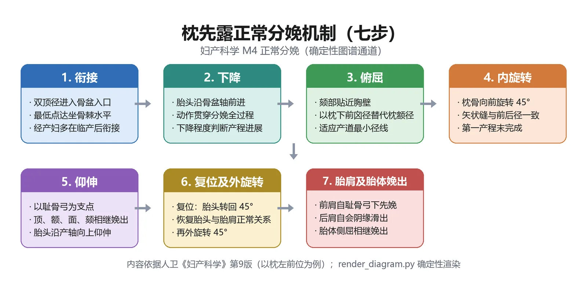

💡 为什么重要：整章核心，是 M05（头盆不称、枕后位）机制的直接对照。

🧬 第一性原理：胎头是胎体最大、最硬部分，产道前窄后宽且弯曲，故胎头须"边转边走"。衔接（双顶径入骨盆入口、颅骨最低点达或近坐骨棘水平）时以枕额径（11.3cm）入盆；遇肛提肌阻力<b>俯屈</b>把枕额径换成枕下前囟径（9.5cm）——不俯屈即头盆不称；为适应中骨盆前后长横径短而<b>内旋转</b> 45°；达阴道口以耻骨弓为支点<b>仰伸</b>；胎头娩出后<b>复位及外旋转</b>各 45°，使胎肩转到出口前后径。

#### 🔬 枕左前位七步机转（一步一图）
```
衔接(双顶径入盆/枕额径/矢状缝在入口右斜径)
  ↓ 宫缩+胎轴压力
下降(贯穿全程首要条件,与各动作同时)
  ↓ 肛提肌阻力
俯屈(枕额径11.3→枕下前囟径9.5)
  ↓ 骨盆底阻力
内旋转(枕部向母体中线转45°,第一产程末完成)
  ↓ 阴道口
仰伸(以耻骨弓为支点,顶额鼻口颏相继娩出)
  ↓ 胎头娩出
复位(枕部向左外转45°恢复头肩关系)
  ↓ 胎肩下降
外旋转(前肩向前向中线转45°,头再左外转45°)
  ↓ 宫缩
胎肩及胎儿娩出(前肩自耻骨弓下,后肩自会阴前缘)
```
★关键转折：俯屈（决定能否通过）与内旋转（决定是否枕后位）。

> [!WARNING] 易错陷阱
> 衔接用枕额径、通过用枕下前囟径；下降贯穿全程；复位与外旋转各 45°。

---

🔴 【掌握级】<b>胎头径线与囟门（表12-1）</b>：双顶径 9.3cm、枕额径 11.3cm、枕下前囟径 9.5cm、枕颏径 13.3cm（教材P163-164）。
💡 为什么重要：径线=头盆相称关键，囟门是确定胎方位的重要标志。

🧬 第一性原理：胎头是胎体最大部分、最难通过产道。最大横径=双顶径 9.3cm（判断胎儿大小）；入盆用枕额径、俯屈后用枕下前囟径——枕额径过大一入盆即卡在入口即头盆不称。大囟（前囟，菱形）与小囟（后囟，三角）是颅骨板间空隙，使胎头受压时颅缝轻叠、变形变小而利于娩出。

#### 🔬 四径线 + 两囟门（A1 必背）
双顶径 BPD（两顶骨隆突间，最大横径）9.3cm；枕额径（鼻根上方至枕外隆凸）11.3cm；枕下前囟径（前囟中央至枕外隆凸下方）9.5cm；枕颏径（颏骨下方中央至后囟顶）13.3cm。大囟=前囟（菱形，额骨+顶骨+额缝/冠状缝/矢状缝）；小囟=后囟（三角）。胎头以枕额径衔接、以枕下前囟径通过产道；触清矢状缝及前后囟定胎方位。

> [!WARNING] 易错陷阱
> BPD=9.3cm 但通过产道用枕下前囟径（9.5cm）；枕颏径 13.3cm 最大径线；前囟菱形、后囟三角常互换设误。

---

🔴 【掌握级】<b>产程分期及时限</b>（教材P167）。
💡 为什么重要：产程时限是 M05（产程延长/活跃期停滞）与 M06（产后出血）判定的时间基石。

🧬 第一性原理：产程被"宫口开全（10cm）"与"胎儿娩出"切为三段：第一产程=规律宫缩至宫口开全；第二产程=开全至胎儿娩出；第三产程=胎儿至胎盘娩出。若第二产程无限延长，胎头持续压盆底，母体易裂伤/感染、胎儿易缺氧——故须设上限并据此干预。

#### 🔬 各产程时限与处理阈值
①第一产程：潜伏期初产≤20h、经产≤14h；活跃期宫口开 4～5cm（最迟 6cm）进入、扩张≥0.5cm/h，现以 5cm 为进入活跃期标志。②第二产程：无硬膜外初产≤3h、经产≤2h；硬膜外各 +1h（初产≤4h、经产≤3h）；初产>1h 应关注、>2h 必须全面评估。③第三产程：约 5～15 分钟、不超过 30 分钟。

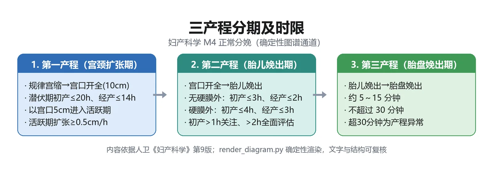


> [!WARNING] 易错陷阱
> 活跃期进入标志是宫口扩张 5cm（可 4～5cm 起、最迟 6cm）；硬膜外各 +1h；第三产程≤30 分钟。

---

🔴 【掌握级】<b>新生儿 Apgar 评分与窒息判断</b>：5 项体征（心率、呼吸、肌张力、喉反射、皮肤颜色）各 0/1/2 分，满分 10；1 分钟反映宫内、5 分钟反映复苏效果并与预后相关（教材P172）。
💡 为什么重要：出生时快速评估与复苏决策的第一抓手，A2 常见题干。

🧬 第一性原理：出生瞬间胎儿从"胎盘供氧"切换为"自主呼吸"，Apgar 把切换成功量化为 0～10 分。1 分钟体现宫内状态、5 分钟反映复苏效果；因窒息新生儿不能等 1 分钟才复苏，Apgar 只作评估+指导而非替代即时处理。

#### 🔬 Apgar 细目 + 我国窒息标准
五项（各 0/1/2 分）：心率（0 / <100 次 / ≥100 次）；呼吸（无 / 浅慢不规则 / 佳、哭声响亮）；肌张力（松弛 / 四肢稍屈曲 / 四肢屈曲活动好）；喉反射（无反射 / 有些动作 / 咳嗽、恶心）；皮肤颜色（全身苍白 / 身体红四肢青紫 / 全身粉红）。我国窒息标准（①～③必要、④参考）：①1 或 5 分钟 Apgar≤7 且未建立有效呼吸；②脐动脉血气 pH<7.15；③排除其他病因；④产前有窒息高危因素。

> [!WARNING] 易错陷阱
> 5 项是心率/呼吸/肌张力/喉反射/皮肤颜色，非体温血压；"1 分钟≠开始复苏"；Apgar≤7 且未建立有效呼吸才是窒息；脐动脉 pH<7.15。

---

🟡 【熟悉级】<b>分娩启动的多因素（炎症 + 机械性）</b>：分娩启动是炎症因子、内分泌激素、机械性刺激等多因素综合作用，宫颈成熟是必备条件（教材P159）。
机制：母胎界面免疫微环境由蜕膜免疫活性细胞及细胞因子组成，维持对胎儿的特异性耐受；临产前后蜕膜、宫颈见中性粒细胞及巨噬细胞浸润、炎症因子表达增高，为<b>非感染性炎症</b>；PG 与缩宫素是促宫缩最直接因素。机械性（教材P160）：子宫容量增大、壁伸展张力增高、收缩敏感性增加；胎先露压迫子宫下段及宫颈、刺激宫颈部 Frankenhauser 神经丛诱宫缩；缩宫素与受体结合→胞内游离 Ca²⁺ 增加→促发宫缩。这也可解释双胎/羊水过多易早产。

---

🟡 【熟悉级】<b>软产道——子宫下段、生理性缩复环、宫颈管消失与宫口扩张</b>（教材P162、P163）。
机制：子宫下段由非孕子宫峡部形成，妊娠 12 周后渐展为宫腔一部分，临产后规律宫缩使其拉长达 <b>7～10cm</b>；宫体缩复使上段壁渐厚、下段被动牵拉渐薄，上下段交界成环状隆起＝<b>生理性缩复环</b>（生理时腹部不能见到，异常升高提示先兆子宫破裂 M06）。软产道＝子宫下段＋宫颈＋阴道＋盆底软组织。初产妇<b>先宫颈管消失、后宫口扩张</b>，经产妇同时进行；胎先露衔接后前羊水不能回流，子宫下段胎膜易与该处蜕膜分离向宫颈管突出成<b>前羊膜囊</b>协助扩宫口；宫口近开全时胎膜多自然破裂，破膜后胎先露直接压迫宫颈使扩张加快；会阴由 5cm 厚变 2～4mm 薄。

---

🟡 【熟悉级】<b>胎位与胎儿畸形对分娩的影响、先兆临产</b>（教材P164、P166）。
机制：纵产式（头/臀先露）易通过；<b>枕前位</b>最利于机转；<b>臀先露</b>先娩胎臀，胎臀较胎头小且软、不能充分扩张产道，后出头无变形机会故胎头娩出困难（未足月更易）；<b>肩先露</b>胎体纵轴与骨盆轴垂直，足月活胎不能通过、对母儿威胁极大；胎儿畸形（脑积水、连体双胎）因胎头或胎体过大通过困难。<b>先兆临产</b>：<b>见红</b>为分娩发动前 24～48 小时，宫颈内口附近胎膜与该处子宫壁分离、毛细血管破裂出血与宫颈黏液混合成淡血性黏液，<b>若出血≥月经量</b>考虑病理性产前出血；<b>胎儿下降感</b>为胎先露下降入盆使宫底降低、上腹舒适、可压迫膀胱致尿频；"见红+规律宫缩"是最可靠先兆组合。

---

🟡 【熟悉级】<b>产程观察——宫缩、胎头下降、胎心监测与母体观察、破膜</b>（教材P168-169）。
机制：<b>宫缩</b>：10 分钟内 3～5 次为有效产力、>5 次为<b>宫缩过频</b>；观察法为腹部触诊（最简便重要）与外监测（宫腔压力探头放腹壁、连续描记 40 分钟）。<b>胎头下降</b>：①国际五分法（腹部触诊，剩余 5/5～1/5）；②坐骨棘水平=0，棘上 1cm=-1、棘下 1cm=+1；活跃期每小时约下降 0.86cm。<b>胎心</b>在宫缩间歇听诊：潜伏期每 60 分钟、活跃期每 30 分钟 1 次；高危用连续电子监护。<b>母体</b>：每 4 小时测生命体征（宫缩时血压升 5～10mmHg、间歇恢复）；观察阴道流血警惕前置胎盘/胎盘早剥/前置血管破裂。<b>破膜</b>：立即监测胎心、观察羊水性状、记录破膜时间并测体温；胎心异常立即阴道检查排除脐带脱垂；无感染征象时破膜<b>>12 小时</b>未分娩可给抗菌药物预防感染。

---

🟡 【熟悉级】<b>第二产程处理</b>（教材P169-171）：宫缩时胎头露于阴道口、间歇缩回＝<b>胎头拨露</b>；双顶径越过骨盆出口、间歇不再回缩＝<b>胎头着冠</b>。
机制：宫缩持续 60 秒、间隔 1～2 分钟；每次宫缩后或每 5 分钟监测胎心（听 30～60 秒）；<b>先腹部触诊后行阴道检查</b>排除头盆不称；会阴热敷或按摩、有排便感时再指导用力。<b>接产要领</b>：协助胎头俯屈、控制胎头娩出速度、适度保护会阴，让胎头以最小径线（枕下前囟径）缓慢通过阴道口。<b>限制性会阴切开</b>：不常规切开；会阴过紧/胎儿过大估计撕裂难免、或需急结束分娩时才切；后-侧切开自会阴后联合中线向左后 45°、长 4～5cm，正中切开沿后联合正中垂直剪 2cm（组织少出血少，但有撕裂肛门括约肌风险，胎儿大或技术不熟不采用）。

---

🟡 【熟悉级】<b>第三产程处理 + 剖宫产再孕（VBAC/TOLAC）</b>（教材P171-173）。
机制：胎儿娩出后宫腔缩小、胎盘子宫壁错位剥离。<b>胎盘剥离征象</b>：①宫体变硬呈球形、宫底升高达脐上；②阴道口外露脐带段自行延长；③阴道少量流血；④掌尺侧压耻骨联合上方子宫下段，宫体上升而外露脐带不回缩。<b>娩出式</b>：胎儿面娩出式（多见，自中央先剥、先出胎盘后少量流血）；母体面娩出式（少见）。<b>处理</b>：胎儿前肩娩出后缩宫素 10～20U 稀释于 250～500ml 生理盐水静滴＋控制性牵拉脐带，确认完全剥离后旋转缓慢牵出；检查胎盘母体面小叶有无缺损、胎膜完整性、胎儿面边缘有无血管断裂（发现<b>副胎盘</b>）。<b>VBAC/TOLAC</b>（教材P173）：成功率约 60%～70%、子宫破裂率通常<1%，2 次分娩间隔≥18 个月可考虑；适应证为既往 1 次子宫下段剖宫产史且无阴道试产禁忌；禁忌证为子宫破裂史、高位纵切口古典式剖宫产史、>2 次剖宫产史、倒"T"或"J"形子宫切口或广泛子宫底部手术、子宫下段纵切口、合并症不适宜阴道分娩、不具备急诊剖宫产条件；管理为连续电子胎心监护（异常胎心监护图是子宫破裂<b>最早、最常见</b>征象）、注意瘢痕部位压痛、警惕异常阴道流血/血尿/低血容量性休克、胎头位置升高或从阴道回缩，疑/诊子宫破裂立即紧急剖腹探查。

---

🟢 【了解级】<b>分娩镇痛（总论 + 种类）</b>（教材P173-174）。
第一产程疼痛来自宫缩时子宫肌缺血缺氧及宫颈扩张，经交感神经由<b>第 10～12 胸神经</b>后段传至脊髓；第二产程还包括胎头对盆底/阴道/会阴压迫，经<b>第 2～4 骶神经</b>感觉纤维传至脊髓；紧张焦虑可致"害怕-紧张-疼痛"综合征；产妇自临产至第二产程均可镇痛。非药物（调整呼吸、按摩、家属陪伴、导乐）；全身阿片类（静脉/肌内间断给药或 PCA，常用哌替啶、芬太尼、瑞芬太尼、纳布啡，可致过度镇静、呼吸抑制、新生儿呼吸抑制）；<b>椎管内</b>（首选）＝腰麻、硬膜外或腰硬联合，平面固定、较少运动阻滞、可长时间镇痛，但平面过高致严重呼吸抑制，并可有低血压、局麻药毒性、麻醉后头痛、产时发热、第二产程延长。

---

🟢 【了解级】<b>延迟脐带结扎与新生儿/产后处理</b>（教材P171、P172、P173）。
对不需要复苏的足月儿和早产儿娩出后<b>延迟脐带结扎至少 30～60 秒</b>，利于胎盘血液转运至新生儿、增加血容量与血红蛋白、维持早产儿循环稳定并降低脑室内出血风险。剪断脐带后距脐根上方 0.5cm 处结扎，残端消毒后纱布包扎；新生儿体格检查、足底印与母亲拇指印留存病历。超声结合宫高估计胎儿体重，与实际出生体重相差在 10% 内视为较准确；胎头最大最难通过产道，胎儿过大易致头盆不称。胎盘娩出后 2 小时内是产后出血高危期（<b>第四产程</b>），观察一般情况、血压脉搏、阴道流血量、子宫收缩、膀胱充盈、会阴阴道血肿，无异常方送回病房。

---

### 📊 对比速查

<b>表1｜三产程期别与时限对比</b>

| 产程 | 定义 | 关键时限 | 备注 |
|---|---|---|---|
| 第一产程（宫颈扩张期） | 规律宫缩→宫口开全（10cm） | 潜伏期初产≤20h/经产≤14h；活跃期≥0.5cm/h | 以宫口扩张 5cm 进入活跃期 |
| 第二产程（胎儿娩出期） | 宫口开全→胎儿娩出 | 无硬膜外初产≤3h/经产≤2h；硬膜外初产≤4h/经产≤3h | 初产>1h 关注、>2h 全面评估 |
| 第三产程（胎盘娩出期） | 胎儿娩出→胎盘娩出 | 约 5～15 分钟、≤30 分钟 | 超过 30 分钟为产程异常 |

<b>表2｜骨产道三平面关键径线（cm）</b>

| 平面 | 形态 | 关键径线 | 数值 | 临床意义 |
|---|---|---|---|---|
| 入口 | 横椭圆 | 前后径（真结合径） | 11 | 胎先露入盆 |
| 入口 | 横椭圆 | 横径 / 斜径 | 13 / 12.75 | 观察入盆 |
| 中骨盆 | 纵椭圆（最小） | 横径（坐骨棘间径） | 10 | 与内旋转最密切 |
| 中骨盆 | 纵椭圆 | 前后径 | 11.5 | 产程进展关键 |
| 出口 | 两三角 | 横径（坐骨结节间径） | 9 | 胎头通过出口 |
| 出口 | 两三角 | 前后径/前矢状径/后矢状径 | 11.5 / 6 / 8.5 | 横径+后矢状径>15cm 可过 |

<b>表3｜假临产 vs 临产 vs 病理性产前出血</b>

| 特征 | 假临产（不规律宫缩） | 临产 | 病理性产前出血 |
|---|---|---|---|
| 宫缩 | 频率不一致、强度不增强 | 规律渐强、持续≥30s、间歇 5～6min | 无规律宫缩 |
| 宫颈 | 无进行性消失/扩张 | 进行性消失+扩张 | 多无产兆 |
| 镇静剂 | 可抑制 | 不能抑制 | — |
| 出血量 | 见红少量淡血性 | 见红量少 | ≥月经量（前置胎盘/胎盘早剥） |
| 处理 | 观察/休息 | 消毒阴道检查、进入产程管理 | 禁肛查禁灌肠、立即评估 |

<b>表4｜胎头四径线与两囟门</b>

| 名称 | 长度（cm） | 测量/意义 |
|---|---|---|
| 双顶径（BPD） | 9.3 | 两顶骨隆突间最大横径，判断胎儿大小 |
| 枕额径 | 11.3 | 以之衔接 |
| 枕下前囟径 | 9.5 | 以之通过产道（最小通过径线） |
| 枕颏径 | 13.3 | 颏骨至后囟顶，最大径线 |
| 大囟门（前囟） | — | 菱形，确定胎方位 |
| 小囟门（后囟） | — | 三角形，确定胎方位 |

---

### 🔗 因果链（D2）

```
分娩启动（多因素共同作用）
  │
  ├─ 炎症反应：母胎界面免疫平衡改变＋蜕膜/宫颈中性粒&巨噬细胞浸润（非感染性炎症）
  ├─ 内分泌：PG↑ 促宫颈成熟/上调缩宫素受体；雌激素↑ 促肌动蛋白+膜电位；缩宫素受体↑
  └─ 机械性：子宫容量/张力↑＋胎先露压迫宫颈部(Frankenhauser 神经丛)
        │
        ▼
  ★子宫功能性改变：肌细胞间隙连接↑＋胞内游离 Ca²⁺↑
        │
        ▼
  节律性宫缩(30-40s/间歇5-6min)
        │ 缩复作用：肌纤维逐次缩短、宫腔渐小
        ▼
  ★宫颈管消失＋宫口扩张＋胎先露下降
        │
        ▼
  宫口开全 → 第二产程(胎头拨露→着冠→胎肩娩出) → 第三产程(胎盘剥离→娩出)
```
> [!INFO] 此图展示"分娩启动→胎盘娩出"机制链路；各段数据（宫缩压力、产程时限、Apgar）见「📊 对比速查」表 1、表 4 与结构化笔记折叠区。

---

### 🌳 鉴别决策树（D4）

<b>主诉：下腹阵痛/阴道见红——临产、假临产还是出血？</b>

```
【起点】不规律宫缩或阴道见红？（见红少量淡血性黏液＋不规律宫缩＋上腹舒适/尿频）
   │        │
   │        ▼
   │  宫缩规律渐强、持续≥30s、间歇5-6min 且伴宫颈进行性改变？
   │      │是                │否
   │      ▼                  ▼
   │  临产(镇静剂不能抑制)  假临产(可抑制、夜间出现清晨消失)→观察/休息
   │      │
   │      ▼
   │  进入产程：规律宫缩＋进行性宫颈消失/扩张/先露下降(Bishop 评估试产成功率)
   │
   └─ 见红≥月经量(色较鲜/量较多)
          │
          ▼
      病理性产前出血：禁肛查/禁灌肠→评估前置胎盘、胎盘早剥、前置血管破裂
```
> [!TIP] 判断依据：①"镇静剂能否抑制宫缩"鉴别假临产与临产最可靠；②"见红是否≥月经量"把正常先兆与病理性出血分开；③核心看宫颈是否进行性改变。

---

### ⚠️ 常见陷阱

1. 足月"满 37 至不满 42 周"，42 周整即过期产；早产≥28 周。
2. 宫缩压力：第一产程末 40～60mmHg、第二产程 100～150mmHg、间歇 6～12mmHg；宫底为下段 2 倍。
3. 径线张冠李戴：真结合径 11cm；坐骨棘间径=中骨盆横径 10cm；坐骨结节间径=出口横径 9cm；"出口横径+后矢状径>15cm"才可经阴道分娩。
4. 机转次序：衔接→下降→俯屈→内旋转→仰伸→复位及外旋转→胎肩娩出；衔接用枕额径、通过用枕下前囟径；活跃期以宫口扩张 5cm 为标志、第三产程≤30 分钟。

### 💡 记忆口诀

1. <b>三力三特 + 骨盆径线</b>：产力三兄弟（宫缩力、腹压、肛提肌），宫缩三特性（律、称极、缩）；骨盆"十一、十、九"（入口真结 11、中盆坐棘 10、出口结节 9）；机转"接降俯内仰，复外肩出"。
2. <b>宫缩启动 + 产程</b>：PG 火种、雌激素引信、缩宫素点火、孕激素踩刹车；一程潜伏二十、二程初产三、三程十五莫过三十。

### 📌 本章小结

> [!INFO] 本章小结
> - <b>take-home 1</b>：分娩是多因素共同启动（炎症、以 PG/雌激素/缩宫素为核心的内分泌、机械性刺激→子宫功能性改变→节律性宫缩）；宫颈成熟是分娩启动的必备条件。
> - <b>take-home 2</b>：决定分娩四因素＝产力（宫缩三特性＋腹压/肛提肌）、产道（骨产道三平面＋软产道）、胎儿（大小/胎位/畸形）、精神心理；宫缩特性与骨盆径线是 🔴 必背。
> - <b>take-home 3</b>：临产＝规律渐强宫缩（≥30s、间歇 5～6min）＋进行性宫颈改变且镇静剂不能抑制；三产程时限＋胎头机转（衔接用枕额径、通过用枕下前囟径）是 A1/A2 高频。
> <b>🧬 本章核心洞察</b>：正常分娩本质是"有节奏、能回血、逐次缩短"的宫缩，把胎头以最"巧"的径线（枕下前囟径）一路扭转送出产道——任何一条被打破，就滑向 M05（异常分娩）或 M06（分娩并发症）。

### 🔗 深度链接

本模块的"产力-产道-胎儿"三因素与分娩机转，是模块5（异常分娩：协调/不协调宫缩乏力、骨盆狭窄三平面、枕后位/肩难产）的直接对照基线；宫缩过频、胎先露下降受阻、异常胎心监护则引向模块6（分娩并发症：产后出血、羊水栓塞、子宫破裂——生理性缩复环异常升高需警惕病理性缩复环与先兆子宫破裂）。分娩启动的内分泌调控与模块2（妊娠生理）一脉相承；假临产鉴别、胎方位判断与模块3（妊娠诊断）衔接；产褥期恢复与模块9（产褥期）衔接。


## 模块5：异常分娩

> [!INFO] 模块信息
> <b>重点等级</b>：🔴掌握 7 / 🟡熟悉 7 / 🟢了解 5
> <b>预计题型</b>：A1（产程异常数值/狭窄骨盆分级、诊断标准）/ A2（病例：诊断→处理）/ B1（鉴别：病理性缩复环 vs 子宫痉挛性狭窄环、各胎位异常）/ X（机制多选：异常分娩成因、臀先露对母胎影响）
> <b>关联模块</b>：模块4（正常分娩）、模块6（分娩并发症）、模块3（胎先露/胎方位）

---

### 🧩 前置知识检查

1. 决定分娩四因素：产力、产道、胎儿、精神心理（M04）。
2. 枕先露分娩机制：衔接→下降→俯屈→内旋转→仰伸→复位外旋转；宫缩三特性：节律性、对称性、极性（M04）。
3. 胎先露/胎方位由指示点命名；骨产道三平面径线决定胎头衔接（M03/M01）。

---

### 🎯 高收益摘要

1. 异常分娩=难产，最常见病因为<b>产力、产道、胎儿因素</b>，互为因果（教材P175）。
2. <b>产程异常数值</b>：潜伏期延长=初产＞20h、经产＞14h；活跃期延长=宫口扩张＜0.5cm/h；活跃期停滞=破膜宫口≥5cm 后停止扩张≥4h（宫缩正常）或≥6h（宫缩欠佳）（教材P176）。
3. <b>协调性宫缩乏力=低张性</b>→加强宫缩；<b>不协调性=高张性</b>→调节宫缩、<b>严禁先用缩宫素</b>（教材P178-179）。
4. <b>病理性缩复环/血尿=先兆子宫破裂</b>（教材P179）；肩难产首选<b>屈大腿法（McRoberts）+耻骨上加压法</b>，切忌加压子宫底（教材P197）。

---

### 📋 结构化笔记

🔴 【掌握级】异常分娩（难产）指分娩进程受阻，危险因素为产力异常、产道异常、胎儿因素及社会心理因素，且各因素相互影响、互为因果，最常见为产力、产道、胎儿因素（教材P175）。
💡 为什么重要：抓住"四因素失衡+相互不能适应"主线，是各节分类的诊断框架。
🧬 第一性原理：产出靠产力推胎头、产道给空间、胎儿以最小径线旋进窄平面，任一打破即难产；把头盆不称误判为单纯宫缩乏力而盲目加强宫缩，会把"难产"推向"子宫破裂"。
#### 🔬 展开：异常分娩分类
- 产力异常：宫缩乏力（协调=低张/不协调=高张）、宫缩过强（协调→急产；不协调→强直宫缩、子宫痉挛性狭窄环）。
- 产道异常：骨产道异常（狭窄骨盆最多见）与软产道异常（阴道、宫颈、子宫下段及骨盆底软组织）。
- 胎儿因素：胎位异常（头先露异常、臀先露、肩先露）、胎儿相对过大、发育异常。
- 警示：产程延长致脱水、代谢性酸中毒、肠胀气、尿潴留；严重时病理性缩复环、血尿、先兆子宫破裂（教材P175）。
> [!WARNING] 易错陷阱
> 不能把"产力异常"当难产唯一原因。骨盆狭窄可致胎位异常及宫缩乏力，宫缩乏力又反过来引起胎位异常——先查头盆关系和胎位，再决定是否加强宫缩。

---

🔴 【掌握级】产程曲线异常诊断标准：第一产程异常（潜伏期延长、活跃期延长、活跃期停滞）与第二产程异常（胎头下降延缓、胎头下降停滞、第二产程延长）（教材P176）。
💡 为什么重要：产程曲线是难产"分水岭"，数值标准是 A1 高频考点。
🧬 第一性原理：潜伏期（临产→5cm）看宫缩启动，活跃期（5cm→开全）看产力与产道匹配，第二产程看胎头下降。潜伏期拖长多示原发宫缩乏力（可纠正），活跃期停滞多示头盆不称（不可强推）。
#### 🔬 展开：产程异常数值标准
- 潜伏期延长：初产妇＞20h，经产妇＞14h；活跃期延长：活跃期宫口扩张＜0.5cm/h。
- 活跃期停滞：破膜且宫口≥5cm 后，宫缩正常停止扩张≥4h、宫缩欠佳≥6h。
- 胎头下降延缓：第二产程初产妇＜1cm/h，经产妇＜2cm/h；下降停滞：不降＞1h。
- 第二产程延长：初产妇＞3h、经产妇＞2h；硬膜外镇痛时初产妇＞4h、经产妇＞3h。

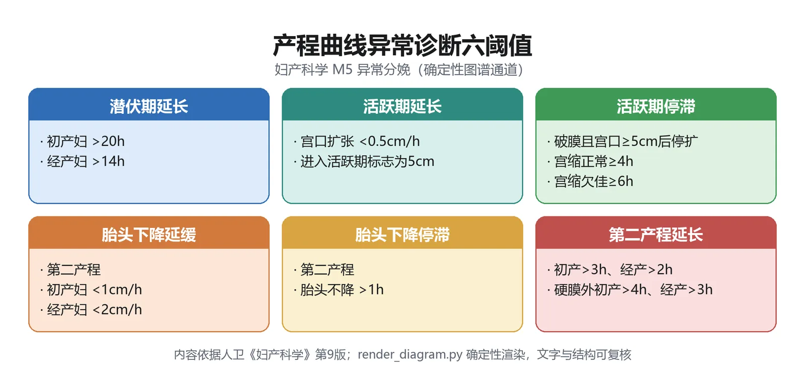

> [!NOTE] 诊断难产时机
> 宫口扩张 4cm 前不应诊断难产；人工破膜和缩宫素后仍无进展才可诊断。潜伏期延长不是剖宫产指征（教材P176）。

---

🔴 【掌握级】协调性子宫收缩乏力（低张性）：宫缩节律性、对称性、极性正常，仅收缩力弱，宫腔压力＜180 Montevideo 单位、宫缩＜2 次/10 分钟、持续短、间歇长；处理原则为<b>加强宫缩</b>（教材P178-179）。
💡 为什么重要：低张性宫缩乏力对胎儿影响小、可药物加强，是"可逆"难产因素。
🧬 第一性原理：协调性宫缩乏力仅"力量偏小"但节律、对称、极性、缩复作用仍在、方向正确，只须"给力量"——人工破膜让胎头紧贴子宫下段及宫颈内口反射性加强宫缩，再以缩宫素补充外力。若存在头盆不称或胎位异常，问题不在"力"而在"路"，故处理前必须做阴道检查排除。
#### 🔬 展开：协调性宫缩乏力处理要点
- 分原发性（产程早期即乏力，多致潜伏期延长）与继发性（活跃期后期或第二产程减弱，多伴胎位或骨盆异常）。
- 一般处理：解除顾虑、休息、补液、导尿；潜伏期可用哌替啶 100mg/吗啡 10mg 肌注。
- 加强宫缩：①人工破膜——适用于宫口＞3～5cm、无头盆不称、胎头已衔接而产程延缓者，破膜前查脐带先露；②缩宫素静滴——适用于协调性宫缩乏力、胎心良好、胎位正常、头盆相称者。
- 第二产程无头盆不称者缩宫素加强+指导屏气；胎头 S+3 及以下可等待自然分娩或阴道助产。第三产程胎肩娩出后予缩宫素 10～20U 静注防产后出血（教材P179）。
> [!WARNING] 易错陷阱
> 低张（协调）=强度低但方向正常→加强；高张（不协调）=机制紊乱、不放松→调节。张性判错即用错缩宫素。

---

🔴 【掌握级】不协调性子宫收缩乏力（高张性）：宫缩失去正常节律性、对称性尤其极性，兴奋点来自子宫下段一处或多处、由下而上扩散为无效宫缩，宫缩间歇期子宫不能很好松弛，多呈持续性腹痛、腹部拒按；处理原则为<b>调节子宫收缩</b>（教材P178-179）。
💡 为什么重要："无效宫缩但子宫不放松"损害子宫胎盘循环，易致胎儿窘迫，处理方向与低张性相反。
🧬 第一性原理：正常宫缩兴奋点起自子宫角、极性宫底部最强下段最弱才有向下合力；高张性兴奋点乱在下段、波自下而上，宫底部反弱于下段，再强也是"无效宫缩"，且间歇期宫壁不能完全松弛、子宫胎盘循环受阻。给镇静剂（哌替啶/吗啡）充分休息多可转协调性。
#### 🔬 展开：不协调性宫缩乏力诊疗要点
- 特点：宫缩失去正常节律性、对称性尤其极性，兴奋点来自子宫下段；间歇期子宫不能松弛，宫口扩张受限、胎先露不能如期下降，为无效宫缩。
- 多见于原发性宫缩乏力；持续腹痛、腹部拒按、烦躁，严重时水电解质紊乱、尿潴留、肠胀气、胎儿-胎盘循环障碍、胎心率异常。
- 处理：哌替啶 100mg/吗啡 10mg 肌注；<b>未恢复协调性前严禁使用缩宫剂</b>；伴胎儿窘迫、头盆不称或镇静剂后宫缩仍不协调者考虑剖宫产。
> [!NOTE] 张性记忆法
> 低张（协调）=强度不足、方向正常→加强；高张（不协调）=不弱甚至强、但方向乱、不放松→调节。见"持续腹痛、腹部拒按、无效宫缩"即想高张性。

---

🔴 【掌握级】子宫收缩过强与病理性缩复环（先兆子宫破裂）：协调性宫缩过强若产道无阻力、总产程＜3 小时称<b>急产</b>（经产妇多见）；若合并产道梗阻或瘢痕子宫，过强宫缩时出现<b>病理性缩复环</b>，属先兆子宫破裂征象（教材P179-180）。
💡 为什么重要：病理性缩复环是"宫缩过强+梗阻"的危险信号，直接关系母胎安危与剖宫产决策。
🧬 第一性原理：正常宫缩下段被动拉长但须有"泄压口"——胎头持续下降、产道有空间；若胎头推不动（梗阻/瘢痕），过强宫缩力量叠加于子宫下段，环状分界随宫缩上升，形成病理性缩复环，合并下段压痛、血尿，是子宫将破的危象——必须抑制宫缩并剖宫产。
#### 🔬 展开：子宫收缩过强分类与鉴别
- 协调性过强：产道无阻力→急产（总产程＜3h）；梗阻/瘢痕子宫→病理性缩复环甚至子宫破裂。
- 不协调性过强：①强直性子宫收缩——无节律、无间歇、持续性强直，多见于缩宫剂使用不当，合并梗阻出现病理性缩复环、血尿。②子宫痉挛性狭窄环——局部平滑肌持续不放松形成的环，位于胎体狭窄部及子宫上下段交界处（如胎儿颈、腰），<b>不随宫缩上升</b>；多因精神紧张、过度疲劳、不当用缩宫剂或粗暴阴道操作；第三产程易致胎盘嵌顿（教材P180）。
- 处理：预防为主；发生强直性收缩或狭窄环时立即停阴道操作及缩宫剂，吸氧＋宫缩抑制剂（特布他林/硫酸镁，必要时哌替啶）；若宫缩不缓解、出现病理性缩复环而宫口未开全、胎头高或胎儿窘迫，立即剖宫产；胎死宫内且宫口已开全者缓解宫缩后阴道助产（教材P180）。
> [!WARNING] 易错陷阱
> 病理性缩复环<b>随宫缩上升</b>、位于子宫下段（先兆子宫破裂标志）；子宫痉挛性狭窄环<b>不随宫缩上升</b>、位于胎体狭窄部。常作 B1 鉴别共用选项。

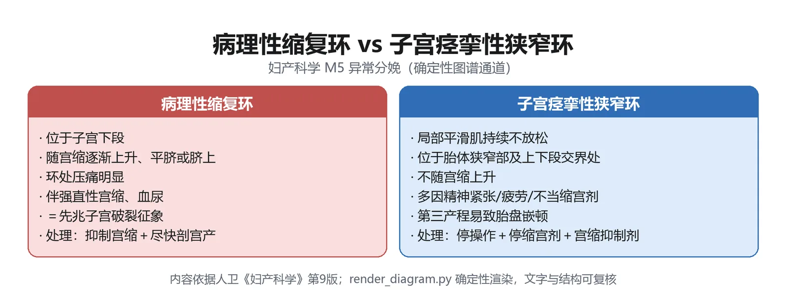


---

🔴 【掌握级】骨产道异常——骨盆入口平面狭窄分级与处理：以对角径为主分 3 级，Ⅲ级绝对性狭窄需剖宫产；相对性狭窄（对角径 10.0～11.0cm）且胎儿不大、产力胎位胎心正常时可严密试产（教材P180、P184）。
💡 为什么重要：狭窄骨盆是最常见骨产道异常，分级直接决定"能否试产/是否剖宫产"，是 A2 病例核心。
🧬 第一性原理：胎头入盆取决于入口平面能否容纳枕额径，以前后径（临床以对角径代表）最重要，前后径不足则胎头高浮、难入盆、甚至头盆不称。分级在"留有余地"：Ⅰ级临界可经阴道；Ⅱ级相对需试产后决定；Ⅲ级绝对（对角径≤9.5cm）无法入盆必须剖宫产。
#### 🔬 展开：骨盆三平面狭窄分级（表13-1，单位cm）
- 入口（对角径）：Ⅰ级 11.5；Ⅱ级 10.0～11.0；Ⅲ级≤9.5。中骨盆（坐骨棘间径/＋后矢状径）：Ⅰ级 10.0/13.5；Ⅱ级 8.5～9.5/12.0～13.0；Ⅲ级≤8.0/≤11.5。
- 出口（坐骨结节间径/＋后矢状径）：Ⅰ级 7.5/15.0；Ⅱ级 6.0～7.0/12.0～14.0；Ⅲ级≤5.5/≤11.0。中骨盆狭窄重在影响内旋转→持续性枕横/枕后位；出口狭窄常与中骨盆并存。出口"坐骨结节间径+出口后矢状径"＞15cm 多可经阴道，≤15cm 足月胎儿应剖宫产（教材P184）。
> [!SUCCESS] 试产关键数
> 入口相对性狭窄可试产至宫口扩张 4cm 以上；破膜后宫缩较强、产程进展顺利，多数能经阴道分娩。试产后胎头仍不入盆、宫口扩张停滞或出胎儿窘迫，及时剖宫产（教材P184）。

---

🔴 【掌握级】头盆不称临床诊断——胎头跨耻征：嘱孕妇排空膀胱仰卧、双腿伸直，一手置耻骨联合上方、另一手将胎头向盆腔方向推压，据胎头与耻骨联合平面的关系判断（教材P183）。
💡 为什么重要：跨耻征是"入口头盆相称程度"的床边检查，但<b>不能单凭阳性即诊断</b>。
🧬 第一性原理：头盆相称本质是"胎头能否通过入口平面"：胎头低于耻骨联合平面＝已衔接（阴性）；同平面＝可疑头盆不称（可疑阳性）；高于耻骨联合平面＝头盆不称（阳性）。但与骨盆倾斜度、胎方位相关，且胎头水肿（产瘤）会造"看似低位"假象，故跨耻征阳性仅是提示，需观察产程进展或试产后作最后诊断。
#### 🔬 展开：跨耻征与骨产道异常影响
- 阴性：胎头低于耻骨联合平面→已衔接入盆；可疑阳性：与耻骨联合同一平面；阳性：高于耻骨联合平面→头盆不称（CPD）。
- 骨产道异常对母儿影响：入口狭窄→胎位异常、胎膜早破、脐带脱垂增多；中骨盆狭窄→持续性枕横/枕后位；出口狭窄→第二产程停滞，不宜强行阴道助产；严重梗阻伴宫缩过强可致先兆子宫破裂（教材P183）。
> [!WARNING] 易错陷阱
> "胎头跨耻征阳性"≠"决定剖宫产"，只是提示头盆不称可能，最终分娩方式结合骨盆分级、胎儿大小、产力、胎位及试产。胎儿明显产瘤时阴道口见"胎头"可能是假象。

---

🟡 【熟悉级】子宫收缩乏力病因：肌源性（羊水过多、巨大胎儿、多胎；子宫畸形、肌瘤、腺肌病、经产妇、高龄产妇）、头盆不称或胎位异常、内分泌失调、精神源性，及宫缩抑制剂/镇静剂（教材P177-178）。头盆不称/胎位异常=梗阻性先纠正梗阻；肌源性/内分泌/精神源性=动力性可药物加强。
🟡 【熟悉级】急产：协调性宫缩过强且产道无阻力时总产程＜3 小时，经产妇多见，可致软产道裂伤甚至子宫破裂（教材P179-180）。胎头快速通过软产道→无充分时间扩张→裂伤；压力解除过快→颅内出血。预防为主、提前住院。
🟡 【熟悉级】子宫痉挛性狭窄环：局部平滑肌持续不放松，形成位于胎体狭窄部及子宫上下段交界处的环状狭窄，<b>不随宫缩上升</b>（教材P180）。病理性缩复环＝子宫下段、随宫缩上升、伴血尿=先兆子宫破裂；狭窄环＝不随宫缩上升、致胎盘嵌顿。
🟡 【熟悉级】狭窄骨盆常见类型：单纯扁平骨盆、佝偻病性扁平骨盆、漏斗型骨盆、横径狭窄骨盆、均小骨盆、畸形骨盆（偏斜骨盆）及病理性骨盆（教材P181-182）。扁平型→入口前后径短→衔接困难；漏斗型（男型）→中骨盆及出口均窄→内旋转受阻→持续性枕横/枕后位；均小骨盆→三平面整体偏小（各径线比正常小 2cm 以上）。漏斗型特征：坐骨切迹＜2 横指、耻骨弓＜90°、坐骨结节间径+出口后矢状径＜15cm；偏斜骨盆两侧侧斜径差＞1cm（教材P181-182）。"中骨盆只影响入口"是误解——主要影响内旋转。
🟡 【熟悉级】软产道异常：阴道异常（横隔、纵隔、包块）、宫颈异常（粘连瘢痕、坚韧、水肿、宫颈癌）、子宫异常（子宫畸形、瘢痕子宫）及盆腔肿瘤（教材P184-185）。处理：阴道横隔中央小孔撑薄时 X 形切开、分娩后切除，高且坚厚者剖宫产；宫颈坚韧（高龄初产妇）、宫颈水肿（扁平骨盆/枕后位/潜伏期延长）可宫颈两侧注入 0.5% 利多卡因 5～10ml，不缓解则剖宫产；宫颈癌应剖宫产；VBAC 需一次剖宫产史+子宫下段横切口+术后无感染+间隔＞18 个月+胎儿适中（教材P185）。
🟡 【熟悉级】持续性枕后位、枕横位：胎头以枕后位或枕横位衔接，经充分试产后枕部不能转向前方，仍位于骨盆后方/侧方，发生率为分娩总数 5%（教材P186-187）。机制：枕前位俯屈良好以枕下前囟径通过；枕后/枕横位俯屈差以较大枕额周径通过，内旋转受阻→胎头嵌顿中骨盆。诊断：产妇肛门坠胀排便感、宫口未开全早用腹压、宫颈前唇水肿；阴道检查枕后位盆腔后部空虚；超声明确枕部方位。处理：无骨盆异常、胎儿不大可试产；活跃期宫口＞3～5cm 人工破膜、静滴缩宫素，处理不佳或每小时宫口＜0.5cm 应剖宫产；第二产程 S+3 及以下可手转胎头或胎吸/产钳转枕前位后助产；第二产程延长且双顶径仍＞坐骨棘、或胎儿窘迫考虑剖宫产。
🟡 【熟悉级】臀先露分类与分娩方式：以骶骨为指示点，分混合臀先露（完全臀先露）、单臀先露（腿直臀先露）、足先露（不完全臀先露）；绝大多数分娩期选剖宫产（教材P190）。机制：较小且软之臀部先娩出、较大胎头后出，后出胎头时颅骨变形、脐带受压致胎儿低氧血症、酸中毒；宫口未开全强行牵拉胎头易损伤胎头及颈神经。要点：①单臀先露（双髋屈曲+双膝伸直，臀部，最多见）、混合臀先露（双髋+双膝均屈曲，臀部及双足，较多见）、足先露（较少见）；②病因：胎龄愈小发生率愈高（早产）、先天畸形（无脑儿/脑积水）、低体重儿、双胎多胎、羊水过多或过少、经产妇腹壁松弛、子宫畸形、脐带过短、前置胎盘、盆腔肿瘤、骨盆狭窄；③对母儿影响：胎臀不能紧贴子宫下段及宫颈→活跃期延长/停滞、胎膜早破（产褥感染增多）、脐带脱垂是头先露 10 倍、后出胎头致低氧、强行娩头致小脑幕撕裂/臂丛麻痹/颅内出血；④妊娠期：36 周前多数自转头位，36 周后仍臀位可外倒转术（ECV）或针灸至阴穴；分娩期脐部娩出后一般 8 分钟内结束分娩。<b>择期剖宫产指征</b>：骨盆狭窄、瘢痕子宫、胎儿体重＞3500g、胎儿生长受限、胎儿窘迫、胎头仰伸位、有难产史、妊娠合并症、脐带先露和不完全臀先露、无臀先露助产经验（教材P193）。经阴道分娩 3 方式：臀助产术（滑脱法/旋转胎体法，后出胎头必要时产钳）、臀牵引术（损伤大、少用）、自然分娩（经产妇、胎儿小、宫缩强、骨产道宽大者）。

---

🟢 【了解级】胎头高直位：不屈不仰（枕额径）衔接、矢状缝与入口前后径一致；分高直前位（枕耻位）与高直后位（枕骶位），约占 1%（教材P187-188）。高直后位枕骨向后靠骶岬、难旋转 180°，确诊即剖宫产；高直前位可阴道试产。
🟢 【了解级】前不均倾位：枕横位入盆的胎头侧屈、以前顶骨先入盆，发生率 0.5%～0.8%（教材P188-189）。前顶骨嵌顿于耻骨联合后，基本需剖宫产，可形成"胎头已衔接"假象；早期取坐位/半卧位减骨盆倾斜度可部分预防。
🟢 【了解级】面先露：胎头极度仰伸（枕颏径）通过产道，以颏骨为指示点 6 种胎位，发病率 0.8‰～2.7‰（教材P189-190）。颏前位可试产；持续性颏后位/颏横位不能经阴道娩出→剖宫产；低垂部位水肿时易与臀先露肛门混淆，用超声区分。
🟢 【了解级】复合先露：胎头或胎臀伴四肢同时进入骨盆入口，发生率 0.08%～0.1%，多见于早产，以胎头与一手/前臂最常见（教材P196）。确认无头盆不称后向脱出肢体对侧侧卧多可自然回缩；还纳失败、阻碍胎头下降或伴明显头盆不称/胎儿窘迫则剖宫产。胎手与胎足鉴别：胎足趾短平齐、有足跟；胎手指长、端不平齐（教材P191）。
🟢 【了解级】肩难产高危因素与母儿影响：＞50% 发生于正常体重新生儿，无法准确预测和预防；产前高危——巨大胎儿、肩难产史、妊娠期高血糖、过期妊娠、骨盆解剖结构异常；产时高危——第一产程活跃期延长、第二产程延长伴"乌龟征"、胎头吸引器/产钳助产（教材P196）。对母体：严重会阴裂伤（Ⅲ度及Ⅳ度）、产后出血、宫颈裂伤、子宫破裂、生殖道瘘、产褥感染。对新生儿：臂丛损伤最常见（2/3 为 Duchenne-Erb 麻痹，第 5、6 颈神经根受损，多为一过性）、锁骨骨折、肱骨骨折、新生儿窒息，严重时颅内出血、神经受损甚至死亡。

---

### 📊 对比速查

| 类型 | 宫缩特点 | 张性 | 处理原则 | 关键处理 |
|---|---|---|---|---|
| 协调性宫缩乏力 | 节律/对称/极性正常，仅力弱；＜180MU | 低张性 | 加强宫缩 | 人工破膜＋缩宫素静滴 |
| 不协调性宫缩乏力 | 节律/对称/极性乱，无效宫缩，不放松 | 高张性 | 调节宫缩 | 哌替啶/吗啡，禁先缩宫剂 |
| 协调性宫缩过强 | 节律/对称/极性正常，过强过频 | 协调性 | 预防为主 | 总产程＜3h=急产；梗阻→缩复环 |
| 不协调性宫缩过强 | 无节律、无间歇（强直）或局部狭窄环 | 不协调性 | 抑制宫缩 | 停缩宫剂＋特布他林/硫酸镁 |

| 骨盆平面 | 关键径线 | Ⅰ级(临界) | Ⅱ级(相对) | Ⅲ级(绝对) |
|---|---|---|---|---|
| 入口 | 对角径 | 11.5 | 10.0～11.0 | ≤9.5 |
| 中骨盆 | 坐骨棘间径/＋后矢状径 | 10.0/13.5 | 8.5～9.5/12.0～13.0 | ≤8.0/≤11.5 |
| 出口 | 坐骨结节间径/＋后矢状径 | 7.5/15.0 | 6.0～7.0/12.0～14.0 | ≤5.5/≤11.0 |

| 臀先露类型 | 髋膝关节姿 | 先露部位 | 相对频率 |
|---|---|---|---|
| 混合臀先露（完全臀先露） | 双髋+双膝均屈曲 | 臀部及双足 | 较多见 |
| 单臀先露（腿直臀先露） | 双髋屈曲+双膝伸直 | 臀部 | 最多见 |
| 足先露（不完全臀先露） | 一足/双足/膝 | 足/膝 | 较少见 |

---

### 🔗 因果链（D2）

```
异常分娩（难产）
   │
   ├─ 产力异常 ──> 宫缩乏力 ──> 产程延长/停滞 ──> ★加强宫缩（人工破膜/缩宫素）
   │                                    └─> 产后出血/产褥感染（母体）
   │         └─ 宫缩过强 ──> 梗阻/瘢痕子宫 ──> ★病理性缩复环/血尿 ═> 先兆子宫破裂 ═> 剖宫产
   │
   ├─ 产道异常（骨产道/狭窄骨盆）──> 头盆不称 ──> 胎头不入盆 ──> ★跨耻征阳性
   │                                    └─ 试产 / 剖宫产（按分级）
   │
   ├─ 胎儿异常（胎位异常：枕后位/臀先露/肩先露）──> 头位难产/后出胎头 ──> 脐带脱垂/胎儿窘迫 ──> ★剖宫产
   │
   └─ 肩难产 ──> 前肩嵌顿于耻骨联合 ──> ★屈大腿法+耻骨上加压法（避免压宫底）
                              └─> 新生儿臂丛损伤/锁骨骨折
```

---

### 🌳 鉴别决策树（D4）

<b>产程异常 → 先查"路"还是"力"（异常胎位处理分流）</b>

```
产程延长/停滞
   │
   ├─ 阴道检查：有无头盆不称/胎位异常？
   │      │
   │      ├─ 有严重胎位异常（高直后位/前不均倾位/颏后位/肩先露）══> 剖宫产
   │      ├─ 有持续性枕后/枕横位 → 无骨盆异常、胎儿不大 → 人工破膜+缩宫素 → 手转胎头/助产；S+2以上或胎儿窘迫→剖宫产
   │      └─ 无头盆不称、无胎位异常 → 加强宫缩（低张性）或 调节宫缩（高张性）
   │
   └─ 有骨产道狭窄？
          │
          ├─ 绝对性（对角径≤9.5 / 出口和≤15cm）══> 剖宫产
          ├─ 相对性（对角径10~11cm / 出口>15cm）→ 严密试产
          └─ 中骨盆狭窄 → 持续性枕横/枕后位 → 手转胎头/助产 或 剖宫产
```

---

### ⚠️ 常见陷阱

1. 把"宫缩乏力"当唯一原因，忽视先查头盆关系与胎位；头盆不称时盲目加强宫缩可致梗阻性难产。
2. 低张性与高张性宫缩乏力处理相反，张性判错即用错缩宫素。
3. 病理性缩复环（随宫缩上升、子宫下段、先兆子宫破裂）与子宫痉挛性狭窄环（胎体狭窄部、不随宫缩上升）鉴别错误。
4. 胎头跨耻征阳性≠决定剖宫产，需结合骨盆分级与试产；产瘤可造成"低位"假象。
5. "臀先露一律剖宫产"过绝对化，应结合骨盆类型、胎儿体重（＞3500g 为指征）与助产经验。
6. 肩难产处理忌<b>加压子宫底</b>，宜屈大腿法+耻骨上加压法；避免猛力牵拉致臂丛损伤/锁骨骨折。

---

### 💡 记忆口诀

1. <b>产程三延长</b>：潜伏 20/14（初/经产）（h），活跃＜0.5cm/h 记"半厘米"，第二产程 3/2（初/经产）（h）。
2. <b>骨盆狭窄看门道</b>：入口看对角径、中骨盆看坐骨棘间径+后矢状径、出口看坐骨结节间径+出口后矢状径；"≤9.5 入、≤8.0 中、≤5.5 出"即绝对狭窄。
3. <b>缩复环与狭窄环</b>：缩复环"随宫缩上升在子宫下段"＝要破；狭窄环"不随宫缩上升在胎体狭窄部"＝卡牢。
4. <b>肩难产三招</b>：屈大腿、压耻骨上、旋肩（Rubin/Woods）；"不压宫底、防臂丛伤"。

---

### 📌 本章小结

> [!INFO] 本章小结
> - take-home 1：异常分娩=难产，四因素失衡且互为因果，最常见为产力、产道、胎儿因素。
> - take-home 2：产程曲线异常数值标准是诊断难产的"分水岭"；处理"先查头盆与胎位→低张加强、高张调节→梗阻/绝对狭窄/严重胎位异常则剖宫产"。
> - take-home 3：宫缩过强+梗阻→病理性缩复环/先兆子宫破裂；肩难产首选屈大腿法+耻骨上加压法；臀先露、肩先露削弱胎头紧贴宫颈的反射刺激，易致宫缩乏力、胎膜早破与脐带脱垂。
> <b>🧬 本章核心洞察</b>：产力是"推力"、产道是"门槛"、胎位是"姿势"——三者任一失衡即难产；处理难产的灵魂是"先识别不可逆的头盆不称与严重胎位异常（转向剖宫产），再对可纠的产力异常精准加强或调节"。

---

### 🔗 深度链接

本模块与<b>模块6（分娩并发症）</b>紧密相连——难产处理不当的终点正是<b>产后出血</b>（宫缩乏力/产道损伤/胎盘因素）与<b>子宫破裂</b>（病理性缩复环失控）；与<b>模块4（正常分娩）</b>互为镜鉴，M04 机制被打断即演化为本模块的枕后位/高直位/前不均倾位等；与<b>模块3（妊娠诊断与产前检查）</b>衔接，胎先露、胎方位与骨盆测量评估为本模块的产前识别提供工具。瘢痕子宫 VBAC 决策与<b>模块4</b>相关，需综合判断。


## 模块6：分娩并发症

> [!INFO] 模块信息
> <b>重点等级</b>：🔴掌握 8 / 🟡熟悉 7 / 🟢了解 4
> <b>预计题型</b>：A1（数值：产后出血阈值、休克指数折算失血量）；A2（病例：阴道流血特点→判断病因→首选处理）；B1（鉴别共用选项：产后出血四大病因）；X（机制多选：羊水栓塞病理生理）
> <b>关联模块</b>：与模块4（正常分娩·第三产程）、模块5（异常分娩·宫缩异常/梗阻性难产）、模块7（妊娠并发症·前置胎盘/胎盘早剥/羊水过多）

---

### 🧩 前置知识检查

1. 第三产程止血：胎盘娩出后靠子宫肌纤维收缩缩复使剥离面血窦关闭而止血（模块4）。
2. 正常胎盘剥离：多在胎儿娩出后 15 分钟内娩出，超 30 分钟未排出即异常。
3. 羊水是母胎界面内液体；胎膜破裂、血窦开放是羊水入母血前提；产科 DIC 高危：胎盘早剥、死胎、羊水栓塞、重度子痫前期（模块7）。

---

### 🎯 高收益摘要

1. 产后出血：胎儿娩出后 <b>24 小时内</b>，阴道分娩 ≥500ml、剖宫产 ≥1000ml；<b>严重产后出血</b>指 24h 出血 ≥1000ml（教材P198）。
2. 产后出血是致我国孕产妇死亡的首位原因，<b>子宫收缩乏力</b>最常见；四大病因：<b>子宫收缩乏力、胎盘因素、软产道裂伤、凝血功能障碍</b>（教材P198）。
3. 羊水栓塞典型<b>三联征</b>：骤然低氧血症、低血压（与失血量不符）、凝血功能障碍；诊断为<b>排除性临床诊断</b>（教材P204）。
4. 子宫破裂常见于<b>瘢痕子宫</b>与<b>胎先露下降梗阻</b>；先兆破裂核心体征是<b>病理性缩复环</b>（教材P205-206）。

---

### 📋 结构化笔记

🔴 【掌握级】产后出血定义：胎儿娩出后 24 小时内，阴道分娩者出血量≥500ml，剖宫产者≥1000ml；或失血后伴低血容量症状/体征。严重产后出血指 24 小时内出血量≥1000ml（教材P198）
💡 为什么重要：诊断靠客观出血量阈值，低估出血量会丧失抢救时机。
🧬 第一性原理：正常时胎盘娩出后子宫肌纤维收缩缩复使剥离面迅速缩小、血窦关闭而止血，这是"产后不出血"的生理根基。若子宫能正常收缩、胎盘完整娩出、软产道无损、凝血功能正常，就不会有产后出血——四环节缺一不可，任一失灵即失血。
#### 🔬 展开：估计值常被低估
产后出血发病率 5%～10%，但临床估计值往往低于实际出血量，实际发病率更高；应把"估计出血量"与"低血容量症状"两组指标综合判断。
> [!WARNING] 易错陷阱
> 出血量不是只看 mL 数，而看"时间窗+分娩方式"——阴道分娩 ≥500ml、剖宫产 ≥1000ml 是不同阈值，只看一个会误判严重度。

---

🔴 【掌握级】产后出血四大病因：子宫收缩乏力、胎盘因素、软产道裂伤、凝血功能障碍，四者可共存、相互影响或互为因果（教材P198）
💡 为什么重要：这是鉴别与处理的分支主干，先定"是哪一类"再定"怎么办"。
🧬 第一性原理：四病因对应止血"四道防线"——子宫收没收缩、胎盘走没走净、产道裂没裂、血凝不凝。若胎盘完整、软产道无伤、凝血正常，则子宫收缩乏力就是唯一原因；反之大量失血又可继发凝血耗竭，故四因互因果。
子宫收缩乏力最常见，凡影响子宫肌纤维收缩缩复功能者均可引起：①全身因素（精神紧张、疲乏、高龄、肥胖、合并慢性病）；②产科因素（产程延长、急产、前置胎盘、胎盘早剥、妊娠期高血压疾病、宫腔感染）；③子宫因素（过度膨胀如多胎/羊水过多/巨大胎儿，肌壁损伤如剖宫产史/肌瘤切除/产次过多，病变如肌瘤/畸形/变性）；④药物因素（临产后过多使用镇静剂、麻醉剂、宫缩抑制剂）。
#### 🔬 展开：子宫收缩乏力的诊查要点
正常时胎盘娩出后宫底平脐或脐下一横指、质硬；宫缩乏力时<b>宫底升高、质软、轮廓不清</b>、流血多。按摩子宫并应用宫缩剂后子宫变硬、流血减少或停止，即可确诊——这是与其余三类出血相鉴别的操作依据。
> [!WARNING] 易错陷阱
> 四病因常并存：大量失血可诱发继发性凝血障碍，软产道裂伤也常合并宫缩乏力。诊断时切忌"找到一个就停"，应系统排查。

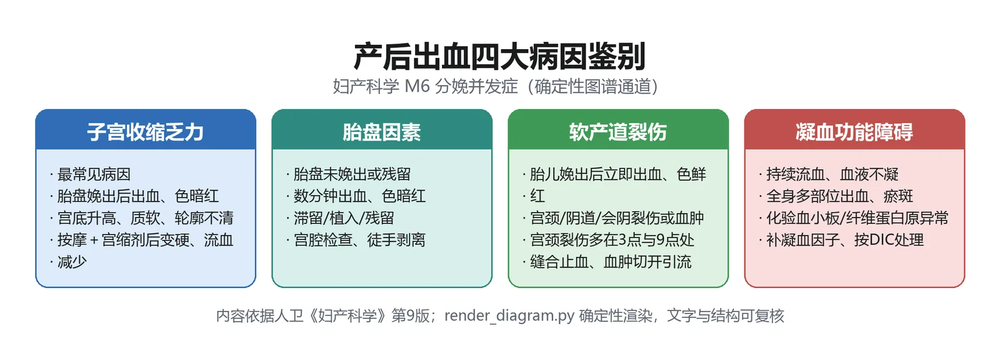


---

🔴 【掌握级】产后出血估测失血量法：称重法、容积法、面积法、休克指数法、血红蛋白测定（教材P199）
💡 为什么重要：低估出血量是抢救失败的首要原因，需多法综合。
🧬 第一性原理：失血本质是血液离开循环，估算靠"接住了多少"（称重/容积/面积）与"循环少了多少"（休克指数/血红蛋白）。若失血量与临床症状不符，提示隐匿性失血（阴道血肿、腹膜后血肿），此时"估量"要转向"检查"。
- <b>称重法</b>：失血量（ml）=［接血敷料湿重(g)−干重(g)］÷1.05；<b>容积法</b>用量杯；<b>面积法</b>按浸血面积估计。
- <b>休克指数法（SI）</b>：SI=脉率÷收缩压。产妇 SI 正常 0.7～0.9；SI=1.0 失血 20%（约1000ml）；SI=1.5 失血 30%（约1500ml）；SI=2.0 失血 ≥50%（≥2500ml）。
- <b>血红蛋白</b>：每下降 10g/L 估计失血 400～500ml；但产后出血早期血液浓缩，血红蛋白不准。
#### 🔬 展开：为什么单一方法不可靠
任何单一估量法都有缺陷、易低估，应多种方法综合评估；<b>出血速度</b>也是反映病情轻重的重要指标。还应警惕"流血不多但低血容量明显"的隐匿性损伤（如阴道壁血肿），须经阴道检查与影像学排查。
> [!WARNING] 易错陷阱
> 血红蛋白在出血早期"骗人"——血液浓缩使数值不降反持平，不能因 Hb 正常就排除产后出血；贫血者代偿储备低，同样出血量下休克更重。

---

🔴 【掌握级】产后出血处理原则：针对出血原因迅速止血；补充血容量，纠正失血性休克；防止感染（教材P200）
💡 为什么重要：三大原则分别对应"止血/复容/防感染"，是处理任何产后出血的主轴。
🧬 第一性原理：休克本质是循环血容量不足，故"止血"与"补容"须同时进行——只止血不复容则休克不逆转，只复容不止血则出血不止。失血过多会持续消耗凝血因子继发凝血障碍，故须动态监测血常规与凝血功能，必要时成分输血。
一般处理：寻找病因同时调集医护、交叉配血、建立双静脉通道补容、保持气道通畅给氧、监测生命征与出血量、留置尿管记尿量、动态监测血常规与凝血功能。
#### 🔬 展开：子宫收缩乏力止血阶梯（由简到繁）
①<b>按摩或按压子宫</b>：腹部按摩法或腹部-阴道双手压迫法。②<b>应用宫缩剂</b>：缩宫素为一线（5～10U/h 静滴，24h 总量≤60U）；卡贝缩宫素 100μg 静注/肌注；麦角新碱 0.2mg 肌注（禁用于妊娠期高血压疾病及部分心血管病变）；前列腺素类（卡前列素氨丁三醇、米索前列醇、卡前列甲酯）首选肌注。③<b>宫腔填塞</b>：纱条/球囊，需排除宫腔残留与子宫破裂。④<b>子宫压缩缝合术</b>：B-Lynch 及 Hayman、Cho、Pereira 改良术。⑤<b>结扎盆腔血管</b>：子宫动脉上下行支，必要时髂内动脉。⑥<b>经导管动脉栓塞术（TAE）</b>：保守无效、生命征平稳者。⑦<b>切除子宫</b>：积极抢救无效、危及生命时尽早行次全或全子宫切除术。
> [!WARNING] 易错陷阱
> 缩宫素不能无限加量——24 小时总量应≤60U；麦角新碱<b>禁用于妊娠期高血压疾病</b>患者，错误选用会诱发严重副作用。

---

🔴 【掌握级】羊水栓塞三联征与发病机制：骤然低氧血症、低血压（与失血量不符）、凝血功能障碍（教材P204）
💡 为什么重要：这是标志性表现与诊断核心，机制对应三大治疗方向。
🧬 第一性原理：羊水及胎儿异体抗原进入母血是前提，三条通路：羊膜腔压力过高挤入微血管、血窦开放、胎膜破裂。有形物质刺激肺血管反射性痉挛→肺动脉高压→右心负荷加重→急性右心衰→左心回血减少→左心输出骤降→低血压休克；同时抗原触发Ⅰ型变态反应与 SIRS。若羊水进入母血而肺血管不痉挛、凝血不被激活，就不会有典型三联征——故"肺动脉高压 + DIC"是机制核心。
#### 🔬 展开：DIC 是羊水栓塞特点与死亡主因
羊水中含大量类似组织凝血活酶的促凝物质，进入母血产生大量微血栓，消耗凝血因子及纤维蛋白原；炎性介质与内源性儿茶酚胺释放触发凝血级联→DIC。DIC 不仅是一表现甚至唯一表现，也是导致孕产妇死亡的主因。病理生理四环节：过敏样反应、肺动脉高压、炎症损伤（SIRS）、DIC。
> [!WARNING] 易错陷阱
> 典型羊水栓塞的"低血压"与失血量<b>不匹配</b>——休克程度远重于出血量，这是区别于产后出血休克的关键；只按出血量补液会延误肺动脉高压与右心衰处理。

---

🔴 【掌握级】羊水栓塞诊断：5 条需全部符合的临床诊断、排除性诊断（教材P204）
💡 为什么重要：诊断是临床判断，母血找到羊水成分已<b>不再是必须依据</b>。
🧬 第一性原理：羊水栓塞本质是"排他性临床综合征"——症状特异性低，须先排除肺栓塞、心肌梗死、心律失常、围产期心肌病、主动脉夹层、脑血管意外、药物过敏、输血反应、麻醉并发症、子宫破裂、胎盘早剥、子痫、严重产后出血性凝血障碍。若临床表现支持即可诊断，不必依赖病理查找；反之即便找到羊水有形物质，临床表现不支持也不能诊断。
5 条（需全部符合）：①急性低血压或心搏骤停；②急性低氧血症（呼吸困难、发绀或呼吸停止）；③凝血功能障碍（血管内凝血因子消耗或纤溶亢进的实验室证据，或无法解释的严重出血）；④症状发生在分娩、剖宫产、刮宫或产后短时间内（多在胎盘娩出后 30 分钟内）；⑤不能用其他疾病解释。当出现其他原因不能解释的急性孕产妇心肺衰竭伴低血压、心律失常、呼吸短促、抽搐、急性胎儿窘迫、心搏骤停、凝血障碍、出血或前驱症状之一时，应考虑羊水栓塞。
#### 🔬 展开：重视前驱症状
30%～40% 患者出现非特异性前驱症状：呼吸急促、胸痛、憋气、寒战、呛咳、头晕、乏力、心悸、恶心、呕吐、麻木、针刺样感觉、焦虑、烦躁、濒死感、胎心减速、胎心基线变异消失。重视前驱症状有助于及早识别、争取抢救窗口。
> [!WARNING] 易错陷阱
> 不能把"母血找到羊水有形物质"当确诊铁证，也不能因找不到而否认诊断——诊断锚点永远是临床表现+排除其他疾病。不典型羊水栓塞隐匿、进展慢、缺乏急性呼吸循环衰竭，更易漏诊。

---

🔴 【掌握级】子宫破裂病因：瘢痕子宫为常见原因，其次为梗阻性难产（教材P205）
💡 为什么重要：病因决定高危人群筛查方向与分娩方式选择。
🧬 第一性原理：子宫肌壁应完整连续承受宫腔压力；一旦局部肌层菲薄或形成瘢痕（手术史），妊娠晚期或分娩期宫腔内压力增高时，薄弱处即可能破裂。前次手术后伴感染、切口愈合不良、分娩间隔过短者临产后破裂风险更高——"瘢痕薄弱+压力增高"是破裂两要素。
病因：①<b>子宫手术史（瘢痕子宫）</b>——剖宫产、子宫肌瘤切除、宫角切除、输卵管间质部妊娠病灶清除、子宫成形、超声聚焦消融、反复人工流产；②<b>梗阻性难产</b>——头盆不称、巨大胎儿、胎位异常、畸形胎儿；③<b>不协调或过强收缩</b>——自发性或因缩宫素、前列腺素等药物所致；④<b>产科手术损伤</b>——宫颈口未开全行产钳、中高位产钳、臀牵引，或强行剥离植入/粘连胎盘；⑤<b>其他</b>——子宫先天发育异常致局部肌层菲薄，自发破裂。
#### 🔬 展开：瘢痕子宫为何成为第一大原因
近年子宫破裂中瘢痕子宫比例上升，是多次剖宫产与子宫肌瘤剥除术增多的结果。前次剖宫产切口多在下段，妊娠晚期下段拉长变薄、压力集中，故多见于剖宫产切口瘢痕破裂；瘢痕子宫阴道试产须严密监测并具备紧急手术条件。
> [!WARNING] 易错陷阱
> 子宫体部瘢痕破裂多为<b>完全性</b>且常<b>无先兆子宫破裂</b>典型症状，易被当"急腹症/先兆临产"而漏诊——瘢痕子宫者一旦持续腹痛伴胎心率异常应高度警惕。

---

🔴 【掌握级】先兆子宫破裂与子宫破裂表现及处理（教材P206）
💡 为什么重要：先兆破裂是唯一"可逆窗口"，早识别早手术可避免破裂。
🧬 第一性原理：子宫破裂通常渐进：先兆子宫破裂→不完全性→完全性。若在"先兆"阶段解除梗阻、抑制宫缩并尽快手术，就能阻止破裂。一旦完全破裂，羊水血液进入腹腔刺激腹膜，母胎生命直接受威胁，只能在抢救休克同时紧急手术。
先兆子宫破裂（常见于产程长、有梗阻性难产因素者）：①子宫强直性或痉挛性过强收缩，产妇烦躁不安、呼吸心率加快、下腹剧痛难忍；②子宫下段变薄拉长、宫体增厚变短，二者间形成环状凹陷即<b>病理性缩复环</b>，随产程逐渐上升平脐或脐上、压痛明显；③膀胱受压致排尿困难及血尿；④宫缩过强过频，无法触清胎体，胎心率加快/减慢或听不清。完全性子宫破裂：突感下腹一阵撕裂样剧痛，子宫收缩骤停；腹痛稍缓和后因羊水血液进入腹腔出现全腹持续痛、腹膜刺激征、低血容量休克，<b>腹壁下可扪及胎体、子宫位于侧方、胎心胎动消失</b>，阴道检查见鲜血、胎先露升高、宫颈口缩小。处理：先兆破裂应立即抑制子宫收缩并尽快手术（可用全身麻醉）；破裂则无论胎儿是否存活均应抢救休克同时尽快手术。
#### 🔬 展开：不完全性与手术选择
不完全性子宫破裂：子宫肌层破裂但浆膜层完整，宫腔与腹腔不相通，胎儿仍在宫内；多见于子宫下段剖宫产切口瘢痕破裂，常无先兆症状、仅破裂处压痛，累及子宫血管可致急性大出血，侧壁破裂可形成阔韧带血肿。完全性破裂：累及子宫壁全层（含浆膜层），宫腔与腹腔相通。手术决策：破口整齐、破裂时间短、无明显感染者行<b>破口修补术</b>；破口大、不整齐、明显感染者行<b>次全子宫切除术</b>；破口大且累及宫颈者行<b>全子宫切除术</b>；围手术期足量足疗程广谱抗菌药物抗感染。
> [!WARNING] 易错陷阱
> 病理性缩复环 ≠ 生理性缩复环：生理性缩复环是正常产程中子宫上下段交界处的收缩环，无压痛、不上升；病理性缩复环伴强直性宫缩、上升平脐、压痛明显，是先兆子宫破裂的证据。

---

🟡 【熟悉级】产后出血临床表现与原因初步判断：依出血时间、颜色、与胎盘娩出关系判断（教材P199）。胎儿娩出后<b>立即</b>出血、鲜红色→软产道裂伤；<b>数分钟</b>出血、暗红色→胎盘因素；胎盘娩出后出血较多→子宫收缩乏力或胎盘胎膜残留；持续流血且<b>血液不凝</b>→凝血功能障碍；低血容量明显而流血不多、伴阴道痛→隐匿性软产道损伤（阴道血肿）。确诊：宫缩乏力看"按摩+宫缩剂后是否变硬、流血减少"；胎盘因素检查胎盘胎膜完整性、留意胎儿面断裂血管（副胎盘残留）；宫颈裂伤多在 3 点与 9 点处。
🟡 【熟悉级】胎盘因素（滞留/植入/残留）诊断与处理（教材P198、P201）。滞留：30 分钟后未排出（膀胱充盈、胎盘嵌顿、剥离不全）。植入：按深度分粘连性、植入性、穿透性；部分性出血多、完全性出血不多、穿透性可致子宫破裂或膀胱/直肠损伤。残留影响子宫收缩而出血。处理：疑滞留立即宫腔检查，可徒手剥离；剥离困难疑植入应<b>停止剥离</b>（牵拉脐带时子宫壁随胎盘一起内陷是植入征象），保守治疗（局部切除、TAE、米非司酮、甲氨蝶呤+彩超）或子宫切除；活动性出血、病情加重或穿透性植入时切除子宫。<b>瘢痕子宫合并前置胎盘、胎盘附着于瘢痕处</b>处理棘手，应及时转诊。
🟡 【熟悉级】软产道裂伤（会阴 4 度/宫颈 3-9 点/阴道血肿）及处理（教材P200-201）。宫颈裂伤多在<b>3 点与 9 点</b>，可上延至子宫下段、阴道穹隆。会阴裂伤 4 度：Ⅰ度——会阴皮肤及阴道入口黏膜撕裂，出血不多；Ⅱ度——达会阴体筋膜及肌层，累及阴道后壁黏膜，出血较多；Ⅲ度——深部扩展、肛门外括约肌断裂、直肠黏膜完整；Ⅳ度——肛门、直肠与阴道完全贯通，直肠肠腔外露，出血量可不多。处理：宫颈浅裂无活动性出血不需缝合，深且有活动性出血应缝合（第一针超裂口顶端 0.5cm，间断缝合；累及子宫下段经腹修补）。会阴阴道裂伤按解剖层次缝合、不留死腔、避免穿透直肠黏膜。软产道血肿应切开、清除积血、彻底止血缝合，必要时置橡皮片引流。
🟡 【熟悉级】凝血功能障碍（DIC）出血的诊断与处理（教材P199、P202）。病因：原发性（血小板减少、再生障碍性贫血、肝脏疾病）；继发性（胎盘早剥、死胎、羊水栓塞、重度子痫前期等引发 DIC）。表现：持续阴道流血、血液不凝；全身多部位出血、身体瘀斑。据临床表现及血小板计数、纤维蛋白原、凝血酶原时间等凝血检测诊断。处理：尽快补充凝血因子并纠正休克；血液制品包括新鲜冰冻血浆、冷沉淀、血小板，以及纤维蛋白原、凝血酶原复合物、凝血因子；并发 DIC 按 DIC 处理。抢救中随时做血气、纠正酸中毒，尿量<25ml/h 时积极快速补液并监测尿量，防治肾衰竭。
🟡 【熟悉级】产后出血输血治疗与大量输血方案（MTP）（教材P202）。输血指征：血红蛋白 <60g/L 几乎均需输血；<70g/L 可考虑输血；继续出血风险大者可适当放宽。大量输血方案（MTP）：红细胞∶血浆∶血小板按 <b>1∶1∶1</b> 输入（如 10U 红细胞悬液+1000ml 新鲜冰冻血浆+1U 机采血小板）。目标导向输血（TTP）：依据产妇临床情况及实验室检测结果个体化补充成分血。
🟡 【熟悉级】羊水栓塞病因与预防（教材P203）。诱发因素：高龄初产、经产妇、宫颈裂伤、羊水过多、多胎妊娠、子宫收缩过强、急产、胎膜早破、前置胎盘、子宫破裂、剖宫产和刮宫术。具体原因不明，可能与三点有关：①<b>羊膜腔内压力过高</b>——第二产程宫缩时可达 100～175mmHg，超过静脉压时羊水被挤入破损微血管；②<b>血窦开放</b>——宫颈或宫体损伤、血窦破裂；③<b>胎膜破裂</b>——大部分发生在胎膜破裂以后。预防：人工破膜时<b>不推荐剥膜</b>，避免宫缩时人工破膜；剖宫产刺破羊膜前保护好子宫切口开放性血管；掌握缩宫素指征避免宫缩过强；死胎、胎盘早剥监测凝血功能；避免产伤、子宫破裂与宫颈裂伤。
🟡 【熟悉级】子宫破裂分类与鉴别（教材P206）。不完全性：子宫肌层破裂但浆膜层完整，宫腔与腹腔不相通，胎儿仍在宫内，多见于子宫下段剖宫产切口瘢痕破裂，常无先兆症状、仅破裂处压痛，累及血管可致急性大出血，可形成阔韧带血肿。完全性：破裂累及子宫壁全层（含浆膜层），宫腔与腹腔相通，突发撕裂样剧痛、宫缩骤停、腹膜刺激征、胎体可扪及、胎心胎动消失。诊断：典型者据病史、症状、体征、影像学诊断；切口瘢痕破裂症状不明显时结合前次剖宫产史、子宫下段压痛、胎心率异常、胎先露上升、宫颈口缩小综合判断，<b>超声</b>能协助诊断。鉴别：与胎盘早剥、宫内感染、胎儿窘迫鉴别；穿透性胎盘植入者破裂可表现持续腹痛伴胎心率异常，易误诊为其他急腹症或先兆临产。

---

🟢 【了解级】产后出血发病率与三级预防（教材P198、P202）。发病率为 5%～10%，因临床估计往往低于实际出血量，实际发病率更高。三级预防：<b>产前</b>加强围产保健、防治贫血、对高危人群一般转诊与紧急转诊；<b>产时</b>密切观察产程、防产程延长、正确处理第二、三产程（预防性使用宫缩剂是处理第三产程最重要的措施）；<b>产后</b>产后出血多发于产后 2 小时内，密切监测生命征、阴道流血量、子宫高度、膀胱充盈，鼓励排空膀胱、早接触早吸吮以反射性引起子宫收缩、减少出血。
🟢 【了解级】氨甲环酸的应用（教材P200）。具抗纤维蛋白溶解作用，适用于各种病因的产后出血。一旦发生产后出血，应在产后 <b>3 小时内</b>尽早使用：1g 静脉滴注，滴注时间不少于 10 分钟；若 30 分钟后出血仍未控制或 24 小时后再次出血，可重复使用 1 次。
🟢 【了解级】羊水栓塞发病率、病死率与治疗细节（教材P202、P205）。发病率为（1.9～7.7）/10 万，病死率 19%～86%。治疗原则：维持呼吸循环等生命体征及保护器官功能。细节：<b>呼吸支持</b>可选面罩、无创呼吸机、气管插管甚至 ECMO；<b>循环支持</b>用去甲肾上腺素、多巴酚丁胺、磷酸二酯酶抑制剂；用依前列醇、西地那非、伊洛前列素、曲前列环素、一氧化氮、波生坦解除肺动脉高压；心搏骤停立即高质量心肺复苏并保持妊娠子宫左倾；<b>抗过敏</b>大剂量糖皮质激素（氢化可的松 500～1000mg/d 或甲泼尼龙 80～160mg/d，或地塞米松 20mg 静注后 20mg 静滴）；<b>纠正凝血</b>早期评估、动态监测并及时快速启动大量输血，可抗纤溶、<b>不推荐肝素</b>；<b>产科处理</b>——胎儿娩出前在抢救同时行阴道助产或紧急剖宫产，心搏骤停且孕周 23 周以上可考虑紧急剖宫产；产后出血难以控制时果断切除子宫。
🟢 【了解级】子宫破裂预防与产科手术损伤（教材P205-206、P207）。预防四要点：①做好产前保健，有高危因素者提前入院待产；②严密观察产程，警惕并尽早发现先兆子宫破裂征象并及时处理；③严格掌握宫缩剂应用指征并专人监护，避免宫缩过强，瘢痕子宫阴道试产须严密监测并具备紧急手术条件；④正确掌握产科手术助产指征与操作常规，阴道助产术后仔细检查宫腔及软产道、及时发现损伤修补。产科手术损伤（宫颈口未开全行产钳、中高位产钳、臀牵引）可致宫颈裂伤延及子宫下段，是重要医源性病因。

> [!INFO] 一句话串联
> 产后出血（最常见）、羊水栓塞（最凶险）、子宫破裂（最可防）三大分娩并发症，共同指向"早识别、早处理"。

> [!SUCCESS] 多学科协作要点
> 羊水栓塞抢救成功的关键是<b>多学科协作</b>与<b>快速决策</b>：启动产科、麻醉、呼吸、心血管、重症医学等多学科；胎儿娩出前在抢救孕妇同时行阴道助产或紧急剖宫产（孕周≥23 周且心搏骤停时可考虑紧急剖宫产）；产后出血难以控制时果断切除子宫。

---

### 📊 对比速查

<b>表 1：产后出血四大病因鉴别</b>

| 病因 | 出血时机/颜色 | 关键体征 | 首选处理 |
|---|---|---|---|
| 子宫收缩乏力 | 胎盘娩出后、暗红 | 宫底升高、质软、轮廓不清 | 按摩+宫缩剂→宫腔填塞 |
| 胎盘因素 | 胎盘未娩出或残留 | 胎盘滞留/植入/残留 | 宫腔检查、徒手剥离/切除子宫 |
| 软产道裂伤 | 胎儿娩出后立即、鲜红 | 宫颈/阴道/会阴裂伤、血肿 | 缝合止血、血肿切开引流 |
| 凝血功能障碍 | 持续、血不凝 | 全身出血、瘀斑、化验异常 | 补凝血因子、按 DIC 处理 |

<b>表 2：子宫收缩乏力止血阶梯（由简到繁）</b>

| 阶梯 | 措施 | 要点/注意 |
|---|---|---|
| 1 | 按摩/按压子宫 | 有效标准：轮廓清楚、收缩有皱褶、出血减少 |
| 2 | 宫缩剂 | 缩宫素一线；麦角新碱禁用于妊娠期高血压疾病 |
| 3 | 宫腔填塞 | 纱条/球囊；需排除残留与子宫破裂 |
| 4 | 子宫压缩缝合术 | B-Lynch 及改良术 |
| 5 | 结扎盆腔血管 | 子宫动脉上下行支、髂内动脉 |
| 6 | TAE | 保守无效、生命征平稳者 |
| 7 | 切除子宫 | 积极抢救无效、危及生命时及早施行 |

<b>表 3：会阴裂伤 4 度分级</b>

| 分级 | 累及组织 | 出血量 |
|---|---|---|
| Ⅰ度 | 会阴皮肤+阴道入口黏膜 | 不多 |
| Ⅱ度 | 会阴体筋膜及肌层、阴道后壁黏膜 | 较多 |
| Ⅲ度 | 深部扩展、肛门外括约肌断裂、直肠黏膜完整 | 中等 |
| Ⅳ度 | 肛门、直肠与阴道完全贯通，直肠肠腔外露 | 可不多 |

<b>表 4：子宫破裂分期与表现</b>

| 分期 | 核心表现 | 处理 |
|---|---|---|
| 先兆子宫破裂 | 病理性缩复环、下腹剧痛、血尿 | 抑制宫缩+尽快手术 |
| 不完全性破裂 | 肌层破、浆膜完整，破裂处压痛 | 手术（多为瘢痕破裂） |
| 完全性破裂 | 撕裂样剧痛、胎体可扪及、胎心消失 | 抢救休克同时紧急手术 |

---

### 🔗 因果链（D2）

<b>D2-1：产后出血的因果链</b>

```text
[子宫收缩/缩复功能异常]  ← 产程延长、急产、过度膨胀、麻醉镇静
        │
        ▼
[胎盘剥离面血窦不能迅速关闭]  ★ 止血机制的临床转折点
        │
        ├─▶ [阴道流血↑]
        │       │
        │       └─▶ [失血性休克/重度贫血]
        └─▶ [代偿性心动过速/血压↓]
                    │
                    ▼
        [组织灌注不足→酸中毒]
                    │
                    ▼
        [继发凝血因子消耗→DIC→全身出血]  ★ 恶性循环
```

<b>D2-2：羊水栓塞的病理生理链</b>

```text
[羊水/胎儿异体抗原进入母血]
  ①羊膜腔压力>静脉压  ②血窦开放  ③胎膜破裂
        │
        ▼
[过敏样反应/SIRS炎症损伤]
        │
        ▼
[肺血管反射性痉挛→肺动脉高压]  ★ 机制核心
        │
        ├─▶ [右心负荷↑→急性右心衰]
        │           │
        │           ▼
        │   [左心回心血量↓→左心输出↓]→[低血压/循环衰竭/休克]
        │
        ▼
[促凝物质→微血栓→凝血因子消耗→DIC]  ★ 出血与死亡主因
        │
        └─▶ [多脏器功能衰竭]
```

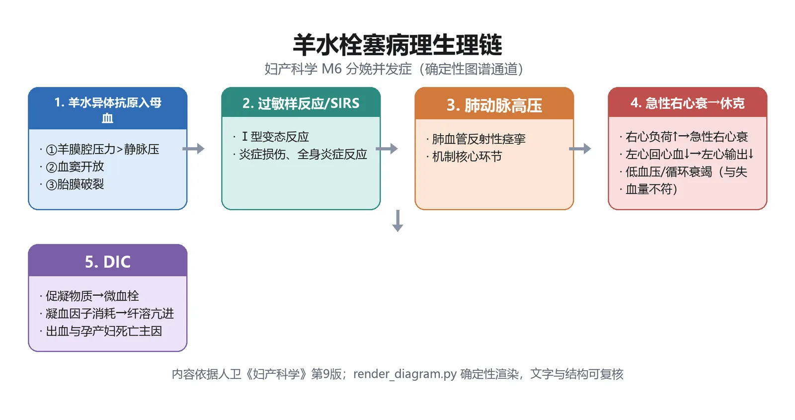


---

### 🌳 鉴别决策树（D4）

<b>产后出血阴道出血时间轴定位病因</b>

```text
[胎儿娩出后阴道流血]
        │
        ├─ 立即出血、鲜红色 ────────────► [软产道裂伤] → 检查宫颈/阴道/会阴，缝合
        │
        ├─ 数分钟后出血、暗红色 ─────────► [胎盘因素] → 检查胎盘/胎膜完整性
        │
        ├─ 胎盘娩出后出血较多 ───────────► [子宫收缩乏力 or 胎盘胎膜残留]
        │                                  → 按摩+宫缩剂后变硬、流血减少
        │
        └─ 持续出血、血不凝 + 全身出血 ───► [凝血功能障碍] → 凝血功能检测、补凝血因子
```
每一步判断依据：<b>出血时间</b>——立即者裂伤；胎盘娩出前/时者胎盘因素；胎盘娩出后者宫缩乏力或残留。<b>颜色与性状</b>——鲜红为动脉性/裂伤；暗红为静脉性/胎盘面；不凝为凝血障碍。<b>操作应答</b>——按摩+宫缩剂后子宫变硬、流血减少→宫缩乏力；胎盘未娩出且伴内陷→植入；检查无裂伤且宫缩好→考虑凝血。

> [!INFO] 若阴道流血不多而低血容量明显，转向隐性失血路径（阴道血肿/腹膜后血肿），应做阴道检查与影像学排查。

---

### ⚠️ 常见陷阱

- 四大病因常并存、互为因果，找到一项不代表排除其余——必须系统排查。
- 出血量估计偏低：用称重/容积/休克指数"多法综合"，不能单看肉眼估计或出血早期血红蛋白。
- 剖宫产阈值是 ≥1000ml 而非 ≥500ml；严重产后出血统一为 ≥1000ml。
- 羊水栓塞休克程度与失血量不匹配，不要只按出血量补液而忽略肺动脉高压与右心衰。
- 羊水栓塞母血找到羊水成分不是诊断必需条件，诊断以临床表现+排除为基础。
- 病理性缩复环（压痛、上升、伴强直宫缩）区别于生理性缩复环，是先兆子宫破裂的警示。
- 麦角新碱禁用于妊娠期高血压疾病及部分心血管病变；缩宫素 24 小时总量≤60U。
- 完全性胎盘植入可不出血，切忌强行剥离，应立即切除子宫。
- 子宫破裂与胎盘早剥可混淆，鉴别不清时按最危险方向积极手术探查。

---

### 💡 记忆口诀

- 产后出血"一 500 二 1000"：阴道分娩 ≥500ml、剖宫产 ≥1000ml，严重者统一 ≥1000ml。
- 四大病因"缩、胎、软、凝"：子宫收缩乏力、胎盘因素、软产道裂伤、凝血功能障碍。
- 羊水栓塞"三联征"：低氧血症、低血压（与失血不符）、凝血功能障碍；机制"高压、过敏、DIC 三条线"。
- 子宫破裂"疤、梗、缩、产"：瘢痕子宫、梗阻性难产、过强收缩、产科手术损伤。
- 先兆破裂"一个环、三异常"：病理性缩复环＋下腹剧痛＋血尿＋胎心率异常。

---

### 📌 本章小结

> [!INFO] 本章小结
> - 产后出血是致我国孕产妇死亡的首位原因，子宫收缩乏力最常见；处理原则"止血、补容、抗感染"，核心是尽快定位四大病因并分因处理。
> - 羊水栓塞以"低氧血症＋低血压（与失血量不符）＋凝血功能障碍"三联征为特征，是排除性临床诊断，治疗以维持呼吸循环、抗过敏、纠正 DIC 为目标。
> - 子宫破裂多由瘢痕子宫与梗阻性难产引起，先兆破裂（病理性缩复环）是唯一可逆窗口，一旦确诊应尽快剖宫产。
> <b>🧬 本章核心洞察</b>：分娩并发症皆为"母胎界面止血/血循环防线失控"——子宫收缩乏力是生理防线失灵，羊水栓塞是屏障被突破后多系统连锁失控，子宫破裂是结构防线断裂，三者在结构与功能的临界点上共同指向早诊断与早干预。

---

### 🔗 深度链接

本模块与<b>模块4（正常分娩）</b>衔接：第三产程正常胎盘剥离与子宫缩复是产后出血的"防线上游"，其机制一旦被打破即进入本模块；与<b>模块5（异常分娩）</b>联动：产力异常、骨盆狭窄、胎位异常等梗阻性难产既是子宫破裂的诱因，也是产后出血（产程延长→宫缩乏力）与羊水栓塞（宫缩过强）的土壤；与<b>模块7（妊娠并发症）</b>贯通：前置胎盘、胎盘早剥、羊水过多、胎膜早破等既是产后出血/羊水栓塞的高危因素，其凝血异常又与 DIC 相互加重。产后出血、羊水栓塞、子宫破裂引发的失血性休克与 DIC，是<b>模块8</b>妊娠合并内科病、<b>模块9</b>产褥期疾病共同的病理基础，其中产后出血的晚期表现与<b>模块9</b>"晚期产后出血"需在时间窗上衔接鉴别。


## 模块7：妊娠并发症

> [!INFO] 模块信息
> <b>重点等级</b>：🔴掌握 12 个 / 🟡熟悉 7 个 / 🟢了解 4 个
> <b>预计题型</b>：A1（定义/数值/标准）、A2（阴道流血＋腹痛→诊断→处理）、B1（流产类型/子痫分级）、X（子痫机制多选）
> <b>关联模块</b>：模块2（胎盘母胎界面）为前导；模块6（产后出血）、模块8（合并症加重）为后续
> <b>谱系位置</b>：产科"母胎界面/胎盘病理"高危谱系：流产→异位妊娠→妊娠期高血压→前置胎盘/早剥→早产/过期妊娠

---

### 🧩 前置知识检查

- 胎盘：气体/营养交换、防御、合成 hCG/雌孕激素。
- 孕周分割：早期流产<12周、晚期≥12周；早产=28~37周；过期≥42周。
- 螺旋动脉重塑→低阻高容血供；妊娠血容量增、高凝（DIC/血栓基础）。

---

### 🎯 高收益摘要

- <b>流产与异位妊娠</b>：自然流产<28周、体重<1000g，50%~60%与胚胎染色体异常有关（教材P76）；异位妊娠95%输卵管（壶腹78%），三联征=停经＋腹痛＋流血＋宫颈举痛（教材P78、P81）。
- <b>子痫前期</b>：基本病理=全身小血管痉挛＋内皮损伤；无"轻度"，只分有无严重特征（教材P87-88），硫酸镁解痉、中毒=膝反射消失、呼吸<16次/分、尿量<17ml/h，配10%葡萄糖酸钙（教材P92）。
- <b>早产与胎盘病变</b>：早产28~37周、<34周促胎肺成熟（地塞米松）＋护脑（硫酸镁）（教材P100-101）；前置胎盘无痛反复流血、胎盘早剥腹痛＋流血（教材P145、P147）。

---

### 📋 结构化笔记

🔴 【掌握级】自然流产：妊娠未达28周、胎儿体重不足1000g 终止；<12周早期、≥12周晚期（教材P76）。

🧬 第一性原理：胚胎与蜕膜"附着-存活"是维持核心。胚胎/滋养层发育不良→绒毛与蜕膜剥离→血窦开放→阴道流血，剥离物刺激宫缩→腹痛；出血随剥离递增→先兆→难免→不全→完全；剥离不可逆（宫口已开）则保胎无效。

#### 🔬 展开：临床类型
先兆：宫口<b>闭</b>、出血少→保胎。难免：宫口<b>扩张</b>、出血多→尽早清宫。不全：宫口扩张、组织堵塞、子宫小于孕周→刮宫。完全：宫口闭、全部排出→无特殊处理。

> [!TIP] 处理口诀：先兆保胎、难免速清、不全即刮、完全观察。

---

🔴 【掌握级】稽留流产（过期流产）：胚胎/胎儿死亡后滞留宫腔未自然排出（教材P77）。

🧬 第一性原理：死亡胚胎滞留，胎盘机化与宫壁紧密粘连；晚期稽留过久，坏死组织释放组织凝血活酶→激活凝血并消耗凝血因子→DIC 大出血。

#### 🔬 展开：处理分层
≤12周：负压吸宫（<10周）/钳刮（10~12周）/药物（前列腺素类似物±米非司酮）、期待7~14日。>12周：钳刮＋促宫颈成熟；凝血异常先输新鲜血、血浆、纤维蛋白原，好转后再清。

> [!WARNING] 易错：稽留流产刮宫前不查凝血就"硬刮"，可诱发无法控制的 DIC 大出血。

---

🔴 【掌握级】异位妊娠：受精卵在宫腔外着床；95% 输卵管（壶腹部78%），少见卵巢/腹腔/宫颈妊娠（教材P78-79）。

🧬 第一性原理：输卵管既无蜕膜又无黏膜下组织，滋养层只能直接侵蚀肌层浆膜。峡部肌层薄血运丰→<b>破裂</b>（6周，骤痛大出血）；壶腹/伞部管腔宽→<b>流产</b>（8~12周，出血少）；输卵管炎致管腔狭窄/纤毛受损则于该处着床。

#### 🔬 展开：破裂 vs 流产
破裂：峡部、6周、剧痛、内出血量大易休克；间质部破裂12~16周更凶险。流产：壶腹/伞部、8~12周、反复少量出血；陈旧性→机化包块甚至石胎。

> [!NOTE] 壶腹部占 78%，是 A1 数值题常考（教材P79）。

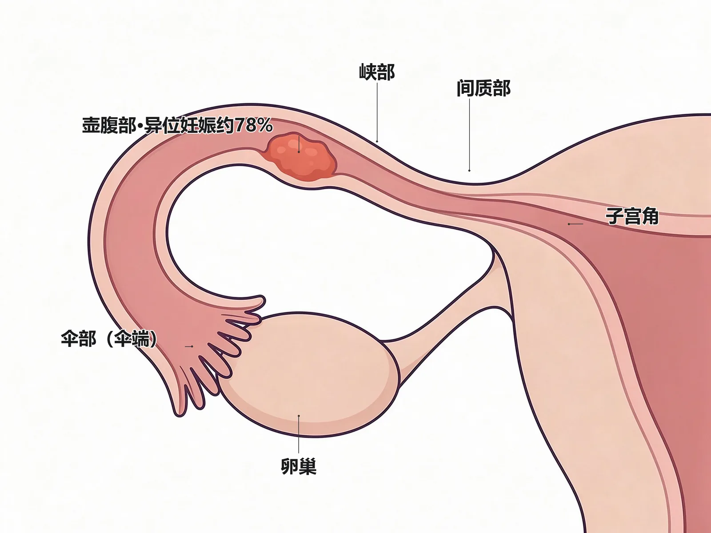

---

🔴 【掌握级】异位妊娠临床表现与诊断：三联征=停经（6~8周）＋腹痛（95%）＋阴道流血（60%~80%暗红点滴）；宫颈举痛、子宫漂浮感（教材P81）。

🧬 第一性原理：血 hCG 维持黄体但宫内无蜕膜供血→胚胎发育不良→阴道流血（量少）；腹腔内出血积聚于直肠子宫陷凹刺激腹膜→宫颈举痛、肛门坠胀、肩胛放射痛。内出血量与通道性外出血无关，故<b>休克程度与外出血不成正比</b>。

#### 🔬 展开：诊断
首选经阴道超声：宫腔无孕囊＋宫旁低回声/卵黄囊/胚芽/胎心；子宫陷凹游离暗区；与假孕囊（蜕膜管型）鉴别。血 hCG>99% 阳性，≥3500IU/L 怀疑。后穹隆穿刺抽<b>暗红不凝血</b>提示腹腔积血。

> [!TIP] "停经＋腹痛＋少量流血＋宫颈举痛＋后穹窿不凝血"即高度提示异位妊娠。

---

🔴 【掌握级】异位妊娠治疗：手术（保守/根治）、药物（MTX）、期待，按生命体征/部位/包块/hCG 选择（教材P83）。

🧬 第一性原理：治疗"止血保命优先，其次保留生育"。生命体征不稳/内出血/进展→手术；稳定且低危→MTX（抑制滋养细胞、破坏绒毛）；极低危→期待；绝不能用药物救休克。

#### 🔬 展开：药物规格
适应证：未破裂、包块<4cm、hCG<5000IU/L、无出血、无禁忌。禁用：不稳、已破裂、包块≥4.0cm（或≥3.5cm 伴胎心）、药物过敏/慢性肝病。单剂量 50mg/m² 肌注。保守术后 hCG：1日未降至术前50% 或12日未降至术前10%→持续性异位妊娠，予 MTX。

> [!WARNING] 易错：把"停经＋少量流血"误判先兆流产而保胎，忽略腹腔内出血休克征象。

---

🔴 【掌握级】妊娠期高血压疾病分类：妊娠期高血压、子痫前期（无/伴严重特征）、子痫、妊娠合并慢性高血压、慢性高血压并发子痫前期（教材P87-88）。

🧬 第一性原理：本质是"妊娠与高血压并存"，按发病时序与严重程度分型。孕20周后新发高血压、产后12周内恢复、无蛋白尿→妊娠期高血压；伴蛋白尿→子痫前期；子痫前期基础上抽搐→子痫；孕前已高血压→合并慢性高血压；其上蛋白尿加重→并发子痫前期。

#### 🔬 展开：诊断要点（详表见"📊 对比速查"表1）
子痫前期：孕20周后血压≥140/90＋尿蛋白（++）/P/C≥0.3/24h≥0.3g；或无蛋白尿但血小板<100×10⁹/L、肝酶2倍、肌酐>1.1mg/dl、肺水肿、新发头痛、视觉障碍之一。重度=收缩压≥160 或舒张压≥110 或任一严重表现；早发型<34周。

> [!WARNING] 易错：血压"较基础升高30/15mmHg"但<140/90 不作诊断；"轻度子痫前期"已废弃。

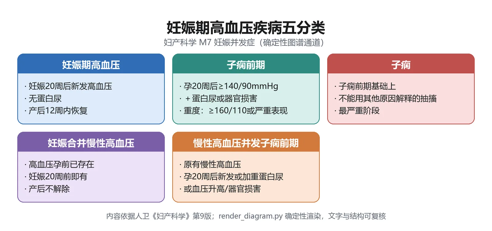


---

🔴 【掌握级】子痫前期-子痫诊断与机制：靠血压/蛋白尿/器官损害；机制=胎盘浅着床→螺旋动脉重塑不足→胎盘缺血→内皮损伤（教材P88-90）。

🧬 第一性原理：正常妊娠滋养细胞（EVT）侵入螺旋动脉使其转低阻高容。子痫前期 EVT 浸润受损→<b>胎盘浅着床</b>、螺旋动脉仅蜕膜层重塑（管腔径仅正常1/2）→胎盘灌注不足→释放胎盘因子→炎症激活＋<b>内皮损伤</b>→扩血管物减少、缩血管物增多→全身小血管痉挛。

#### 🔬 展开：病理生理
脑：痉挛→脑水肿/缺血/点状出血。肾：蛋白尿、少尿。肝：门静脉周围出血、肝包膜下血肿、破裂。心血管：低排高阻→心肌缺血、肺水肿、心衰。子宫胎盘：FGR、窘迫，胎盘床血管破裂→早剥。

> [!NOTE] 高危：子痫前期史、多胎、慢性高血压、糖尿病、肾病、自身免疫病。预防用低剂量阿司匹林 100~150mg 睡前自 11~13⁺⁶周用至36周。

---

🔴 【掌握级】子痫前期-子痫治疗：降压＋解痉（硫酸镁）＋镇静＋适时终止妊娠；硫酸镁中毒识别抢救（教材P91-93）。

🧬 第一性原理：本质是血管痉挛，故解痉（镁抑制神经末梢释放乙酰胆碱、拮抗钙内流）关键；严重高血压需降压防脑卒中；抽搐控制后终止妊娠是唯一有效处理。

#### 🔬 展开：硫酸镁要点
指征：控抽防再抽、防重度发展成子痫；<b>不作降压药</b>。方案：负荷 4~6g 静注（15~20分钟）→1~2g/h 维持；24h≤30g、≤5日；产后续用24~48小时。有效浓度 1.8~3.0mmol/L，>3.5mmol/L 中毒。<b>中毒：膝反射消失、呼吸<16次/分、尿量<17ml/h 或<400ml/24h；抢救=停镁＋静注10%葡萄糖酸钙10ml。</b>目标血压 130~139/80~89mmHg，禁用 ACEI/ARB/阿替洛尔/哌唑嗪。终止：非重度期待至37周后；重度<24周终止、28~33周不稳促胎肺成熟后终止、≥34周终止。

> [!WARNING] 易错：把硫酸镁当降压药、忽略中毒监测；硫酸镁中毒最早体征是<b>膝反射消失</b>。

---

🔴 【掌握级】HELLP 综合征：子痫前期基础上发生，溶血＋转氨酶升高＋血小板减少，是重度子痫前期严重表现（教材P95-96）。

🧬 第一性原理：子痫前期血管内皮损伤＋微血管病变→红细胞破坏（溶血）、肝细胞受损（肝酶升）、血小板消耗（减少），三者叠加即 HELLP。DIC、肝破裂、多器官衰竭风险极高，唯一有效治疗是终止妊娠。

#### 🔬 展开：诊断与处理
诊断：①溶血（血涂片破碎/球形红细胞，总胆红素≥20.5μmol/L，结合珠蛋白<250mg/L）；②肝酶升高（正常值2倍，LDH≥600U/L）；③血小板<100×10⁹/L。LDH 升高＋结合珠蛋白降低是敏感指标。终止=唯一有效：≥34周/胎肺成熟/肝包膜下血肿/恶化→立即终止；<34周稳定→延长48小时促胎肺成熟后终止。禁阴部阻滞与硬膜外麻醉。输血小板：阴道分娩前<20×10⁹/L、剖宫产前<50×10⁹/L。

> [!NOTE] 与急性脂肪肝：后者有<b>低血糖、PT/APTT 延长、血氨增高</b>；HELLP 无氮质血症、PT/APTT 正常、血糖正常（见"📊 对比速查"表4）。

---

🔴 【掌握级】早产：妊娠达28周但不足37周分娩；分自发性/治疗性；处理=抑制宫缩＋促胎肺成熟＋护脑（教材P100-101）。

🧬 第一性原理：早产是宫缩提前激活＋宫颈成熟过早。母胎界面"维持妊娠"信号不足或感染激活炎症→规律宫缩、宫颈缩短→胎肺未成熟→呼吸窘迫；抑制宫缩＋糖皮质激素促肺成熟＋硫酸镁护脑，可把早产儿呼吸/脑损伤风险降到最低。

#### 🔬 展开：治疗要点
先兆早产：规律宫缩（20min≥4次）＋宫颈管进行性缩短；早产临产：同前＋宫口扩张≥2cm；与生理性宫缩（Braxton Hicks 不规则无痛）鉴别。抑制宫缩：硝苯地平、吲哚美辛（仅32周前短期，防动脉导管早闭）、利托君（慎用于心脏病/糖尿病/重度子痫前期）、阿托西班。促胎肺成熟：<34周用<b>地塞米松 6mg 肌注 每12h×4</b> 或倍他米松 12mg 肌注 24h 重复。护脑：<34周硫酸镁负荷 4g 静注后 1g/h×24h。宫颈长度≤25mm 提示早产风险。

> [!WARNING] 易错：把生理性宫缩当早产过度保胎；利托君对合并心脏病、重度子痫前期、双胎者慎用/禁用。

---

🟡 【熟悉级】复发性流产（RSA）：同一性伴侣连续≥2次自然流产（含生化）。早期-胚胎染色体异常、免疫异常、黄体功能不全、甲减；晚期-子宫解剖异常、自身免疫、血栓前状态。按病因治疗（教材P77）。

🟡 【熟悉级】流产合并感染：宫腔感染（厌氧菌＋需氧菌混合），可致盆腔炎、腹膜炎、感染性休克。治疗=控感染同时清残留；出血不多先广谱抗菌2~3日再刮宫；出血多先卵圆钳夹出大块（勿全面搔刮），感染控制后再彻底刮宫（教材P78）。

🟡 【熟悉级】子痫：子痫前期基础上发生不能用其他原因解释的抽搐，是最严重阶段、母儿死亡主因；产后48小时约25%。发作=抽搐、口吐白沫、深昏迷，继之全身高张阵挛惊厥（1~1.5分钟）。处理=保持气道通畅、避免声光刺激、硫酸镁控抽（产后续用24~48小时）、20%甘露醇降颅压、控制血压（收缩压≥160/舒张压≥110 降压防脑血管意外）、抽搐控制后终止妊娠（教材P93-94）。

🟡 【熟悉级】其他妊娠期高血压类型：①妊娠期高血压（孕20周后新发、无蛋白尿、产后12周内恢复，50%以上发展成子痫前期）；②妊娠合并慢性高血压（孕前已存在，13%~40%并发子痫前期，38~39周终止）；③慢性高血压并发子痫前期（按子痫前期处理）（教材P94-95）。

🟡 【熟悉级】过期妊娠：过期妊娠=平时月经规则、达42周（≥294日）未分娩；42周后羊水迅速减少（约30%至300ml以下）、羊水粪染率增高；胎儿可巨大、过熟综合征（"小老人"）、生长受限；处理≥41周即考虑终止、促宫颈成熟（Bishop≥7 可引产）、放宽剖宫产指征（教材P102-104）。

---

### 🔗 关联考点：胎儿附属物异常（第11章补充）

🔴 【掌握级】前置胎盘：妊娠28周后胎盘低于胎先露部、下缘毗邻或覆盖宫颈内口；典型=妊娠晚期/临产时<b>无诱因、无痛性反复阴道流血</b>；<b>禁止肛门指检</b>（教材P145-146）。

🧬 第一性原理：胎盘附着于子宫下段/宫颈内口，缺乏收缩能力。子宫下段形成与宫颈扩张时，伸展性差的胎盘与附着处错位分离、血窦破裂出血；因无宫缩触发故"无痛"。完全性最重（34~37周后择期）、边缘性较轻（38周后择期）。

#### 🔬 展开：分类与处理
分类：完全性/部分性/边缘性/低置（距内口<2cm）。诊断首选<b>经阴道超声</b>，疑似合并植入者用 MRI。严禁肛门指检与不必要阴道检查。期待治疗适用<36周、胎儿存活、出血少；剖宫产是终止主要方式；阴道试产仅限边缘性/低置、枕先露。使 Hb≥110g/L。

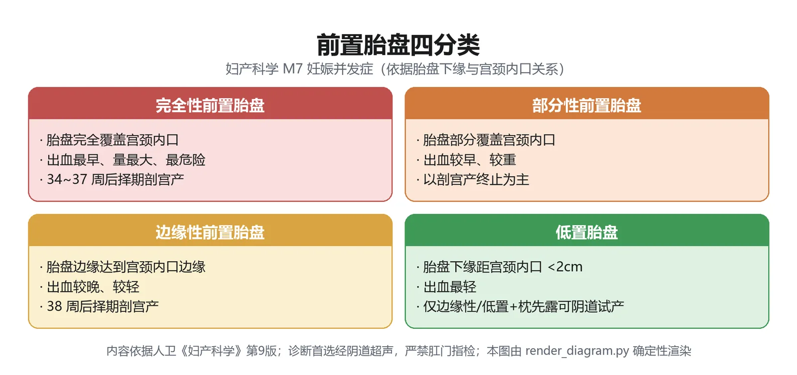

> [!WARNING] 易错：妊娠中期超声"胎盘前置"应称<b>胎盘前置状态</b>（其后胎盘可上移复位）；对前置胎盘行肛门指检可诱发大出血。

🔴 【掌握级】胎盘早剥：妊娠20周后正常位置胎盘在胎儿娩出前部分/全部自宫壁剥离；典型=<b>腹痛＋阴道流血</b>，可伴子宫压痛、板状腹、休克、DIC（教材P147-148）。

🧬 第一性原理：早剥源于底蜕膜血管病变（痉挛/硬化）出血形成胎盘后血肿，使胎盘与子宫壁分离。血液经宫颈流出→<b>显性剥离</b>；积聚于胎盘与宫壁间→<b>隐性剥离</b>。内出血骤增浸入子宫肌层→<b>子宫胎盘卒中（库弗莱尔子宫）</b>；释放组织凝血活酶→激活凝血并消耗→<b>DIC</b>。

#### 🔬 展开：分级、并发症、处理
分级：0无症状、1少量出血/子宫轻压痛、2子宫强直性收缩/胎儿窘迫、3板状腹/产妇休克/胎死宫内（1/3併凝血异常）。并发症：胎儿窘迫或死胎、<b>DIC（妊娠期凝血障碍最常见原因）</b>、失血性休克（可致希恩综合征）、急性肾衰、羊水栓塞。处理：早期识别、纠正休克、及时终止妊娠；0~1级可阴道分娩，2~3级剖宫产；子宫胎盘卒可按摩＋热盐纱湿敷，出血难控切子宫。

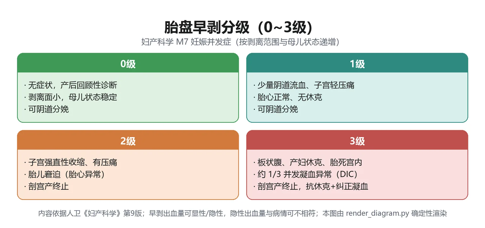

> [!WARNING] 易错：早剥出血量与病情<b>不一定相符</b>（后壁隐性剥离出血少但重）；宫缩间歇期子宫高张、触诊不清是早剥特征，勿误诊为先兆子宫破裂。

🟢 【了解级】胎膜早破（PROM）：PROM=临产前胎膜破裂，≥37周足月、<37周未足月（PPROM，早产主因），阴道液 pH≥6.5 或羊齿状结晶阳性，足月破膜2~12h引产、>12h防性抗生素，PPROM按孕周个体化（<24周引产、28~33周期待+促肺成熟+抗感染，GBS阳性不建议期待）（教材P151-153）。

---

### 📊 对比速查

<b>表1｜妊娠期高血压疾病分类与表现</b>

| 分类 | 何时现高血压 | 蛋白尿 | 关键特征 |
|---|---|---|---|
| 妊娠期高血压 | 妊娠20周后 | 无 | 产后12周内恢复，产后方可确诊 |
| 子痫前期（无严重特征） | 妊娠20周后 | 有 | 血压≥140/90＋蛋白尿或器官损害 |
| 子痫前期（伴严重特征/重度） | 妊娠20周后 | 可有 | 收缩压≥160或舒张压≥110或任一严重表现 |
| 子痫 | 子痫前期基础上 | 可有 | 不能用其他原因解释的抽搐 |
| 妊娠合并慢性高血压 | 妊娠20周前 | 无 | 高血压孕前已存在，产后不解 |
| 慢性高血压并发子痫前期 | 原有慢性高血压 | 新发或加重 | 孕20周后出现蛋白尿或加重/血压升高/器官损害 |

<b>表2｜各型流产鉴别</b>

| 类型 | 出血量 | 下腹痛 | 组织排出 | 宫颈口 | 子宫大小 |
|---|---|---|---|---|---|
| 先兆流产 | 少 | 无/轻 | 无 | 闭 | 与孕周相符 |
| 难免流产 | 中→多 | 加剧 | 无 | 扩张 | 相符或略小 |
| 不全流产 | 少→多 | 减轻 | 部分排出 | 扩张/堵塞 | 小于孕周 |
| 完全流产 | 少→无 | 无 | 全部排出 | 闭 | 正常或略大 |
| 稽留流产 | 少/无 | 无 | 无 | 闭 | 较停经周数小 |

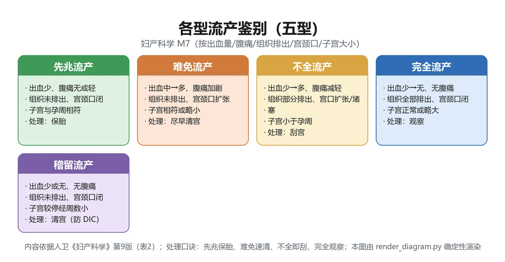

<b>表3｜前置胎盘 vs 胎盘早剥</b>

| 对比项 | 前置胎盘 | 胎盘早剥 |
|---|---|---|
| 定义 | 妊娠28周后胎盘低于胎先露、覆盖宫颈内口 | 妊娠20周后正常胎盘在胎儿娩出前自宫壁剥离 |

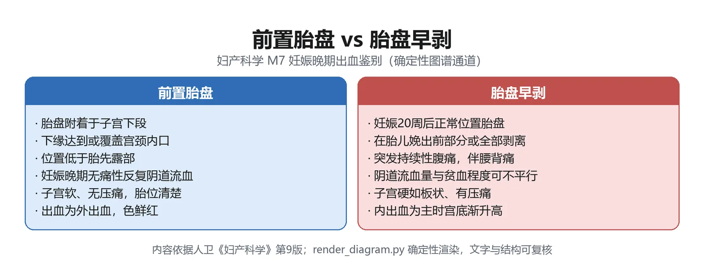

| 典型症状 | <b>无痛性</b>反复阴道流血 | <b>腹痛</b>＋阴道流血 |
| 出血特点 | 色鲜红，外出血为主 | 陈旧不凝血，可显性/隐性 |
| 子宫 | 软、无压痛、轮廓清楚 | 张力增高、有压痛、重者板状腹 |
| 禁忌/处理 | 禁忌肛门指检 | 立即终止妊娠 |

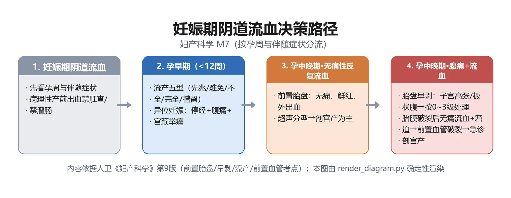

<b>表4｜HELLP 与其他严重肝病鉴别</b>

| 项目 | HELLP | 急性脂肪肝 |
|---|---|---|
| 高血压/蛋白尿 | 有 | 无 |
| PT/APTT | 正常 | 延长 |
| 血糖 | 正常 | 降低 |
| 血氨 | 正常 | 显著升高 |
| 肌酐 | 正常/增高 | 显著增高 |

---

### 🔗 因果链（D2）

```text
[胚胎/滋养细胞]
   │
   ▼
螺旋动脉重塑不足 ─► 胎盘浅着床 ─► 胎盘缺血缺氧 ─► 释放胎盘因子(★)
   │                                            │
   └──────────────► ★ 全身小血管痉挛 ─► 高血压＋蛋白尿＋器官损害
   │                                            │
   ▼                                            ▼
系统性炎症＋内皮损伤 ─► 扩血管↓ 缩血管↑ ─► 脑水肿/心衰/肝破裂/早剥/DIC ─► 胎儿窘迫
   │
   ▼
若螺旋动脉重塑正常 ─► 低阻高容灌注 ─► 母胎交换正常 ─► 无子痫前期(转折点)
```

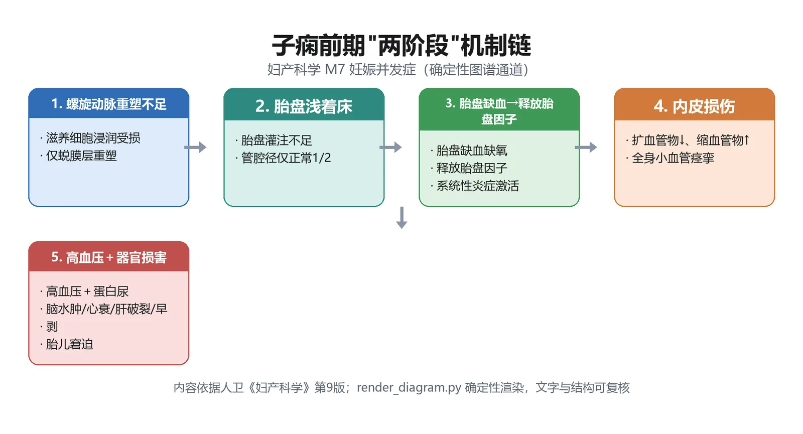


> [!INFO] 此图展示子痫前期"两阶段"机制链路，分级与数据见上方「📊 对比速查」表1。

---

### 🌳 鉴别决策树（D4）

```text
妊娠期阴道流血(±腹痛)
   │
   ├─ 先兆流产：宫口闭、出血少、无排出 → 保胎
   ├─ 难免流产：宫口扩、出血多、腹痛加剧 → 尽早清宫
   ├─ 不全流产：宫口扩、部分排出、子宫小于孕周 → 刮宫
   ├─ 稽留流产：宫口闭、子宫小于停经孕周、无胎心 → 先查凝血再清宫
   ├─ 异位妊娠：撕裂样腹痛＋休克与外出血不成正比＋宫颈举痛 → 血hCG＋超声＋后穹窿穿刺 → 手术/MTX
   ├─ 前置胎盘：无痛反复流血、子宫软无压痛、胎先露高浮 → 禁肛诊，经阴道超声分型 → 期待/剖宫产
   └─ 胎盘早剥：腹痛＋流血、子宫张力高有压痛、可能板状腹 → 立即终止妊娠
```

判定顺序：<b>先看宫口开闭（流产类型）→ 再看有无痛（无痛=前置，痛=早剥）→ 最后看休克与外出血是否成比例（异位妊娠）</b>。

---

### ⚠️ 常见陷阱

- 把"宫口已扩张、出血多"的难免流产当先兆流产保胎，延误清宫。
- 异位妊娠"休克与外出血不成正比"被忽视，误诊为先兆流产/黄体破裂。
- 硫酸镁中毒漏识别——最早是膝反射消失，须备10%葡萄糖酸钙。
- 前置胎盘行肛门指检；或把妊娠中期"胎盘前置状态"误断为前置胎盘；胎盘早剥后壁隐性剥离出血少但病情重，被低估。

---

### 💡 记忆口诀

- 流产与异位：<b>先兆保胎、难免速清、不全即刮、完全观察</b>；<b>停经、腹痛、流血</b>，部位<b>峡部易破、壶腹易流</b>。
- 子痫与胎盘：<b>收缩160/舒张110，任一严重即重度</b>；<b>前置不疼早剥疼，一个禁诊、一个急清</b>。

---

### 📌 本章小结

> [!INFO] 本章小结
> - 自然流产类型由"宫口开闭＋出血量＋组织排出"判断，先兆保胎、其余清宫；稽留流产必先查凝血防 DIC。
> - 异位妊娠 95% 输卵管（壶腹78%），三联征＋宫颈举痛＋后穹窿不凝血；休克与外出血不成正比；MTX 条件=包块<4cm、hCG<5000、未破裂、无出血。
> - 子痫前期-子痫机制=螺旋动脉重塑不足→胎盘浅着床→内皮损伤→全身小血管痉挛；治疗=降压（禁用 ACEI/ARB）＋硫酸镁解痉＋适时终止妊娠（最有效）。
> - HELLP=溶血＋肝酶升＋血小板低，唯一有效治疗是终止妊娠；与急性脂肪肝靠血糖/PT-APTT/血氨鉴别。早产（28~37周）=抑制宫缩＋促胎肺成熟（地塞米松）＋护脑（硫酸镁）。
> - <b>🧬 本章核心洞察</b>：妊娠期并发症多源于"母胎界面"失衡——种植位置错（异位/前置）、胎盘血供不足（子痫前期、早剥、早产）、时机不对（流产、过期妊娠）。

---

### 🔗 深度链接

- 前置胎盘与胎盘早剥的出血→产后出血因果链，与<b>模块6（分娩并发症）</b>紧衔接；子痫前期/慢性高血压与<b>模块8（妊娠合并内外科疾病）</b>相互加重。
- 子痫前期患者产后血压波动高危期（产后7~10日）、HELLP 产后监测，与<b>模块9（产褥期及产褥期疾病）</b>管理相关。
- 孕周定义（早期/晚期流产、早产、过期妊娠）以<b>模块3（妊娠诊断与孕期保健）</b>孕周计算与胎心监护技术为基础。


## 模块8：妊娠合并内外科疾病

> [!INFO] 模块信息
> <b>重点等级</b>：🔴掌握 2 个 / 🟡熟悉 1 个 / 🟢了解 1 个
> <b>关联模块</b>：模块02（妊娠期血容量/胎盘激素）、模块07（妊娠期高血压疾病、胎盘早剥）、模块06（产后出血）、模块13（内分泌轴）
> <b>谱系位置</b>：产科高危妊娠合并症谱系——本课表仅覆盖妊娠合并心脏病；心脏病居非直接产科死因首位，按 NYHA 分级决定监护与分娩时机

---

### 🧩 前置知识检查

- 妊娠期循环适应性变化——血容量与心输出量在妊娠32-34周达高峰（模块02）。
- 胎盘内分泌——hCG（刺激TSH受体）、人胎盘催乳素（拮抗胰岛素）、雌激素/孕激素（模块02）。
- 妊娠高血压与胎盘早剥母儿影响（模块07）；产后出血四大病因（模块06）；生理性贫血与白细胞增多（模块02、03）。

---

### 🎯 高收益摘要

- <b>心脏病</b>：三危险期（<b>32-34周/分娩期/产后3日内</b>）心衰最易发生（教材P105）；NYHAⅠ级可阴道试产、<b>Ⅲ-Ⅳ级或高风险者择期剖宫产</b>，分娩期<b>禁用麦角新碱</b>、用缩宫素（教材P108、P110）。

---

### 📋 结构化笔记

🔴 【掌握级】妊娠合并心脏病的三个危险时期：血容量与心输出量渐增，至<b>妊娠32-34周达高峰</b>；分娩期每次宫缩约250-500ml液体进入体循环、第二产程屏气增肺循环压力；胎儿胎盘娩出后回心血量激增；产褥期尤以<b>产后3日内（尤其产后24小时）</b>心脏负担最重——此三阶段最易诱发心衰（教材P105）。

🧬 第一性原理：血容量增多是"生理前负荷"增加，心脏不能代偿即失代偿。32-34周负荷达峰、分娩加速期宫缩挤静脉回流、胎盘娩出后回心血量第三次冲击——三处"负荷峰值"叠加，击穿病变心脏代偿极限。

机制要点：前负荷↑→舒张末压↑→肺循环淤血→急性左心衰（以急性肺水肿多见）；合并先心病者右心压升高可使分流逆转。

#### 🔬 展开：三大危险期时间轴
妊娠期：血容量至32-34周高峰、心率+10-15次/分。分娩期：每宫缩250-500ml入体循环；先心病左→右分流可逆转为右向左而发绀。产褥期：产后3日（尤其24h）潴留液回体循环＋宫缩挤血。早期心衰征象：①活动后胸闷心悸气短；②休息心率>110次/分、呼吸>20次/分；③夜间胸闷须坐起；④肺底湿啰音咳嗽后不消失。

> [!WARNING] 易错陷阱：危险期最易把"产后3日"误记成"产后3周"；并牢记产后24小时仍是高峰。

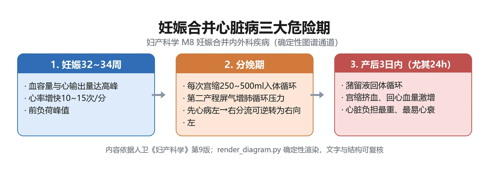


🔴 【掌握级】心功能分级（NYHA）：按日常活动受限程度分4级——Ⅰ级不受限；Ⅱ级轻度受限；Ⅲ级明显受限（休息无不适）；Ⅳ级严重受限（休息也有症状、不能进行任何体力活动）（教材P108）。

🧬 第一性原理：分级本质是"泵血储备"对"生理需求"的匹配度。Ⅲ/Ⅳ级以"休息时是否有症状"分界——Ⅲ级休息无症状、仅活动受限；Ⅳ级休息也喘，说明已失代偿。

机制要点：识别标志是"休息时"是否出现心悸、呼吸困难；分娩与终止妊娠决策随分级升级而收紧。

#### 🔬 展开：NYHA 分级与产科决策
Ⅰ级：不受限——风险低者可妊娠至足月、可阴道试产。Ⅱ级：轻度受限——妊娠风险分级高者也可考虑择期剖宫产。Ⅲ/Ⅳ级：Ⅲ级活动明显受限、Ⅳ级休息也有症状——均应择期剖宫产。

> [!TIP] 巧记界限："休息时"是分水岭——活动受限但休息无症状=Ⅲ级；休息时也喘=Ⅳ级。


---

🟡 【熟悉级】常见先心/瓣膜＋围产期心肌病（PPCM）：①房缺最常见先心（约20%）、>2cm²最好术前矫治；②室缺膜部最常见、未修补大者死亡率极高应禁妊娠；③法洛四联症最常见发绀型、自然流产率约24%、未矫治不宜妊娠；④马方主动脉根部>45mm或有夹层史<b>不宜妊娠</b>（夹层风险1%-3%、致死率50%）；⑤风湿性<b>二尖瓣狭窄最多</b>（占2/3-3/4）、瓣口1.5-2.0cm²可耐受（教材P106）。左向右分流（房缺/室缺/动脉导管未闭）→妊娠加重肺动脉高压→可"逆转"为右向左→发绀+心衰；瓣膜狭窄以前负荷增高+肺淤血为主、关闭不全反流减轻较耐受。<b>PPCM</b>：既往无心血管病者妊娠晚期至产后6个月内发生的扩张型心肌病，表现为收缩功能下降＋充血性心衰、<b>LVEF<45%</b>，产褥期及产后3个月内最多（约60%），曾患且遗留心脏扩大者<b>避免再孕</b>；50%-80%可恢复、血栓率约7%（教材P107）。

---

🟢 【了解级】妊娠高血压性心脏病＋无分流型先心：高血压孕妇突发以<b>左心衰为主的全心衰</b>（冠状痉挛、心肌缺血、水钠潴留），产后病因消除多不留器质病变（教材P107）；单纯肺动脉瓣狭窄预后较好、重度者妊娠期血容/心输出量↑加重右室负荷可致右心衰、宜孕前矫治；主动脉缩窄少见、常伴畸形、预后较差（教材P106）。

---

### 📊 对比速查


<b>表 8-2　妊娠合并心脏病：三大危险期与处理要点</b>

| 阶段 | 危险点（血流动力学） | 处理要点 |
|---|---|---|
| 妊娠期 | 血容量/心输出量<b>32-34周达高峰</b>；心率+10-15次/分 | 32周后增加产检；妊娠<b>36-38周提前住院</b>待产 |
| 分娩期 | 每次宫缩+250-500ml；第二产程屏气增肺循环压；胎盘娩出后回心血量激增 | 心功能Ⅰ级可阴道试产；<b>缩短第二产程、避免屏气</b>；<b>禁用麦角新碱</b>、用缩宫素；产程开始即抗菌药物 |
| 产褥期 | <b>产后3日内（尤其24小时）</b>潴留液回体循环＋宫缩挤血 | 控制液体入量、输液勿快；抗菌药物5-10日；心功能Ⅰ级可母乳、重者人工喂养 |


---

### 🔗 因果链（D2）

```text
心脏病变（器质性/功能异常）
   │
   ▼
妊娠期：血容量↑·心输出量↑（32-34周高峰★）→ 心脏前负荷↑
   │
   ├─► 分娩期：宫缩＋250-500ml/次、屏气→肺循环压↑
   │        （先心病者左→右分流可逆转为右向左★，出现发绀）
   │        └─► 胎盘娩出：回心血量激增、腹压骤减→血流动力学剧变
   │
   ├─► 产褥期：产后3日内潴留液回体循环＋宫缩挤血（★产后24h高峰）
   │
   ▼
心脏代偿超过极限 → 急性左心衰（急性肺水肿）
   │
   └─► 血压↓·脉搏细弱·神志模糊·休克/窒息
```
> [!INFO] 此图展示妊娠合并心脏病"负荷叠加→心衰"的机制链路；三个阶段的具体血流动力学数据见上方「📊 对比速查」表8-2。

---

### ⚠️ 常见陷阱

- 三大危险期误记为"32-34周后/分娩期/产后3周"，漏掉"产后24小时"这一高峰。
- 分娩期用<b>缩宫素、禁用麦角新碱</b>（麦角新碱加重心衰）；勿把缩宫素与麦角类混淆。

---

### 💡 记忆口诀

- 心衰三关与 NYHA：<b>"三十二四周高峰、分娩使劲、产后三天"</b>；<b>"一级随便跑、二级饭后喘、三级一动就喘、四级躺着也喘"</b>。

---

### 📌 本章小结

> [!INFO] 本章小结
> - 心脏病三大危险期（32-34周/分娩期/产后3日）定监护与分娩时机；NYHA分级定能否阴道试产（Ⅰ级可、Ⅲ-Ⅳ级剖宫产），分娩期禁用麦角新碱。
> - <b>🧬 本章核心洞察</b>：妊娠如同一场"生理应激试验"——血容量进行性升高叠加分娩期宫缩挤血，三处负荷峰值共振，击穿病变心脏的代偿极限；按 NYHA 分级与三大危险期监护，是心脏病孕妇处理的总开关。

---

### 🔗 深度链接

- 本模块的妊娠期血容量、胎盘激素等生理基础承接<b>模块02（妊娠生理）</b>；妊娠期高血压疾病/子痫前期与胎盘早剥详见<b>模块07</b>。
- 分娩期"禁用麦角新碱、用缩宫素、缩短第二产程、预防产后出血"直接衔接<b>模块06（产后出血）</b>，抗菌药物预防感染延伸至<b>模块09（产褥期）</b>。


## 模块9：产褥期及产褥期疾病

> [!INFO] 模块信息
> <b>重点等级</b>：🔴掌握 6 个 / 🟡熟悉 3 个 / 🟢了解 1 个
> <b>预计题型</b>：A1（时限/标准数值：产褥期 6 周、产褥发热 24h 后 10 日内≥38℃×2 次）、A2（病例：产后出血/发热→诊断→处理）、B1（恶露演变、晚期产后出血病因共用选项）、X（泌乳激素机制多选）
> <b>关联模块</b>：前导——模块4（正常分娩/产程）、模块6（分娩并发症/产后出血）、模块7（妊娠并发症/产前出血）；后续——模块12（滋养细胞疾病·产后血 hCG 随访）、模块14（生育规划）。
> <b>谱系位置</b>：产科「产后阶段」收尾——从胎盘娩出至产后 6 周，承接产时出血/感染风险，衔接产后保健与节育指导。

---

### 🧩 前置知识检查

- <b>妊娠期激素基础</b>（模块2）：妊娠期雌、孕激素与人胎盘催乳素升高→乳腺发育、血容量增加、高凝——理解「产后激素骤降→泌乳」与「高凝→血栓」前提。
- <b>分娩三产程与产后 2 小时</b>（模块4/6）：产后 2 小时是严重并发症（出血、子痫、心衰）高发期。
- <b>产前出血病因</b>（模块7）：前置胎盘、胎盘早剥、胎盘植入——延续为晚期产后出血（胎盘/胎膜残留）主因。

---

### 🎯 高收益摘要

- <b>产褥期＝从胎盘娩出至全身各器官（除乳腺外）恢复至未孕状态，通常 6 周</b>（教材P208）。
- <b>子宫复旧 6 周</b>：产后 1 周≈妊娠 12 周/约 500g，6 周恢复至未孕 50～70g（教材P208、P210）。
- <b>恶露时间轴</b>：血性（鲜红，3～4日）→浆液（淡红，约10日）→白色（大量白细胞，约3周），总量 250～500ml，有血腥味无臭味（教材P210）。

---

### 📋 结构化笔记

🔴 【掌握级】产褥期的定义与时限：从胎盘娩出至产妇全身各器官（<b>除乳腺外</b>）恢复至正常未孕状态所需的一段时期，通常为 <b>6 周</b>（教材P208）。
💡 时限 + 唯一除外项（乳腺）近乎必考。
🧬 第一性原理：若 6 周回退被打破（复旧不全、残留、感染、创面再出血），疾病窗口随即打开
#### 🔬 展开：界定与临床窗口
产后 2 小时为严重并发症高发期；产后访视 3 次（产后 1 周内、14 日、28 日），6 周常规回院全身+妇科检查。

> [!WARNING] 易错陷阱
> 恶露可延长（4～6 周），但产褥期时限固定 6 周，勿依恶露定产褥期。

---

🔴 【掌握级】子宫复旧：胎盘娩出后子宫逐渐恢复至未孕状态的过程，一般 6 周；主要变化为宫体肌纤维缩复 + 子宫内膜再生，另有子宫血管、子宫下段与宫颈复原（教材P208）。
💡 复旧时间轴（大小/重量/位置）与「复旧不全→晚期产后出血」直接相关。
🧬 第一性原理：子宫复旧不是肌细胞数目减少，而是胞质中蛋白质被分解排出使细胞质减少致肌细胞缩小；若血栓脱落、血窦再开放即晚期产后出血；只要缩复+再生+血栓化按部就班就不再出血。

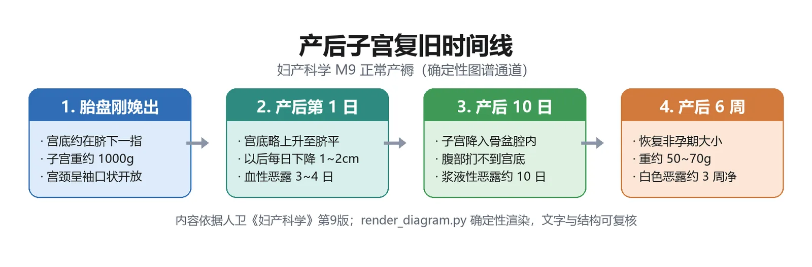

#### 🔬 展开：子宫复旧时间轴（重量+大小+位置）
产后 1 周≈妊娠 12 周大小、约 500g，产后 2 周≈300g，产后 6 周恢复至 50～70g（分娩结束约 1000g）；内膜第 3 周除附着部位外均再生；<b>产后 10 日降至骨盆腔内、腹部触不到宫底</b>。

> [!TIP] 记忆钩子
> 位置节点「1 日平脐、1 周耻上、10 日入盆」；重量「产毕 1000g、1 周 500g、2 周 300g、6 周 50～70」。

---

🔴 【掌握级】恶露演变：产后子宫蜕膜脱落，含血液、分泌物、坏死蜕膜等的产道排出物；有血腥味但<b>无臭味</b>，持续 <b>4～6 周</b>，总量 <b>250～500ml</b>（教材P210）。
💡 恶露的时间-颜色-镜下成分是 B1 型共用选项和产科护理高频点；「有臭味」是感染/宫腔残留的重要报警。
🧬 第一性原理：时间梯度；创面愈合顺利、无残留无感染则梯度自然推进且无臭味；一旦复旧不全、宫腔残留或合并感染，血性恶露延长并出现臭味。
#### 🔬 展开：三段恶露镜下成分
血性：大量红细胞、坏死蜕膜、少量胎膜；浆液：较多坏死蜕膜、宫腔渗出液、宫颈黏液、少量红白细胞及细菌；白色：大量白细胞、坏死蜕膜、表皮细胞及细菌。

> [!NOTE] 教材补充
> 恶露「有腥味无臭味」是正常特征；一旦<b>恶臭味</b>，应高度怀疑宫腔残留合并感染或子宫内膜炎，需查血常规、超声并抗感染。

---

🔴 【掌握级】泌乳机制：胎盘剥离娩出后，雌激素、孕激素、人胎盘催乳素水平急剧下降，解除下丘脑催乳素抑制因子，在催乳素作用下乳汁开始分泌；吸吮乳头是持续泌乳与排乳的关键（教材P209）。
💡 催乳素（泌乳）+ 缩宫素（喷乳）双激素分工是高频机制题。
🧬 第一性原理：而泌乳维持靠「吸吮」：吸吮经传入神经至下丘脑，抑制多巴胺及催乳素抑制因子→催乳素脉冲释放→维持泌乳；同时吸吮反射性引起神经垂体释放缩宫素→乳腺腺泡周围肌上皮收缩→乳汁喷出（喷乳反射）。
#### 🔬 展开：产后激素与月经复潮
催乳素：哺乳产妇产后下降但仍高于非妊娠水平；不哺乳产妇产后 2 周降至非妊娠水平。血 hCG 通常于产后 10 日左右恢复至非妊娠水平。不哺乳产妇常在产后 6～10 周复潮、约产后 10 周恢复排卵；哺乳产妇平均产后 4～6 个月恢复排卵，故月经未复潮仍可能受孕。

> [!SUCCESS] 成功母乳喂养关键
> 产后 1 小时内开奶、按需哺乳、24 小时母婴同室、纯母乳喂养 6 个月；每日满意哺乳约 8 次，婴儿每日排尿 5～6 次、排便 2～4 次。

---

🔴 【掌握级】产褥感染与产褥发热的定义：产褥感染指分娩及产褥期生殖道受病原体侵袭引起局部或全身感染（发病率约 6%）；<b>产褥发热＝分娩 24 小时以后、10 日内，每日间隔 4 小时测体温，有 2 次≥38℃</b>（教材P213）。
💡 产褥发热的「时间窗+次数+温度」是 A1 数值题核心；三大主症（发热、疼痛、异常恶露）与「先考虑产褥感染」次序是处理题起点。
🧬 第一性原理：当免疫力与病原体毒力/数量平衡失调（体质弱、贫血、胎膜早破、羊膜腔感染、产程延长、产前产后出血、多次宫颈检查、产科手术）时，条件致病菌才致病
#### 🔬 展开：产褥发热的鉴别顺序
产褥早期发热最常见原因是<b>脱水</b>；先考虑产褥感染，再排除上感、急性乳腺炎、泌尿系感染；注意区分外阴阴道宫颈炎、子宫感染（内膜炎/肌炎）、盆腔结缔组织炎与输卵管炎（冰冻骨盆）、盆腔腹膜炎、血栓性静脉炎（股白肿）、脓毒血症。

> [!WARNING] 易错陷阱
> 别把「产褥期 2～3 日低热+随后高热」判为乳腺炎或上感——应先按产褥感染排查；<b>血清 C-反应蛋白升高有助于早诊感染</b>。

---

🔴 【掌握级】晚期产后出血（定义 + 病因 + 处理）：分娩 <b>24 小时以后</b>、在产褥期内发生的子宫大量出血，以产后 <b>1～2 周</b>发病最常见（可迟至 2 月余）；阴道分娩后 <b>胎盘、胎膜残留</b>为最常见原因（教材P215）。
💡 定义限定了「非产时出血」；病因-时间-处理对应关系是病例题与鉴别决策树核心。
🧬 第一性原理：产后出血本质是「胎盘剥离创面（或子宫切口）血窦关闭失败」；若产后创面正常血栓化+内膜修复（需 6～8 周）则无再出血；一旦残留、复旧不全、感染或切口不愈合，创面即再次开放。
#### 🔬 展开：处理分层
①少量/中等量流血：广谱抗菌药+子宫收缩剂+支持；②疑残留：备血下轻柔清宫（防穿孔），刮出物送病理；③疑剖宫产切口裂开：少量流血亦住院，量大则剖腹探查/腹腔镜；坏死小→清创缝合+髂内/子宫动脉结扎；假性动脉瘤→髂内动脉或子宫动脉栓塞术；坏死大→次全/全子宫切除；④肿瘤按性质处理。辅助检查：血常规、凝血、超声、病原体培养、血 hCG（排除残留及绒癌）、病理、CT/MRI。

> [!TIP] 处理记忆
> 晚期产后出血按「病因导向」：残留→清宫，切口裂开→介入/手术，感染→抗感染+促宫缩；<b>血 hCG 必做</b>——阳性要想到滋养细胞肿瘤，清宫反而危险。

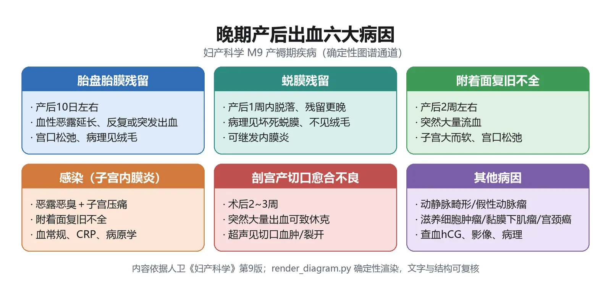


---

🟡 【熟悉级】产褥期生殖道、盆底与生命体征复旧一组：产后 2～3 日宫口容纳 2 指、产后 1 周宫颈内口关闭、产后 4 周宫颈恢复非孕形态；初产妇宫颈外口由产前圆形（未产型）变为「一」字形横裂（已产型）——判断经产的金标准（教材P208）。产后 3～4 日出现<b>泌乳热</b>（持续 4～16 小时下降，需排除感染）；产后宫缩痛见于<b>经产妇</b>、哺乳时加重、不需用药；产后 72 小时内循环血量增加 <b>15%～25%</b> 应防心衰；产褥早期血液<b>高凝</b>、白细胞可达（15～30）×10⁹/L 属生理；产后过早重体力劳动易致盆腔器官脱垂（教材P208～210）。

---

🟡 【熟悉级】产褥感染病原、治疗与母乳喂养一组：病原体——<b>乙型溶血性链球菌</b>致病最强、大肠埃希菌类是菌血症与感染性休克最常见病原；厌氧菌与大肠埃希菌混合感染呈<b>异常恶臭</b>；感染途径<b>内源性</b>（更常见、更重要）与外源性；<b>发热、疼痛、异常恶露</b>为三大主要症状（教材P213～214）。治疗——<b>广谱、足量、有效</b>抗菌药，<b>半卧位</b>利于局限，脓肿/感染灶切开引流，血栓静脉炎加<b>肝素钠（150U/（kg·d））</b>抗凝，严重感染/不能控制出血/脓毒血症及时<b>子宫切除</b>；剖宫产建议<b>皮肤切开前</b>用抗菌药（教材P214～215）。母乳喂养促子宫复旧、减少产后出血、降低乳腺癌/卵巢癌风险（教材P212）。

---

🟡 【熟悉级】晚期产后出血病因与处理：六大病因详见「📊 对比速查」表 3；处理须针对病因（残留→清宫、感染→抗感染+促宫缩、切口→介入/手术）。

---

🟢 【了解级】消化腹壁与产褥期保健一组：产后胃肠蠕动及肌张力减弱、胃液盐酸分泌减少需 1～2 周恢复；产褥期活动减少+腹肌盆底肌松弛易便秘，宜多食蔬菜、早下床活动；腹壁松弛、紧张度需在产后 <b>6～8 周</b>恢复（教材P209～210）。保健——①合理饮食、清洁、居室通风；②适当活动及产后康复锻炼；③避孕指导——<b>哺乳者以工具避孕为宜，不哺乳者可选用药物或工具</b>；④产后检查——访视 3 次（产后 1 周内、14 日、28 日），6 周常规回院全身+妇科检查（教材P211）。母乳储存——<b>20～30℃ 不超过 4 小时、4℃ 不超过 48 小时、-15～-5℃ 可保存 6 个月</b>；不宜/暂停哺乳——母亲患<b>传染病急性期</b>（活动性结核等）、严重器官功能障碍性疾病、严重产后心理障碍和精神疾病、婴儿乳糖不耐受，以及母亲酗酒、暴怒、服用对婴儿有影响的特殊药物等（教材P212）。

---

### 📊 对比速查

<b>表 1｜恶露演变（</b>教材P210<b>）</b>

| 类型 | 颜色 | 持续时间 | 镜下主要成分 | 特征 |
|---|---|---|---|---|
| 血性恶露 | 鲜红色 | 约 3～4 日 | 多量红细胞、坏死蜕膜、少量胎膜 | 量多、可有小血块 |
| 浆液恶露 | 淡红色 | 约 10 日 | 坏死蜕膜、宫腔渗出液、宫颈黏液、少量红白细胞及细菌 | 浆液为主要成分 |
| 白色恶露 | 较白、质黏稠 | 约 3 周 | 大量白细胞、坏死蜕膜、表皮细胞、细菌 | 大量白细胞 |

> 总量 250～500ml，有血腥味但<b>无臭味</b>；异常（增多/血性延长/有臭味）提示复旧不全、宫腔残留或合并感染。

<b>表 2｜子宫复旧时间轴（</b>教材P208、P210<b>）</b>

| 时间 | 子宫大小/位置 | 重量 |
|---|---|---|
| 分娩结束时 | 宫底约脐下一指 | 约 1000g |
| 产后 1 日 | 宫底略上升至脐平 | — |
| 产后 1 周 | 约妊娠 12 周大小，耻骨联合上方可触及 | 约 500g |
| 产后 2 周 | — | 约 300g |
| 产后 10 日 | 降至骨盆腔内，腹部触不到宫底 | — |
| 产后 6 周 | 恢复至妊娠前（未孕）大小 | 50～70g |

<b>表 3｜晚期产后出血病因鉴别（</b>教材P215～216<b>）</b>

| 病因 | 好发时间 | 出血特点/子宫情况 | 关键鉴别 |
|---|---|---|---|
| 胎盘、胎膜残留 | 产后 10 日左右 | 血性恶露延长、反复或突然大量出血，宫口松弛 | 病理见绒毛 |
| 蜕膜残留 | 产后 1 周内脱落、残留更晚 | 与胎盘残留不易鉴别，继发内膜炎 | 病理见坏死蜕膜、<b>不见绒毛</b> |
| 附着面复旧不全 | 产后 2 周左右 | 突然大量流血，子宫大而软、宫口松弛 | 超声见附着面异常 |
| 感染（子宫内膜炎） | 多见 | 恶露恶臭+子宫压痛，附着面复旧不全 | 血常规、CRP、病原学 |
| 剖宫产切口愈合不良 | 术后 2～3 周 | 突然大量出血，可致失血性休克 | 超声见切口血肿/裂开 |
| 其他（动静脉畸形/假性动脉瘤/滋养细胞肿瘤/黏膜下肌瘤/宫颈癌） | 不定 | 视病因而异 | <b>血 hCG</b>、影像、病理 |


---

### 🔗 因果链（D2）

<b>D2-1｜子宫复旧时间线 → 恶露 → 晚期产后出血</b>

```
胎盘娩出
  │
  ▼
[1] 宫体肌纤维缩复：肌细胞质蛋白质被分解→细胞缩小(非细胞数减少)
[2] 子宫内膜再生：基底层生长新功能层→第3周新生内膜覆盖
[3] 子宫血管：附着面缩小→螺旋动脉压缩变窄+血栓形成→出血减少
  │
  ▼
子宫复旧：产后1周≈妊娠12周大小/约500g；产后2周≈300g；产后10日入盆；6周恢复未孕(50~70g)
  │
  ▼
恶露演变：血性(鲜红,3~4日)→浆液(淡红,约10日)→白色(大量白细胞,约3周)
  │
  ▼
★复旧不全／胎盘胎膜残留／感染 → 恶露增多、血性恶露延长+臭味 → 晚期产后出血(产后24h后~产褥期内)
  │
  ▼
【处理】子宫收缩剂 + 广谱抗感染 + 清宫／介入／手术
```

> [!INFO] 此图展示子宫复旧—恶露—晚期产后出血的机制链路；具体数据见上方「📊 对比速查」表 1、表 2。

<b>D2-2｜泌乳的激素调动：催乳素（泌乳）+ 缩宫素（喷乳）</b>

```
胎盘剥离娩出
  │
  ▼
血中雌激素/孕激素/人胎盘催乳素 骤降
  │
  ▼
解除下丘脑「催乳素抑制因子」抑制 ──► 腺垂体催乳素脉冲式释放 ──► 泌乳(乳汁分泌)
                                                     ▲
婴儿吸吮乳头──►感觉信号→下丘脑──►抑制多巴胺及催乳素抑制因子(维持泌乳)
      │
      └─►反射性→神经垂体释放缩宫素──►乳腺腺泡周围肌上皮收缩──►喷乳反射(排乳)
```

> [!NOTE] 此图说明泌乳是「激素点火（雌孕激素骤降）+吸吮维持（催乳素）+吸吮排乳（缩宫素）」的三环机制。

---

### 🌳 鉴别决策树（D4）

<b>D4｜产褥期 >24h 阴道大出血的病因鉴别（按时间线索）</b>

```
产后>24h、产褥期内子宫大量出血(晚期产后出血)
          │
          ├─ 有剖宫产史?
          │    ├─ 是 → 子宫切口愈合不良/裂开 → 术后2~3周突然大量出血,可致休克
          │    │        → 超声见切口血肿/裂开 → 少量即住院观察;量大→剖腹探查/介入/手术
          │    └─ 否 → 转入「阴道分娩」时间轴
          │
          └─ 阴道分娩 → 按好发时间定位
                    ├─ 产后10日左右 → 胎盘/胎膜残留(最常见)/蜕膜残留
                    │    → 血性恶露延长+反复或突然出血;宫口松弛
                    │    → 刮出物见绒毛=胎盘残留 / 不见绒毛=蜕膜残留 → 轻柔清宫+病理
                    ├─ 产后2周左右 → 胎盘附着面复旧不全(突然大量出血,子宫大而软)
                    │    → 可伴感染(内膜炎):恶露恶臭+子宫压痛 → 抗感染+促宫缩+查血hCG
                    └─ 时间不定 → 动静脉畸形/假性动脉瘤/滋养细胞肿瘤/黏膜下肌瘤/宫颈癌
                          → 影像+血hCG+病理 → 按肿瘤性质处理
```

<b>每步判断依据说明：</b>
- <b>第一步查剖宫产史</b>：切口愈合不良/裂开是剖宫产后特征性病因，好发于术后 2～3 周。
- <b>第二步按好发时间定病因</b>：残留多在产后 10 日（阴道分娩）、复旧不全多在产后 2 周、感染叠加其上。
- <b>第三步看症状+辅助检查</b>：宫口松弛→残留；子宫大而软→复旧不全；恶臭+压痛→感染；血 hCG 高→滋养细胞肿瘤（勿盲目清宫）。

---

### ⚠️ 常见陷阱

1. <b>产褥期＝6 周，别与恶露持续（4～6 周）混淆</b>：恶露可延长，但产褥期时限固定 6 周。
2. <b>产后生理性改变勿误判为异常</b>：产后 72 小时循环血量增加 15%～25%（易答成「减少」，应防心衰）；白细胞可高达（15～30）×10⁹/L。
3. <b>子宫复旧不全/残留/感染→恶露「有臭味」</b>：正常恶露只有血腥味、无臭味，出现臭味即报警。
4. <b>产褥发热（24h 后 10 日内≥38℃×2 次）先考虑产褥感染</b>：别先入为主判为乳腺炎或上感；早期发热最常为脱水。
5. <b>晚期产后出血清宫须轻柔防穿孔</b>：且<b>必查血 hCG</b>——阳性提示滋养细胞肿瘤。

---

### 💡 记忆口诀

- <b>产褥期时限</b>：产褥六周，除乳腺；子宫一日平脐、一周耻上、十日入盆、六周复原。
- <b>恶露三变</b>：红三日、淡十日、白三周——「血→浆→白」。

---

### 📌 本章小结

> [!INFO] 本章小结
> - take-home 1：产褥期＝胎盘娩出至除乳腺外器官恢复未孕（6 周）；子宫复旧 6 周（产后 10 日入盆），其「缩复+内膜再生+血窦血栓化」一旦失序即致晚期产后出血。
> - take-home 2：恶露按「血性→浆液→白色」随时间演变（4～6 周，250～500ml，无臭味）；有臭味提示复旧不全/残留/感染。
> - take-home 3：产褥发热（24h 后 10 日内≥38℃×2 次）先考虑产褥感染，处理以广谱足量抗菌药+支持疗法+外科引流为纲；晚期产后出血以残留→清宫、切口→介入/手术、感染→抗感染为纲。
> - <b>🧬 本章核心洞察</b>：产褥期本质是一场「创面愈合并恢复生理稳态」的过程，任何异常恶露/发热/出血，都是这一稳态被「残留、感染、复旧不全」打破的信号——诊断与处理围绕「封住创面、控制感染」展开。

---

### 🔗 深度链接

- <b>模块7（妊娠并发症）→ 本模块</b>：前置胎盘、胎盘早剥、胎盘植入是产后出血与晚期产后出血的共同上游；产前出血史者产后须警惕胎盘/胎膜残留、附着面复旧不全。
- <b>模块6（分娩并发症/产后出血）→ 本模块</b>：产时出血（子宫收缩乏力、软产道损伤、凝血功能障碍）与产褥期出血（晚期产后出血）在「出血」主线上相接；产后 2 小时的严密观察贯穿二者。
- <b>模块12（妊娠滋养细胞疾病）→ 本模块</b>：产后血 hCG 持续不降提示侵蚀性葡萄胎/绒癌，是晚期产后出血「其他」病因的重要排查项；产后 10 日 hCG 恢复非孕水平可作为随访基线。
- <b>模块14（生育规划）→ 本模块</b>：产褥期避孕指导——哺乳者以工具避孕为宜、不哺乳者可选用药物或工具；哺乳期月经未复潮仍可能受孕，节育决策须置于产后保健场景中。


## 模块10：妇科炎症与子宫内膜异位症

> [!INFO] 模块信息
> <b>重点等级</b>：🔴掌握 5 个 / 🟡熟悉 5 个 / 🟢了解 1 个
> <b>关联模块</b>：模块1（外阴阴道/微生态、卵巢-子宫内膜轴）、模块11（宫颈病变）、模块13（AUB）
> <b>谱系位置</b>：妇科感染病原谱（阴道→宫颈→上生殖道上行线）与"不孕/慢性盆腔痛"谱系起始。
> <b>预计阅读</b>：约 27 分钟

---

### 🧩 前置知识检查

- 模块1：外阴阴道微生态——产 H₂O₂ 乳杆菌为优势菌、pH≤4.5，是全部阴道炎"衬底"。
- 模块1：雌激素使阴道上皮增厚、增糖原，糖原经乳杆菌变乳酸，是"自净"核心。
- 内异症核心表现：继发性、进行性痛经＋不孕是内异症/腺肌病标志（见本章下文）。

---

### 🎯 高收益摘要

- <b>阴道炎一眼区分</b>：豆腐渣样→VVC（pH＜4.5）；黄绿泡沫状→滴虫；绝经后干涩淡黄→萎缩性阴道炎（教材P241）。
- 内异症<b>典型四联</b>：继发性进行性痛经＋不孕（50%）＋性交痛＋月经异常，好发卵巢（巧克力囊肿）与子宫骶韧带，腹腔镜为首选（教材P269、P272）。

---

### 📋 结构化笔记

🟡 【熟悉级】阴道微生态平衡与萎缩性阴道炎：正常以产 H₂O₂ 乳杆菌为优势菌，糖原→乳酸维持 pH≤4.5（3.8～4.4）抑病原、自净；雌激素、pH、乳杆菌与黏膜免疫共同维系（教材P233）。萎缩性阴道炎为雌激素降低、<b>以需氧菌感染为主</b>，多见于绝经后，分泌物稀薄淡黄（重者脓血性）、黏膜萎缩菲薄（教材P241、P242）；治疗补充雌激素+抗菌，首选局部雌激素，血性分泌物须与生殖道恶性肿瘤鉴别。

> [!WARNING] 易错陷阱
> pH 判读别搞反：VVC 是<b>唯一 pH＜4.5</b> 的阴道炎；滴虫、萎缩性阴道炎均＞4.5。

---

🔴 【掌握级】外阴阴道假丝酵母菌病（VVC）：由假丝酵母菌（80%～90% 白假丝酵母菌）引起，属机会致病菌、<b>以内源性感染为主</b>；临床为外阴阴道瘙痒＋<b>豆腐渣样/凝乳状</b>白带（教材P235）。
💡 分单纯型/复杂型决定疗程，妊娠期"局部用药为主、禁用口服唑类"是硬考点。
🧬 第一性原理：若广谱抗生素杀光乳杆菌、或妊娠/糖尿病造成高糖，酵母爆发成条件致病；首选革兰氏染色涂片
#### 🔬 展开：单纯型 vs 复杂型
单纯型=非妊娠、散发性、白念珠菌、轻中度。复杂型占 10%～20%（非白念珠菌、重度评分≥7、复发性<b>1 年内≥4 次</b>、妊娠期、未控糖尿病/免疫低下者）。治疗：单纯型<b>唑类</b>局部或氟康唑 0.15g 顿服；复杂型加量/延长；复发性强化+巩固（半年）；<b>妊娠期局部小剂量长疗程、禁用口服唑类</b>；无须治性伴侣。（教材P236、P237）

> [!TIP] 记忆技巧
> "能发酵的才产酸"——VVC 是真菌喜酸故 pH＜4.5；VVC"酸"、滴虫"泡+绿"、萎缩性"干+黄"。

---

🔴 【掌握级】阴道毛滴虫病：由阴道毛滴虫引起、以<b>性交</b>为主传播（可间接），典型白带<b>稀薄脓性、泡沫状、有异味</b>（可黄绿色），阴道黏膜散在出血点，严重者"草莓样"子宫颈（教材P240）。
💡 唯一<b>外源性</b>病原、需<b>全身用药＋性伴侣同治</b>，与其余三种内源性阴道炎根本不同。
🧬 第一性原理：滴虫消耗/吞噬阴道上皮糖原→阻碍乳酸生成→pH 升高转碱；滴虫可侵入尿道、尿道旁腺、前庭大腺，故必须全身用药。
#### 🔬 展开：诊断与治疗
诊断：分泌物找到滴虫即确诊，最简便是<b>生理盐水湿片</b>（灵敏度 40%～70%），取标本前 24～48 小时避免性交/灌洗/局部用药。治疗：首选<b>甲硝唑 0.4g 口服 2/日×7 日</b>（替硝唑 2g 顿服可选）；<b>性伴侣同时治疗</b>、治愈前避免无保护性行为；用药期禁酒（甲硝唑停药 24h、替硝唑 72h 内），哺乳期不宜哺乳。（教材P241）

> [!WARNING] 易错陷阱
> 滴虫"草莓颈"宫颈须与其他黏液脓性宫颈炎鉴别；治疗为全身抗滴虫+性伴侣同治。

---

🔴 【掌握级】盆腔炎性疾病（PID）：女性上生殖道的一组感染性疾病，包括子宫内膜炎、输卵管炎、输卵管卵巢脓肿（TOA）、盆腔腹膜炎；病原为外源性（沙眼衣原体、淋病奈瑟球菌）与内源性（需氧菌/厌氧菌），<b>常为混合感染</b>；以输卵管炎、输卵管卵巢炎最常见（教材P248）。
💡 2021 CDC 三级诊断标准＋后遗症四件套＋广谱/及时/个体化治疗是核心。
🧬 第一性原理：若防御被破坏（宫腔操作、经期性交、性传播病原入侵），病原体沿黏膜上行蔓延宫颈→宫腔→输卵管→盆腹腔，于是下腹痛＋阴道分泌物增多；输卵管黏膜破坏、纤毛脱落、粘连闭锁→后遗不孕与异位妊娠。感染途径以沿生殖道黏膜上行蔓延为主（非妊娠期）。
#### 🔬 展开：诊断（2021 CDC 三级）
<b>最低标准</b>：子宫颈举痛，或子宫压痛，或附件区压痛（性活跃年轻女性＋下腹痛＋排除他因即可抗菌）。<b>附加标准</b>：体温＞38.3℃；宫颈异常黏液脓性分泌物；阴道湿片大量白细胞；ESR/CRP 升高；病原学证实淋菌/衣原体阳性。<b>特异标准</b>：内膜活检证实子宫内膜炎；超声/MRI 示输卵管增粗、输卵管积液、盆腔积液或输卵管卵巢包块；腹腔镜见 PID 征象。腹腔镜为金标准但有创，仅选择性使用。（教材P251、P252）

> [!WARNING] 易错陷阱
> PID 须与<b>急性阑尾炎、输卵管妊娠破裂、卵巢囊肿蒂扭转/破裂</b>急症鉴别；特异性诊断极少用于初诊，勿把"腹腔镜确诊"当人人必做。

---

🟡 【熟悉级】PID 治疗与后遗症：PID 三原则<b>及时、广谱、个体化</b>，诊断 48 小时内用药可明显减少后遗症。后遗症：<b>不孕 20%～30%、异位妊娠为正常 8～10 倍、慢性盆腔痛约 20%</b>、反复发作约 25%（教材P252、P253、P254）。治疗：非静脉用头孢曲松 0.5g 单次肌注+甲硝唑+多西环素 14 日；静脉用头孢曲松 1g q24h+多西环素 0.1g q12h；<b>不推荐喹诺酮类</b>；脓肿破裂须抗菌下紧急探查。

---

🟡 【熟悉级】慢性子宫颈炎：慢性子宫颈炎为宫颈间质内大量淋巴/浆细胞浸润，多为慢性宫颈管黏膜炎、子宫颈息肉、子宫颈肥大（教材P246、P247）；治疗：黏膜炎对因治疗，糜烂样改变伴症状→<b>物理治疗</b>（激光、冷冻、微波，先除外 CIN/宫颈癌），息肉→<b>摘除术</b>送病理，肥大无须治。

---

🟢 【了解级】子宫内膜异位症发病因素与预防：内异症除种植/化生/诱导学说外，还有<b>遗传</b>（一级亲属为无家族史者 7 倍）、<b>免疫炎症</b>、DIE 浸润<b>≥5mm</b>、恶变率约 0.5%～1%（教材P270、P271）。预防——防治经血潴留、药物避孕、避免医源性内膜种植（避免多次宫腔操作、缝合子宫壁勿穿内膜层、经前禁输卵管通畅试验）、术后药物巩固（COC、孕激素、GnRH-a 推荐 6 个月、LNG-IUS）；复发 2 年内平均 20%，有生育要求者避免反复手术，建议药物保守治疗（教材P275）。

---

🔴 【掌握级】子宫内膜异位症（内异症）：具有生长功能的子宫内膜组织（腺体+间质）出现在宫体以外部位，以<b>卵巢、子宫骶韧带</b>最常见；形态学良性、但临床行为上<b>极具侵袭、易复发</b>，为激素依赖性疾病（绝经/妊娠后病灶萎缩）（教材P269）。
💡 继发性进行性痛经＋不孕＋性交痛的"元凶"，与慢性盆腔痛/不孕两大主诉相关，须掌握诊断与治疗选择。
🧬 第一性原理：<b>内膜跑到宫腔外仍随周期出血但排不出去只能原地蓄积——反复出血、纤维增生、形成紫褐色结节与巧克力囊肿并与周围粘连</b>；故痛经继发性、进行性加重。<b>经血不逆流、体腔上皮不被刺激化生则无内异症</b>——这是妊娠/绝经压住它的原因。发病学说：Sampson 种植（经血逆流）、体腔上皮化生、诱导、遗传、免疫炎症。
（贺银成讲义补充）定义与病理细节：本病 80% 发生于卵巢，其余依次为子宫阔韧带、直肠子宫陷凹、盆腔腹膜、腹部手术瘢痕、脐、阴道、外阴、阑尾等；内膜腺体＋间质异位于子宫肌层（距子宫内膜基底层 2mm 以上）即子宫腺肌病。肉眼为点灶状紫红色或棕黄色结节、质软似桑葚，病灶出血机化与周围器官纤维性粘连；镜下见正常内膜腺体、间质及含铁血黄素，病程长者仅见增生纤维组织与吞噬含铁血黄素的巨噬细胞。在卵巢内异症基础上，少数患者可继发卵巢癌（如卵巢子宫内膜样癌）。
#### 🔬 展开：病理分型与急腹症
①<b>卵巢型</b>（单侧 80%、双侧 50%）：<b>卵巢子宫内膜异位囊肿（巧克力囊肿）</b>，内含咖啡色黏稠液体，壁薄易反复破裂。②<b>腹膜型</b>：骶韧带、直肠子宫陷凹、子宫后壁下段浆膜多见。③<b>深部浸润型（DIE）</b>：<b>≥5mm</b>，累及骶韧带、直肠子宫陷凹、阴道穹隆、膀胱/输尿管。镜检见内膜腺体、间质及含铁血黄素细胞；反复出血后找到少量内膜间质或含铁血黄素细胞即可确诊。<b>囊肿破裂急腹症</b>：较大囊肿破裂→突发剧烈腹痛+恶心呕吐、腹膜刺激征阳性，多在经期。（教材P270、P271）

> [!WARNING] 易错陷阱
> 痛经并非内异症诊断必需——27%～40% 患者无痛经，且病灶大小与疼痛程度不成正比；诊断靠临床表现＋触痛结节，必要时腹腔镜。

---

🟡 【熟悉级】内异症临床分期与治疗选择：采用<b>美国生殖医学学会 ASRM（1997 年修正）分期法</b>（曾称 r-AFS），在腹腔镜/剖腹探查或手术时对病灶部位、数目、大小、粘连程度评分：<b>Ⅰ期（微型）1～5 分、Ⅱ期（轻型）6～15 分、Ⅲ期（中型）16～40 分、Ⅳ期（重型）＞40 分</b>；用于评估严重度、选方案、评疗效与判预后（教材P273）。分期决定"保留生育/保留卵巢功能/根治性"术式选择；药物适用于无附件包块或包块＜4cm、未合并不孕者，手术适用于药物无效/合并不孕/包块≥4cm 者（腹腔镜为首选）。

> [!TIP] 治疗分层思路
> 止痛控病情（药物：NSAID、口服避孕药——假孕疗法、孕激素——地诺孕素/甲羟孕酮、GnRH-a——药物性卵巢切除、米非司酮、孕三烯酮/达那唑）→合并不孕/复发/包块≥4cm（手术：保留生育→保留卵巢功能→根治性）→漫长管理（术后药物巩固、LNG-IUS、警惕恶变）。

---

🔴 【掌握级】子宫腺肌病：为子宫内膜腺体及间质<b>侵入子宫肌层</b>生长的良性疾病，多发生 30～50 岁经产妇，约 15% 合并内异症、约半数合并子宫肌瘤；主要症状为<b>经量过多、经期延长和进行性继发性痛经</b>，子宫<b>均匀增大、质硬</b>、经期压痛更甚（教材P276）。
💡 与内异症同为"进行性痛经"却病位不同（肌层 vs 宫腔外），且对孕激素无反应、无根治药，治疗方向完全不同。
🧬 第一性原理：子宫内膜基底层缺乏黏膜下层，若基底层内膜（或多次妊娠分娩/人工流产/慢性子宫内膜炎造成的损伤）侵入肌层，异位内膜在肌层内弥漫生长、刺激肌纤维增生与收缩紊乱；均匀增大；如果基底层有完整黏膜下层屏障，内膜就不会侵入肌层——属基底层不成熟内膜，对雌激素有反应、对孕激素无反应。
#### 🔬 展开：诊断与治疗
<b>诊断</b>：进行性继发性痛经+月经过多、子宫均匀增大质硬有压痛可初步诊断，<b>病理诊断为金标准</b>；影像有助诊断，CA125 可升高。须与<b>子宫肌瘤</b>（多无痛经、边界清、CA125 不高）、子宫内膜癌、子宫肉瘤鉴别。<b>治疗</b>：<b>无根治性药物</b>，症状轻/有生育要求/近绝经者用 NSAID、口服避孕药、孕激素、GnRH-a 或<b>左炔诺孕酮宫内释放系统（LNG-IUS）</b>缓解（停药复现；GnRH-a 需注意骨质丢失、加补钙）；希望生育的腺肌瘤行<b>病灶切除术</b>（有复发风险）；症状严重/无生育要求/药物无效者行<b>全子宫切除</b>；保留子宫意愿强烈且除外恶性者考虑介入（HIFU、子宫动脉栓塞）。（教材P277）

> [!WARNING] 易错陷阱
> 子宫腺肌病异位内膜"像基底层内膜、对孕激素无反应"，所以<b>假孕/孕激素对人体的抑制不等于对腺肌病病灶有效</b>——这解释了它"无根治药、停药即复发"；与内异症（对孕激素有反应）的治疗逻辑截然不同，勿混为一谈。

---

### 📊 对比速查

<b>表 1：常见阴道炎鉴别总表（VVC / 滴虫）</b>

| 项目 | VVC（假丝酵母菌） | 阴道毛滴虫病 |
|---|---|---|
| 症状 | 重度瘙痒 | 轻度瘙痒 |
| 分泌物 | 白色豆腐渣样/凝乳状 | 稀薄脓性、泡沫状 |
| 阴道黏膜 | 水肿、红斑 | 散在出血点、草莓颈 |
| 阴道 pH | <b>＜4.5</b> | ＞4.5 |
| 胺试验 | 阴性 | 可为阳性 |
| 镜检 | 芽生孢子/假菌丝 | 活动滴虫、大量白细胞 |
| 治疗 | 局部唑类/口服氟康唑 | 甲硝唑全身+伴侣同治 |


<b>表 2：子宫内膜异位症 vs 子宫腺肌病</b>

| 比较点 | 子宫内膜异位症 | 子宫腺肌病 |
|---|---|---|
| 定义 | 内膜（腺体+间质）出现于<b>子宫体以外</b> | 内膜腺体+间质<b>侵入子宫肌层</b> |
| 病因学说 | 种植（经血逆流）/体腔上皮化生/诱导 | 基底层内膜侵入肌层（缺黏膜下层） |
| 好发部位 | 卵巢（巧克力囊肿）、子宫骶韧带、腹膜 | 子宫肌层（弥漫型居后壁） |
| 典型症状 | 继发进行性痛经+不孕（50%）+性交痛+月经异常 | 经量过多+经期延长+进行性痛经（下腹正中、经期压痛更甚） |
| 子宫形态 | 可后倾固定、附件区触痛结节/囊实包块 | <b>均匀增大、质硬</b>（球形，≤12 孕周）、可伴子宫腺肌瘤 |
| 对孕激素 | 有反应（可抑制、假孕/绝经后萎缩） | <b>无反应/不敏感</b>（基底层不成熟内膜，仅增殖期改变） |
| 诊断金标准 | 腹腔镜手术 | 病理诊断 |
| 治疗 | 药物+手术（腹腔镜首选、年轻保留生育） | <b>无根治药</b>，手术为主的综合治疗（LNG-IUS、全子宫切除） |
| 复发 | 2 年 20%、5 年 50% | 术后可复发（病灶切除） |

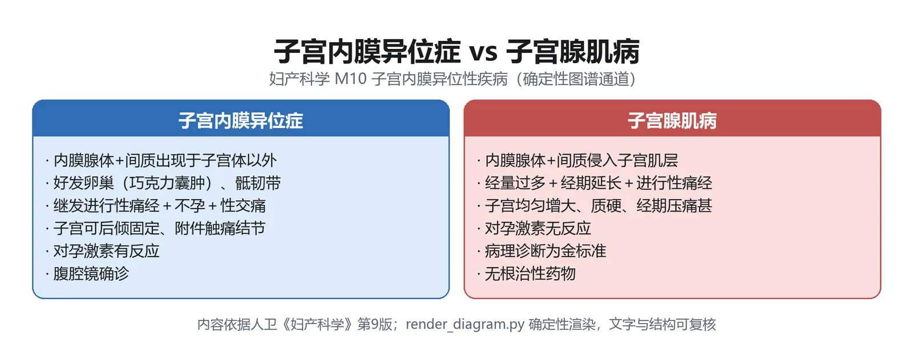


---

### 🔗 因果链（D2）

```
[阴道自净护盾：雌激素↑→糖原→乳酸→pH≤4.5 + 产H₂O₂乳杆菌占优]
        │
        ▼
[维持阴道生态平衡·抑制病原体]
        │
        ├─ 雌激素↓(绝经/产后闭经/婴幼儿)
        │       ▼  [糖原↓→乳酸↓→pH↑5.0-7.0]→乳杆菌失势→需氧菌繁殖
        │       ▼
        │   萎缩性阴道炎 ★
        │
        ├─ 广谱抗菌药/糖尿病/妊娠/免疫抑制剂
        │       ▼  [乳杆菌被杀→假丝酵母菌失去抑制]★ 条件致病爆发
        │       ▼
        │   VVC (豆腐渣样、pH<4.5)
        │
        │
        └─ 性交→外源性阴道毛滴虫入侵
                ▼  [消耗糖原/耗氧→pH↑、脓性泡沫、吞噬精子]★
                ▼
            滴虫性阴道炎
```
> [!INFO] 此图展示阴道护盾被不同因素破坏后走向不同阴道炎的机制链路，具体数据/鉴别见上方「📊 对比速查」表 1。

---

### 🌳 鉴别决策树（D4）

```
[阴道分泌物增多 ± 瘙痒/异味]
      │
      ├─ 豆腐渣样/凝乳状＋重度外阴瘙痒 → pH<4.5, 镜检=芽生孢子/假菌丝
      │        → 外阴阴道假丝酵母菌病（VVC）→ 分单纯/复杂（评分≥7）
      ├─ 稀薄脓性/泡沫状/黄绿色，多为轻度瘙痒 → pH>4.5, 镜检=活动滴虫+大量白细胞
      │        → 阴道毛滴虫病 → 甲硝唑全身＋性伴侣同治（可有"草莓样"宫颈）
      └─ 绝经/卵巢术后/放疗后＋干涩灼痛, 分泌物淡黄/脓血性, 黏膜萎缩菲薄
               → 萎缩性阴道炎 → 排除其他阴道炎，局部雌激素试验性有效
```

> [!TIP] 决策要点（判断依据说明）
> ①认<b>分泌物性状</b>；②看<b>pH</b>（VVC 唯一＜4.5）；③<b>镜检</b>（芽生孢子/活动滴虫）确认；④看<b>黏膜</b>——VVC 水肿红斑、滴虫散在出血点草莓颈、萎缩性黏膜菲薄。

---

### ⚠️ 常见陷阱

1. <b>pH 混淆</b>：VVC 是唯一 pH＜4.5 的阴道炎，滴虫与萎缩性阴道炎均＞4.5。
2. <b>滴虫漏掉伴侣</b>：滴虫须<b>全身用药+性伴侣同治</b>，仅局部或只治本人必复发；用药期禁酒。
3. <b>PID 单用窄谱</b>：PID 为混合感染，须覆盖淋菌/衣原体/支原体/厌氧菌/需氧菌；喹诺酮类不推荐用于淋病奈瑟球菌性 PID。

---

### 💡 记忆口诀

- <b>阴道炎三型</b>："酸 VVC（真菌）、泡+绿滴虫；萎缩性绝经后干涩淡黄"。
- <b>内异症四联</b>："痛经进行性＋不孕＋性交痛＋月经乱，巧克力囊肿伴结节"。

---

### 📌 本章小结

> [!INFO] 本章小结
> - take-home 1：阴道微生态（雌激素+pH≤4.5+产 H₂O₂ 乳杆菌+黏膜免疫）是自净核心；护盾被破的病因决定炎症主角——抗生素/糖尿病→VVC，外源侵入→滴虫。
> - take-home 2：PID 为混合感染、上行性，治疗按"及时、广谱、个体化"；后遗不孕、异位妊娠、慢性盆腔痛与再发，重点是防其发生。
> - take-home 3：内异症与腺肌病同为激素依赖性异位内膜，但位置不同（宫腔外 vs 肌层内），决定其症状、对孕激素反应、治疗与转归截然不同。
> - <b>🧬 本章核心洞察</b>：从阴道微生态失调到异位内膜，贯穿"屏障与激素"两大主线——破屏障则感染、激素失调则异位生长；抓住"护盾"与"内膜异位"两个枢纽，即可串起全部考点。

---

### 🔗 深度链接

与模块1（外阴阴道/内生殖器解剖、雌孕激素-子宫内膜轴）连接——阴道微生态平衡与内膜周期性变化是本章炎症与异位病变的生理基础。与模块13（异常子宫出血）连接——内异症/腺肌病是 AUB 的重要病因，须列入鉴别。与模块11（宫颈病变）连接——慢性宫颈炎与 HPV/宫颈上皮内病变共享"宫颈糜烂样改变"征象，须行 HPV/细胞学筛查除外。性传播疾病（第21章）详见性传播疾病专科章节，本手册不展开。


## 模块11：子宫颈肿瘤与子宫体肿瘤

> [!INFO] 模块信息
> <b>重点等级</b>：🔴掌握 8 / 🟡熟悉 4 / 🟢了解 1 ｜ <b>关联模块</b>：模块10（炎症背景）、模块12、13、14 ｜ <b>谱系位置</b>：妇科肿瘤第三站——宫颈（HPV/上皮内病变→浸润癌）+ 宫体（肌瘤→内膜癌/肉瘤） ｜ <b>预计阅读</b>：约 50 分钟

---

### 🧩 前置知识检查

- 子宫内膜周期：增殖期雌激素促生长、分泌期孕激素促分泌——源于内膜癌"无孕激素拮抗的雌激素"（教材M01）。
- 子宫颈解剖：鳞-柱交接部/转化区是宫颈癌好发部位（教材M01）。
- 异常子宫出血（AUB）：先排器质性（内膜癌、息肉、黏膜下肌瘤）再按功能性（教材M13）。

---

### 🎯 高收益摘要

- <b>宫颈癌 = 高危型 HPV 持续感染</b>，约 70% 与 HPV16/18 相关、HPV16 致癌性最强；<b>E6 降解 p53、E7 失活 Rb</b> 是核心；三阶梯筛查（HPV/细胞学→阴道镜→活检）抓癌前（教材P304、P307）。
- <b>FIGO 2018 关键数值</b>：ⅠA1 ≤3mm、ⅠA2 >3～5mm、ⅠB1 ≤2cm、ⅠB2 ≤4cm、ⅡA1≤4cm、ⅢC 分 r/p；ⅠA～ⅡA1 手术为主、ⅠB3/ⅡA2 及以上同步放化疗（教材P311、P314）。
- <b>宫体主线</b>：肌瘤是性激素依赖性良性肿瘤（肌壁间最多、经量增多最常见）；内膜癌以绝经后出血+三联征为线索、首选"全子宫+双附件+盆腹腔淋巴结"手术（教材P316、P327）。

---

### 📋 结构化笔记

#### 🔴 子宫颈上皮内病变（SIL/CIN）：定义与分级

🔴 【掌握级】子宫颈上皮内病变（SIL）：与宫颈浸润癌密切相关的一组病变，是与宫颈癌密切联系的前驱病变，组织学上分<b>鳞状上皮内病变</b>与<b>腺上皮内病变</b>（教材P304）。

💡 为什么重要：它是宫颈癌唯一可筛查、可完全治愈的"癌前阶段"，三阶梯筛查的目的就是抓住它。

🧬 第一性原理：正常鳞状上皮从基底→副基底层→中间/表层逐层分化成熟，只有生发层有增殖能力；高危型 HPV 持续感染时，未成熟化生鳞状上皮增殖"刹车"失灵，异常细胞从下 1/3 逐层向上蔓延——<b>病变向上层爬得越高、分化越差，越接近癌</b>，一旦爬穿基底膜即浸润癌。现行采用与细胞学一致的<b>二级分类</b>：LSIL＝CIN1，HSIL＝CIN2+CIN3；CIN2 难辨时用 <b>P16 免疫组化</b>（阴性归 LSIL、阳性归 HSIL）（教材P305-P306）。

#### 🔬 展开：LSIL/HSIL 鉴别与转归（最值/最易错）
LSIL 异型局限<b>下 1/3</b>（常见<b>挖空细胞</b>）；HSIL 全层核异型，CIN2 至中 1/3、CIN3 超全层 2/3，P16 强而弥漫片状染色。转归：CIN1 不治约 10% 进展到 CIN3；CIN2 约 50% 消退、仅 18% 进展；CIN3/AIS 不治疗风险大（教材P306）。（贺银成）CINⅠ→LSIL、CINⅡ/Ⅲ→HSIL；CINⅠ 浸润癌<2%、CINⅢ 10 年内约 20%。

> [!WARNING] 易错陷阱
> 别把"接触性出血"直接等同宫颈癌——上皮内病变也可有接触性出血；但有接触性出血者必须首先排除宫颈病变。分级口诀"LSIL=下1/3，HSIL 往上爬"。

---

#### 🔴 高危型 HPV 感染与宫颈癌病因（E6/E7 → p53/Rb）

🔴 【掌握级】宫颈癌主要病因为<b>高危型 HPV 持续感染</b>；近 90% 的宫颈癌及癌前病变组织中可检出高危型 HPV（教材P304）。

💡 为什么重要：这是宫颈癌"可预防、可通过疫苗消除"的发病学基础，也是筛查对象选择的依据。

🧬 第一性原理：<b>有转录活性的 HPV DNA 与宿主 DNA 整合后，癌蛋白 E6 与 E7 高水平持续表达</b>——E6 使 p53 降解失活、E7 使 Rb 失活，两条抑癌通路同时被废，细胞周期失控、基因组不稳定，最终上皮内病变→浸润癌。若病毒只是一过性感染（多数 2 年内被清除、仅不到 5% 持续感染进展为癌），两条通路不会被长期抑制。高危型 14 种：16、18、31、33、35、39、45、51、52、56、58、59、66、68；<b>HPV16 致癌性最强、约 70% 与 16/18 型相关</b>；危险因素：多个性伴侣、性生活过早（<16 岁）、免疫低下、吸烟（教材P304）。

#### 🔬 展开：为何"持续性"是关键词（最值/最易错）
我国≥20 岁女性 HPV 感染率 15%，常见型别 HPV52、58、16、51；绝大多数被清除，<b>只有"持续感染"才是病变必经之路</b>，故对 HPV 阳性分层管理（分型+细胞学分流）而非一律治疗（教材P304）。

> [!WARNING] 易错陷阱
> "高危型 HPV 感染"≠"宫颈癌"。感染率远高于癌变率，二者靠"持续感染 + 上皮内病变"桥接；答题时别把"感染"和"癌"直接划等号。

---

#### 🔴 子宫颈癌 FIGO 2018 分期（关键数值）

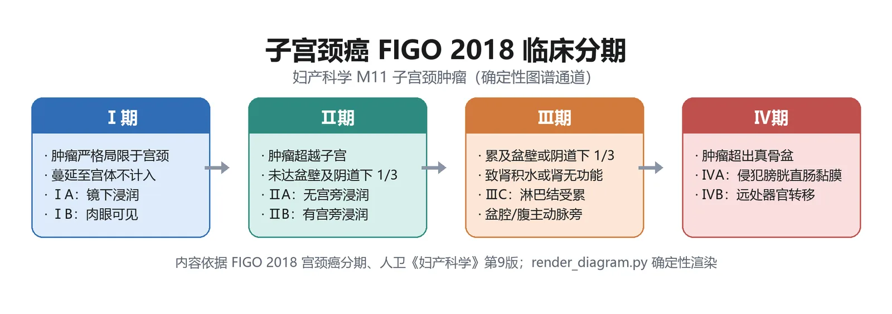

🔴 【掌握级】子宫颈癌 FIGO 2018 分期：Ⅰ期癌灶局限宫颈；Ⅱ期超出宫颈、未达阴道下 1/3 或骨盆壁；Ⅲ期累及阴道下 1/3/骨盆壁/肾盂积水/盆腔或主动脉旁淋巴结；Ⅳ期浸润膀胱或直肠黏膜（活检证实）或超出真骨盆（教材P311）。

💡 为什么重要：FIGO 分期直接决定治疗方式（手术 vs 放化疗）与预后，是 A1/A2 题核心。

🧬 第一性原理：分期本质是"癌灶就地/向外侵犯（直接蔓延）与转移（淋巴/血行）"的几何量化：Ⅰ期只在宫颈；突破宫颈→Ⅱ期（ⅡA 累及阴道上 2/3、无子宫旁，ⅡB 有子宫旁）；Ⅲ期已侵犯阴道下 1/3（ⅢA）、骨盆壁/肾盂积水（ⅢB）或淋巴结（ⅢC）；Ⅳ期波及膀胱/直肠（ⅣA）或远处（ⅣB）。<b>不突破基底膜、不侵犯间质、不突破宫颈边界就不会进入更晚分期</b>（教材P311-P312）。

#### 🔬 展开：各亚期数值（最值/最易错）
ⅠA（镜下≤5mm）：ⅠA1 深≤3mm、ⅠA2 深>3～≤5mm。ⅠB：ⅠB1 深>5mm 且径≤2cm、ⅠB2 径>2～≤4cm、ⅠB3 径>4cm。ⅡA：ⅡA1 径≤4cm、ⅡA2 径>4cm。ⅢC 记 r（影像）/p（病理）。<b>LVSI 不改变分期；有疑问归入较低分期</b>（教材P311-P312）。

> [!WARNING] 易错陷阱
> ①ⅠA1/ⅠA2 看<b>间质浸润深度</b>（3/5mm），ⅠB 看<b>最大径线</b>（2/4cm），别混用。②ⅢC 必须写 r/p；③"有疑问归入较低分期"。

---

#### 🔴 子宫颈癌治疗选择（手术、同步放化疗）

🔴 【掌握级】宫颈癌治疗按分期个体化：<b>ⅠA～ⅡA1 期以手术为主</b>，<b>ⅠB3、ⅡA2 及以上或不宜手术者以根治性放疗/同步放化疗为主</b>（教材P314）。

💡 为什么重要：治疗决策表直接对应分期，是"诊断→处理"病例题的落脚点。

🧬 第一性原理：早期病灶局限、解剖清晰，手术可"整块切除+清扫区域淋巴结+保留年轻患者卵巢/阴道功能"；ⅠA1 无 LVSI 者甚至只需<b>筋膜外全子宫切除或锥切</b>（有生育要求者）。一旦病灶大或已达淋巴结，手术边界难净，转为<b>放疗</b>控制局部+<b>同步放化疗</b>（铂类为基础）提高控制率（教材P314）。

#### 🔬 展开：各期术式与放化疗（最值/最易错）
ⅠA1 无 LVSI→筋膜外全子宫/锥切（有 LVSI 按 ⅠA2）；ⅠA2→改良广泛性子宫切除+盆腔淋巴评估（有生育可广泛性宫颈切除）；ⅠB1、ⅡB2、ⅡA1→广泛性子宫切除+盆腔淋巴结+选择性腹主动脉旁淋巴结（<2cm 可用前哨淋巴结示踪）；晚期/复发用贝伐珠单抗或免疫检查点抑制剂（教材P314）。

> [!WARNING] 易错陷阱
> ①ⅠA1 "有 LVSI"要按 ⅠA2 处理——LVSI 会升格治疗。②放疗损伤卵巢/阴道功能，年轻早期患者应尽量避免放疗作初始治疗。

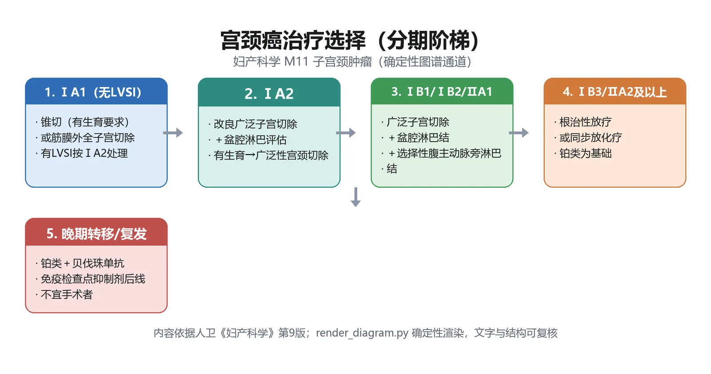


---

#### 🔴 子宫肌瘤分类与临床表现

🔴 【掌握级】子宫肌瘤是<b>性激素依赖性</b>、女性生殖器官及体内<b>最常见的良性肿瘤</b>，好发于 30～50 岁；按与肌壁关系分<b>肌壁间（60%～70%）、浆膜下（约 20%）、黏膜下（10%～15%）</b>（教材P316-P317）。

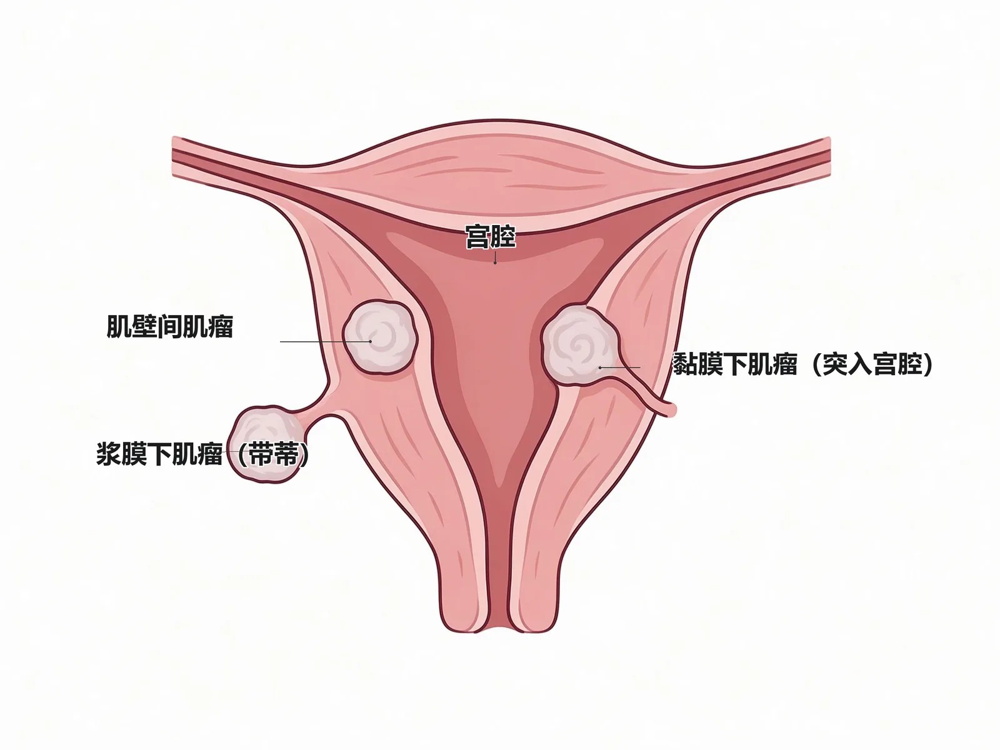

💡 为什么重要：分类决定症状与术式（黏膜下→宫腔镜，浆膜下/肌壁间→经腹/腹腔镜），最常见症状是经量增多。

🧬 第一性原理：肌瘤由平滑肌+结缔组织组成，局部对雌激素<b>高敏感</b>（雌激素受体表达高、雌二醇与雌酮转化低），孕激素又促其有丝分裂，故"生育期长大、绝经后萎缩"——<b>缺乏雌激素/孕激素刺激肌瘤就不会长大</b>。位置决定向哪腔面突出：黏膜下/大的肌壁间肌瘤使宫腔面积增大、内膜静脉丛充血扩张 → <b>经量增多、经期延长最常见</b>（教材P318）。

#### 🔬 展开：三种病理"身份"（最值/最易错）
大体实性球形、表面光滑、压迫周围肌壁形成<b>假包膜</b>（故易剥出）、切面灰白旋涡状；镜下梭形平滑肌细胞、核杆状两端钝圆、核分裂象少见。FIGO 2011 另按位置分 0～8 型（教材P317）。

> [!WARNING] 易错陷阱
> ①黏膜下肌瘤最易致经量增多/不孕，但"最常见症状"（经量增多）多见于大的肌壁间及黏膜下。②肌瘤属良性，但<b>绝经后增大要警惕肉瘤变</b>。

---

#### 🔴 子宫肌瘤手术指征

🔴 【掌握级】子宫肌瘤手术适应证：①<b>月经过多致继发性贫血</b>；②肌瘤体积过大；③有疼痛或压迫症状；④影响妊娠；⑤可疑肌瘤恶变（教材P320）。

💡 为什么重要：手术指征是选择"观察 vs 药物 vs 手术"的边界，是病例题"该不该手术"的依据。

🧬 第一性原理：无症状肌瘤多不需治疗（绝经后多可萎缩、症状消失）。只有当肌瘤<b>造成实际损害</b>（贫血、疼痛/压迫、不育、恶变风险）或<b>体积/位置已构成威胁</b>时，切除收益才大于风险——<b>不引起贫血、不压迫、不影响妊娠、不怀疑恶变就没有手术必要</b>。术式：①<b>子宫肌瘤切除术</b>（希望保留生育功能）——黏膜下宫腔镜、肌壁间/浆膜下经腹或腹腔镜；②<b>子宫切除术</b>——肌瘤多而大、症状明显、无生育要求或怀疑恶变者（教材P320）。

#### 🔬 展开：观察/药物/其他（最值/最易错）
观察：无症状每 3～6 个月随访。药物：GnRH-a 抑制 FSH/LH、缩瘤但<b>停药复发</b>、不推荐长期；SPRM（米非司酮）缩瘤但增加内膜病变风险。其他：子宫动脉栓塞术（UAE，可致卵巢功能减退、有生育要求不建议）、高能聚焦超声（HIFU）（教材P319-P320）。

> [!WARNING] 易错陷阱
> "绝经后肌瘤增大"才是恶变警惕点，绝经前快速增大未必是肉瘤；手术是肌瘤最有效治疗，GnRH-a 只用于术前/围绝经期过渡、"缩瘤"是暂时的。

---

#### 🔴 子宫内膜癌：临床表现与诊断（绝经后出血、分段诊刮）

🔴 【掌握级】子宫内膜癌约 90% 出现阴道流血或分泌物增多，<b>绝经后阴道流血</b>为典型表现；确诊依据是<b>活组织病理检查</b>，最常用<b>诊断性刮宫</b>（分段诊刮可同时取宫腔+宫颈组织，是金标准）（教材P326）。

💡 为什么重要：绝经后出血必须首先排除内膜癌，分段诊刮是"金标准"诊断手段。

🧬 第一性原理：内膜癌向宫腔内生长、表面脆弱、出血早，故绝经后（内膜已萎缩、本无症状）一旦出血即高度提示癌变；内膜癌生长缓慢、长期局限宫体，多数早期确诊、预后较好。<b>若异常出血只是功能或良性（息肉/黏膜下肌瘤），诊断性刮宫病理就能区分</b>——病理金标准给"功能 vs 器质"定性（教材P326）。

#### 🔬 展开：影像与辅助（最值/最易错）
超声<b>绝经后内膜厚度>5mm 应重视</b>；MRI 对肌层浸润判断较准、CT 判宫外转移；CA125 用于评估与监测（浆液性癌/宫外转移可升高）。警惕代谢综合征、不孕、绝经延迟、他莫昔芬、林奇综合征（教材P326）。

> [!WARNING] 易错陷阱
> ①分段诊刮与普通诊刮区别：分段诊刮同时取宫腔+宫颈组织、可鉴别宫颈受累。②绝经后内膜>5mm 提示但非确诊、确诊靠病理。③高度怀疑内膜癌时可直接取材，不必常规宫腔镜防扩散。

---

#### 🔴 子宫内膜癌治疗（以手术为主，全子宫+双附件+淋巴结）

🔴 【掌握级】子宫内膜癌<b>手术治疗为首选</b>，早期行全面分期手术：<b>筋膜外子宫+双侧附件切除±盆腹腔淋巴结切除术</b>（淋巴结应达肾血管水平）（教材P327）。

💡 为什么重要：手术是首选+唯一可根治手段；术后按复发风险分层决定辅助治疗。

🧬 第一性原理：内膜癌转移以<b>淋巴转移为主</b>，途径随病灶部位不同（底部→腹主动脉旁、角/前壁→腹股沟、下段/宫颈受累→与宫颈癌同路）。故手术要<b>切除原发子宫+清扫区域淋巴结以解决"看不见的转移"</b>、同时留腹腔冲洗液行细胞学——这个"根治"跨度正是内膜癌手术与"肌瘤全切"的本质区别（教材P327）。

#### 🔬 展开：风险分层与保留生育（最值/最易错）
低危（ⅠA 低级别）→仅随访；中危→近距离放疗/观察；高中危→盆腔外照射±化疗；高危（特殊类型伴肌层浸润、Ⅲ/Ⅳ期）→化疗±放疗。保留生育（40~45 岁以下、G1 内膜样癌、病灶限内膜）选高效孕激素、3~6 个月活检评估、完成生育后切子宫（教材P327-P328）。

> [!WARNING] 易错陷阱
> ①"盆腔+腹主动脉旁淋巴结（达肾血管水平）"是内膜癌标准清扫范围，与宫颈癌的"盆腔+选择性腹主动脉旁"不同。②高危类型（浆液性/透明细胞）有时需加做<b>大网膜切除/活检</b>。③保留生育（孕激素）不是标准痊愈，完成生育后仍应手术。

---

#### 🟡 子宫颈癌临床表现（接触性出血）与转移途径

🟡 【熟悉级】宫颈癌早期可无症状，最常见表现为<b>接触性出血</b>（性生活或妇科检查后流血），老年患者常为绝经后不规则阴道流血（教材P313）。<b>转移以直接蔓延和淋巴转移为主、血行极少见</b>，直接蔓延最常见（教材P311）。
  机制：外生型向表面生长、组织脆、血管丰富、外力接触即易破裂出血；内生型向深部浸润致宫颈肥大呈桶状、表面光滑反而易漏诊；晚期坏死感染出现米泔样/脓性恶臭排液、累及输尿管致梗阻肾盂积水。<b>出血量与病灶大小、侵及间质血管相关</b>、外生型出血较早较多；一级组为盆腔淋巴结、二级组为腹主动脉旁/腹股沟；<b>前哨淋巴结（SLN）</b>证实无转移可考虑免除系统性淋巴结切除（教材P311、P313）。

---

#### 🟡 子宫肌瘤变性（红色变性/其它变性）与药物治疗

🟡 【熟悉级】子宫肌瘤<b>红色变性</b>多见于妊娠期或产褥期，是一种特殊类型坏死，表现为剧烈腹痛伴恶心、呕吐、发热、白细胞增多、肌瘤增大局部压痛；通常<b>保守治疗</b>、应<b>预防产后出血</b>，肌瘤阻碍胎儿下降者剖宫产（教材P318、P320）。其它变性：<b>玻璃样变（最常见，呈均匀透明无结构胶原）</b>、囊性变、钙化（见于蒂小血供不足的浆膜下肌瘤及绝经后）、<b>肉瘤变（仅 0.4%～0.8%，绝经后增大应警惕）</b>。药物以<b>GnRH-a</b>为代表：抑制 FSH/LH、缩瘤但<b>停药复发</b>、不推荐长期；SPRM（米非司酮）缩瘤但增加内膜病变风险（教材P317-P319）。
  机制：妊娠期肌瘤血供相对不足→小血管退行性变、血栓形成及溶血，血红蛋白渗入肌纤维间而呈暗红色（似"半熟牛肉"）——<b>血供充足就不会发生这种坏死性"红色"变性</b>。

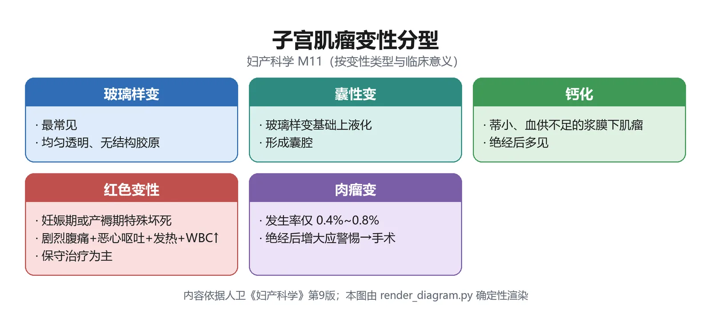

---

#### 🟡 子宫内膜癌：三联征、病理与分子分型

🟡 【熟悉级】子宫内膜癌为子宫内膜上皮性恶性肿瘤（腺癌最常见），常伴<b>肥胖、糖尿病、高血压</b>（三联征），主要病理类型为<b>子宫内膜样癌</b>（占 80%～90%）（教材P324）。WHO（2020）分子分型：<b>POLE 超突变型（预后最好）、MSI-H/dMMR 型、CNL/NSMP 型（预后中等）、CNH/p53 异常型（预后最差）</b>；临床仍以 FIGO 2009 分期为主（教材P324-P325、P326）。
  机制：内膜在<b>无孕激素拮抗的雌激素长期作用</b>下异常增生继而癌变；肥胖者脂肪组织使雄烯二酮芳香化为雌酮（内源性高雌激素）、糖尿病高血压与之共存（代谢综合征）故称三联征——<b>缺了孕激素这个"刹车"，纯雌激素驱动内膜过度增殖→不典型增生（EIN）→内膜样癌</b>。Bokhman：Ⅰ型雌激素相关（内膜样癌、预后好）、Ⅱ型无关（浆液性癌等、预后差）。贺银成：内膜增生症癌变率单纯性约 1%、复杂性约 3%、不典型约 1/3；<b>有无间质浸润是不典型增生与高分化内膜样癌关键鉴别点</b>；FIGO 分级按实性占比（G1≤5%、G2 6%~50%、G3>50%）（教材P324-P325）。

---

#### 🟡 子宫颈上皮内病变好发部位、筛查方案与病理分型

🟡 【熟悉级】好发部位为<b>子宫颈转化区</b>；≥25 岁健康女性首选 <b>HPV 检测</b>初筛、25 岁起、65 岁终止；<b>三级预防</b>（一级=HPV 疫苗（9～26 岁获益最大）、二级=筛查、三级=治疗）；细胞学用 <b>TBS</b>（ASC-US/LSIL/HSIL/ASC-H/AGC）、特异度>90%、灵敏度较低（CIN2/CIN3 约 47%～62%）；组织学以<b>鳞状细胞癌为主</b>（75%～85%）、腺癌 15%～20%、腺鳞癌 3%～5%，<b>腺癌对放疗不敏感、预后差</b>（教材P308、P307-P310、P315）。
  机制：转化区=原始鳞-柱交接部与生理鳞-柱交接部之间，青春期柱状上皮外移形成异位、被鳞状上皮取代（鳞状上皮化生），<b>未成熟化生鳞状上皮代谢活跃、对致癌物敏感</b>故易在 HPV 下病变。筛查 25～64 岁每 5 年 1 次 HPV（或每 5 年联合筛查、每 3 年细胞学），终止为 10 年内连续 2 次 HPV/联合筛查或连续 3 次细胞学正常、且最近一次在 5 年内、无高危因素、65 岁终止。需转诊阴道镜：HPV 阳性且 ASC-US、或细胞学≥LSIL、或 HPV16/18 阳性；微小浸润癌为突破基底膜向间质浸润<b>深度≤5mm</b>。（贺银成）宫颈腺癌对放疗化疗均不敏感、预后较差，考点常以"腺癌对放疗不敏感/预后差"作干扰项（教材P307-P310）。

---

#### 🟢 其他了解级

🟢 【了解级一组】①宫颈<b>原位腺癌（AIS）</b>是宫颈腺癌的癌前病变、部分与高危型 HPV 无关，治疗首选<b>全子宫切除术</b>（有生育需求者切缘阴性可随访）（教材P306、P308）。②子宫内膜癌内分泌治疗用于晚期复发：<b>高效大剂量孕激素</b>、他莫昔芬、芳香化酶抑制剂、LNG-IUS；化疗以<b>铂类联合紫杉醇</b>首选（教材P328）。③子宫内膜癌 FIGO（2009）分期：ⅠA 肌层浸润<1/2、ⅠB ≥1/2；Ⅱ 侵袭宫颈间质；ⅢA 累及浆膜/附件、ⅢB 累及阴道/子宫旁、ⅢC 盆腔/主动脉旁淋巴结；ⅣA 膀胱/直肠、ⅣB 远处转移（教材P326）。④随访：宫颈癌查 HPV/SCCA、内膜癌查盆腔超声与 CA125（教材P315、P328）。

---

### 📊 对比速查

<b>表1 · 子宫颈癌 FIGO（2018）分期简化表</b>

| 分期 | 关键界定 | 备注 |
|---|---|---|
| Ⅰ期 | 癌灶局限宫颈（含累及宫体） | 未见转移 |
| ⅠA1 | 镜下浸润深≤3mm | 间质浸润 |
| ⅠA2 | 镜下浸润深>3～≤5mm | 间质浸润 |
| ⅠB1 | 浸润>5mm，径≤2cm | 限于宫颈 |
| ⅠB2 | 最大径>2～≤4cm | 限于宫颈 |
| ⅠB3 | 最大径>4cm | 限于宫颈 |
| ⅡA1 | 累及阴道上2/3、径≤4cm | 无子宫旁受累 |
| ⅡA2 | 累及阴道上2/3、径>4cm | 无子宫旁受累 |
| ⅡB | 有子宫旁受累、未达骨盆壁 | — |
| ⅢA | 累及阴道下1/3 | 未达骨盆壁 |
| ⅢB | 达骨盆壁和/或肾盂积水 | 除外其他原因 |
| ⅢC1 | 仅盆腔淋巴结转移 | 标注 r/p |
| ⅢC2 | 主动脉旁淋巴结转移 | 标注 r/p |
| ⅣA | 侵及膀胱/直肠黏膜 | 活检证实 |
| ⅣB | 远处器官转移 | 超出真骨盆 |

> [!TIP] 记忆抓手
> ⅠA 记"深度 3/5mm"，ⅠB 记"径线 2/4cm"，ⅡA 记"阴道上 2/3 + 4cm"，ⅢC 记"淋巴结 r/p"。"有疑问归较低分期。"

<b>表2 · 子宫颈癌治疗选择决策表</b>

| 分期 | 首选处理 | 折衷/替代 |
|---|---|---|
| ⅠA1（无 LVSI） | 锥切（有生育需求）/ 筋膜外全子宫切除 | 术前锥切明确范围 |
| ⅠA1（有 LVSI） | 按 ⅠA2 处理 | — |
| ⅠA2 | 改良广泛子宫切除+盆腔淋巴评估 | 有生育→广泛性宫颈切除+盆腔淋巴评估 |
| ⅠB1、ⅠB2、ⅡA1 | 广泛子宫切除+盆腔淋巴结+选择性腹主动脉旁淋巴结切除 | <2cm 可用前哨淋巴结替代系统性清扫 |
| ⅠB3、ⅡA2 及以上 | 根治性放疗/同步放化疗 | 不宜手术者 |
| 术后中高危 | 辅助性放疗/同步放化疗 | 盆腔外照射±顺铂同步化疗 |
| 晚期转移/复发 | 铂类+贝伐珠单抗 | 免疫检查点抑制剂后线 |

> [!WARNING] 易错陷阱
> ①手术的升高阶梯：ⅠA1→ⅠA2→ⅠB/ⅡA1 是"切除范围+淋巴结评估"逐级加码。②放疗作为初始治疗会损卵巢，年轻早期患者应尽量避开。

<b>表3 · 子宫颈癌与子宫内膜癌鉴别表</b>

| 项目 | 子宫颈癌 | 子宫内膜癌 |
|---|---|---|
| 好发部位 | 宫颈转化区（鳞-柱交接部） | 子宫内膜（宫体） |
| 主要病因 | 高危型 HPV（16/18）持续感染 | 无孕激素拮抗的雌激素（+代谢/遗传） |
| 最常见病理类型 | 鳞状细胞癌（75%～85%） | 子宫内膜样癌（80%～90%） |
| 典型出血 | 接触性出血（性交/检查后） | 绝经后自发阴道流血 |
| 发病年龄 | 50～55 岁 | 绝经后（60 岁上下，绝经过渡期） |
| 转移特点 | 直接蔓延+淋巴（血行极少见） | 淋巴为主（部位而异）、血行晚期 |
| 关键诊断 | HPV/细胞学→阴道镜→活检（三阶梯） | 分段诊刮、宫腔镜、内膜活检；绝经后内膜>5mm |
| 淋巴清扫 | 盆腔淋巴结+选择性腹主动脉旁 | 盆腔+主动脉旁（达肾血管水平） |
| 手术术式 | 锥切→广泛子宫切除+淋巴清扫 | 筋膜外全子宫+双附件+淋巴清扫 |
| 预后 | 与期别、类型、切缘、LVSI 相关 | 5 年生存率 80% 以上 |

> [!SUCCESS] 一句话鉴别
> "宫颈癌=HPV、接触性出血、鳞癌、直接蔓延；内膜癌=雌激素、绝经后出血、内膜样癌、淋巴为主；<b>后壁宫体部内膜癌可同时累及宫颈</b>，二者可并存。"

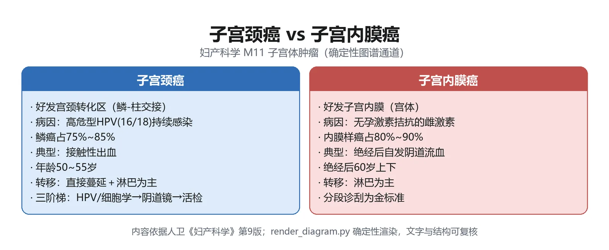


<b>表4 · 子宫肌瘤分类与去向</b>

| 类型 | 占比 | 生长方向 | 典型表现/处理 |
|---|---|---|---|
| 肌壁间肌瘤 | 60%～70% | 肌壁内 | 大者经量增多；经腹/腹腔镜剔除 |
| 浆膜下肌瘤 | 约 20% | 向腹腔 | 可成带蒂/阔韧带/游离性肌瘤；压迫 |
| 黏膜下肌瘤 | 10%～15% | 向宫腔 | 经量增多、不孕、易脱出宫颈口；宫腔镜切 |

> [!NOTE] 补充
> 子宫肌瘤常为多发、各型可同时存在（多发性子宫肌瘤）。FIGO 2011 另按与肌壁位置分 0～8 型，临床逐步采用。

<b>表5 · 子宫内膜癌病理分型与分子分型</b>

| 分型维度 | 类型 | 特征/预后 |
|---|---|---|
| BokhmanⅠ型 | 内膜样癌 | 与雌激素代谢相关，预后好 |
| BokhmanⅡ型 | 浆液性癌等 | 与雌激素无关，恶性度高，预后差 |
| 分子 POLE 超突变 | POLE | 预后最好 |
| 分子 dMMR/MSI-H | dMMR | 预后中等，免疫疗效好 |
| 分子 CNL/NSMP | 低拷贝 | 预后中等 |
| 分子 CNH/p53 异常 | p53 | 预后最差，贝伐珠单抗+免疫获益 |

---

### 🔗 因果链（D2）

```
【子宫颈癌 · HPV"刹车失灵"因果链】
正常鳞状上皮生发层增殖受控（HPV 2 年内清除→自愈）
        ▼
高危型 HPV（16/18）持续感染 ──► 病毒 DNA 整合宿主基因组
        │                              ▼
        │                   E6→降解 p53 ；E7→失活 Rb（两条抑癌通路同时被废）
        ▼
   未成熟化生鳞状上皮增殖失控（转化区好发）
        ▼
   LSIL(CIN1)→HSIL(CIN2/CIN3)/AIS ★
        ▼
   突破基底膜浸润间质 = 微小浸润癌(≤5mm) ★
        ▼
   浸润癌 → 直接蔓延+淋巴结转移(盆腔淋巴) → 晚期尿毒症
```
> [!INFO] 图1：HPV→抑癌失活→上皮内病变→浸润癌→转移；分期/治疗见表1、2、3。

```
【子宫内膜癌 · 雌激素无拮抗"增殖失控"因果链】
正常周期：雌激素促增殖＋孕激素促分化/剥脱（孕激素正常对抗→不癌变）
        ▼
无孕激素拮抗的雌激素长期作用（肥胖→芳香化↑→内源雌酮↑）
        ▼
子宫内膜异常增生 → 不典型增生(AEH)/EIN ★（癌前病变）
        │                            ▼
  内膜样癌(Ⅰ型·预后较好)     浆液性癌等(Ⅱ型·预后差)
        ▼
  淋巴转移（部位而异）→ 直接蔓延 → 血行(肺肝骨) → 晚期/复发
        ▼
  全面分期手术(全子宫+双附件+盆/主动脉旁淋巴结)+按风险分层
```
> [!INFO] 图2：雌激素无拮抗→内膜增生→不典型增生/内膜癌→按分子分型与风险分层；分型见表5。

---

### 🌳 鉴别决策树（D4）

```
绝经后/异常阴道流血 → 先排除器质性病变
│
├── 接触性出血？ → 宫颈病变 → HPV+细胞学→阴道镜→活检 → 宫颈癌（鳞癌、直接蔓延）
├── 绝经后自发出血+三联征？ → 子宫内膜癌 → 分段诊刮/宫腔镜 → 内膜样癌（淋巴为主）
├── 经量增多、育龄、肌瘤增大？ → 子宫肌瘤（假包膜、核分裂少）→ 超声/MRI
└── 绝经后肌瘤增大+疼痛、界限不清、核分裂≥10/10HPF？ → 子宫肉瘤 → 术中/术后病理
```
> [!TIP] 判断依据
> ①出血性质：接触性出血→宫颈；自发绝经后→内膜。②高危人群：HPV16/18→宫颈；代谢三联征/他莫昔芬/林奇→内膜。③生长方式：肌瘤假包膜→良性；肉瘤界限不清→恶性。④确诊：宫颈靠<b>活检</b>、内膜靠<b>分段诊刮</b>、肉瘤靠<b>术中/术后病理</b>。

---

### ⚠️ 常见陷阱

- <b>ⅠA1/ⅠA2 用径线、ⅠB 用深度搞混</b>：ⅠA 看深度（3/5mm）、ⅠB 看径线（2/4cm）；ⅢC 写 r/p。
- <b>宫颈癌误以为血行转移常见</b>：血行极少见，以直接蔓延+淋巴为主。
- <b>绝经后肌瘤增大不当回事</b>：应警惕肉瘤变；绝经前快速增大不提示肉瘤；"最常见症状"是经量增多。
- <b>内膜癌"常见=预后好"</b>：内膜样癌最常见且预后好、特殊类型预后差；分段诊刮取宫腔+宫颈组织、是金标准。

---

### 💡 记忆口诀

- <b>HPV 致癌</b>："16 最强，16/18 占七成；E6 拆 p53，E7 废 Rb，两只刹车一起松。"
- <b>FIGO 宫颈癌 + 肌瘤</b>："ⅠA 深度 3/5、ⅠB 径线 2/4、ⅢC 写 r/p；肌壁最多、玻璃最常见、红变在孕期、肉瘤变绝经后。"

---

### 📌 本章小结

> [!INFO] 本章小结
> - take-home 1：宫颈癌＝高危型 HPV 持续感染（16/18），<b>E6/E7 使 p53/Rb 失活</b>是"刹车失灵"核心；三阶梯筛查（HPV/细胞学→阴道镜→活检）抓癌前（教材P304、P307）。
> - take-home 2：宫颈癌 FIGO 2018 分期以"深度 3/5mm、径线 2/4cm、淋巴结 r/p"为界；ⅠA～ⅡA1 手术为主、ⅠB3/ⅡA2 及以上同步放化疗（教材P311、P314）。
> - take-home 3：子宫肌瘤为性激素依赖性良性肿瘤（肌壁间最多、经量增多最常见）；内膜癌以绝经后出血+三联征为线索、首选"全子宫+双附件+盆腹腔淋巴结"手术（教材P316、P318、P327）。
> <b>🧬 本章核心洞察</b>：宫颈与宫体两大肿瘤的分水岭在<b>致癌驱动不同</b>——宫颈是"病毒（HPV-E6/E7）拆抑癌刹车"，宫体是"激素（无孕激素拮抗的雌激素）喂增殖引擎"；两者都靠"早筛/早诊抓癌前与早期"实现根治。

---

### 🔗 深度链接

- 与<b>模块10（妇科炎症与内异症）</b>：慢性宫颈炎/阴道微生态异常是 TCT 检查的"背景疾病"；子宫腺肌病（继发性痛经、子宫均匀增大、CA125）是子宫肌瘤鉴别表的重要对照。
- 与<b>模块12</b>：卵巢肿瘤标志物（CA125/HE4）与内膜癌筛查互补；滋养细胞疾病以血行转移、血 hCG 升高为特征。
- 与<b>模块13、模块14</b>：排卵障碍性 AUB 需先排除内膜癌再按功能性处理；治疗后影响生育与性功能。


## 模块12：卵巢肿瘤与妊娠滋养细胞疾病

> [!INFO] 模块信息
> <b>重点等级</b>：🔴掌握 7 个 / 🟡熟悉 8 个 / 🟢了解 5 个
> <b>预计题型</b>：A1（FIGO 分期数值、预后评分、hCG 随访周期）/ A2（卵巢肿瘤蒂扭转→急诊手术、清宫后 hCG 平台→诊断 GTN）/ B1（浆液性 vs 黏液性、完全性 vs 部分性葡萄胎、侵蚀性葡萄胎 vs 绒癌）/ X（四大类分类、各肿瘤特异标记物）
> <b>关联模块</b>：模块11（妇科肿瘤谱系）、模块13（肿瘤性出血鉴别）、模块14（生育规划）
> <b>谱系位置</b>：卵巢肿瘤为妇科恶性肿瘤病死率之首、以手术为主；滋养细胞疾病是唯一可用血 hCG 精准监测的化疗可治愈肿瘤。

---

### 🧩 前置知识检查

- 卵巢被覆单层立方上皮（体腔上皮）→上皮性肿瘤化生起点（模块01）。
- 颗粒细胞分泌雌激素、卵泡膜细胞合成雄激素后芳香化为雌激素→功能性肿瘤内分泌基础（模块01）。
- hCG 由合体滋养细胞分泌、滋养细胞具侵袭血管特性（模块02）；异常/绝经后出血需与肿瘤性出血鉴别（模块13）。

---

### 🎯 高收益摘要

- 卵巢肿瘤分<b>四大类</b>：上皮性（最常见，占恶性肿瘤 85%~90%）、生殖细胞（20%~40%）、性索间质（5%~8%）、转移性（5%~10%）（教材P329、P333）。
- 标记物对应：<b>CA125/HE4→上皮性</b>、<b>AFP→卵黄囊瘤</b>、<b>hCG→绒癌/葡萄胎</b>、<b>抑制素/雌激素→颗粒细胞瘤</b>（教材P331）。
- <b>蒂扭转</b>约 10% 发生、好发成熟性畸胎瘤、<b>一经确诊尽快手术</b>（教材P330）。
- 完全性葡萄胎典型：<b>子宫大于孕周 + hCG 异常升高 + 超声"落雪状/蜂窝状"</b>；清宫+送病理+随访（教材P345-348）。
- 侵蚀性葡萄胎 vs 绒癌<b>关键区别是有无绒毛结构</b>；GTN 以<b>化疗为主</b>（低危单药、高危 EMA-CO）（教材P348-351）。

---

### 📋 结构化笔记

🟡 【熟悉级】卵巢肿瘤组织学分类四大类：按组织发生分上皮性、生殖细胞、性索间质、转移性（教材P329）。分类决预后与治疗方向；<b>转移以盆腹腔种植+淋巴为主</b>（右膈下淋巴丛最易受侵），血行少见（教材P329）。占比：上皮性 50%~70%、生殖细胞 20%~40%、性索间质 5%~8%、转移性 5%~10%（上皮性占卵巢癌 85%~90%）。

> [!WARNING] 易错陷阱
> 别把"转移性卵巢肿瘤"算进"上皮性"——转移性独立成类；卵巢原发性黏液性癌少见，<b>绝大多数黏液性癌是转移来的</b>，双侧受累更要警惕转移。

---

🟡 【熟悉级】卵巢良性/恶性临床鉴别：病程（长/短）、体征（单侧囊性光滑 vs 双侧固定囊实性）、一般情况、超声（液性暗区 vs 杂乱光团/囊壁乳头），恶性常伴血性腹腔积液（教材P332）。超声符合率约 90%；<b>确诊＝组织病理学</b>；鉴别卵巢瘤样病变（滤泡/黄体囊肿 <5cm 可自消）、浆膜下子宫肌瘤、子宫内膜异位症（后者 CA125 升高）。

---

🔴 【掌握级】卵巢肿瘤并发症——蒂扭转：约 10% 卵巢肿瘤发生蒂扭转，好发<b>瘤蒂长、中等大、活动度高、重心偏一侧</b>者（如成熟性畸胎瘤），常在<b>体位突变</b>或妊娠期/产褥期子宫改变时发生（教材P330）。
🧬 第一性原理：肿瘤的"蒂"＝骨盆漏斗韧带+卵巢固有韧带+输卵管，是其供血"脐带"，重心偏一侧就易绕柄旋转。<b>扭转先闭静脉——瘤内充血、血管破裂、瘤体迅速增大；动脉也被绞死则肿瘤缺血坏死、破裂、继发感染</b>；一旦动脉受阻即组织坏死，故须手术。<b>治疗原则：一经确诊尽快手术</b>（不全扭转自然复位则腹痛缓解）（教材P331）。
  表现：<b>体位改变后突然一侧下腹剧痛</b>（伴恶心呕吐、休克），双合诊触及<b>压痛肿块、以蒂部最明显</b>；不全扭转可自然复位，扭转坏死则患侧附件切除。

#### 🔬 展开：急腹症的缺血本质
"一经确诊尽快手术"≠"先复位再观察"。卵巢扭转属<b>缺血性急腹症</b>，延迟手术会让卵巢坏死（教材P331）。

---

🔴 【掌握级】卵巢肿瘤标记物：CA125（上皮性，80% 升高但早期多不升）、HE4（与 CA125 联合）、AFP（卵黄囊瘤特异）、hCG（非妊娠性绒癌特异）、抑制素/雌激素（颗粒细胞瘤）、雄激素（支持-间质细胞瘤）（教材P331）。
🧬 第一性原理：标记物是肿瘤"残留分泌功能"的分子指纹：上皮性→CA125；生殖细胞向胚外分化→AFP（卵黄囊）或 hCG（滋养层）；性索间质保留内分泌→性激素/抑制素。CA125 近半数早期不升、用于<b>监测/疗效</b>；CA199 对黏液性癌价值较高；AFP 特异性诊断卵黄囊瘤。

---

🟡 【熟悉级】卵巢上皮性肿瘤：最常见组织学类型，占卵巢肿瘤 50%~70%、占卵巢恶性肿瘤 85%~90%；分良性、交界性、恶性（教材P333）。
🧬 第一性原理：表面上皮排卵后反复修复→包涵囊肿→向输卵管上皮化生<b>浆液性</b>、向宫颈/肠黏膜化生<b>黏液性</b>、向内膜化生<b>子宫内膜样</b>。<b>良性＝囊腺瘤；有异型无间质浸润＝交界性；突破基底膜浸润间质＝癌。</b> HGSC 多起自输卵管上皮内癌；子宫内膜样/透明细胞癌多源自内异症；分Ⅰ型（预后好）与Ⅱ型（预后差）。

> [!WARNING] 易错陷阱
> <b>浆液性＝最常见（占卵巢癌 75%）</b>；黏液性肿瘤<b>体积巨大</b>、可致<b>腹膜假黏液瘤</b>，交界性需增生区<b>占上皮 >10%</b>；砂粒体为浆液性囊腺癌标志性结构。

---

🟡 【熟悉级】卵巢生殖细胞肿瘤：好发于年轻女性，畸胎瘤（成熟性/未成熟性）、无性细胞瘤、卵黄囊瘤（内胚窦瘤）、胚胎性癌、绒癌（教材P338）。
🧬 第一性原理：生殖细胞肿瘤是"原始生殖细胞分化方向出错"：向<b>多胚层</b>→畸胎瘤；向<b>卵黄囊</b>→卵黄囊瘤（AFP）；向<b>滋养层</b>→绒癌；<b>不分化</b>→无性细胞瘤。<b>残留越"原始"越恶性；成熟性畸胎瘤已分化成熟故良性</b>。<b>无性细胞瘤对化、放疗均敏感</b>；卵黄囊瘤<b>AFP 高、易转移</b>；生殖细胞肿瘤<b>无论期别早晚均可保留生育功能</b>。（贺银成）无性细胞瘤镜下胞质空亮透明、<b>胎盘碱性磷酸酶阳性</b>；卵黄囊瘤镜下<b>疏网状结构最常见</b>、见 <b>S-D 小体</b>及<b>细胞外嗜酸性小体</b>（特征性）；成熟性畸胎瘤恶变率 2%~4%、以<b>鳞状细胞癌</b>最多见。

---

🟡 【熟悉级】卵巢性索间质肿瘤——颗粒细胞瘤：分泌雌激素，成年多见（95%），属<b>低度恶性</b>；可致性早熟（青春期前）、月经紊乱/绝经后出血，常合并子宫内膜增生甚至内膜癌（教材P339-340）。
🧬 第一性原理：颗粒细胞持续分泌雌激素 → 子宫内膜受单一雌激素刺激 → 增生、可癌变。故<b>保留子宫者术前须排除子宫内膜病变</b>。特征性结构 <b>Call-Exner 小体</b>（核呈咖啡豆样）；卵泡膜细胞瘤亦分泌雌激素（良性）；<b>纤维瘤伴腹水/胸水＝梅格斯综合征</b>（切除后消退）；支持-间质细胞瘤<b>交界性/潜在恶性</b>、分泌<b>雄激素</b>。

> [!WARNING] 易错陷阱
> <b>Meigs 综合征＝纤维瘤+腹腔积液+胸腔积液</b>（术后消退），别误记为恶性肿瘤晚期腹水；它是良性。

---

🟡 【熟悉级】卵巢转移性肿瘤——库肯勃瘤（Krukenberg）：来自<b>胃肠道</b>的转移性腺癌，<b>双侧</b>多见，常保持卵巢原状或呈肾形；镜下见<b>印戒细胞</b>；治疗原则是缓解和控症（教材P340-341）。特异为<b>印戒细胞</b>（黏液把核挤到一侧贴近胞膜）；转移以<b>血行/淋巴/种植</b>途径，好发于绝经前女性。

---

🟢 【了解级一组】①卵巢上皮性癌治疗：以<b>手术和化疗为主</b>（两者同等重要）、辅以靶向（PARP 抑制剂）；早期全面分期手术、晚期<b>肿瘤细胞减灭术</b>，卡铂+紫杉醇首选（教材P335-336）。②卵巢恶性生殖细胞肿瘤：对化疗敏感、首选<b>BEP</b>，无论期别早晚均可保留生育功能（教材P339）。③输卵管/腹膜肿瘤：输卵管癌三联征＝<b>阴道排液+盆腔包块+痉挛性下腹胀痛</b>；输卵管上皮内癌是高级别浆液性卵巢癌与原发性腹膜癌的共同起源（教材P342-343）。

> [!WARNING] 易错陷阱
> 葡萄胎/绒癌/侵蚀性葡萄胎<b>同属 GTD</b>，但只有<b>侵蚀性葡萄胎 + 绒癌</b>归入临床"GTN"——别把葡萄胎当作"肿瘤"混入 GTN 概念。

---

🔴 【掌握级】完全性葡萄胎：核型为<b>二倍体，全部来自父系</b>（90% 为 46XX，系空卵与单倍体精子受精后自身复制）；<b>无胚胎/胎儿组织</b>，绒毛水肿、血管消失、滋养细胞弥漫增生、<b>P57 免疫组化阴性</b>（教材P344-345）。
🧬 第一性原理：完全性葡萄胎是<b>"空卵受精"</b>——卵细胞核缺如/失活，父方单倍体精子自我复制成二倍体（46XX）或两精子进入空卵（46XY）。<b>核来自父方、过度表达父源基因、又无母源 P57 表达→胚胎发育失败、滋养细胞却异常增生。</b> 故核型全父源、无胚胎、P57 阴性。
  表现：<b>停经后阴道流血</b>（最常见，停经 8~12 周开始）、<b>子宫异常增大变软</b>（多大于停经月份）、妊娠剧吐、子痫前期征象（24 周前）、甲亢样表现；<b>卵巢黄素化囊肿</b>多为双侧、清宫后 2~4 个月自消、血 hCG 常 >10 万 IU/L。镜下三特点（滋养层增生最重要）：绒毛间质<b>高度疏松水肿、黏液变性</b>；间质内<b>血管消失</b>；滋养层细胞不同程度增生。

#### 🔬 展开：葡萄胎镜下三特点
①绒毛间质高度疏松水肿、黏液变性而增大；②间质内血管消失或仅少量无功能毛细血管、内无红细胞；③滋养层细胞（合体/细胞滋养细胞）不同程度增生、轻度异型性。

---

🟡 【熟悉级】部分性葡萄胎：核型 <b>90% 以上为三倍体</b>（69XXY 最常见）；有胚胎/孕囊成分，绒毛部分水肿、滋养细胞<b>局限性轻度增生</b>、有正常绒毛，<b>P57 免疫组化阳性</b>（教材P344-345）。<b>缺乏明显高危因素</b>，子宫局部侵袭概率仅 1%~4%、一般不转移；需与早期流产、双胎妊娠、剖宫产瘢痕部位妊娠鉴别（靠大体/镜下、P57、DNA 倍体、STR 分型）。

> [!TIP] 记忆口诀
> 完全性＝父源双倍体、无胚胎、P57 阴、hCG 极高；部分性＝三倍体、有胚胎、P57 阳、hCG 轻度升高。

> [!NOTE] 高危葡萄胎标准
> ①hCG>10 万 IU/L；②子宫明显大于相应孕周；③卵巢黄素化囊肿直径>6cm；另年龄>40 岁、重复葡萄胎史亦高危。

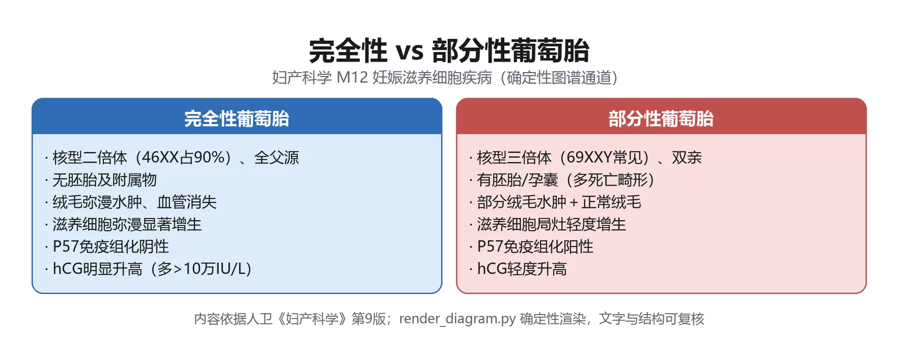


---

🔴 【掌握级】葡萄胎处理与随访：诊断成立即<b>清宫</b>（超声引导、大号吸管吸刮，刮出物<b>必须送组织学</b>）；清宫后<b>监测血 hCG</b>：每周 1 次直至连续 3 次阴性，以后每月 1 次共 6 个月；<b>避孕 6 个月</b>（教材P347-348）。
🧬 第一性原理：清宫后若滋养细胞已<b>侵入肌层（侵蚀性葡萄胎）</b>或<b>无绒毛浸润（绒癌）</b>，血 hCG 不会如期降至正常——故 <b>hCG 是"是否残留或恶变"的哨兵</b>。清宫干净且无侵袭→hCG 规律转阴；若平台/上升→有滋养细胞肿瘤在分泌。子宫大而软易穿孔，应在输液备血下进行，一次清宫即可、有残留可二次、>16 孕周或合并症者转院。

> [!TIP] 避孕提醒
> 随访期应<b>可靠避孕 6 个月</b>，可选口服避孕药或避孕套，<b>不宜用宫内节育器</b>（免混淆出血或穿孔）。

---

🔴 【掌握级】侵蚀性葡萄胎 vs 绒毛膜癌：<b>有无绒毛结构是两者鉴别的重要病理指标</b>。侵蚀性葡萄胎<b>有水泡状绒毛侵入子宫肌层</b>（全部继发于葡萄胎）；绒毛膜癌<b>无绒毛、无间质、无血管</b>，可继发于葡萄胎、流产、足月产或异位妊娠（教材P348-349）。
🧬 第一性原理：侵蚀性葡萄胎是"葡萄胎的延伸"——水泡状绒毛从宫腔<b>钻进肌层/血管</b>；绒癌是<b>滋养细胞失去绒毛形态</b>的纯浸润癌、靠侵袭血管获取营养。<b>镜下见到绒毛/绒毛阴影＝侵蚀性葡萄胎；完全见不到绒毛＝绒癌。</b> 绒癌无间质无血管、必掠夺宿主血管，故出血坏死极明显（多源自父系 XX 双倍体）。侵蚀性葡萄胎子宫表面见<b>紫蓝色结节</b>，绒毛在栓塞部不继续生长、可自然消退。

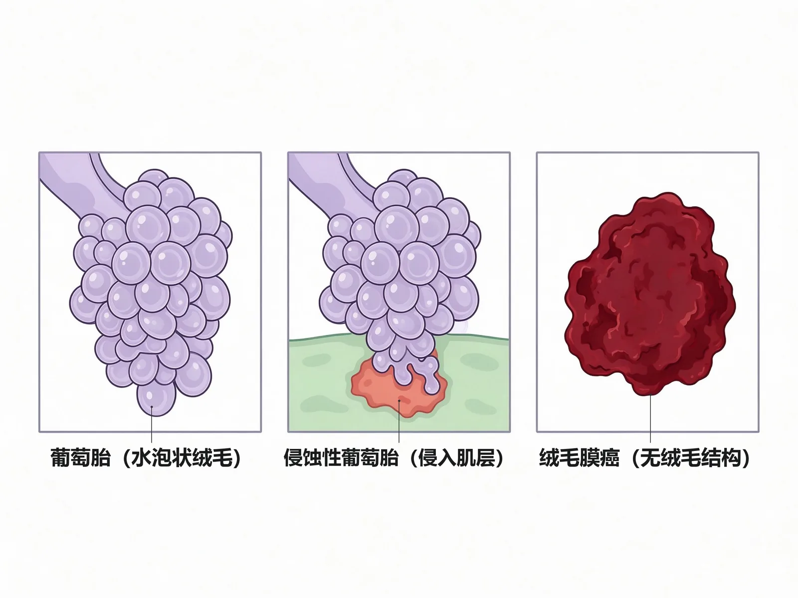

> [!WARNING] 易错陷阱
> 病理区别<b>只看"有无绒毛"</b>，不看"有无滋养细胞"（两者都有）；教材强调"任何切片见绒毛结构均诊断侵蚀性葡萄胎"。

---

🔴 【掌握级】妊娠滋养细胞肿瘤诊断（血 hCG）：hCG 异常是主要诊断依据。葡萄胎清宫后<b>符合①或②/③任 1 项</b>即可诊为 GTN：①hCG 4 次（1、7、14、21 日）呈<b>高水平平台</b>（±10%）持续 3 周以上；②hCG 3 次（1、7、14 日）<b>上升</b>（>10%）至少持续 2 周；③组织学诊断（教材P349）。
🧬 第一性原理：葡萄胎经正确清宫后血 hCG 应呈对数下降至正常。<b>若 hCG 反而平台（±10%）或上升（>10%），说明体内仍有滋养细胞在分泌 hCG——即发生了 GTN。</b> 平台/上升的"时间窗及幅度"正是为了排除一过性波动与妊娠物残留。非葡萄胎后（流产/足月产/异位妊娠）：异常流血或脏器出血、肺/神经症状→查血 hCG，异常并除外妊娠物残留或再孕即可诊断；影像学（超声肌层高回声团块、彩超血流丰富；胸片棉球状阴影多在右肺中下）支持诊断但<b>非必需</b>。

---

🟡 【熟悉级】滋养细胞肿瘤临床分期与预后评分：采用 FIGO 分期 + 预后评分。<b>预后评分 ≤6 分为低危，≥7 分为高危，≥13 分或一线化疗反应差的肝、脑/广泛转移为极高危</b>（教材P350）。评分决定"单药 vs 联合化疗"。FIGO 分期：Ⅰ期局限于子宫；Ⅱ期扩散但限于生殖器；Ⅲ期肺转移（±生殖系统病变）；Ⅳ期其他部位转移。其中<b>肝、脑、阴道、既往化疗失败均影响评分</b>（评分越高越危险）。

---

🔴 【掌握级】滋养细胞肿瘤治疗——化疗为主：低危首选<b>单药化疗</b>（MTX 或 Act-D，放线菌素-D），高危首选<b>联合化疗</b>（<b>EMA-CO</b> 或氟尿嘧啶为主方案），恶性度高者凶险但<b>多数可治愈</b>（教材P350-351）。
🧬 第一性原理：滋养细胞<b>增殖极快</b>，对干扰核酸合成/细胞分裂的化疗药高度敏感，故<b>化疗能彻底杀伤</b>。低危负荷小单药足矣；高危负荷大、易耐药需多药联合。正因绒癌高度依赖血供、增殖旺盛，化疗是有效根治手段——与多数"手术为主"的实体瘤相反。停药指征：hCG 正常后低危巩固化疗 2~3 个疗程、高危巩固 3~4 个疗程；手术为辅助；随访每月监测 hCG 持续 1 年、第 2~3 年每 3 个月 1 次、第 4~5 年每年 1 次，<b>严格避孕至少 1 年</b>。

> [!WARNING] 易错陷阱
> 高危患者<b>首选 EMA-CO</b>（不是 BEP）；BEP 是<b>卵巢恶性生殖细胞肿瘤</b>的首选，两者别混。

---

🟢 【了解级】胎盘部位滋养细胞肿瘤（PSTT）源于<b>种植部位中间型滋养细胞</b>，多数不转移、预后较好；<b>血 hCG 多阴性或轻度升高、hPL 阳性</b>；<b>手术（全子宫+双输卵管切除）为首选</b>（教材P352-353）。上皮样滋养细胞肿瘤（ETT）为 GTN <b>最少见</b>之类型、源于<b>绒毛膜型中间型滋养细胞</b>，好发子宫颈/下段、异常阴道流血最常见；<b>手术为主要治疗</b>、不常规保留生育功能、无转移者预后良好（教材P353-354）。

> [!SUCCESS] 本章核心结论
> <b>葡萄胎</b>＝清宫+血 hCG 随访（6 月避孕）；<b>GTN</b>＝化疗为主（评分定方案）；<b>侵蚀性葡萄胎 vs 绒癌</b>＝看绒毛；<b>卵巢肿瘤</b>＝四大类+标记物+蒂扭转急症处理。

---

### 📊 对比速查

<b>表1：卵巢肿瘤四大类总表（病理+标记物）</b>

| 类别 | 占比 | 良恶性 | 代表类型 | 特异标记物 |
|---|---|---|---|---|
| 上皮性 | 50%~70% | 良/交界/恶性 | 浆液性（最常见）、黏液性、子宫内膜样、透明细胞 | CA125、HE4、CA199（黏液性） |
| 生殖细胞 | 20%~40% | 多恶性（畸胎瘤良性） | 成熟/未成熟畸胎瘤、无性细胞瘤、卵黄囊瘤 | AFP（卵黄囊瘤）、hCG（绒癌） |
| 性索间质 | 5%~8% | 良性或低度恶性 | 颗粒细胞瘤、卵泡膜细胞瘤、纤维瘤、支持-间质细胞瘤 | 雌激素/抑制素（颗粒细胞）、雄激素（支持-间质） |
| 转移性 | 5%~10% | 恶性（继发） | 库肯勃瘤（胃肠道来源，印戒细胞） | 依原发灶（多为胃肠道） |

<b>表2：完全性 vs 部分性葡萄胎</b>

| 项目 | 完全性葡萄胎 | 部分性葡萄胎 |
|---|---|---|
| 核型 | 二倍体（46XX 90%），父源 | 三倍体（69XXY 常见），双亲 |
| 胚胎/胎儿 | 无胚胎及附属物 | 有胚胎/孕囊（多死亡畸形） |
| 绒毛 | 弥漫水肿、血管消失 | 部分绒毛水肿+正常绒毛 |
| 滋养细胞增生 | 弥漫、显著 | 局灶、轻度 |
| P57 免疫组化 | 阴性 | 阳性 |
| hCG 显著升高 | 明显（多>10万IU/L） | 轻度升高 |

<b>表3：侵蚀性葡萄胎 vs 绒毛膜癌</b>

| 项目 | 侵蚀性葡萄胎 | 绒毛膜癌 |
|---|---|---|
| 绒毛结构 | <b>有水泡状绒毛</b>（/绒毛阴影）侵入肌层 | <b>无绒毛</b>、无间质、无血管 |
| 来源 | <b>全部继发于葡萄胎</b> | 可继发于葡萄胎、流产、足月产、异位妊娠 |
| 恶性程度 | 恶性度较低 | 恶性度高、转移早而广 |
| 浸润特点 | 水泡状组织侵入子宫肌层，可见紫蓝色结节 | 侵入肌层血管，广泛出血坏死 |
| 转移 | 晚期可血行转移 | 以血行转移为主，肺 80%最常见 |
| 预后 | 较好 | 化疗药物问世前病死率>90%，现多可治愈 |

<b>表4：卵巢良性 vs 恶性肿瘤鉴别</b>

| 鉴别 | 良性肿瘤 | 恶性肿瘤 |
|---|---|---|
| 病史 | 病程长、逐渐增大 | 病程短、迅速增大 |
| 体征 | 多单侧、活动、囊性、表面光滑、常无腹水 | 多双侧、固定、囊实性/表面不平结节状、常有血性腹水 |
| 超声 | 液性暗区、边缘清晰 | 杂乱光团、囊壁乳头、血流丰富、腹膜结节 |
| 一般情况 | 良好 | 恶病质 |

---

### 🔗 因果链（D2，每模块 ≥1 张）

```
【卵巢肿瘤蒂扭转】因果链
（瘤蒂长·活动度好·重心偏侧，如成熟性畸胎瘤）
        │  体位突变 / 妊娠·产褥期子宫变化
        ▼
   肿瘤随体位旋转 → 蒂（骨盆漏斗韧带+卵巢固有韧带+输卵管）扭转
        │
        ├── ▶ 静脉回流受阻 → 瘤内充血/血管破裂 → 瘤体迅速增大
        └── ▶ ★ 动脉血流受阻 → 肿瘤缺血坏死 → 破裂 / 继发感染
                                        │
                                        ▼
                        ★ 突然一侧下腹剧痛（+恶心·呕吐·休克）
                                        │
                                        ▼
                  双合诊压痛肿块（蒂部最明显）→ ★ 一经确诊尽快手术
```
> [!INFO] 此图展示卵巢肿瘤蒂扭转的机制链路，具体"10% 发生率、好发成熟性畸胎瘤"等数据见上表1。

---

### 🌳 鉴别决策树（D4）

```
停经后子宫异常增大 + 血 hCG 升高 + 阴道流血
        │
        ├── B超无胎儿、无胎心，宫腔"落雪状/蜂窝状"，hCG 极高
        │       └──▶ 完全性葡萄胎（核型父源二倍体、P57 阴）
        ├── B超见胚胎/孕囊（多畸形），hCG 轻度升高
        │       └──▶ 部分性葡萄胎（三倍体、P57 阳）
        ├── 宫内见正常胎囊+胎心，hCG 相应孕周，无阴道流血
        │       └──▶ 双胎妊娠
        └── 无葡萄样水泡，子宫增大、血 hCG 异常上升
                └──▶ 需排除流产（早期）确诊靠病理/P57/STR
```
> [!INFO] 判断依据：完全性葡萄胎核型为父源二倍体、无胚胎、P57 阴性；部分性为三倍体、有胚胎、P57 阳性；双胎以超声确诊；与早期流产靠 DNA 倍体/STR 区分。

---

### ⚠️ 常见陷阱

- 卵巢肿瘤<b>四大类</b>是"上皮/生殖/性索间质/转移"，勿把转移性并入上皮性。
- <b>浆液性＝最常见（占卵巢癌 75%）</b>，黏液性<b>巨大</b>（可致腹膜假黏液瘤）。
- 库肯勃瘤＝<b>胃肠道来源、双侧、印戒细胞</b>，不是卵巢原发。
- 葡萄胎核型：完全性＝<b>父源二倍体</b>、部分性＝<b>三倍体</b>；P57 <b>阴=完全性</b>。
- 侵蚀性葡萄胎 vs 绒癌：<b>只认"有无绒毛"</b>，两者都有滋养细胞。
- GTN 化疗：高危首选 <b>EMA-CO</b>；<b>BEP</b> 属于卵巢恶性生殖细胞肿瘤方案，别混用。
- "一经确诊尽快手术"是<b>蒂扭转</b>的处理；葡萄胎是清宫+随访。

---

### 💡 记忆口诀

- <b>卵巢四类</b>：上皮到生殖、性索又转移——"最常上皮、最恶生殖、内分泌找性索、来路问转移"。
- <b>标记物</b>：CA125 上皮、AFP 卵黄囊、hCG 滋养层、雌激素找颗粒。
- <b>蒂扭转</b>：瘤长活动中，体位一急动；剧痛伴呕吐，确诊快手术。
- <b>侵蚀 vs 绒癌</b>：见到绒毛是侵蚀，绒毛消失是绒癌。

---

### 📌 本章小结

> [!INFO] 本章小结
> - 卵巢肿瘤按组织学分四大类，标记物各配一位；<b>蒂扭转</b>是卵巢肿瘤最常见急腹症，好发成熟性畸胎瘤，<b>一经确诊尽快手术</b>。
> - <b>葡萄胎</b>＝清宫+送病理+血 hCG 随访（每周→每月 6 个月+避孕 6 个月）；<b>GTN</b>＝以化疗为主（低危单药、高危 EMA-CO），<b>多数可治愈</b>。
> - 完全性葡萄胎=父源二倍体、无胚胎、P57 阴；部分性=三倍体、有胚胎、P57 阳；<b>侵蚀性葡萄胎 vs 绒癌靠"有无绒毛"鉴别</b>。
> <b>🧬 本章核心洞察</b>：卵巢肿瘤病在"组织发生错了"，用标记物+分型定位；滋养细胞疾病病在"滋养细胞增殖失控"，用血 hCG 精准监测、用化疗彻底杀伤——一个是手术谱系，一个是化疗谱系。

---

### 🔗 深度链接

- 卵巢肿瘤的"功能性出血、绝经后出血、子宫内膜增生"与<b>模块13</b>异常子宫出血/绝经综合征鉴别相关；卵巢癌异常出血需先排除内膜病变。
- 生殖细胞肿瘤保留生育功能与化疗对卵巢功能的影响，衔接<b>模块14</b>的生育保存策略。
- 滋养细胞肿瘤清宫后 hCG 随访、肺转移表现，与<b>模块09</b>产后出血、<b>模块02</b> hCG 来源协同理解。


## 模块13：生殖内分泌疾病

> [!INFO] 模块信息
> <b>重点等级</b>：🔴掌握 3 个 / 🟡熟悉 2 个 / 🟢了解 1 个　|　<b>关联模块</b>：模块1（H-P-O 轴与月经生理）、模块14（不孕症，排卵障碍最常见病因）　|　<b>谱系位置</b>：妇科内分泌谱系——以 H-P-O 轴失调为主线，课内覆盖异常子宫出血（AUB）与绝经综合征（MHT）　|　<b>预计阅读</b>：约 24 分钟

---

### 🧩 前置知识检查

- 卵巢"双激素"节律：E2 促内膜增殖、P 促内膜分泌脱落，协同才有规律自限性月经（模块1）。
- H-P-O 轴正负反馈：GnRH 脉冲→LH/FSH→性激素→反馈中枢，任一环节失灵则轴失调。
- 无排卵→内膜只受单一雌激素刺激；卵巢体积、窦状卵泡、内膜厚度是共同读片基础。

---

### 🎯 高收益摘要

- AUB 分类即 <b>PALM-COEIN</b> 九亚型，AUB-O 约占 50%，"功血"已于 2011 年停用（P368）。无排卵性 AUB 本质"单一雌激素→突破性/撤退性出血"，治疗三步：止血→调周期→（生育期）促排卵（P371）。
- MHT：有适应症、无禁忌症时，<60 岁或绝经 10 年以内者获益/风险比最高（P394）。

---

### 📋 结构化笔记

🔴 【掌握级】异常子宫出血（AUB）的 PALM-COEIN 分类：来源于子宫腔、与正常月经周期频率/规律性/经期/经量不同的异常出血；不包括妊娠期、产褥期、青春期前与绝经后出血（教材P368）。
💡 为什么重要：AUB 是症状群而非独立病，分类决定"找器质性还是找轴失调"，是异常出血的入口。

🧬 第一性原理：
   正常月经=卵巢周期→内膜增殖→排卵后黄体→雌孕激素撤退→内膜崩解脱落：<b>"有排卵才有规律自限性出血"</b>。排卵出问题（无排卵或黄体异常）则内膜受单一/异常激素驱动，出血失序；分类即把失序来源拆成器质性（P/A/L/M 找病灶）与非器质性（C/O/E/I/N 找轴与凝血）。

#### 🔬 展开：PALM-COEIN 九亚型拆解
- <b>PALM</b>（器质性）：P 息肉、A 腺肌病、L 平滑肌瘤、M 恶变/不典型增生（唯一须警惕、按肿瘤原则处理）。
- <b>COEIN</b>（非器质性）：C 凝血相关疾病、O 排卵障碍（最常见）、E 内膜局部异常、I 医源性（性激素/抗凝药/IUD）、N 未分类。记忆：PALM=看得见的病灶、COEIN=看不见的机制。

> [!WARNING] 易错陷阱
> AUB 已<b>排除</b>妊娠期、产褥期、青春期前、绝经后出血——早孕流产、产后出血、绝经后出血算进 AUB 即错；"功血"是旧称，现一律称 AUB-O。

---

🔴 【掌握级】无排卵性 AUB 的诊断与治疗三步法：青春期/绝经过渡期最多见，表现为月经紊乱、量多甚至大出血（教材P369）。
💡 为什么重要：这是 AUB-O 的主体，也是"止血与调经"用药逻辑主线，每年必考用药选择。

🧬 第一性原理：
   无排卵→无孕酮→内膜被单一雌激素推着长，又失去孕酮的"成熟-稳定-脱落"刹车，于是出现雌激素<b>突破性</b>（持续增生后脆脱）或<b>撤退性</b>出血（雌激素骤降）。一句话：<b>缺了孕酮这枚"刹车片"，内膜增生不可控、脱屑不完整</b>，故止血要"补刹车（孕激素）或换系统（复方短效口服避孕药/刮宫）"。

#### 🔬 展开：诊断要点与止血药选择
- 诊断：孕酮<3ng/ml（黄体中期）提示无排卵；BBT<b>单相型</b>最常用；血 hCG 除外妊娠；诊断性刮宫兼"诊断+止血"双重作用（P370）。
- 止血（性激素首选）：①孕激素内膜脱落法（药物刮宫，Hb>90g/L；忌严重贫血）；②孕激素内膜萎缩法；③复方短效口服避孕药；④雌激素内膜修复法（Hb<90g/L 青春期，现少用）；⑤ GnRH-a（不立即止血，>3 个月反向添加）。
- 刮宫：大量出血、药疗无效、需组织学检查、有药疗禁忌者；<b>绝经过渡期及病程长生育期患者首先考虑刮宫</b>，无性生活史青少年原则上不刮宫（P371）。调周期：孕激素后半周期、复方短效口服避孕药、雌孕激素序贯法、LNG-IUS。促排卵（生育期求孕）：氯米芬（CC，第 5 日起 50mg/d×5 日）、来曲唑（LE）、尿促性素（hMG）+绒促性素，警惕 OHSS。

> [!TIP] 诊疗提示
> 按人群选止血/调经：<b>青春期</b>选孕激素脱落法或复方短效口服避孕药、不常规推荐高效合成孕激素萎缩法与诊刮；<b>绝经过渡期</b>推荐孕激素脱落/萎缩法、不推荐复方短效避孕药（增血栓风险）、多建议刮宫除外癌变；<b>生育期</b>求孕者调经选不影响妊娠的天然孕激素并促排卵（教材P373）。

---

🔴 【掌握级】绝经综合征（MPS）：女性绝经前后因性激素波动或减少所致的一系身、心症状；绝经为 40 岁以上停经 12 个月以上（排除妊娠等）的回顾性诊断（教材P391）。
💡 为什么重要：MHT 的适应证/禁忌证/方案选择是本章最常考的应用型知识，且牵涉血栓与肿瘤风险权衡。

🧬 第一性原理：
   绝经本质是<b>卵巢功能衰竭</b>（卵泡耗竭），E2 骤降→下丘脑体温调节中枢失稳（潮热）、骨转换加速（骨质疏松）、泌尿生殖道萎缩（GSM）、脂代谢与血管内皮失保护（心血管）。<b>一切症状都源于"雌激素撤出"</b>——病根是"雌激素没了"，最有效治疗就是<b>把雌激素补回来（MHT）</b>，但必须在"有适应证、无禁忌证"前提下个体化、最低有效剂量。

#### 🔬 展开：MHT 适应证/禁忌证/慎用与核心数值
- 年龄时机：中国女性围绝经期平均 46 岁，绝经多 48～52 岁，中位 49 岁，约 90% 在 45～55 岁绝经；40～45 岁为早绝经。适应证：①绝经相关症状；②泌尿生殖道症状（GSM）；③低骨量/骨质疏松及骨折风险；④过早低雌激素状态（手术绝经、早绝经）。
- 禁忌证：①已知或可疑妊娠；②原因不明阴道流血；③乳腺癌/性激素相关恶性肿瘤；④近 6 个月内活动性静脉或动脉血栓栓塞；⑤严重肝肾功能不全（经皮途径）。慎用情况见下方表6。
- 激素与诊断：绝经过渡期 FSH≥25IU/L 提示进入晚期；绝经后 FSH/LH>1；FSH>40IU/L 且 E2<10～20pg/ml 提示卵巢衰竭；T 值≤-2.5SD 骨质疏松、-2.5～-1SD 低骨量。

> [!WARNING] 易错陷阱
> MHT 禁忌证里"<b>原因不明的阴道流血</b>"与"<b>乳腺癌/性激素相关恶性肿瘤</b>"是两道硬闸；有子宫者<b>禁用单雌激素</b>（久用增加子宫内膜癌风险），须加孕激素。口服 MHT 增加静脉血栓风险，而<b>经皮雌激素不增加</b>静脉血栓风险。

---

🟡 【熟悉级】排卵性异常子宫出血（AUB）两类：<b>黄体功能不足</b>（黄体期孕激素不足或黄体过早衰退，周期缩短、经前期出血、不易受孕/早孕流产；BBT 双相但高温相<11 日、内膜活检分泌反应落后 2 日）与<b>子宫内膜不规则脱落</b>（黄体萎缩不全，周期正常但经期延长达 9～10 日；BBT 双相但下降缓慢、月经第 5～7 日诊刮仍示分泌期改变）（教材P374-375）。治疗：前者重在促卵泡发育/促 LH 峰/黄体功能补充（地屈孕酮 10～20mg/d、黄体酮）；后者重在排卵后孕激素撤退集中脱膜；均可用复方短效口服避孕药 3～6 周期。AUB-E（内膜局部异常）是有排卵月经、排查排除他因后的<b>排除性诊断</b>，可宫腔镜+CD138。

🟡 【熟悉级】绝经综合征的临床表现与诊断：常见月经紊乱、潮热出汗、乏力、肌肉骨骼疼痛、阴道干涩、情绪/睡眠/认知改变（P392）；<b>潮热为雌激素降低的特征性血管舒缩症状</b>；骨质疏松最常见于椎体；GSM 绝经后期发生率高（P392）。诊断：病史+症状量表；血清 FSH/E2（FSH>10IU/L 提示储备下降；闭经+FSH>40IU/L+E2<10～20pg/ml 提示卵巢衰竭）、AMH（<1.1ng/ml 提示储备下降，<0.2ng/ml 提示即将绝经）、超声（AFC 减少、内膜变薄）、骨密度双能 X 线（T≤-2.5SD 骨质疏松）。治疗分激素（MHT）与非激素（中药/植物药、帕罗西汀、镇静药、阴道保湿/润滑剂），MHT 最有效（P393-394）。

---

🟢 【了解级】绝经综合征的 MHT 方案：


- 绝经 MHT 方案：口服雌激素（天然 17β-雌二醇/戊酸雌二醇/结合雌激素、尼尔雌醇）、孕激素（天然微粒化孕酮、地屈孕酮、甲羟孕酮、炔诺酮、屈螺酮）、雌孕激素序贯/连续联合制剂、<b>替勃龙</b>（无需加孕激素）、经皮雌激素（较口服血栓风险低）、经阴道激素（普罗雌烯/雌三醇，GSM 首选）（教材P394-395）。方案按"子宫有无+是否要月经样出血"分单孕激素/单雌激素/序贯/连续联合/替勃龙/阴道局部；有子宫者长期单用雌激素→子宫内膜癌风险升高（加足量孕激素可降）；乳腺癌风险与孕激素种类有关（天然孕激素/地屈孕酮较低）；口服增静脉血栓、经皮不增加。个体化=最低有效剂量，初始 1、3、6、12 个月复诊（教材P395）。

---

### 📊 对比速查

<b>表1 AUB 分类（PALM-COEIN）</b>

| 亚型 | 含义 | 性质 |
|---|---|---|
| <b>P</b> | 子宫内膜息肉（polyp） | 器质性 |
| <b>A</b> | 子宫腺肌病（adenomyosis） | 器质性 |
| <b>L</b> | 子宫平滑肌瘤（leiomyoma） | 器质性 |
| <b>M</b> | 子宫内膜恶变/不典型增生（malignancy/hyperplasia） | 器质性（警惕癌变） |
| <b>C</b> | 全身凝血相关疾病（coagulopathy） | 非器质性 |
| <b>O</b> | 排卵障碍（ovulatory dysfunction） | 非器质性（最常见） |
| <b>E</b> | 子宫内膜局部异常（endometrial） | 非器质性（排除性诊断） |
| <b>I</b> | 医源性（iatrogenic） | 非器质性 |
| <b>N</b> | 未分类（not otherwise classified） | 非器质性 |

<b>表2 无排卵性 AUB 分期治疗选择</b>

| 时期 | 止血 | 调经/促排卵 |
|---|---|---|
| 青春期 | 孕激素脱落法/复方短效口服避孕药（不推荐高效合成孕激素萎缩、不常规诊刮） | 天然孕激素/地屈孕酮定期撤退法，或 COC |
| 生育期 | COC、孕激素脱落/萎缩法；诊刮/宫腔镜可明确病变 | 求孕者：天然孕激素调经+促排卵（氯米芬/来曲唑）；不孕育者：COC 或 LNG-IUS |
| 绝经过渡期 | 孕激素脱落/萎缩法；不推荐 COC（血栓风险）；首考虑刮宫除外癌变 | 孕激素定期撤退法、LNG-IUS；有明确雌激素缺乏者可启动 MHT |

<b>表3 MHT 适应证 vs 禁忌证</b>

| 类别 | 内容 |
|---|---|
| 适应证 | ①绝经相关症状（血管舒缩/精神神经）②泌尿生殖道症状（GSM）③低骨量/骨质疏松及骨折风险④过早低雌激素状态（手术绝经、早绝经） |
| 禁忌证 | ①已知或可疑妊娠 ②原因不明阴道流血 ③乳腺癌/性激素相关恶性肿瘤 ④近 6 个月内活动性静脉或动脉血栓栓塞 ⑤严重肝肾功能不全（用经皮途径） |
| 慎用 | 子宫肌瘤、内异症/腺肌病、内膜增生病史、血栓倾向、胆石症、免疫系统疾病、乳腺良性疾病及家族史、癫痫、偏头痛、哮喘、卟啉病、耳硬化、脑膜瘤 |

---

### 🔗 因果链（D2）

<b>图1 无排卵性 AUB 的出血机制</b>

```
无排卵（青春期轴未成熟 / 绝经过渡期卵泡耗尽、应激、肥胖）
        │
        ▼
只有雌激素、无孕酮拮抗 ★（缺"孕酮刹车"）
        │
        ├──────────┬──────────────┐
        ▼          ▼              ▼
雌激素突破性出血  雌激素撤退性出血  内膜自限机制缺陷
（持续增生脆脱） （雌激素骤降）   （组织脆、脱落不全）
        │          │              │
        └──────────┴──────────────┘
                        ▼
        月经紊乱、量多或大出血（BBT 单相、孕酮<3ng/ml）
                        │
                        ▼
 止血（激素/刮宫）→ 调周期（孕激素/COC/人工周期/LNG-IUS）→（生育期）促排卵
```

> [!INFO] 此图展示机制链路，具体数据对比见上方「📊 对比速查」表1/表4。

---

### ⚠️ 常见陷阱

- <b>AUB 范畴</b>：已排除妊娠期、产褥期、青春期前、绝经后出血；把早孕流产或绝经后出血当作 AUB 即错。
- <b>MHT</b>：有子宫者禁用单雌激素（增多内膜癌风险）；禁忌证含乳腺癌与原因不明阴道流血。

---

### 💡 记忆口诀

- <b>AUB 九亚型</b>："PALM 有病灶、COEIN 无病灶"——P 息肉、A 腺肌、L 肌瘤、M 恶变；C 凝血、O 排卵、E 内膜、I 医源、N 未分类。
- <b>MHT 五忌</b>："孕、血、癌、栓、肝"；有子宫者必须雌孕同补、最低有效剂量。

---

### 📌 本章小结

> [!INFO] 本章小结
> - <b>AUB 用 PALM-COEIN 分类</b>，AUB-O 最常见（约 50%）；无排卵性 AUB 病根是"单一雌激素、无孕酮刹车"，治疗=止血→调周期→（生育期）促排卵。
> - <b>🧬 本章核心洞察</b>：把"AUB→绝经"串起来的是同一条 H-P-O 轴——<b>排卵与激素的周期性是生殖内分泌健康的中枢；排卵失调表现为异常子宫出血（AUB-O），卵巢耗竭表现为潮热与绝经（MHT）</b>。

---

### 🔗 深度链接

- 本模块的 H-P-O 轴、卵巢周期与月经生理来自<b>模块1</b>（女性生殖系统生理），是理解一切生殖内分泌疾病的底层语言。
- 排卵障碍性 AUB 的"无排卵"是<b>模块14</b>（不孕症）最常见病因；促排卵与辅助生殖在模块14 详述。
- 无排卵性 AUB 与绝经的异常出血需与<b>模块11</b>（子宫颈/宫体肿瘤）的接触性出血、子宫内膜癌判别，AUB-M 与子宫内膜不典型增生衔接模块11 的癌前病变管理。


## 模块14：不孕症与生育规划（计划生育）

> [!INFO] 模块信息
> <b>重点等级</b>：🔴掌握 6 个 / 🟡熟悉 8 个 / 🟢了解 4 个　|　<b>关联模块</b>：模块13（生殖内分泌、排卵障碍是不孕常见病因）、模块11（妇科肿瘤患者生育力保存与绝育）　|　<b>谱系位置</b>：本模块是"生殖内分泌（M13）→ 生育障碍 → 生育规划"的应用终端，处于生殖健康谱系收口位置。　|　<b>预计阅读</b>：约 12 分钟

---

### 🧩 前置知识检查

- 排卵依赖 H-P-O 轴正常：下丘脑 GnRH → 垂体 FSH/LH → 卵巢雌孕激素负反馈（模块13）。
- 输卵管具拾卵、受精、输送受精卵功能；妊娠需精子获能→受精→着床，任一环节持续异常即阻碍受孕（模块1/2）。
- 排卵障碍（AUB-O）、子宫内膜异位症均降低生育力（模块13/10）。

---

### 🎯 高收益摘要

- 不孕症 = 未避孕正常性生活 ≥1 年未孕，生育期每周期妊娠率约 25%（教材P396）；盆腔因素最常见（输卵管病变居首），排卵障碍占女性不孕 25%～35%（P396）。
- 男方精液分析是不孕（育）夫妇<b>首选检查</b>（2～3 次）；子宫输卵管 X 线造影是输卵管通畅<b>首选</b>，月经净后 3～7 日（P397）。
- IUD 机制为异物刺激致内膜损伤、慢性炎症干扰着床（含铜 IUD 月经净后 3～7 日放置，P404）；药物流产用米非司酮+米索前列醇，适用于早孕 ≤49 日（P412）。

---

### 📋 结构化笔记

🔴 【掌握级】不孕症定义与分类：女性未避孕正常性生活至少 12 个月未孕称<b>不孕症</b>（男方称不育症）；既往从未妊娠为<b>原发性</b>，既往妊娠后不孕为<b>继发性</b>（教材P396）。
💡 为什么重要：定义阈值直接决定何时开始诊断与治疗，是 A1 数值型题眼。

🧬 第一性原理：
   受孕需"女方（可排卵+输卵管通畅+子宫容受）+ 男方（合格精子）+ 适时相遇 + 内膜着床"四环皆通，任一环持续异常即不可孕。单周期妊娠率仅约 25%，故"12 个月未孕"是经统计验证的阈值——用时间反推"某个环节出了持续问题"。机理：我国发病率约 7%～10%，与<b>不可逆的不生育（sterility）</b>不同，不孕（育）是可逆、可纠正的相对概念。

#### 🔬 展开：原发/继发与病因比例
- 原发性 = 既往从未妊娠；继发性 = 既往有过妊娠（含流产、异位妊娠）而后不孕。
- 女性因素：盆腔因素占全部不孕因素约 35%（继发不孕最主要），排卵障碍 25%～35%，卵巢生殖功能衰老（≥35～37 岁）；不明原因性不孕占 10%～20%。

> [!WARNING] 易错陷阱
> "未避孕 1 年"是定义；勿与"婚后 2 年""同居 3 年"混淆。继发不孕的判定是"既往曾妊娠"，非"从未生育"。

---

🟡 【熟悉级】女性不孕原因——盆腔因素与排卵障碍，及男方因素：盆腔因素含输卵管病变（梗阻、粘连、积水）、子宫体病变、子宫颈因素、子宫内膜异位症、生殖器官发育异常；排卵障碍按下丘脑-垂体-卵巢逐级归类（教材P396）。输卵管为精卵相遇/受精/运卵通道，梗阻/粘连使配子无法相遇；输卵管病变是国内女性（尤其继发不孕）最常见病因。男方：少精子症、弱精子症、畸形精子症、无精子症、单纯精浆异常、勃起/射精障碍。不明原因性不孕为生育力低下，可能病因有免疫、隐性输卵管、卵母细胞异常、受精障碍、着床失败等，缺乏针对性检测。

🟢 【了解级】不明原因性不孕治疗与甾体激素避孕其他剂型：年龄＜35 岁且不孕年限＜2 年先期待治疗 6～12 个月，未孕者诱发排卵联合 IUI，3～6 周期未孕行 IVF-ET（教材P399），原则低侵袭优先。甾体激素避孕其他剂型含避孕针、皮下埋植剂、阴道避孕环、避孕贴片等缓释制剂（教材P407）：皮下埋植在月经开始 7 日内嵌入左上臂内侧，左炔诺孕酮硅胶棒Ⅰ型 6 根可用 5～7 年；单孕激素避孕针适合哺乳期、对口服药有胃肠道反应者；有血栓风险者建议皮下埋植/阴道环/贴片等非胃肠道途径。

---

🔴 【掌握级】不孕症检查程序——男方精液分析首选、女方输卵管通畅检查：夫妇双方同时就诊；精液分析为首选项目（2～3 次）；女方行排卵监测 + 基础激素/AMH + 输卵管通畅检查（教材P397）。
💡 为什么重要：检查顺序与"首选"判定是高频考点，HSG 时间窗为数值点。

🧬 第一性原理：
   诊断必须"夫妇双方同时排因"：男方能以伤害小、费用低的精液分析快速筛查；女方则需确认有无排卵（基础体温、2～9mm 窦状卵泡计数、周期 2～4 日 FSH/LH/E2/T/PRL/P）与输卵管是否通畅。子宫输卵管 X 线造影既评估宫腔病变又判断通畅度，是<b>首选</b>；拟宫腔/盆腔异常再行宫腔镜、腹腔镜；不明原因、反复流产者加做染色体核型分析。AMH 反映卵巢储备；黄体期 P 提示有无排卵与黄体功能。

#### 🔬 展开：HSG 窗口与基础体温局限
- HSG：月经干净后 3～7 日、无禁忌证时进行；三维实时超声子宫输卵管造影同为可靠方法。
- 基础体温：双相型提示可能排卵，但<b>不能作为独立诊断依据</b>。排卵障碍或年龄 ≥35 岁者于周期第 2～4 日测 FSH、LH、E₂、T、PRL、P 基础水平。

> [!WARNING] 易错陷阱
> 基础体温不作独立诊断依据；HSG 必须在月经净后 3～7 日做，出血期或疑妊娠者禁做。

---

🔴 【掌握级】IUD 的避孕机制与放置：IUD 靠异物刺激致子宫内膜损伤及慢性炎症反应、铜离子毒精毒胚等多重机制干扰着床，含铜 IUD 月经干净后 3～7 日放置（教材P404）。
💡 为什么重要：机制（"无菌性炎症""铜离子"）与放置时间均为多选/数值题核心。

🧬 第一性原理：
   IUD 本质是在宫腔内置入异物：异物刺激产生局部慢性炎症、前列腺素改变输卵管蠕动，使受精卵运行与内膜发育不同步，着床受阻——这是<b>主要</b>避孕机制；内膜受压缺血 + 巨噬细胞激活纤溶酶原使囊胚溶解吸收；铜离子影响锌酶系统（碱性磷酸酶、碳酸酐酶）阻碍着床并致精子头尾分离、不能获能。机理：LNG-IUS（左炔诺孕酮宫内节育系统）以孕激素局部作用为主——内膜腺体萎缩间质蜕膜化、宫颈黏液稠厚、抑制精子功能、部分抑制排卵。

#### 🔬 展开：IUD 种类与使用期限
- 惰性 IUD（第一代）脱落率高、带器妊娠率高，金属单环已停产；含铜活性 IUD 避孕效果与含铜表面积成正比，副作用为月经模式改变（量多、经期延长、不规则出血）。
- LNG-IUS 两种剂型：32mm×32mm（52mg，每日 20μg，5 年）；28mm×30mm（13.5mg，每日 8～12μg，3 年，适合年轻未育女性）；一般使用期限约 5～10 年。

> [!TIP] 记忆角度
> 含铜 IUD"铜越大越有效、越伤内膜"；LNG-IUS"越小越适合未育年轻女性、闭经是特点"。

---

🔴 【掌握级】复方口服避孕药（COC）机制、用法与禁忌：以孕激素为主抑制排卵，改变宫颈黏液、内膜与输卵管功能；21 片剂连服 21 日停 7 日；禁忌血栓病史、肝病、乳腺癌、年龄＞35 岁吸烟、高血压等（教材P406）。
💡 为什么重要：机制与禁忌证双双高频，属"数值 + 机制"双重考点。

🧬 第一性原理：
   甾体避孕药核心是负反馈：孕激素抑制下丘脑释放 GnRH，进而抑制垂体分泌 FSH/LH，干扰卵泡发育并削弱垂体对 GnRH 的反应，不出现排卵前 LH 峰，从而<b>抑制排卵</b>；孕激素又使宫颈黏液量少、黏稠度增、拉丝度降低，不利精子穿透，并使内膜与胚胎发育不同步。雌激素对心血管-凝血-血脂有潜在影响，故血栓、肝病、乳腺肿瘤、高血压及吸烟（＞35 岁）、哺乳期者禁用或慎用（详见上方禁忌与表1）。

#### 🔬 展开：服法与代谢影响
- 21 片剂：第 1 日起连服 21 日，停药 7 日；24+4 片剂服完活性片接 4 片空白片，无须停药。
- 非避孕益处：调节周期、减少经量、缓解痛经及经前期综合征，可降低子宫内膜癌与卵巢癌风险；停药后即妊娠不增加胎儿畸形率；长效口服避孕药（炔雌醚）激素含量大、副作用多，临床已少用。

> [!WARNING] 易错陷阱
> COC 禁忌是高危人群评估（血栓/肝病/乳腺/吸烟＞35/严重高血压）；哺乳期禁用含雌激素制剂；漏服后有效率下降，勿与"停药 6 个月才能妊娠"的长效制剂混淆。

---

🟡 【熟悉级】诱导排卵（促排卵）药物：氯米芬（CC）竞争性结合下丘脑/垂体雌激素受体、抑制负反馈促卵泡生长；来曲唑（LE）为芳香化酶抑制剂；尿促性素（hMG）含 FSH/LH 各 75U；绒促性素模拟 LH 峰诱发排卵（教材P398）。氯米芬适用于 H-P-O 轴反馈机制健全、有一定雌激素水平者，月经第 3～5 日开始每日口服 50mg（最大 150mg/d）连用 5 日，排卵率 70%～80%、周期妊娠率 20%～30%；来曲唑 2.5～5mg/d；hMG 周期第 2～3 日开始每日/隔日肌注 75～150U，须超声监测并测血雌激素，成熟后予绒促性素 5000～10000U 肌注 1 次诱发排卵；溴隐亭（多巴胺受体激动剂）1.25mg/d 起、酌情增至 2.5mg/d，用于高催乳素血症性排卵障碍，每 3～6 个月复查 PRL。

🟡 【熟悉级】辅助生殖技术（ART）与卵巢过度刺激综合征（OHSS）：人工授精分夫精（AIH）与供精（AID），临床以子宫腔内人工授精（IUI）最常用；IVF-ET 指取卵体外受精培养 3～5 日再移植（教材P399）。IUI 需正常卵泡、正常活动精子、健全女性生殖道、至少 1 条通畅输卵管；促排卵周期出现 ≥3 个优势卵泡建议取消本周期以降低多胎。IVF-ET 适应证为输卵管性不孕、子宫内膜异位症、排卵障碍、男性因素、不明原因性不孕及宫颈因素；ICSI（卵胞质内单精子注射）适应证：严重少弱畸形精子症、不可逆梗阻性无精子症、体外受精失败、精子顶体异常、需行 PGT 者（教材P401）。OHSS：促排卵致多个卵泡发育、雌激素过高，血管通透性增加、体液进入体腔、血液浓缩，hCG 升高加重（教材P400）；轻者腹胀、卵巢增大，中重度大量腹水、胸水、血液浓缩、脏器血栓、电解质紊乱，严重可致死。接受促排卵药者约 20% 发生不同程度 OHSS，重症 1%～4%；PCOS、高 AMH 为高危因素；治疗以增加胶体渗透压扩容为主、防血栓形成辅以对症支持。

> [!WARNING] 易错陷阱
> hCG（绒促性素）是加重 OHSS 的关键诱因，高危者（高 AMH/卵巢多囊样）慎用或减量。

🟡 【熟悉级】IUD 并发症、取出与绝育手术：常见 IUD 异位、嵌顿或断裂、下移或脱落（多发生在放置 1 年内）、带器妊娠；取出于月经干净后 3～7 日（教材P405）。异位由子宫穿孔/宫缩致移位至宫腔外，确诊后腹腔镜/开腹取出；脱落与放置未达宫底、大小不符、月经过多、宫颈内口过松有关；带器妊娠一经确诊应终止妊娠同时取出 IUD。取出适应证含绝经过渡期停经 1 年内、放置期限已满等生理情况。放置：含铜 IUD 月经净后 3～7 日；LNG-IUS 月经开始 7 日内；产后 42 日恶露净、伤口愈合；哺乳期先排除早孕；＜10 周负压吸宫术后可立即放置。输卵管绝育术经手术/药物阻断输卵管阻止精卵相遇，为永久性避孕，首选腹腔镜；吻合术（复通术）为绝育后恢复生育功能（教材P409）。绝育术择期月经干净后 2～7 日，哺乳期/闭经者先排除早孕；禁忌证含 24 小时内 2 次体温达 37.5℃ 或以上、全身状况不佳、严重神经症、疾病急性期、腹部皮肤感染或急慢性盆腔炎、腹腔粘连/膈疝。失败率：电凝 0.19% 最低、硅胶环 0.33%、弹簧夹 2.71%；机会性切除输卵管可降低卵巢癌/输卵管癌风险。

🟡 【熟悉级】屏障避孕与自然避孕法：避孕套为物理屏障阻止精子入阴道，可避孕兼防性传播疾病；自然避孕法利用月经周期推算安全期，失败率高不宜推广（教材P409）。男用避孕套正确使用避孕率达 93%～95%，尤其适用于年轻、性活跃者；女用避孕套亦避孕兼防性病；外用杀精剂（壬苯醇醚）破坏精子顶体膜，失败率可达 20% 以上。自然避孕法含日历表法（排卵在下次月经前 14 日左右，推算前后 4～5 日为易受孕期）、基础体温法、宫颈黏液观察法及哺乳闭经避孕法（产后 6 个月内完全哺乳、月经未恢复）。

> [!NOTE] 提醒
> 避孕套需每次性交全程正确使用、不可反复使用；自然避孕失败率高，不宜推广。

---

🔴 【掌握级】紧急避孕：无保护性生活或避孕失败后数小时至数日内采用的补救避孕法，含放置含铜 IUD 和口服紧急避孕药（教材P408）。
💡 为什么重要：时间窗（72h/120h）与方法的对应关系属高频数值考点。

🧬 第一性原理：
   紧急避孕是在"卵子已可能遇精"的时窗内抢在着床前干预：含铜 IUD 在无保护性生活后 5 日（120 小时）内放入，失败率低于 1%，适合希望长期避孕或忌用激素者；口服紧急避孕药在 72 小时内服用，通过阻止/延迟排卵、影响内膜着床起作用。若超过时间窗，受精与着床已先行发生，补救即失去意义，故"72h / 120h"是临床硬阈值。机理：左炔诺孕酮 0.75mg 在 72h 内服 1 片、12h 重复 1 片；米非司酮 10mg 在 72h 内口服；复方左炔诺孕酮片 72h 内即服 4 片、12h 再 4 片。紧急避孕仅对一次无保护性生活有效，效率低于常规方法，<b>不能替代常规避孕</b>。

#### 🔬 展开：紧急避孕适应证与副作用
- 适应证：避孕失败（套破/滑脱、体外排精失败、错算安全期、漏服短效避孕药、IUD 脱落）；性生活未用任何避孕措施；遭受性暴力。
- 含铜 IUD 紧急避孕：120 小时内放入，失败率低于 1%，适合希望长期避孕且符合放置节育器者及对激素有禁忌者。副作用：恶心、呕吐、不规则阴道流血、月经紊乱，一般不需处理；月经延迟 1 周以上需除外妊娠。

> [!WARNING] 易错陷阱
> 紧急避孕是补救而非常规避孕，其效率明显低于常规方法；"72 小时内口服、120 小时内放含铜 IUD"不可颠倒。

---

🔴 【掌握级】终止早期妊娠方法——药物流产与手术流产：药物流产用米非司酮（抗孕激素）+ 米索前列醇（前列腺素类似物）终止早孕，主要用于早孕 ≤49 日；手术流产含负压吸引术（妊娠 10 周内）与钳刮术（≥10 周）（教材P411-412）。
💡 为什么重要：三种方法的孕周适应证与禁忌证是 A1/A2 题核心，需成对记忆。

🧬 第一性原理：
   终止妊娠越早、创伤越小：药物流产靠米非司酮竞争孕激素受体 + 米索前列醇兴奋子宫软化宫颈，模拟"自然流产"，完全流产率 90% 以上，但出血时间长、量大，须在正规抢救条件机构监护下进行；孕周增大后组织增多、药物难排净，故手术吸刮更合适。手术流产中，负压吸引术依负压（400～500mmHg）吸出妊娠物，适用妊娠 10 周内；妊娠 ≥10 周需先机械/药物软化宫颈再钳刮，以减少出血、宫颈裂伤、子宫穿孔风险；确诊宫内妊娠才可手术，异位妊娠切不可行吸宫。（适应证/禁忌证见下方表2）

#### 🔬 展开：人工流产并发症（适应证/禁忌证见上方表2）
- 人工流产综合征：疼痛/刺激致迷走神经兴奋，出现恶心呕吐、心动过缓、心律失常、面色苍白、头晕胸闷，重者血压下降、昏厥；停止手术、吸氧，严重者阿托品 0.5～1mg 静注。
- 子宫穿孔：突然无子宫底感或器械进入深度超过所测深度应停止手术，小穿孔无脏器损伤可注射宫缩剂保守治疗，破口大/内出血/疑脏器损伤应剖腹探查。
- 漏吸/空吸、吸宫不全、感染、羊水栓塞（轻于晚期妊娠）、远期并发症（宫颈粘连、宫腔粘连、慢性盆腔炎、继发性不孕及再次妊娠早产/前置胎盘等）。

> [!WARNING] 易错陷阱
> 药物流产 ≤49 日、负压吸引 ≤10 周、钳刮 ≥10 周——三个孕周阈值极易混淆；负压吸引负压 400～500mmHg；人工流产是避孕失败的<b>补救</b>措施，术后须立即落实高效避孕。

---

🟢 【了解级】胚胎植入前遗传学检测（PGT）与辅助生殖在生育力保存及伦理管理中的作用：PGT 从第 3 日胚胎或第 5 日囊胚取 1～2 个卵裂球/滋养层细胞行遗传学检测再移植（教材P401）。PGT-M 单基因病、PGT-SR 染色体结构异常、PGT-A 非整倍体；禁忌为基因诊断不明、非疾病性状选择、违反法律道德。配子移植术（GIUT）简便，适于双侧输卵管梗阻/缺失，临床渐少用。年轻肿瘤患者在放化疗、生殖器官手术前，可行胚胎冷冻、卵子冷冻、卵巢组织冷冻保存生育力（教材P402）；ART 涉及子代健康，须严格伦理、道德、法规监管。

---

🟡 【熟悉级】避孕措施的选择（按人群）：按生育时期与自身特点知情选择（教材P413）。新婚期首选复方短效口服避孕药，男用避孕套亦理想，未生育者 IUD 不作首选、不宜用安全期/体外排精/长效避孕药；哺乳期避孕套最佳，产后 6 周后可选用单孕激素法，不宜用雌孕激素复合制剂、避孕针及安全期、避孕药膜；生育间隔期各种方法均适用；绝经过渡期以屏障避孕为主，原用 IUD 无不良反应可继续使用至绝经后半年内取出，不宜用复方避孕药及安全期。

---

### 📊 对比速查

#### 表 1｜避孕方法适合人群表

| 人群 | 首选/宜选方法 | 不宜/慎选方法 | 关键依据 |
|---|---|---|---|
| 新婚期 | 复方短效口服避孕药（首选）、男用避孕套 | IUD（未生育不作首选）、安全期、体外排精、长效避孕药 | 尚未生育，选方便不影响生育者（教材P413） |
| 哺乳期 | 避孕套（最佳）、产后 6 周后单孕激素法、IUD（轻柔） | 雌孕激素复合避孕药/避孕针、安全期、避孕药膜 | 不影响乳汁质量与婴儿健康（教材P413） |
| 生育间隔期 | IUD、皮下埋植、COC、避孕针、避孕套均适用 | — | 长效、可逆、安全、可靠（教材P413） |
| 绝经过渡期 | 屏障避孕（避孕套）为主，IUD 无不良反应可续用至绝经后半年内取出 | 复方避孕药、安全期 | 此期仍有排卵可能（教材P413） |
| 青少年/性活跃 | 避孕套（避孕兼防性病）、COC | — | 避孕套尤其适用于年轻性活跃者（教材P409） |
| 合并血栓/肝炎/乳腺肿瘤/吸烟＞35 | 非胃肠道途径（皮下埋植、阴道环、贴片）、屏障法 | 含雌激素 COC、复方避孕针 | 甾体激素避孕药禁忌/慎用（教材P407） |

#### 表 2｜终止早期妊娠方法适应证与禁忌证

| 方法 | 适应证 | 禁忌证 | 关键数值/机制 |
|---|---|---|---|
| 药物流产 | 早孕 ≤49 日；本人自愿、hCG 阳性、超声确诊宫内孕；存在手术高危因素（瘢痕子宫、哺乳期、宫颈发育不良、严重骨盆畸形） | 米非司酮禁忌（肾上腺及内分泌疾病、妊娠期皮肤瘙痒史、血液病、血管栓塞）；前列腺素禁忌（心血管病、青光眼、哮喘、癫痫、结肠炎）；带器妊娠、异位妊娠；过敏体质、妊娠剧吐、长期服抗结核抗癫痫药等 | 米非司酮+米索前列醇；完全流产率 >90%（教材P412） |
| 负压吸引术 | 妊娠 10 周内要求终止；严重疾病不宜继续妊娠 | 生殖道炎症；疾病急性期；全身状况不良不耐受；术前 2 次体温 ≥37.5℃ | 负压 400～500mmHg（教材P411） |
| 钳刮术 | 妊娠 ≥10 周的早期妊娠 | 同负压吸引术 | 先机械/药物软化宫颈，降低出血、宫颈裂伤、子宫穿孔（教材P411） |

#### 表 3｜常用女性避孕方法对比

| 方法 | 主要机制 | 适用/优势人群 | 关键点 |
|---|---|---|---|
| 宫内节育器（IUD） | 异物刺激致内膜损伤+慢性炎症、铜离子毒精毒胚、干扰着床 | 生育期需长期避孕、无禁忌者 | 月经净后 3～7 日放置；使用 5～10 年（教材P404） |
| 复方短效口服避孕药（COC） | 孕激素抑制排卵为主，改变宫颈黏液/内膜/输卵管功能 | 新婚期首选、青少年 | 第 1 日开始，连服 21 日停 7 日；禁忌血栓/肝病/乳腺/吸烟＞35（教材P406） |
| 避孕套 | 物理屏障阻止精子进入阴道 | 哺乳期最佳、性活跃者（兼防性病） | 每次全程正确使用；避孕率 93%～95%（教材P409） |
| 紧急避孕 | 延迟/阻止排卵、影响着床 | 无保护性生活后补救 | 口服 72h 内；含铜 IUD 5 日（120h）内，失败率 <1%（教材P408） |

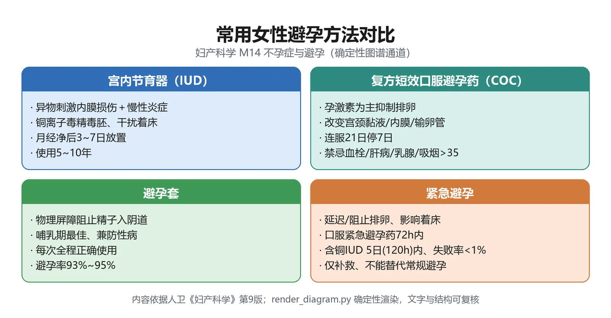


---

### 🔗 因果链（D2，每模块 ≥1 张）

```
[育龄夫妇未避孕未孕 ≥12 个月] ──★确诊不孕(育)──▶ [夫妇双方同时就诊]
      │
      ├── 男方：病史+体格检查 ──▶ 精液分析×2~3 次(首选) ──┐
      │                                                   │
      └── 女方：病史+妇科检查 ──▶ 排卵监测(2~9mm窦状卵泡)+AMH
                                    +基础激素(周期2~4日)   │
                         ──▶ 输卵管通畅检查：HSG(月经净后3~7日，首选)
                                    ──▶ 宫腔镜/腹腔镜(拟宫腔或盆腔异常)
                                                    │
                                ★病因明确 ──▶ 对因治疗：纠正盆腔器质病变 + 诱导排卵
                                                    │ 仍不孕
                                                    ▼
                                   辅助生殖：IUI(3~6周期) ──▶ IVF-ET ──▶ ICSI / PGT
```
> [!INFO] 此图展示不孕症诊疗因果链，★ 标关键转折：①达"≥12 个月未孕"时间阈值才诊断；②明确病因后对因治疗，仍不孕才升级 ART。检查窗口与数值见上方表格与笔记。

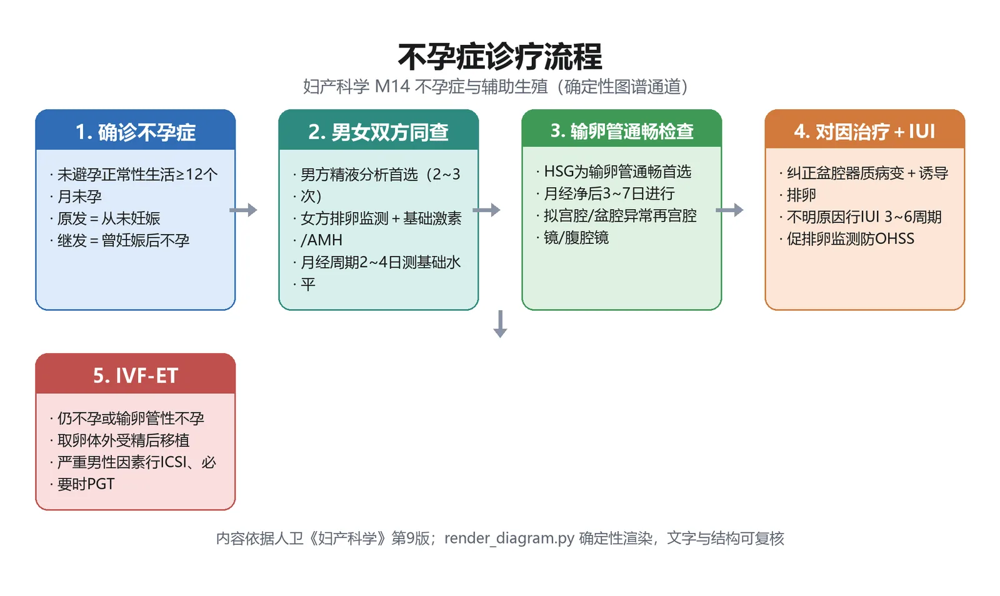


---

### 🌳 鉴别决策树（D4）

```
[非意愿妊娠要求终止]
     │
     ├─ 孕周 ≤49 日 + 无禁忌 ──▶ 药物流产（米非司酮+米索前列醇）
     │         （判断依据：宫内妊娠确诊 + 米非司酮/前列腺素均无禁忌）
     ├─ 妊娠 10 周内 + 无禁忌 ──▶ 负压吸引术（负压 400~500mmHg 可吸出）
     ├─ 妊娠 ≥10 周 ──▶ 钳刮术（先机械/药物软化宫颈，降低出血/裂伤/穿孔风险）
     └─ 异位妊娠/带器妊娠被疑及 ──▶ 停药改手术并作相应处理
               （判断依据：药物流产前必须排除异位妊娠，确认宫内妊娠）
```
> [!INFO] 此树按"孕周 + 禁忌证"选择终止方式；药物流产必须先排除异位妊娠与葡萄胎，防止漏诊误诊。

---

### ⚠️ 常见陷阱

- <b>不孕症定义</b>：未避孕 ≥12 个月；原发性（既往从未妊娠）vs 继发性（既往曾妊娠）勿混淆。盆腔因素占约 35%（输卵管病变最常见），排卵障碍占 25%～35%。
- <b>检查时序</b>：男方精液分析、女方 HSG 均为各自"首选"，且 HSG 于月经净后 3～7 日做。
- <b>避孕方法</b>：IUD 机制"异物炎症+铜离子"干扰着床；含铜 IUD 与 LNG-IUS 放置时间不同。COC 禁忌（血栓/肝病/乳腺癌/吸烟＞35/高血压），哺乳期不用含雌激素制剂。
- <b>紧急避孕与终止妊娠</b>：紧急避孕 72h 口服（左炔诺孕酮 0.75mg）、120h 内放含铜 IUD；药物流产 ≤49 日、负压吸引 ≤10 周、钳刮 ≥10 周，负压 400～500mmHg，人流后须立即落实高效避孕。

---

### 💡 记忆口诀

- <b>不孕定义</b>："一岁未孕寻病因，原发从无继发曾；排卵输卵男方精，夫妇同查莫独行。"
- <b>IUD & COC</b>："异物炎症铜毒精，着床不同步最要紧；血栓肝病乳腺癌，吸烟过三十五岁，哺乳莫把雌素配。"<b>终止妊娠孕周</b>："药流四九、吸引十周、刮宫十余。"

---

### 📌 本章小结

> [!INFO] 本章小结
> - take-home 1：不孕症 = 未避孕 ≥12 个月未孕，诊断按"男方精液→女方排卵→输卵管通畅→必要时宫腔镜/腹腔镜"递进，盆腔因素与排卵障碍为女性主因。
> - take-home 2：IUD 靠异物炎症+铜离子干扰着床，COC 靠孕激素抑制排卵；按人群选法，禁忌（血栓/肝病/乳腺/吸烟＞35）是评估重点。
> - take-home 3：避孕失败补救按孕周选法——药物流产 ≤49 日、负压吸引 ≤10 周、钳刮 ≥10 周；人工流产是补救而非避孕，术后立即落实高效避孕。
> - <b>🧬 本章核心洞察</b>：生育规划的本质是"在孕周与人群两个维度下，选择创伤最小、可逆、高效的干预"，从避孕到不孕对因治疗再到辅助生殖，都围绕"让配子在合适时间地点相遇、让内膜在合适时机着床"这一生殖节律展开。

---

### 🔗 深度链接

- 与模块13（生殖内分泌）：排卵障碍（AUB-O）是 M14 不孕症的重要病因，所用 FSH/LH/E₂/T/PRL、AMH 即 M13 的内分泌轴语言。
- 与模块11（妇科肿瘤）：年轻肿瘤女性的生育力保存（胚胎/卵子/卵巢组织冷冻）、绝经后 IUD 取出与绝育与肿瘤谱系相关；宫颈癌术后/放疗影响生育，提示肿瘤患者生殖健康规划。
- 与模块12（滋养细胞疾病）：妊娠滋养细胞疾病需血 hCG 随访；异常出血与不孕/避孕相关表现需与 M12 的 hCG 升高等情况鉴别。

---

## 模块15：妇科病史及检查

> [!INFO] 模块信息
> <b>重点等级</b>：🔴掌握 3 个 / 🟡熟悉 3 个 / 🟢了解 2 个　|　<b>关联模块</b>：模块16（盆底功能障碍——双合诊/三合诊是盆底评估的操作基础）、模块13（生殖内分泌——异常子宫出血）、模块11（妇科肿瘤——阴道流血/白带异常需除外肿瘤）　|　<b>谱系位置</b>：妇科"总论技能章"——病史采集与体格检查是所有妇科疾病模块的共用入口，处谱系最前端　|　<b>预计阅读</b>：约 15 分钟

<b>先行组织者</b>：本章解决"妇科临床怎么问、怎么查、怎么鉴别"三件事：问（病史八项，主诉≤20 字）、查（全身→腹部→妇科三法：双合诊最重要、三合诊补后盆腔、无性生活史改直肠-腹部诊）、鉴别（阴道流血、白带异常、下腹疼痛、外阴瘙痒、下腹部包块五大症状）。症状鉴别是"症状→病因方向"的思维训练，直接对接 M10 炎症、M11 肿瘤、M13 内分泌各模块。

---

### 🧩 前置知识检查

- 女性生殖道解剖：外阴→阴道→宫颈→宫体→输卵管/卵巢（附件）的相对位置——双合诊/三合诊触及结构的解剖基础（模块1）。
- 月经史简写与生育史简写（11 4/28-30、1-0-1-1 或 G2P1）——病史记录的固定格式。
- 异常子宫出血、宫颈病变、内异症等概念（模块13/11/10）——症状鉴别的落点。

---

### 🎯 高收益摘要

1. <b>病史八项与主诉规则</b>：主诉≤20 字、用症状学名称（如"白带增多 3 月"）避免病名、多症状按发生时间先后排列（教材P219-220）。
2. <b>检查基本要求</b>：排空膀胱、膀胱截石位、避免经期检查（阴道异常流血者必须查）；<b>无性生活史禁做阴道窥器及双合诊，改行直肠-腹部诊</b>（教材P220-221）。
3. <b>双合诊=妇科检查中最重要的项目</b>：查阴道/宫颈/宫体（位置、大小、软硬、活动度、压痛）与附件（正常卵巢偶可触及、正常输卵管不能触及）；三合诊是双合诊不足时的重要补充（教材P221-223）。
4. <b>阴道流血按年龄分层</b>：幼女→性早熟/恶性肿瘤、生育期→妊娠相关、围绝经期→先排除恶性肿瘤、绝经后→先排除子宫内膜癌（教材P224-225）。

---

### 📋 结构化笔记

🔴 【掌握级】病史采集方法与病史八项（教材P219-220）
💡 为什么重要：主诉书写规则与简写格式是 A1 送分题，也是病例题病史描述的源头。

🧬 第一性原理：
  病史采集要"以患者为中心、启发式提问、避免暗示性提问"——女性生殖系统症状常涉及隐私，患者叙述可能主次不分，医生要用开放性问题引导并按时间线整理。病史八项：<b>一般项目</b>（姓名年龄籍贯等）、<b>主诉</b>（患者就诊最主要的原因及持续时间，≤20 字，用<b>症状学名称</b>而非病名，多症状按发生时间先后排列）、<b>现病史</b>（症状的发生发展、诱因、伴随症状、诊疗经过，围绕主诉展开）、<b>月经史</b>（初潮年龄、周期、经期，简写如"11 4/28-30"=11 岁初潮、经期 4 天、周期 28-30 天，并记录末次月经 LMP 与前次月经 PMP）、<b>婚育史</b>（婚次与结婚年龄；生育史用 4 个阿拉伯数字表示足月产-早产-流产-现存子女数，如"1-0-1-1"，或 G2P1 表示孕 2 产 1）、<b>既往史</b>（内科/外科疾病、传染病、过敏史、手术史，<b>含 HPV 疫苗接种史</b>）、<b>个人史</b>（生活工作环境、烟酒嗜好）、<b>家族史</b>（家族性肿瘤如乳腺癌/卵巢癌、遗传病）。
  一句话：问得全、记有序——主诉症状化不报病名、月经生育有固定简写、HPV 接种归入既往史。

机制要点：启发式提问、避免暗示；主诉≤20 字症状学名称、多症状按时间排序；月经史简写"初潮 经期/周期"；婚育史"1-0-1-1"或 G2P1；既往史含 HPV 疫苗接种史（教材P219-220）。

> [!TIP] 应试锚点
> "主诉≤20 字""避免病名""按发生时间先后排列"是三个独立的 A1 判断点；生育史"1-0-1-1"顺序为足月产-早产-流产-现存子女，不可调换。

---

🔴 【掌握级】体格检查顺序与基本要求（教材P220-221）
💡 为什么重要：基本要求的"禁忌/替代"是 A1 常考点（无性生活史怎么办、经期能查吗）。

🧬 第一性原理：
  妇科检查顺序：<b>全身检查 → 腹部检查 → 妇科检查</b>（盆腔检查）。基本要求：① 检查前<b>排空膀胱</b>（充盈膀胱影响子宫附件触诊并易误判为包块）；② 取<b>膀胱截石位</b>（臀置检查台缘、双腿分开）；③ <b>避免经期检查</b>，但<b>阴道异常流血者必须检查</b>（为明确出血来源，防延误）；④ <b>无性生活史者禁做阴道窥器及双合诊</b>，改行<b>直肠-腹部诊</b>；阴道闭锁亦同；⑤ 未婚/幼女需家属或护士陪同，动作轻柔、一人一巾防交叉感染。
  一句话：排空膀胱、截石位、异常流血必查、无性生活史走直肠——四条铁律各是一个考点。

机制要点：全身检查→腹部检查→妇科检查顺序；排空膀胱；膀胱截石位；避免经期检查（阴道异常流血必须查）；无性生活史禁窥器及双合诊改直肠-腹部诊（教材P220-221）。

> [!WARNING] 易错陷阱
> "经期不查"≠"流血不查"：<b>阴道异常流血</b>恰恰需要及时检查明确来源；无性生活史是<b>绝对禁忌</b>，改直肠-腹部诊是替代方案，不是"小心一点照做"。

---

🔴 【掌握级】妇科检查方法：外阴/窥器/双合诊/三合诊/直肠-腹部诊（教材P221-223）
💡 为什么重要：双合诊"最重要"、正常输卵管"不能触及"、三合诊适用场景——B1/A1 高频。

🧬 第一性原理：
  检查分五步。① <b>外阴部检查</b>：观察发育、阴毛分布、大小阴唇，<b>嘱患者屏气</b>观察有无阴道前后壁膨出/子宫脱垂/尿失禁（承接模块16 盆底评估）。② <b>阴道窥器检查</b>：斜 45° 缓慢放入（避免损伤），视诊阴道（黏膜颜色、皱襞、出血）与宫颈（大小、色泽、外口形状、糜烂样外观、赘生物）；<b>行宫颈脱落细胞学检查与 HPV 检测时不使用润滑剂（改用生理盐水润滑）</b>，防止污染标本。③ <b>双合诊</b>：一手两指置阴道、另一手在腹部配合，<b>是妇科检查中最重要的项目</b>——查阴道（有无畸形/瘢痕/肿块）、宫颈（大小、方向、质地、有无举痛）、宫体（位置、大小、形状、软硬、活动度、压痛）、附件（有无增厚/包块/压痛；<b>正常卵巢偶可触及、正常输卵管不能触及</b>）。④ <b>三合诊</b>：一手食指入阴道、中指入直肠、一手按腹——是双合诊不足时的<b>重要补充</b>，用于查<b>后倾后屈子宫、子宫后壁、宫颈旁、直肠子宫陷凹、子宫骶韧带及盆壁</b>；对<b>肿瘤、结核、子宫内膜异位症、炎症</b>的评估尤显重要。⑤ <b>直肠-腹部诊</b>：食指入直肠+另一手按腹——用于<b>无性生活史、阴道闭锁或不宜行双合诊</b>者。记录按解剖部位先后顺序（外阴→阴道→宫颈→宫体→附件）。
  一句话：双合诊最重要、正常输卵管摸不到；三合诊专查后盆腔（陷凹/骶韧带/盆壁）；无性生活史走直肠-腹部诊。

机制要点：外阴检查含屏气观察脱垂/尿失禁；窥器检查宫颈涂片/HPV 不用润滑剂用生理盐水；双合诊=最重要（宫体五维+附件，正常卵巢偶可触及、输卵管不可触及）；三合诊=后倾后屈子宫/陷凹/骶韧带/盆壁，肿瘤/结核/内异症/炎症尤重要；直肠-腹部诊=无性生活史/阴道闭锁；记录按解剖顺序（教材P221-223）。

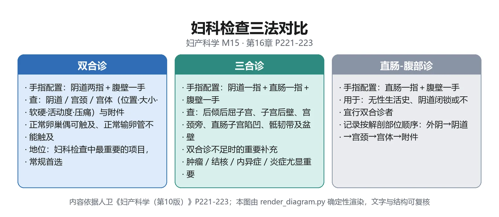

#### 🔬 展开：举痛/摆痛与宫颈口形态的读法
- 宫颈举痛（双合诊推动宫颈时疼痛）提示盆腔炎/内异症等盆腔病变；子宫位置分前倾/后倾与前屈/后屈——三合诊对后倾后屈子宫的触诊更准确（双合诊可能触不到后屈宫底）。
- 宫颈外口形态：未产妇圆形、经产妇横裂状；宫颈口可见红色质硬肿块时要警惕子宫黏膜下肌瘤脱出（与模块11 衔接）。

> [!NOTE] 一遍记忆
> 双合诊＝"查正面"（子宫+附件），三合诊＝"查背面"（后盆腔与骶韧带）——"三合诊是双合诊的补充"指的就是这个方位关系。

---

🟡 【熟悉级】阴道流血（教材P224-225）
💡 为什么重要：A2 病例题最常用主诉，年龄-病因对应关系是分线核心。

🧬 第一性原理：
  阴道流血=源自生殖道的出血，病因七类：<b>妊娠相关</b>（流产/异位妊娠/葡萄胎）、<b>炎症</b>（阴道炎/宫颈炎/内膜炎）、<b>良性病变</b>（肌瘤/息肉/腺肌病）、<b>肿瘤</b>（宫颈癌/内膜癌/肉瘤/滋养细胞肿瘤）、<b>损伤/异物/外源性性激素</b>、<b>全身疾病</b>（血液病/肝病）、<b>卵巢内分泌功能失调</b>（AUB）。表现 11 种形式：经量增多&gt;80ml（肌瘤/腺肌病/AUB）、周期不规则、长期持续出血、停经后流血（妊娠/葡萄胎）、伴白带增多（宫颈病变）、接触性出血（宫颈癌/宫颈炎）、经间出血（<b>排卵期出血：下次月经前 14-15 日</b>）、经前经后点滴出血（黄体功能/内膜炎）、绝经后流血（恶性为主）、间歇性排血性液体（<b>输卵管癌</b>）、外伤后出血。<b>年龄分层是鉴别第一刀</b>：新生女婴（母亲激素撤退）、<b>幼女→性早熟或恶性肿瘤</b>、青春期→无排卵性 AUB、<b>生育期→妊娠相关优先</b>、围绝经期→先排除恶性肿瘤、<b>绝经后→先排除子宫内膜癌</b>。
  一句话：先分年龄再分形式——生育期想妊娠、围绝经/绝后想恶性、经间出血想排卵期。

机制要点：原因 7 类（妊娠/炎症/良性/肿瘤/损伤异物激素/全身/卵巢内分泌失调）；形式 11 种（经间出血=排卵期出血，下次月经前 14-15 日；间歇性排血性液体=输卵管癌）；年龄轴：幼女→性早熟/恶性肿瘤、生育期→妊娠相关、围绝经期→先排除恶性肿瘤、绝经后→先排除子宫内膜癌（教材P224-225）。

#### 🔬 展开：经量增多的量化界值
月经量&gt;80ml 定义为月经过多（AUB-O/肌瘤/腺肌病）；贫血评估（Hb 下降）是临床判断"量是否过多"的实用替代指标——问诊问不到精确 ml 数时看贫血。

> [!WARNING] 易错陷阱
> ① 绝经后流血<b>先排除子宫内膜癌</b>而非先想萎缩性阴道炎；② 生育期阴道流血<b>先想妊娠相关</b>（含异位妊娠）再做其他鉴别；③ 经间出血的正确定位是"下次月经前 14-15 日"，不是月经开始后第 14 天。

---

🟡 【熟悉级】白带异常（教材P225-226）
💡 为什么重要：白带性状-病原体对应关系是 A1 高频，直接对接 M10 阴道炎。

🧬 第一性原理：
  正常白带=白色稀糊状或蛋清样、量少无味。病理性白带按性状定性：<b>透明黏性</b>（量多、清亮）→宫颈病变（慢性宫颈炎/腺上皮增生）；<b>灰黄/黄白泡沫状</b>→滴虫阴道炎（伴外阴瘙痒、阴道灼痛）；<b>凝乳块状/豆腐渣样</b>→外阴阴道假丝酵母菌病（瘙痒剧烈）；<b>灰白色匀质、鱼腥味</b>→细菌性阴道病（胺试验阳性，线索细胞）；<b>脓性黄绿色</b>→淋菌/急性宫颈炎；<b>血性</b>→宫颈癌/子宫内膜癌/宫颈息肉；<b>水样、奇臭</b>→晚期宫颈癌/输卵管癌。
  一句话：泡状滴虫、块状念珠菌、腥鱼细菌病、脓性淋菌、血水恶癌。

机制要点：透明黏性→宫颈病变；灰黄泡沫状→滴虫；凝乳块状→假丝酵母菌；灰白匀质鱼腥→细菌性阴道病；脓性→淋菌/急性宫颈炎；血性→宫颈癌/内膜癌/息肉；水样奇臭→晚期宫颈癌/输卵管癌（教材P225-226）。

> [!NOTE] 一遍记忆
> 「泡、块、腥、脓、血、水」六相各配一病原/疾病——滴虫泡、念珠块、细菌腥、淋菌脓、癌变血、晚期水。

---

🟡 【熟悉级】下腹疼痛（教材P226-227）
💡 为什么重要：腹痛定位-性质-时间-放射-伴随的组合分析是 A2 病例题骨架。

🧬 第一性原理：
  按六维分析：① <b>起病缓急</b>（突然剧痛=破裂/扭转/宫外孕；渐进加重=炎症）；② <b>部位</b>（下腹正中=子宫；一侧=附件；双侧=盆腔炎；全腹=破裂/腹膜炎）；③ <b>性质</b>（钝痛=炎症；绞痛=空腔器官痉挛；撕裂样=破裂；坠痛=积血/积脓）；④ <b>时间</b>（排卵期一过性=排卵痛；周期性伴月经=痛经；无月经但周期腹痛=经血排出受阻）；⑤ <b>放射</b>（肩部=腹腔内出血刺激膈肌；腰骶部=宫颈/子宫；腹股沟大腿内侧=附件）；⑥ <b>伴随症状</b>（停经=妊娠相关；恶心呕吐=蒂扭转/急性炎症；畏寒发热=盆腔炎；休克=腹腔内出血；肛门坠胀=直肠子宫陷凹积液/积血）。
  一句话：正子宫、侧附件、双盆炎、全腹破裂；肩放射出血、腰骶宫颈、大腿内侧附件。

机制要点：六维分析=起病缓急/部位（正中=子宫、一侧=附件、双侧=盆腔炎、全腹=破裂）/性质（钝炎、绞空腔、撕裂破裂、坠积血脓）/时间（排卵痛、痛经、经血受阻）/放射（肩=腹腔内出血、腰骶=宫颈子宫、腹股沟大腿内侧=附件）/伴随（停经、恶心呕吐=蒂扭转、发热=盆腔炎、休克=出血、肛门坠胀=陷凹积液）（教材P226-227）。

---

🟢 【了解级】外阴瘙痒与下腹部包块（教材P227-228）
💡 为什么重要：包块"囊性多良性、固定实性多恶性"与子宫增大六因是 B1/A2 考点。

🧬 第一性原理：
  <b>外阴瘙痒</b>：局部原因最常见（假丝酵母菌、滴虫、细菌性阴道病、萎缩性阴道炎、阴虱疥疮蛲虫、外阴色素减退性疾病）；全身原因（糖尿病、黄疸、维生素A/B缺乏、重度贫血、白血病、妊娠期肝内胆汁淤积症）；夜间加重（蛲虫/疥疮），外阴硬化性苔藓呈"奇痒"。<b>下腹部包块</b>：先判性质——<b>囊性多为良性</b>（卵巢囊肿等，含充盈膀胱）、<b>实性</b>（妊娠子宫、肌瘤、卵巢纤维瘤、炎性包块属良性；<b>其他实性包块首先考虑恶性</b>）。子宫增大六因：妊娠、子宫肌瘤（月经过多）、子宫腺肌病（≤3 个月妊娠大、质硬、进行性痛经）、子宫内膜癌（老年）、子宫肉瘤（增大迅速）、滋养细胞肿瘤；另有子宫畸形、宫腔积血/积脓。附件包块五类：输卵管妊娠（停经史+触痛）、炎性包块（双侧粘连压痛）、卵巢子宫内膜异位囊肿（粘连活动受限+继发性痛经）、非赘生性囊肿（单侧可活动、&lt;8cm，黄体囊肿）、赘生性包块（表面光滑囊性可活动者多良性；<b>固定、实性、不规则多恶性</b>）。
  一句话：囊性良性多、实性先想恶性；子宫六因、附件五类，固定实性不规则=恶性信号。

机制要点：外阴瘙痒=局部（假丝酵母菌/滴虫最常见）+全身（糖尿病/黄疸/缺维A/B/重度贫血/妊娠胆汁淤积）；包块性质=囊性多良性、实性多恶性（妊娠子宫/肌瘤/纤维瘤/炎性包块除外）；子宫增大 6 类、附件包块 5 类（教材P227-228）。

---

### 📊 对比速查

<b>妇科检查三法</b>

| 方法 | 手指配置 | 主要查见 | 适用/地位 |
|------|------|------|------|
| 双合诊 | 阴道两指+腹 | 子宫位置大小软硬活动度压痛；附件（正常卵巢偶可触及、输卵管不可触及） | <b>最重要</b>项目，常规首选 |
| 三合诊 | 阴道一指+直肠一指+腹 | 后倾后屈子宫、子宫后壁、陷凹、骶韧带、盆壁 | 双合诊不足的重要补充；肿瘤/结核/内异症/炎症尤重要 |
| 直肠-腹部诊 | 直肠一指+腹 | 同上（经直肠触诊） | 无性生活史、阴道闭锁、不宜双合诊者 |

<b>病理性白带七型</b>

| 性状 | 指向 |
|------|------|
| 透明黏性 | 宫颈病变 |
| 灰黄泡沫状 | 滴虫阴道炎 |
| 凝乳块/豆腐渣 | 假丝酵母菌病 |
| 灰白匀质鱼腥味 | 细菌性阴道病 |
| 脓性黄绿 | 淋菌/急性宫颈炎 |
| 血性 | 宫颈癌/内膜癌/息肉 |
| 水样奇臭 | 晚期宫颈癌/输卵管癌 |

<b>阴道流血年龄轴</b>

| 年龄段 | 首先考虑 |
|------|------|
| 幼女 | 性早熟、恶性肿瘤 |
| 青春期 | 无排卵性异常子宫出血 |
| 生育期 | 妊娠相关（流产/异位/葡萄胎） |
| 围绝经期 | 先排除恶性肿瘤 |
| 绝经后 | 先排除子宫内膜癌 |

---

### 🔗 因果链

<b>妇科检查路径决策链</b>

```
妇科就诊（症状/体检）
     │
     ├─ 病史八项（主诉≤20字 → 现病史 → 月经/婚育/既往/个人/家族史）
     │
     ├─ 全身检查 → 腹部检查 → 妇科检查（排空膀胱、膀胱截石位）
     │        │
     │        ├─ 有性生活史 → 外阴（屏气观察脱垂/尿失禁）→ 窥器（宫颈细胞学+HPV，生理盐水润滑）
     │        │                  └→ 双合诊（最重要：子宫+附件）
     │        │                       └→ 需查后盆腔（陷凹/骶韧带/盆壁）→ 三合诊
     │        └─ 无性生活史/阴道闭锁 → 禁窥器+双合诊 → 直肠-腹部诊
     │
     └─ 症状鉴别：阴道流血/白带异常/下腹疼痛/外阴瘙痒/下腹部包块
              │
              ├─ 阴道流血 → 按年龄分层 → 生育期先妊娠、围绝经/绝后先恶性
              └─ 包块 → 囊性多良性、实性先恶性 → 定位子宫/附件/盆外
```

> [!INFO] 此图展示"问（病史）→查（三法决策）→鉴（症状分层）"的妇科临床入口链：无性生活史走直肠-腹部诊是最易考的分支；阴道流血年龄轴与包块性质判断是症状鉴别两条主线。检查三法的详细差异回看「📊 对比速查」。

---

### 🌳 鉴别决策树

<b>阴道流血：按年龄分层</b>

```
阴道流血
├─ 幼女 → 性早熟 / 恶性肿瘤（需家长陪同排查）
├─ 青春期 → 无排卵性异常子宫出血（排除血液病/妊娠）
├─ 生育期 → 妊娠相关（血/尿 hCG 筛查）
│   ├─ 阳性 → 流产 / 异位妊娠 / 葡萄胎（结合超声与动态 hCG）
│   └─ 阴性 → 按形式定位：经间出血=排卵期；接触性出血=宫颈病变；经量增多=肌瘤/腺肌病/AUB
├─ 围绝经期 → 先排除恶性肿瘤（分段诊刮/内膜活检）
└─ 绝经后 → 先排除子宫内膜癌 → 再考虑萎缩性阴道炎/息肉/药物
```

> [!NOTE] 决策要点
> 年龄是阴道流血的第一分线器；生育期务必先查妊娠（血 hCG），围绝经期与绝经后"先排除恶性"是防漏诊铁律。

---

### ⚠️ 常见陷阱

1. "经期不查"误读为"流血不查"：阴道异常流血必须检查以明确来源。
2. 无性生活史者做双合诊/窥器=绝对禁忌，改直肠-腹部诊。
3. 双合诊"正常输卵管不能触及"——摸到"输卵管"多为增粗/病变，属异常。
4. 绝经后流血先想子宫内膜癌，生育期流血先想妊娠相关——顺序颠倒即错。
5. 经间出血是"下次月经前 14-15 日"的排卵期出血，不是经后出血。
6. 宫颈细胞学/HPV 采样忌用润滑剂（污染标本），改用生理盐水。

---

### 💡 记忆口诀

1. <b>主诉</b>：「20 字、症状名、按时间」——避免病名与主观判断。
2. <b>病史八项</b>：「一般主诉现病史，月经婚育既往个家」。
3. <b>检查三法</b>：「双查宫附件、三查盆腔后、无性生活走直肠腹」。
4. <b>白带七相</b>：「泡滴、块念珠、腥鱼细菌、脓淋、血癌、水恶」。
5. <b>流血年龄轴</b>：「幼女瘤、青春功血、生育妊、围绝先排癌、绝后内膜癌」。
6. <b>包块性质</b>：「囊性良性多、实性先想恶性；固定实性不规则=恶性」。

---

### 📌 本章小结

> [!INFO] 本章小结
> - take-home 1：病史八项是妇科临床的入口——主诉症状化（≤20 字）、月经/生育史固定简写、HPV 接种入既往史。
> - take-home 2：检查路径=全身→腹部→妇科；双合诊最重要（正常输卵管不可触及）、三合诊补后盆腔、无性生活史改直肠-腹部诊；异常流血必须查。
> - take-home 3：五大症状鉴别的共同思维是"先分层后定位"——阴道流血按年龄、白带按性状、腹痛按六维、包块按囊实性与部位。
> - <b>🧬 本章核心洞察</b>：妇科病史及检查是"症状学→疾病模块"的翻译层——把 M10-M16 各病的表现统一收进问/查/鉴的框架，先问清、查准、鉴别对，才不会在后续疾病模块中漏诊。

---

### 🔗 深度链接

- 阴道流血/白带异常/腹痛的具体病种 → 模块10（妇科炎症与内异症）、模块11（子宫颈肿瘤与子宫体肿瘤）、模块13（生殖内分泌疾病）。
- 外阴屏气观察脱垂/尿失禁、双合诊/三合诊操作基础 → 模块16（盆底功能障碍性疾病与盆腔器官脱垂）。
- 宫颈细胞学+HPV 采样 → 模块11（宫颈癌筛查）。
- 妊娠相关出血 → 模块7（妊娠并发症：自然流产、异位妊娠）。

---

## 模块16：盆底功能障碍性疾病与盆腔器官脱垂（含压力性尿失禁与生殖道瘘）

> [!INFO] 模块信息
> <b>重点等级</b>：🔴掌握 4 个 / 🟡熟悉 3 个 / 🟢了解 1 个　|　<b>关联模块</b>：模块1（女性生殖系统解剖——骨盆底三层结构）、模块15（妇科病史及检查——检查三法/屏气观察）、模块2-7（妊娠分娩——产伤是最重要病因）　|　<b>谱系位置</b>：妇科"结构轴"——盆底支持系统薄弱→盆腔器官脱垂、压力性尿失禁、生殖道瘘三组后果，接在妇科技能层 M15 之后　|　<b>预计阅读</b>：约 20 分钟

<b>先行组织者</b>：盆底功能障碍（PFD）=盆底支持组织（肌肉-筋膜-韧带-神经）薄弱导致的疾病群。本章三大块：<b>盆腔器官脱垂（POP）</b>——定义/分型/分度（POP-Q）/治疗（子宫托一线）；<b>压力性尿失禁（SUI）</b>——压力传导理论 + 三试验 + 吊带一线；<b>生殖道瘘</b>——尿瘘（亚甲蓝/靛胭脂）与粪瘘（直肠阴道瘘）。"什么掉出来"（脱垂）、"什么漏出来"（尿失禁）、"什么串通了"（瘘）是三条记忆主线。

---

### 🧩 前置知识检查

- 骨盆底三层结构与支持组织（模块1）：盆膈、尿生殖膈、会阴体——脱垂的解剖基础。
- 双合诊/三合诊与屏气观察（模块15）：POP 分度与 SUI 评估的操作基础。
- 分娩损伤（模块2-7）：产钳/胎吸、难产——POP 最重要的病因来源。

---

### 🎯 高收益摘要

1. <b>POP 定义</b>：任何阴道节段前缘达到或超过处女膜缘外 1cm（NIH 2001）；子宫脱垂=宫颈外口达坐骨棘水平以下（教材P286）。
2. <b>分度两套</b>：传统 3 度（宫颈外口距处女膜缘 &lt;4cm 未达缘=Ⅰ度轻……全部脱出=Ⅲ度）+ 国际 POP-Q（Aa/Ba/C/D/Ap/Bp 六点 + gh/pb/TVL，0-Ⅳ 度）（教材P287-289）。
3. <b>治疗原则</b>：无症状不需治疗；<b>子宫托=一线治疗、所有脱垂首先推荐</b>；超出处女膜的有症状者手术（LeFort 仅年老体弱；重建术按Ⅰ/Ⅱ水平选择）；FDA 已禁用经阴道网片（教材P289-290）。
4. <b>SUI</b>：腹压突然增加致不自主漏尿（非逼尿肌收缩）；解剖型 &gt;90%（压力传导理论）；无张力尿道中段吊带=一线微创（教材P290-292）。

---

### 📋 结构化笔记

🔴 【掌握级】POP 定义与分型（教材P286）
💡 为什么重要：定义与六种分型的术语对应是 A1/B1 基础分。

🧬 第一性原理：
  POP=盆腔器官脱出于阴道内或阴道外。<b>NIH 2001 定义：任何阴道节段前缘达到或超过处女膜缘外 1cm</b>——用"处女膜缘"这个可复现的解剖标志做客观分界。分型按脱出器官：<b>阴道前壁膨出</b>（膀胱膨出=前壁上 2/3；尿道膨出=前壁下 1/3）、<b>阴道后壁膨出</b>（直肠膨出；直肠子宫陷凹疝=肠疝，疝内容物为小肠）、<b>子宫脱垂</b>（宫颈外口达坐骨棘水平以下——坐骨棘是盆腔内最重要的骨性标志）、<b>阴道穹隆脱垂</b>（子宫切除术后顶端支持缺失）。
  一句话：前壁两膨（膀胱/尿道）、后壁两膨（直肠/肠疝）、宫颈坐骨棘以下=子宫脱垂、切除术后=穹隆脱垂。

机制要点：POP 定义=任何阴道节段前缘达/超处女膜缘外 1cm（NIH 2001）；分型=膀胱膨出（前壁上 2/3）/尿道膨出（下 1/3）/直肠膨出/肠疝/子宫脱垂（宫颈外口达坐骨棘水平以下）/阴道穹隆脱垂（教材P286）。

> [!TIP] 应试锚点
> "坐骨棘水平"是子宫脱垂的客观诊断线；"处女膜缘外 1cm"是 POP 的通用定义线——两线各是一个数值型题眼。

---

🔴 【掌握级】POP 病因与临床表现（教材P286-287）
💡 为什么重要：病因排序与"前壁→排尿症状、后壁→便秘"的症状对应是 A2 高频。

🧬 第一性原理：
  病因四类：① <b>妊娠分娩</b>（最重要：产钳/胎吸等困难阴道分娩致盆底肌肉筋膜撕裂；产后过早重体力劳动）；② <b>衰老</b>（绝经后雌激素↓→组织萎缩、支持力下降）；③ <b>腹压增加</b>（慢性咳嗽、腹腔积液、腹型肥胖、持续负重、便秘）；④ <b>医源性</b>（手术致顶端支持缺失）。临床表现分层：<b>轻症无症状</b>；重度出现腰骶部酸痛、下坠感（站立劳累后明显）；<b>前壁膨出</b>→尿频、排尿困难、残余尿增加——部分患者伴 SUI，膨出加重后 SUI 可消失（尿道受压扭曲）甚至需手助压迫排尿，易并发尿路感染；<b>后壁膨出</b>→便秘，需手助压迫阴道排便；脱出物不能回纳→黏膜溃疡、出血、感染。<b>子宫脱垂不影响月经，轻度不影响受孕</b>。体征：阴道壁/宫颈脱出阴道口外、黏膜增厚角化溃疡；肠疝于后穹隆见球形突出、直肠指检可触及疝囊内小肠；年轻患者可见宫颈延长肥大。
  一句话：产伤居首、绝经腹压医源跟上；前壁尿、后壁粪、脱出溃疡、月经受孕无碍。

机制要点：病因=妊娠分娩（产钳/胎吸、产后过早重体力劳动）/衰老（绝经萎缩）/腹压增加（慢性咳嗽/便秘/肥胖）/医源性；症状=轻症无症状、腰骶酸痛下坠、前壁膨出→尿频排尿困难残余尿（SUI 加重后可消失、手助排尿）、后壁→便秘、脱出溃疡出血感染；子宫脱垂不影响月经和轻度受孕（教材P286-287）。

> [!WARNING] 易错陷阱
> 前壁膨出患者的 SUI 可随脱垂加重而"消失"（尿道被压迫扭曲）——不能因"现在不漏尿"就排除 SUI，还纳后再评估。

---

🔴 【掌握级】POP 分度：传统 3 度与 POP-Q（教材P287-289）
💡 为什么重要：POP-Q 六点+三径与 0-Ⅳ 度界值是本章最易出数值题的考点。

🧬 第一性原理：
  <b>中国传统分度（3 度）</b>（教材表24-1 前）：子宫脱垂Ⅰ度轻=宫颈外口距处女膜缘 &lt;4cm、未达缘；Ⅰ度重=已达处女膜缘；Ⅱ度轻=宫颈脱出阴道口、宫体仍在阴道内；Ⅱ度重=部分宫体脱出；Ⅲ度=宫颈及宫体全部脱出阴道口外。阴道前壁/后壁膨出各分 3 度。 <b>国际 POP-Q 分度</b>（Bump 提出，表24-1/24-2）：六个指示点——前壁 Aa（处女膜缘上 3cm）/Ba（前壁脱出最远处）、后壁 Ap（处女膜缘上 3cm）/Bp（后壁脱出最远处）、子宫颈 C、后穹隆 D；三个测量——生殖道裂孔 gh、会阴体 pb、阴道总长 TVL；以 <b>Valsalva 屏气最重程度</b>计；负数=处女膜缘上方，正数=下方。0-Ⅳ 度界值：<b>0 度</b> C/D≤-(TVL-2)cm；<b>Ⅰ度</b> 最远点&gt;-1cm（处女膜缘内 1cm 以上）；<b>Ⅱ度</b> -1～+1cm（达缘或缘外 1cm 内）；<b>Ⅲ度</b> &gt;+1cm 但 &lt;(TVL-2)；<b>Ⅳ度</b> ≥(TVL-2)（阴道几乎完全外翻）。诊断流程：病史+屏气分度+压力试验（膀胱充盈咳嗽观察 SUI）+宫颈细胞学（排除宫颈病变）+还纳后双合诊（查宫体/附件）+肛提肌肌力及生殖裂隙宽度评估。
  一句话：传统数"出到哪"，POP-Q 量"六点三径"，0 度≤TVL-2、Ⅳ度≥TVL-2——屏气最重程度计分。

机制要点：传统 3 度（宫颈外口距缘 &lt;4cm=Ⅰ轻、达缘=Ⅰ重、出阴道口=Ⅱ轻、部分宫体出=Ⅱ重、全出=Ⅲ度；前/后壁各 3 度）；POP-Q=六点（Aa/Ba/C/D/Ap/Bp）+三径（gh/pb/TVL），Valsalva 最重计，0 度 C/D≤-(TVL-2)、Ⅰ度&gt;-1cm、Ⅱ度-1～+1cm、Ⅲ度&gt;+1cm 且 &lt;(TVL-2)、Ⅳ度≥(TVL-2)（教材P287-289）。

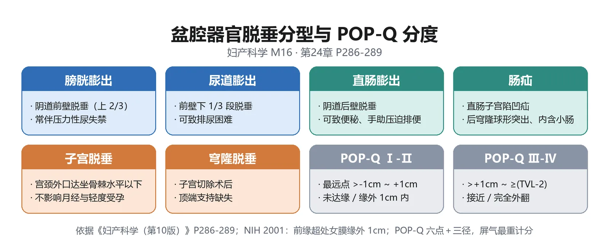

#### 🔬 展开：POP-Q 六个指示点的读法
Aa 与 Ap 是<b>固定参考点</b>（处女膜缘上 3cm，正常情况下处原位）；Ba/Bp 是<b>最远脱出点</b>；C=宫颈最远端、D=后穹隆顶端（子宫切除术后 D 缺如）。正负号表示相对处女膜缘的上下——"0"即处女膜缘水平；Ⅱ度核心界值 -1～+1cm 是最常考的数值段。

> [!NOTE] 一遍记忆
> 六点记"Aa/Ba 前、Ap/Bp 后、C 宫颈、D 后穹隆"；界值记两头：0 度 ≤-(TVL-2)、Ⅳ度 ≥(TVL-2)，中间 Ⅰ-Ⅲ 以 -1cm/+1cm 两刀切。

---

🟡 【熟悉级】POP 诊断与鉴别诊断（教材P289）
💡 为什么重要：鉴别三病（阴道壁肿物/宫颈延长/黏膜下肌瘤）是 B1/A2 考点。

🧬 第一性原理：
  诊断依靠病史+系统检查（屏气分度+压力试验+宫颈细胞学+还纳后双合诊+肛提肌肌力）。<b>鉴别诊断</b>三件：① <b>阴道壁肿物</b>（边界清楚、与脱垂无关，可推动或固定）；② <b>子宫颈延长</b>（双合诊宫体仍在盆内、屏气时不随之下移，仅宫颈长）；③ <b>子宫黏膜下肌瘤</b>（月经过多、宫颈口可见红色质硬肿块、找不到正常宫颈口，肌瘤蒂部上连宫腔）。
  一句话：脱垂"整个掉下来"，宫颈延长"宫颈长宫体不下"、黏膜下肌瘤"宫颈口被红块占位"。

机制要点：诊断=屏气分度+压力试验+宫颈细胞学+还纳后双合诊+肛提肌肌力；鉴别=阴道壁肿物/宫颈延长（宫体不下移）/子宫黏膜下肌瘤（月经过多、宫颈口见肿块）（教材P289）。

---

🔴 【掌握级】POP 治疗（教材P289-290）
💡 为什么重要：子宫托"一线首选"、手术适应证与 LeFort 适用人群、FDA 禁用网片——A1/A2 集中区。

🧬 第一性原理：
  <b>非手术治疗</b>：适用于 POP-Q Ⅰ-Ⅱ 度有症状者、重度但不愿手术者。<b>子宫托=一线治疗，是所有脱垂患者首先推荐的方法</b>（可自行取出清洗、夜间取出）；盆底康复（Kegel 训练：收缩肛门 3 秒以上放松、每次 10-15 分钟、每日 2-3 次）；生物反馈/电刺激；行为指导（避免提重物、治疗慢性咳嗽便秘）；中医中药针灸。<b>手术治疗</b>：适用于超出处女膜的有症状者。<b>封闭手术</b>（阴道半封闭 LeFort/全封闭）——牺牲性交功能，<b>仅用于年老体弱不能耐受大手术者</b>；<b>重建手术</b>：骶棘韧带固定/宫骶韧带悬吊（Ⅰ水平顶端支持）、阴道前后壁修补（Ⅱ水平）、曼彻斯特手术（年轻宫颈延长者）、经腹或腹腔镜子宫阴道骶骨固定术（Ⅰ水平）；<b>经阴道网片植入 FDA 已禁用</b>（网片侵蚀/疼痛等并发症）。合并 SUI 者同时行膀胱颈悬吊或无张力尿道中段吊带术。术后 3 个月内避免腹压增加及负重、禁性生活 3 个月、终身随访。
  一句话：无症状不治、子宫托一线先推荐、出处女膜再手术、LeFort 给年老体弱、网片被 FDA 禁。

机制要点：非手术=子宫托（一线、所有脱垂首先推荐）+Kegel（3 秒/10-15 分钟/每日 2-3 次）+行为指导；手术=超出处女膜有症状者：封闭（LeFort 仅年老体弱）、重建（骶棘韧带/宫骶韧带悬吊、阴道前后壁修补、Manchester 年轻宫颈延长、骶骨固定）、经阴道网片 FDA 禁用；合并 SUI 同时吊带；术后 3 月免腹压、禁性生活 3 月、终身随访（教材P289-290）。

> [!WARNING] 易错陷阱
> ① LeFort 封闭术后失去性交功能，<b>仅</b>用于年老体弱——年轻患者选重建；② 经阴道网片植入已由 FDA 禁用，不能作为常规术式；③ 子宫托是一线"首先推荐"，不是说所有患者都用托、不手术——超出处女膜且有症状者仍需手术评估。

#### 🔬 展开：重建手术的水平对应
- 顶端支持（Ⅰ水平）＝宫骶韧带悬吊 / 骶棘韧带固定 / 经腹或腹腔镜骶骨固定术；前-后壁修补（Ⅱ水平）＝阴道前后壁修补、阴道旁修补；会阴体与远端支持（Ⅲ水平）＝会阴修补术。
- 曼彻斯特手术＝宫颈部分切除+主韧带缩短+阴道前壁修补，适合年轻、宫颈延长的子宫脱垂患者；术前须宫颈细胞学排除癌变。

---

🟡 【熟悉级】压力性尿失禁（SUI）：定义、机制与分度（教材P290-291）
💡 为什么重要："压力传导理论"机制题与 18.9%/90% 数值题。

🧬 第一性原理：
  SUI=<b>腹压突然增加导致尿液不自主流出，非逼尿肌收缩所致</b>；我国成年女性发生率约 18.9%。分两型：<b>解剖型（&gt;90%）</b>——盆底松弛致膀胱颈/近端尿道脱出盆底外，依据<b>压力传导理论</b>：正常情况下咳嗽时腹压同时作用于膀胱与近端尿道（等压传递）；盆底支持缺损后膀胱颈下移，腹压不能平均传递到尿道，<b>膀胱内压&gt;尿道内压</b>→漏尿；<b>尿道内括约肌障碍型（&lt;10%）</b>。约 80% 患者伴阴道前壁膨出。主观分度：Ⅰ度（仅在剧烈腹压下漏尿，如咳嗽/大笑/打喷嚏）、Ⅱ度（中度腹压，如快步走/上下楼梯）、Ⅲ度（轻度腹压，如站立时即漏）。
  一句话：腹压骤增漏尿、非逼尿肌收缩；盆底松→膀胱颈掉出盆外→膀胱压压过尿道压；解剖型九成。

机制要点：SUI 定义=腹压突增漏尿、非逼尿肌收缩；发生率约 18.9%；解剖型&gt;90%（压力传导理论：膀胱颈/近端尿道脱出盆底外→腹压传递不均→膀胱内压&gt;尿道内压）、括约肌障碍型&lt;10%；80% 伴前壁膨出；主观分度 Ⅰ（剧烈腹压）/Ⅱ（中度腹压）/Ⅲ（轻度腹压站立漏尿）（教材P290-291）。

---

🟡 【熟悉级】SUI 诊断与治疗（教材P291-292）
💡 为什么重要：三试验的名称/操作/判读与"吊带一线"是本章 A1 大户。

🧬 第一性原理：
  诊断以症状为主，辅助检查四件：① <b>压力试验</b>：膀胱充盈后取截石位，咳嗽/屏气观察尿道口溢尿；② <b>指压试验（Bonney 试验）</b>：手指上抬膀胱颈（托起尿道膀胱交界处）后咳嗽不漏尿=阳性；③ <b>棉签试验（Q-tip）</b>：尿道内棉签随屏气转动，角度差 &lt;15° 表示盆底支持良好、&gt;30° 提示薄弱；④ <b>尿动力学检查</b>：鉴别急迫性尿失禁（逼尿肌过度活动）。<b>治疗</b>：非手术（盆底肌锻炼、电刺激、α-激动剂、阴道局部雌激素，30%～60% 症状改善）——轻中度首选；<b>手术</b>：耻骨后膀胱尿道悬吊术（Burch/MMK，治愈率 85%～90%）、<b>无张力尿道中段吊带术（一线微创、治愈率约 90%）</b>；Kelly 阴道前壁修补术已废弃（治愈率约 30%）。
  一句话：症状定性、三试验定位（咳漏/抬不漏/角 15-30）、尿动力鉴急迫；轻中度先练盆底肌，重者吊带一线九成愈。

机制要点：诊断=压力试验（咳嗽观察溢尿）、指压试验 Bonney（抬膀胱颈后症状消失）、棉签试验（角度差&lt;15° 良好/&gt;30° 薄弱）、尿动力学（鉴别急迫性）；治疗=非手术（盆底肌锻炼/电刺激/α-激动剂/阴道雌激素，30-60% 改善）+手术（Burch 85-90%、无张力尿道中段吊带一线约 90%、Kelly 废弃约 30%）（教材P291-292）。

> [!TIP] 应试锚点
> 棉签试验角度 15°/30°、吊带治愈率约 90%、Kelly 已废弃（30%）——三个数值各是一个 A1 点。

---

🟢 【了解级】生殖道瘘（教材P292-295）
💡 为什么重要：尿瘘"亚甲蓝 vs 靛胭脂"试验与手术时机是 B1/A2 考点。

🧬 第一性原理：
  生殖道瘘=生殖道与毗邻器官间的异常通道（<b>尿瘘最常见</b>、粪瘘次之、混合瘘）。<b>尿瘘</b>：按部位分类（<b>膀胱阴道瘘最常见</b>，另有尿道阴道瘘、膀胱尿道阴道瘘、输尿管阴道瘘等）。病因：<b>产伤</b>——坏死型（头盆不称、产程延长压迫坏死）vs 创伤型（产钳等手术损伤，更多见）、<b>妇科手术损伤</b>（盆腔手术、广泛子宫切除）、其他（放疗、结核、肿瘤、子宫托压迫）。表现：<b>阴道无痛性持续流液</b>；漏尿出现时间有定位价值——坏死型产后 3～7 天、手术直接损伤即刻出现、能量器械 1～2 周、<b>广泛子宫切除术后 10～21 天多为输尿管阴道瘘</b>；可伴外阴瘙痒疼痛与反复尿路感染。诊断：漏出液生化与尿液比较（肌酐/电解质）+<b>亚甲蓝试验</b>（膀胱注入亚甲蓝、阴道填棉球，蓝染=膀胱阴道瘘；无色/黄染→输尿管阴道瘘）+<b>靛胭脂试验</b>（静脉注射靛胭脂 5ml，5～10 分钟阴道蓝染=输尿管阴道瘘）+膀胱镜/输尿管镜+IVP/CTU。<b>治疗</b>：以手术修补为主；非手术（术后 1 周内发现的极小瘘孔：留置导尿管 4 周～3 个月，15%～20% 自愈）；时机=直接损伤尽早修补、其他损伤等待 3 个月（炎症消退/组织血供恢复）、放疗后 12 个月。经阴道途径首选。<b>粪瘘</b>：<b>直肠阴道瘘最常见</b>；病因=产伤（Ⅳ度会阴撕裂）、盆腔手术、炎性肠病（Crohn）、先天畸形；表现=阴道排气/排粪、腹泻时明显；诊断=病史+窥器/直肠指检+探针+钡灌肠；治疗=手术修补（先天者 15 岁左右月经来潮后；压迫坏死者 3～6 个月后）。
  一句话：尿瘘最常见、膀胱阴道瘘居首；坏死 3-7 天、直接即刻、输尿管瘘 10-21 天；蓝染膀胱瘘、靛胭脂输尿管瘘；粪瘘直肠阴道瘘最常见。

机制要点：尿瘘=膀胱阴道瘘最常见；产伤坏死型 3-7 天/创伤型（产钳）更多见、手术直接损伤即刻、能量器械 1-2 周、广泛子宫切除 10-21 天多为输尿管阴道瘘；诊断=亚甲蓝（蓝染=膀胱瘘、无色/黄染=输尿管瘘）+靛胭脂（输尿管瘘）+膀胱镜/CTU；治疗=手术为主，术后 1 周内小瘘孔留置导尿管 4 周-3 月 15-20% 自愈，时机=直接损伤尽早/其他 3 月/放疗后 12 月；粪瘘=直肠阴道瘘最常见，产伤（Ⅳ度撕裂）/盆腔手术/IBD/先天，先天 15 岁后、压迫坏死 3-6 月（教材P292-295）。

---

### 📊 对比速查

<b>传统分度 vs POP-Q 分度（子宫脱垂/脱垂顶点）</b>

| 传统 3 度 | POP-Q 对应 |
|------|------|
| Ⅰ度轻：宫颈外口距缘 &lt;4cm 未达缘 | Ⅰ度：最远点&gt;-1cm |
| Ⅰ度重：已达处女膜缘 | Ⅱ度：-1～+1cm（达缘） |
| Ⅱ度：宫颈脱出阴道口 | Ⅱ度：缘外 &lt;1cm |
| Ⅲ度：宫颈宫体全部脱出 | Ⅲ/Ⅳ度：&gt;+1cm～≥(TVL-2) |

<b>SUI 主观分度</b>

| 分度 | 漏尿触发 |
|------|------|
| Ⅰ度 | 剧烈腹压（咳嗽、大笑、打喷嚏） |
| Ⅱ度 | 中度腹压（快步走、上下楼梯） |
| Ⅲ度 | 轻度腹压（站立时即漏） |

<b>膀胱阴道瘘 vs 输尿管阴道瘘（试验鉴别）</b>

| 试验 | 膀胱阴道瘘 | 输尿管阴道瘘 |
|------|------|------|
| 亚甲蓝试验 | 阴道棉球蓝染 | 棉球不蓝染（无色/黄染） |
| 靛胭脂试验 | 可蓝染（同源） | 静脉注后 5-10 分钟阴道蓝染 |

<b>POP 非手术 vs 手术指征</b>

| 维度 | 非手术 | 手术 |
|------|------|------|
| 对象 | Ⅰ-Ⅱ 度有症状、重度不愿手术 | 超出处女膜的有症状者 |
| 代表 | 子宫托（一线首选）、Kegel、电刺激 | 重建术（Ⅰ/Ⅱ水平）、LeFort（年老体弱） |
| 备注 | 可自行取出清洗 | 网片 FDA 禁用、术后终身随访 |

---

### 🔗 因果链

<b>盆底功能障碍发生链（压力传导理论主线）</b>

```
妊娠分娩（产钳/胎吸/难产）│ 绝经后组织萎缩 │ 慢性腹压↑（咳嗽/便秘/肥胖/负重）│ 医源性
                    └──────────────┬──────────────┘
                       盆底支持组织（肌肉-筋膜-韧带-神经）薄弱
                              │
              ┌───────────────┼────────────────┐
              ↓               ↓                ↓
        前壁支持缺失      顶端支持缺失       后壁支持缺失
        （膀胱颈/近端尿道  （宫颈/穹隆下移）  （直肠/陷凹下移）
          脱出盆底外）
              │               │                │
       压力传导障碍：咳嗽时    宫颈外口达坐骨棘    直肠膨出→便秘（手助压迫排便）
       腹压不能平均传递至尿道  以下=子宫脱垂      （肠疝=小肠入陷凹）
       └→ 膀胱内压 > 尿道内压
              ↓
         漏尿（SUI，解剖型>90%）
              │
       前壁膨出加重 → 尿道受压扭曲 → SUI 可"消失"
              → 排尿困难/残余尿↑ → 尿路感染
```

> [!INFO] 此图展示"盆底支持薄弱"这一共同上游如何分三条下游（前壁/顶端/后壁）产出 POP 各型，其中压力传导理论解释 SUI 的"漏尿→可消失→排尿困难"变化链。三试验与吊带细节回看「📊 对比速查」。

---

### 🌳 鉴别决策树

<b>阴道脱出物/漏尿的鉴别</b>

```
阴道口见脱出物
├─ 屏气下脱出加重、宫颈外口达坐骨棘以下 → 子宫脱垂 → 传统/POP-Q 分度
├─ 双合诊宫体仍在盆内、屏气不下移，仅宫颈长 → 子宫颈延长
├─ 宫颈口见红色质硬肿块、月经过多、找不到宫颈口 → 子宫黏膜下肌瘤
├─ 边界清楚与脱垂无关的肿块 → 阴道壁肿物
└─ 膀胱充盈咳嗽时尿道口溢尿
    ├─ 抬膀胱颈（指压试验）后不漏 → SUI（解剖型）
    │   ├─ 轻中度 → 盆底肌锻炼/电刺激/α-激动剂
    │   └─ 重度 → 无张力尿道中段吊带（一线）
    └─ 尿动力学示逼尿肌过度活动 → 急迫性尿失禁（抗胆碱类处理）
```

> [!NOTE] 决策要点
> 脱出物先辨"宫颈还是宫体还是肌瘤/肿物"，漏尿先辨"压力性还是急迫性"（尿动力学是金标准）——两棵树的第一分支决定了后续治疗方案。

---

### ⚠️ 常见陷阱

1. 轻症 POP 无症状不需治疗——不是"脱垂都要治"。
2. 子宫托是一线"首先推荐"，适用于有症状的Ⅰ-Ⅱ度与重度不愿手术者；超出处女膜且有症状者仍要手术评估。
3. LeFort 封闭术失去性交功能，仅年老体弱——年轻患者选重建术。
4. 经阴道网片 FDA 已禁用——不能写成"常规术式"。
5. SUI 合并前壁膨出时"漏尿可消失"——还纳后仍要评估 SUI，别漏诊。
6. 尿瘘手术时机：直接损伤尽早、其他 3 个月、放疗后 12 个月——不可统一"等 3 个月"。
7. "蓝染"与"靛胭脂"两试验别混：亚甲蓝从膀胱注入管膀胱侧、靛胭脂静脉注射管上尿路侧。

---

### 💡 记忆口诀

1. <b>POP 定义</b>：「前缘过缘外 1cm 即脱垂」；<b>子宫脱垂</b>：「宫颈坐骨棘以下」。
2. <b>传统 3 度</b>：「Ⅰ近缘、Ⅱ出阴道、Ⅲ全出」。
3. <b>POP-Q</b>：「六点三径、屏气最重；0 度 ≤-(TVL-2)、Ⅳ度 ≥(TVL-2)」。
4. <b>子宫托</b>：「一线首选、所有脱垂先推荐」。
5. <b>SUI 机制</b>：「盆底松→膀胱颈掉出盆外→咳嗽漏尿；解剖型九成+；吊带一线九成愈」。
6. <b>三试验</b>：「咳看漏、抬不漏（Bonney）、角 15/30（棉签）」。
7. <b>瘘试验</b>：「蓝染膀胱瘘、靛胭脂输尿管瘘；直接伤尽早、其他 3 月、放疗 12 月」。

---

### 📌 本章小结

> [!INFO] 本章小结
> - take-home 1：POP 定义线=处女膜缘外 1cm、子宫脱垂线=坐骨棘水平；分度两套（传统 3 度/ POP-Q 六点三径 0-Ⅳ）。
> - take-home 2：治疗按"无症状不治 → 子宫托一线 → 出处女膜手术"递进；LeFort 只给年老体弱、网片 FDA 禁用、术后终身随访。
> - take-home 3：SUI 靠压力传导理论理解（解剖型&gt;90%），诊断用三试验+尿动力学，治疗吊带一线；生殖道瘘以尿瘘为主，亚甲蓝/靛胭脂定位、时机分早/3月/12月。
> - <b>🧬 本章核心洞察</b>：盆底功能障碍是"支持结构薄弱"这一单一因果在不同部位的三组表现——脱垂（下移）、尿失禁（压力传导失效）、瘘（通道错连）。抓住"盆底支持系统"这棵共同上游，POP/SUI/瘘三块考点就能串成一条线。

---

### 🔗 深度链接

- 骨盆底三层结构与支持组织 → 模块1（女性生殖系统发育与解剖）。
- 双合诊/三合诊/屏气观察 → 模块15（妇科病史及检查）——盆底评估的操作基础。
- 妊娠分娩损伤（产钳/胎吸、难产）→ 模块2-7（妊娠与分娩各模块）——POP 最重要病因来源。
- 尿路感染/反复下尿路症状 → 模块8（妊娠合并内外科疾病）泌尿系相关、急症·泌尿外科。
- 老年女性 POP/SUI 手术评估 → 模块13（生殖内分泌——绝经综合征激素补充的适应证与禁忌）。

---

## 🗺️ 妇产科学跨模块概念地图（D5）

<b>跨模块总览（节点＝M01~M16，≤20）</b>

```
┌────────────────────────────────────────────────────────────┐
│ 妇产科学跨模块概念地图（D5）· 三大主轴 + 一条衔接线            │
│ 节点：M01~M16（≤20）                                        │
└────────────────────────────────────────────────────────────┘

【共同底层】M01 女性生殖系统解剖·生殖生理
   骨盆·生殖器｜卵泡发育｜H-P-O 轴｜性激素
        │
   ┌────┼──────────────┐
   ▼    ▼              ▼
◆ ① 产科功能轴   ◆ ② 妇科结构轴   ◆ ③ 内分泌-生育轴
   ▼              ▼              ▼
  M02 妊娠生理    M10 炎症·内异症   M13 生殖内分泌
   │(胎盘/hCG/羊水) │(微生态失衡→炎症)(AUB/绝经综合征)
  M03 诊断·产前保健 M11 宫颈·宫体肿瘤  │
   │(胎方位/NST/孕周)│(SIL/CIN→宫颈癌) │
  M04 正常分娩     M12 卵巢肿瘤+GTD   │
   │(产力/产道/机转) │(良→恶/滋养层浸润)▼
  M05 异常分娩      │(妇科肿瘤谱系)  M14 不孕·生育规划
   │(产力/产道/胎位) │                 (排卵障碍→不孕)
  M06 分娩并发症     │
   │(产后出血/羊水栓塞)│
  M07 妊娠并发症     │
   │(HDCP/前置胎盘/早剥)│
  M08 妊娠合并内外科  │
   │(心脏病) │
  M09 产褥期·产褥病   │
   (复旧/泌乳/hCG随访)│
   └─(跨轴衔接: M07/M12 → M09 hCG/产褥)

   ◆ ④ 妇科技能-盆底支线
   M15 妇科病史及检查（问/查/鉴：三法决策）
      │（双合诊/三合诊=盆底评估操作基础）
   M16 盆底功能障碍（POP/SUI/生殖道瘘）
      (支持系统薄弱 ← 产伤/绝经/腹压↑；→M10 尿路感染)
```

> [!INFO] D5 概念地图怎么看
> 上图把 16 个模块编排成「三条主轴一条衔接＋一条技能-盆底支线」：产科功能轴（M02~M09）解决「胎儿怎么来、怎么生、生后母体怎么复旧」；妇科结构轴（M10~M12）解决「妇科疾病由炎症→功能→肿瘤怎么演进」；内分泌-生育轴（M13→M14）解决「激素失衡→功能病→不孕与生育规划」；技能-盆底支线（M15→M16）提供妇科临床「问-查-鉴」入口并承接盆底支持系统疾病。M01 是所有模块的「共同底层语言」。

<b>关键跨模块链路（附机制）</b>

1. <b>① 母胎轴（M01→M02→M03→M04→M05/M06→M07/M08→M09）</b>
   机制：M01 提供骨盆、生殖器、性激素与 H-P-O 轴基础 → M02 受精着床、胎盘形成（hCG/hPL 维持黄体、羊水）→ M03 借生理变化（停经、子宫增大、hCG、胎方位）做诊断与产前监测 → M04 产力-产道-胎儿-精神四因素启动正常分娩（枕先露机制）→ M05 任一因素异常即异常分娩、M06 机制失控出现产后出血/羊水栓塞/子宫破裂 → M07/M08 妊娠全程的并发症与合并症加重风险 → M09 产褥期复旧、泌乳、hCG 转阴随访。<b>任何一环失衡，即构成下一环的病因</b>。

2. <b>② 妇科轴（M01→M10→M11→M12）</b>
   机制：M01 提供生殖道/子宫/卵巢/宫颈的解剖与内分泌基础 → M10 阴道微生态失衡→阴道炎→上行 PID（炎症），及子宫内膜异位症 → M11 慢性炎症/高危 HPV 持续感染→SIL/CIN→宫颈癌；内膜→子宫内膜癌 → M12 卵巢肿瘤（组织学分类、标志物、并发症）与妊娠滋养细胞疾病（滋养层过度浸润→葡萄胎/绒癌）。炎症、内分泌、肿瘤沿结构轴由良到恶推进。

3. <b>③ 内分泌-生育轴（M01→M13→M14）</b>
   机制：M01 的 H-P-O 轴与性激素是内分泌基石 → M13 轴调节失衡出现 AUB-O 与绝经综合征 → M14 排卵障碍是最常见不孕病因。

4. <b>④ hCG / 产褥衔接链（M07/M12→M09）</b>
   机制：M07 异位妊娠与 M12 葡萄胎/滋养细胞肿瘤均涉及异常 hCG 分泌；M09 产褥期与葡萄胎清宫后都需<b>连续监测血 hCG</b> 至阴性并随访（每周 1 次至阴性，再每 3 个月复查），以排除侵蚀性葡萄胎/绒癌；同时 hCG 与泌乳（催乳素/缩宫素）共同主导产后复旧。

5. <b>⑤ 妇科技能-盆底支线（M01→M15→M16）</b>
   机制：M15 的妇科检查三法（双合诊/三合诊/直肠-腹部诊）与屏气观察是盆底评估的操作基础；M01 骨盆底三层结构为 M16 支持系统概念提供解剖底图；M16 的 POP/SUI 病因（妊娠分娩损伤、绝经萎缩、腹压增加）上溯 M02-M07；前壁膨出所致排尿困难/残余尿与 M16 尿瘘、M10 盆腔炎症反复发作可互为因果。

## 附录一：教材知识点页码索引

> 来源：本手册正文全部页码锚点机械提取（《妇产科学（第10版）》印刷页码）。
> 使用：按页码定位教材原文；同页多考点已合并。

| 模块 | 考点 | 教材页码 |
|---|---|---|
| M01 | 🟡 【熟悉级】外生殖器与前庭大腺 | P8-9 |
| M01 | 🔴 【掌握级】子宫峡部与子宫下段 | P10 |
| M01 | 🟡 【熟悉级】卵巢结构与形态 | P10 |
| M01 | 🟡 【熟悉级】四对子宫韧带 | P11 |
| M01 | 🔴 【掌握级】输卵管四部 | P12 |
| M01 | 🟡 【熟悉级】卵巢结构与形态 | P13 |
| M01 | 🔴 【掌握级】子宫动脉与输尿管交叉 | P14 |
| M01 | 🟡 【熟悉级】血管淋巴神经与邻近器官 | P14 |
| M01 | 🟢 【了解级一组】（月经、分期与性腺发育） | P14-15 |
| M01 | 🔴 【掌握级】骨盆分界与骨盆底（盆膈/肛提肌） | P16 |
| M01 | 🟡 【熟悉级】血管淋巴神经与邻近器官 | P19 |
| M01 | 🔴 【掌握级】卵巢卵泡发育与排卵 | P24-25 |
| M01 | 🟢 【了解级一组】（月经、分期与性腺发育） | P24-30 |
| M01 | 🟡 【熟悉级】性激素合成与两细胞-两促性腺激素学说 | P27 |
| M01 | 🟡 【熟悉级】雌、孕激素生理作用与协同拮抗 | P27-28 |
| M01 | 🟢 【了解级一组】（月经、分期与性腺发育） | P27-28 |
| M01 | 🔴 【掌握级】子宫内膜周期性变化 | P29-30 |
| M01 | 🟢 【了解级一组】（月经、分期与性腺发育） | P29-30 |
| M01 | 🔴 【掌握级】月经周期调节（HPO 轴） | P33 |
| M02 | 模块概览 | P36-37 |
| M02 | 🔴 【掌握级】受精的定义、部位与时限 | P36 |
| M02 | 🟡 【熟悉级】着床与蜕膜三区分 | P36-37 |
| M02 | 🟡 【熟悉级】精子获能、顶体反应与透明带反应 | P36 |
| M02 | 模块概览 | P37-38 |
| M02 | 🔴 【掌握级】孕周计算与胚胎、胎儿分界 | P37 |
| M02 | 🟡 【熟悉级】着床与蜕膜三区分 | P37 |
| M02 | 🔴 【掌握级】胎儿循环特点（三条分流） | P38 |
| M02 | 🟡 【熟悉级】胎肺成熟与胎儿血液系统 | P38-39 |
| M02 | 🟡 【熟悉级】胎肺成熟与胎儿血液系统 | P39 |
| M02 | 🟢 【了解级一组】（妊娠期各系统与胎儿发育） | P39 |
| M02 | 🔴 【掌握级】胎盘的结构组成与绒毛间隙 | P40-41 |
| M02 | 模块概览 | P41-43 |
| M02 | 🔴 【掌握级】hCG 的分泌规律与功能 | P41 |
| M02 | 🔴 【掌握级】hPL 的分泌规律与功能 | P41-42 |
| M02 | 🟡 【熟悉级】胎盘屏障与母胎物质交换 | P41-42 |
| M02 | 🔴 【掌握级】hPL 的分泌规律与功能 | P42 |
| M02 | 🔴 【掌握级】羊水的量与来源 | P42-43 |
| M02 | 🔴 【掌握级】脐带结构（1 条脐静脉、2 条脐动脉） | P42-43 |
| M02 | 🔴 【掌握级】羊水的量与来源 | P43 |
| M02 | 🟡 【熟悉级】子宫增大与血液改变 | P43-44 |
| M02 | 🟢 【了解级一组】（妊娠期各系统与胎儿发育） | P44-45 |
| M02 | 🟡 【熟悉级】妊娠期各系统变化（循环/内分泌/泌尿/呼吸消化） | P45 |
| M02 | 🟡 【熟悉级】子宫增大与血液改变 | P45-46 |
| M02 | 🟢 【了解级一组】（妊娠期各系统与胎儿发育） | P45 |
| M02 | 🟡 【熟悉级】妊娠期各系统变化（循环/内分泌/泌尿/呼吸消化） | P46-47 |
| M02 | 🟡 【熟悉级】妊娠期各系统变化（循环/内分泌/泌尿/呼吸消化） | P46 |
| M02 | 🟢 【了解级一组】（妊娠期各系统与胎儿发育） | P47-48 |
| M02 | 🟢 【了解级一组】（妊娠期各系统与胎儿发育） | P48 |
| M03 | 模块概览 | P49 |
| M03 | 🔴 【掌握级】<b>黑加征（Hegar sign）</b> | P49 |
| M03 | 🟡 【熟悉级】<b>早孕反应、停经与乳房变化</b> | P49 |
| M03 | 模块概览 | P50 |
| M03 | 🔴 【掌握级】<b>子宫增大与孕周关系（宫高、宫底高度）</b> | P50 |
| M03 | 🔴 【掌握级】<b>早孕期超声征象</b> | P50 |
| M03 | 🔴 【掌握级】<b>早期妊娠确诊标准</b> | P50 |
| M03 | 🔴 【掌握级】<b>胎动监测阈值</b> | P50 |
| M03 | 🔴 【掌握级】<b>胎心率正常范围与听诊定位</b> | P50 |
| M03 | 🟡 【熟悉级】<b>胎体触诊、中晚期监测与四步触诊法（Leopold）</b> | P50 |
| M03 | 模块概览 | P51 |
| M03 | 🔴 【掌握级】<b>胎产式、胎先露、胎方位定义与构成比</b> | P51 |
| M03 | 🟢 【了解级】<b>围产期、胎心音鉴别、FDA 分类历史</b> | P51 |
| M03 | 🔴 【掌握级】胎方位 | P52 |
| M03 | 🔴 【掌握级】<b>产前检查次数与孕周安排</b> | P54 |
| M03 | 🟡 【熟悉级】<b>高龄孕妇的孕期保健</b> | P54 |
| M03 | 🟢 【了解级】<b>围产期、胎心音鉴别、FDA 分类历史</b> | P54 |
| M03 | 🔴 【掌握级】<b>预产期（EDC）推算与核对</b> | P55 |
| M03 | 🟢 【了解级】<b>孕期运动禁忌与 37～41 周产检</b> | P56 |
| M03 | 🟡 【熟悉级】<b>胎体触诊、中晚期监测与四步触诊法（Leopold）</b> | P57 |
| M03 | 🟡 【熟悉级】<b>骨盆测量正常值</b> | P57 |
| M03 | 🔴 【掌握级】<b>电子胎心监护（EFM）判读要点</b> | P59 |
| M03 | 🔴 【掌握级】<b>胎动监测阈值</b> | P59 |
| M03 | 🟡 【熟悉级】<b>胎儿生物物理评分（BPP）与高危儿界定</b> | P59 |
| M03 | 🟡 【熟悉级】<b>高龄孕妇的孕期保健</b> | P59 |
| M03 | 🟡 【熟悉级】<b>胎儿生物物理评分（BPP）与高危儿界定</b> | P61 |
| M03 | 🟡 【熟悉级】<b>孕期营养需要、膳食指南与常见症状处理</b> | P63 |
| M03 | 🟢 【了解级】<b>围产期、胎心音鉴别、FDA 分类历史</b> | P64 |
| M03 | 🟢 【了解级】<b>孕期运动禁忌与 37～41 周产检</b> | P64 |
| M03 | 🔴 【掌握级】<b>妊娠期合理用药与孕龄</b> | P65 |
| M03 | 🔴 【掌握级】<b>妊娠期合理用药与孕龄</b> | P66 |
| M03 | 🟡 【熟悉级】<b>孕期营养需要、膳食指南与常见症状处理</b> | P66 |
| M07 | 模块概览 | P76 |
| M07 | 🔴 【掌握级】自然流产 | P76 |
| M07 | 🔴 【掌握级】稽留流产（过期流产） | P77 |
| M07 | 🟡 【熟悉级】复发性流产（RSA） | P77 |
| M07 | 模块概览 | P78 |
| M07 | 🔴 【掌握级】异位妊娠 | P78-79 |
| M07 | 🟡 【熟悉级】流产合并感染 | P78 |
| M07 | 🔴 【掌握级】异位妊娠 | P79 |
| M07 | 🔴 【掌握级】异位妊娠临床表现与诊断 | P81 |
| M07 | 🔴 【掌握级】异位妊娠治疗 | P83 |
| M07 | 模块概览 | P87-88 |
| M07 | 🔴 【掌握级】妊娠期高血压疾病分类 | P87-88 |
| M07 | 🔴 【掌握级】子痫前期-子痫诊断与机制 | P88-90 |
| M07 | 🔴 【掌握级】子痫前期-子痫治疗 | P91-93 |
| M07 | 模块概览 | P92 |
| M07 | 🟡 【熟悉级】子痫 | P93-94 |
| M07 | 🟡 【熟悉级】其他妊娠期高血压类型 | P94-95 |
| M07 | 🔴 【掌握级】HELLP 综合征 | P95-96 |
| M07 | 模块概览 | P100-101 |
| M07 | 🔴 【掌握级】早产 | P100-101 |
| M07 | 🟡 【熟悉级】过期妊娠 | P102-104 |
| M08 | 模块概览 | P105 |
| M08 | 🔴 【掌握级】妊娠合并心脏病的三个危险时期 | P105 |
| M08 | 🟡 【熟悉级】常见先心/瓣膜＋围产期心肌病（PPCM） | P106 |
| M08 | 🟢 【了解级】妊娠高血压性心脏病＋无分流型先心 | P106 |
| M08 | 🟡 【熟悉级】常见先心/瓣膜＋围产期心肌病（PPCM） | P107 |
| M08 | 🟢 【了解级】妊娠高血压性心脏病＋无分流型先心 | P107 |
| M08 | 模块概览 | P108 |
| M08 | 🔴 【掌握级】心功能分级（NYHA） | P108 |
| M07 | 模块概览 | P145 |
| M07 | 🔴 【掌握级】前置胎盘 | P145-146 |
| M07 | 🔴 【掌握级】胎盘早剥 | P147-148 |
| M07 | 🟢 【了解级】胎膜早破（PROM） | P151-153 |
| M04 | 模块概览 | P159 |
| M04 | 🔴 【掌握级】<b>分娩动因核心——内分泌控制理论</b> | P159-160 |
| M04 | 🔴 【掌握级】<b>孕周划分</b> | P159 |
| M04 | 🟡 【熟悉级】<b>分娩启动的多因素（炎症 + 机械性）</b> | P159 |
| M04 | 🔴 【掌握级】<b>产力——宫缩三特性（节律性、对称性和极性、缩复作用）及腹压、肛提肌</b>（教材P160-161）。 | P160-161 |
| M04 | 🟡 【熟悉级】<b>分娩启动的多因素（炎症 + 机械性）</b> | P160 |
| M04 | 模块概览 | P161 |
| M04 | 🔴 【掌握级】<b>骨产道骨盆三平面关键径线、骨盆轴、骨盆倾斜度</b>（教材P161-162）。 | P161-162 |
| M04 | 🟡 【熟悉级】<b>软产道——子宫下段、生理性缩复环、宫颈管消失与宫口扩张</b>（教材P162、P163）。 | P162 |
| M04 | 🔴 【掌握级】<b>胎头径线与囟门（表12-1）</b> | P163-164 |
| M04 | 🟡 【熟悉级】<b>胎位与胎儿畸形对分娩的影响、先兆临产</b>（教材P164、P166）。 | P164 |
| M04 | 🔴 【掌握级】<b>枕先露分娩机制——胎儿以最小径线通过产道</b>（教材P165-166）。 | P165-166 |
| M04 | 模块概览 | P166 |
| M04 | 🔴 【掌握级】<b>临产诊断（临产 vs 假临产）与 Bishop 评分</b> | P166 |
| M04 | 🔴 【掌握级】<b>产程分期及时限</b>（教材P167）。 | P167 |
| M04 | 🟡 【熟悉级】<b>产程观察——宫缩、胎头下降、胎心监测与母体观察、破膜</b>（教材P168-169）。 | P168-169 |
| M04 | 🟡 【熟悉级】<b>第二产程处理</b>（教材P169-171） | P169-171 |
| M04 | 🟡 【熟悉级】<b>第三产程处理 + 剖宫产再孕（VBAC/TOLAC）</b>（教材P171-173）。 | P171-173 |
| M04 | 🟢 【了解级】<b>延迟脐带结扎与新生儿/产后处理</b>（教材P171、P172、P173）。 | P171 |
| M04 | 🔴 【掌握级】<b>新生儿 Apgar 评分与窒息判断</b> | P172 |
| M04 | 🟡 【熟悉级】<b>第三产程处理 + 剖宫产再孕（VBAC/TOLAC）</b>（教材P171-173）。 | P173 |
| M04 | 🟢 【了解级】<b>分娩镇痛（总论 + 种类）</b>（教材P173-174）。 | P173-174 |
| M05 | 模块概览 | P175 |
| M05 | 🔴 【掌握级】异常分娩（难产）指分娩进程受阻，危险因素为产力异常、产道异常、胎儿因素及社会心理因素，且各因素相互影响、互为因果，最常见为产力、产道、胎儿因素（教材P175）。 | P175 |
| M05 | 模块概览 | P176 |
| M05 | 🔴 【掌握级】产程曲线异常诊断标准 | P176 |
| M05 | 🟡 【熟悉级】子宫收缩乏力病因 | P177-178 |
| M05 | 模块概览 | P178-179 |
| M05 | 🔴 【掌握级】不协调性子宫收缩乏力（高张性） | P178-179 |
| M05 | 🔴 【掌握级】协调性子宫收缩乏力（低张性） | P178-179 |
| M05 | 模块概览 | P179 |
| M05 | 🔴 【掌握级】协调性子宫收缩乏力（低张性） | P179 |
| M05 | 🔴 【掌握级】子宫收缩过强与病理性缩复环（先兆子宫破裂） | P179-180 |
| M05 | 🟡 【熟悉级】急产 | P179-180 |
| M05 | 🔴 【掌握级】子宫收缩过强与病理性缩复环（先兆子宫破裂） | P180 |
| M05 | 🔴 【掌握级】骨产道异常——骨盆入口平面狭窄分级与处理 | P180 |
| M05 | 🟡 【熟悉级】子宫痉挛性狭窄环 | P180 |
| M05 | 🟡 【熟悉级】狭窄骨盆常见类型 | P181-182 |
| M05 | 🔴 【掌握级】头盆不称临床诊断——胎头跨耻征 | P183 |
| M05 | 🔴 【掌握级】骨产道异常——骨盆入口平面狭窄分级与处理 | P184 |
| M05 | 🟡 【熟悉级】软产道异常 | P184-185 |
| M05 | 🟡 【熟悉级】软产道异常 | P185 |
| M05 | 🟡 【熟悉级】持续性枕后位、枕横位 | P186-187 |
| M05 | 🟢 【了解级】胎头高直位 | P187-188 |
| M05 | 🟢 【了解级】前不均倾位 | P188-189 |
| M05 | 🟢 【了解级】面先露 | P189-190 |
| M05 | 🟡 【熟悉级】臀先露分类与分娩方式 | P190 |
| M05 | 🟢 【了解级】复合先露 | P191 |
| M05 | 🟡 【熟悉级】臀先露分类与分娩方式 | P193 |
| M05 | 🟢 【了解级】复合先露 | P196 |
| M05 | 🟢 【了解级】肩难产高危因素与母儿影响 | P196 |
| M05 | 模块概览 | P197 |
| M06 | 模块概览 | P198 |
| M06 | 🔴 【掌握级】产后出血四大病因 | P198 |
| M06 | 🔴 【掌握级】产后出血定义 | P198 |
| M06 | 🟡 【熟悉级】胎盘因素（滞留/植入/残留）诊断与处理（教材P198、P201）。 | P198 |
| M06 | 🟢 【了解级】产后出血发病率与三级预防（教材P198、P202）。发病率为 5%～10%，因临床估计往往低于实际出血量，实际发病率更高。 | P198 |
| M06 | 🔴 【掌握级】产后出血估测失血量法 | P199 |
| M06 | 🟡 【熟悉级】产后出血临床表现与原因初步判断 | P199 |
| M06 | 🟡 【熟悉级】凝血功能障碍（DIC）出血的诊断与处理（教材P199、P202）。 | P199 |
| M06 | 🔴 【掌握级】产后出血处理原则 | P200 |
| M06 | 🟡 【熟悉级】软产道裂伤（会阴 4 度/宫颈 3-9 点/阴道血肿）及处理（教材P200-201）。 | P200-201 |
| M06 | 🟢 【了解级】氨甲环酸的应用（教材P200）。具抗纤维蛋白溶解作用，适用于各种病因的产后出血。 | P200 |
| M06 | 🟡 【熟悉级】产后出血输血治疗与大量输血方案（MTP）（教材P202）。输血指征：血红蛋白 <60g/L 几乎均需输血；<70g/L 可考虑输血； | P202 |
| M06 | 🟢 【了解级】羊水栓塞发病率、病死率与治疗细节（教材P202、P205）。发病率为（1.9～7.7）/10 万，病死率 19%～86%。 | P202 |
| M06 | 🟡 【熟悉级】羊水栓塞病因与预防（教材P203）。诱发因素 | P203 |
| M06 | 模块概览 | P204 |
| M06 | 🔴 【掌握级】羊水栓塞三联征与发病机制 | P204 |
| M06 | 🔴 【掌握级】羊水栓塞诊断 | P204 |
| M06 | 模块概览 | P205-206 |
| M06 | 🔴 【掌握级】子宫破裂病因 | P205 |
| M06 | 🟢 【了解级】子宫破裂预防与产科手术损伤（教材P205-206、P207）。 | P205-206 |
| M06 | 🔴 【掌握级】先兆子宫破裂与子宫破裂表现及处理（教材P206） | P206 |
| M06 | 🟡 【熟悉级】子宫破裂分类与鉴别（教材P206）。不完全性 | P206 |
| M09 | 模块概览 | P208 |
| M09 | 🔴 【掌握级】产褥期的定义与时限 | P208 |
| M09 | 🔴 【掌握级】子宫复旧 | P208 |
| M09 | 🟡 【熟悉级】产褥期生殖道、盆底与生命体征复旧一组 | P208 |
| M09 | 🟢 【了解级】消化腹壁与产褥期保健一组 | P208 |
| M09 | 🔴 【掌握级】泌乳机制 | P209 |
| M09 | 🟢 【了解级】消化腹壁与产褥期保健一组 | P209 |
| M09 | 模块概览 | P210 |
| M09 | 🔴 【掌握级】恶露演变 | P210 |
| M09 | 🟢 【了解级】消化腹壁与产褥期保健一组 | P210 |
| M09 | 🟢 【了解级】消化腹壁与产褥期保健一组 | P211 |
| M09 | 🟡 【熟悉级】产褥感染病原、治疗与母乳喂养一组 | P212 |
| M09 | 🟢 【了解级】消化腹壁与产褥期保健一组 | P212 |
| M09 | 🔴 【掌握级】产褥感染与产褥发热的定义 | P213 |
| M09 | 🟡 【熟悉级】产褥感染病原、治疗与母乳喂养一组 | P213 |
| M09 | 🟡 【熟悉级】产褥感染病原、治疗与母乳喂养一组 | P214 |
| M09 | 🔴 【掌握级】晚期产后出血（定义 + 病因 + 处理） | P215 |
| M09 | 🟢 【了解级】消化腹壁与产褥期保健一组 | P215 |
| M09 | 🟢 【了解级】消化腹壁与产褥期保健一组 | P217 |
| M09 | 🟡 【熟悉级】晚期产后出血病因与处理 | P218 |
| M10 | 🟡 【熟悉级】阴道微生态平衡与萎缩性阴道炎 | P233 |
| M10 | 🟡 【熟悉级】慢性子宫颈炎 | P234 |
| M10 | 🔴 【掌握级】外阴阴道假丝酵母菌病（VVC） | P235 |
| M10 | 🔴 【掌握级】外阴阴道假丝酵母菌病（VVC） | P236 |
| M10 | 模块概览 | P237 |
| M10 | 🟡 【熟悉级】阴道微生态平衡与萎缩性阴道炎 | P238 |
| M10 | 🔴 【掌握级】阴道毛滴虫病 | P240 |
| M10 | 模块概览 | P241 |
| M10 | 🔴 【掌握级】阴道毛滴虫病 | P241 |
| M10 | 🟡 【熟悉级】阴道微生态平衡与萎缩性阴道炎 | P241 |
| M10 | 🟢 【了解级】子宫内膜异位症发病因素与预防 | P242 |
| M10 | 🟡 【熟悉级】慢性子宫颈炎 | P246 |
| M10 | 🔴 【掌握级】盆腔炎性疾病（PID） | P248 |
| M10 | 🔴 【掌握级】盆腔炎性疾病（PID） | P251 |
| M10 | 🟡 【熟悉级】PID 治疗与后遗症 | P252 |
| M10 | 🟡 【熟悉级】PID 治疗与后遗症 | P254 |
| M10 | 模块概览 | P269 |
| M10 | 🔴 【掌握级】子宫内膜异位症（内异症） | P269 |
| M10 | 🔴 【掌握级】子宫内膜异位症（内异症） | P270 |
| M10 | 🟢 【了解级】子宫内膜异位症发病因素与预防 | P270 |
| M10 | 🟡 【熟悉级】内异症临床分期与治疗选择 | P273 |
| M10 | 🟢 【了解级】子宫内膜异位症发病因素与预防 | P275 |
| M10 | 🔴 【掌握级】子宫腺肌病 | P276 |
| M10 | 🔴 【掌握级】子宫腺肌病 | P277 |
| M11 | 模块概览 | P304 |
| M11 | 🔴 【掌握级】子宫颈上皮内病变（SIL） | P304 |
| M11 | 🔴 【掌握级】宫颈癌主要病因为<b>高危型 HPV 持续感染</b>；近 90% 的宫颈癌及癌前病变组织中可检出高危型 HPV（教材P304）。 | P304 |
| M11 | 🟢 【了解级一组】①宫颈<b>原位腺癌（AIS）</b>是宫颈腺癌的癌前病变、部分与高危型 HPV 无关，治疗首选<b>全子宫切除术</b>（有生育需求者切缘阴性可随访）（教材P306、P308）。 | P304 |
| M11 | 🔴 【掌握级】子宫颈上皮内病变（SIL） | P305 |
| M11 | 🔴 【掌握级】子宫颈上皮内病变（SIL） | P306 |
| M11 | 🟢 【了解级一组】①宫颈<b>原位腺癌（AIS）</b>是宫颈腺癌的癌前病变、部分与高危型 HPV 无关，治疗首选<b>全子宫切除术</b>（有生育需求者切缘阴性可随访）（教材P306、P308）。 | P306 |
| M11 | 🟡 【熟悉级】好发部位为<b>子宫颈转化区</b>；≥25 岁健康女性首选 <b>HPV 检测</b>初筛、25 岁起、65 岁终止。 | P307 |
| M11 | 🟡 【熟悉级】好发部位为<b>子宫颈转化区</b>；≥25 岁健康女性首选 <b>HPV 检测</b>初筛、25 岁起、65 岁终止。 | P308 |
| M11 | 模块概览 | P311 |
| M11 | 🔴 【掌握级】子宫颈癌 FIGO 2018 分期 | P311 |
| M11 | 🟡 【熟悉级】宫颈癌早期可无症状，最常见表现为<b>接触性出血</b>（性生活或妇科检查后流血），老年患者常为绝经后不规则阴道流血（教材P313）。 | P311 |
| M11 | 🟢 【了解级一组】①宫颈<b>原位腺癌（AIS）</b>是宫颈腺癌的癌前病变、部分与高危型 HPV 无关，治疗首选<b>全子宫切除术</b>（有生育需求者切缘阴性可随访）（教材P306、P308）。 | P311 |
| M11 | 🟡 【熟悉级】宫颈癌早期可无症状，最常见表现为<b>接触性出血</b>（性生活或妇科检查后流血），老年患者常为绝经后不规则阴道流血（教材P313）。 | P313 |
| M11 | 🔴 【掌握级】宫颈癌治疗按分期个体化 | P314 |
| M11 | 🟢 【了解级一组】①宫颈<b>原位腺癌（AIS）</b>是宫颈腺癌的癌前病变、部分与高危型 HPV 无关，治疗首选<b>全子宫切除术</b>（有生育需求者切缘阴性可随访）（教材P306、P308）。 | P315 |
| M11 | 模块概览 | P316 |
| M11 | 🔴 【掌握级】子宫肌瘤是<b>性激素依赖性</b>、女性生殖器官及体内<b>最常见的良性肿瘤</b>，好发于 30～50 岁。 | P316 |
| M11 | 🟢 【了解级一组】①宫颈<b>原位腺癌（AIS）</b>是宫颈腺癌的癌前病变、部分与高危型 HPV 无关，治疗首选<b>全子宫切除术</b>（有生育需求者切缘阴性可随访）（教材P306、P308）。 | P316 |
| M11 | 🔴 【掌握级】子宫肌瘤是<b>性激素依赖性</b>、女性生殖器官及体内<b>最常见的良性肿瘤</b>，好发于 30～50 岁。 | P317 |
| M11 | 🟡 【熟悉级】子宫肌瘤<b>红色变性</b>多见于妊娠期或产褥期，是一种特殊类型坏死，表现为剧烈腹痛伴恶心、呕吐、发热、白细胞增多、肌瘤增大局部压痛。 | P317 |
| M11 | 🔴 【掌握级】子宫肌瘤是<b>性激素依赖性</b>、女性生殖器官及体内<b>最常见的良性肿瘤</b>，好发于 30～50 岁。 | P318 |
| M11 | 🟡 【熟悉级】子宫肌瘤<b>红色变性</b>多见于妊娠期或产褥期，是一种特殊类型坏死，表现为剧烈腹痛伴恶心、呕吐、发热、白细胞增多、肌瘤增大局部压痛。 | P318 |
| M11 | 🔴 【掌握级】子宫肌瘤手术适应证 | P319 |
| M11 | 🔴 【掌握级】子宫肌瘤手术适应证 | P320 |
| M11 | 🟡 【熟悉级】子宫内膜癌为子宫内膜上皮性恶性肿瘤（腺癌最常见），常伴<b>肥胖、糖尿病、高血压</b>（三联征），主要病理类型为<b>子宫内膜样癌</b>（占 80%～90%）。 | P324 |
| M11 | 🔴 【掌握级】子宫内膜癌约 90% 出现阴道流血或分泌物增多，<b>绝经后阴道流血</b>为典型表现。 | P326 |
| M11 | 🟢 【了解级一组】①宫颈<b>原位腺癌（AIS）</b>是宫颈腺癌的癌前病变、部分与高危型 HPV 无关，治疗首选<b>全子宫切除术</b>（有生育需求者切缘阴性可随访）（教材P306、P308）。 | P326 |
| M11 | 🔴 【掌握级】子宫内膜癌<b>手术治疗为首选</b>，早期行全面分期手术 | P327 |
| M11 | 🟢 【了解级一组】①宫颈<b>原位腺癌（AIS）</b>是宫颈腺癌的癌前病变、部分与高危型 HPV 无关，治疗首选<b>全子宫切除术</b>（有生育需求者切缘阴性可随访）（教材P306、P308）。 | P328 |
| M12 | 模块概览 | P329 |
| M12 | 🟡 【熟悉级】卵巢肿瘤组织学分类四大类 | P329 |
| M12 | 模块概览 | P330 |
| M12 | 🔴 【掌握级】卵巢肿瘤并发症——蒂扭转 | P330 |
| M12 | 模块概览 | P331 |
| M12 | 🔴 【掌握级】卵巢肿瘤并发症——蒂扭转 | P331 |
| M12 | 🔴 【掌握级】卵巢肿瘤标记物 | P331 |
| M12 | 🟡 【熟悉级】卵巢良性/恶性临床鉴别 | P332 |
| M12 | 🟡 【熟悉级】卵巢上皮性肿瘤 | P333 |
| M12 | 🟢 【了解级一组】①卵巢上皮性癌治疗 | P335-336 |
| M12 | 🟡 【熟悉级】卵巢生殖细胞肿瘤 | P338 |
| M12 | 🟡 【熟悉级】卵巢性索间质肿瘤——颗粒细胞瘤 | P339-340 |
| M12 | 🟢 【了解级一组】①卵巢上皮性癌治疗 | P339 |
| M12 | 🟡 【熟悉级】卵巢转移性肿瘤——库肯勃瘤（Krukenberg） | P340-341 |
| M12 | 🟢 【了解级一组】①卵巢上皮性癌治疗 | P342-343 |
| M12 | 🔴 【掌握级】完全性葡萄胎 | P344-345 |
| M12 | 🟡 【熟悉级】部分性葡萄胎 | P344-345 |
| M12 | 模块概览 | P345-348 |
| M12 | 🔴 【掌握级】葡萄胎处理与随访 | P347-348 |
| M12 | 模块概览 | P348-351 |
| M12 | 🔴 【掌握级】侵蚀性葡萄胎 vs 绒毛膜癌 | P348-349 |
| M12 | 🔴 【掌握级】妊娠滋养细胞肿瘤诊断（血 hCG） | P349 |
| M12 | 🔴 【掌握级】滋养细胞肿瘤治疗——化疗为主 | P350-351 |
| M12 | 🟡 【熟悉级】滋养细胞肿瘤临床分期与预后评分 | P350 |
| M12 | 🟢 【了解级】胎盘部位滋养细胞肿瘤（PSTT）源于<b>种植部位中间型滋养细胞</b>，多数不转移、预后较好。 | P352-353 |
| M12 | 🟢 【了解级】胎盘部位滋养细胞肿瘤（PSTT）源于<b>种植部位中间型滋养细胞</b>，多数不转移、预后较好。 | P353-354 |
| M13 | 🔴 【掌握级】异常子宫出血（AUB）的 PALM-COEIN 分类 | P368 |
| M13 | 🔴 【掌握级】无排卵性 AUB 的诊断与治疗三步法 | P369 |
| M13 | 🔴 【掌握级】无排卵性 AUB 的诊断与治疗三步法 | P373 |
| M13 | 🟡 【熟悉级】排卵性异常子宫出血（AUB）两类 | P374-375 |
| M13 | 🔴 【掌握级】绝经综合征（MPS） | P391 |
| M13 | 🟢 【了解级】绝经综合征的 MHT 方案 | P394-395 |
| M13 | 🟢 【了解级】绝经综合征的 MHT 方案 | P395 |
| M14 | 模块概览 | P396 |
| M14 | 🔴 【掌握级】不孕症定义与分类 | P396 |
| M14 | 🟡 【熟悉级】女性不孕原因——盆腔因素与排卵障碍，及男方因素 | P396 |
| M14 | 🔴 【掌握级】不孕症检查程序——男方精液分析首选、女方输卵管通畅检查 | P397 |
| M14 | 🟡 【熟悉级】诱导排卵（促排卵）药物 | P398 |
| M14 | 🟡 【熟悉级】辅助生殖技术（ART）与卵巢过度刺激综合征（OHSS） | P399 |
| M14 | 🟢 【了解级】不明原因性不孕治疗与甾体激素避孕其他剂型 | P399 |
| M14 | 🟡 【熟悉级】辅助生殖技术（ART）与卵巢过度刺激综合征（OHSS） | P400 |
| M14 | 🟡 【熟悉级】辅助生殖技术（ART）与卵巢过度刺激综合征（OHSS） | P401 |
| M14 | 🟢 【了解级】胚胎植入前遗传学检测（PGT）与辅助生殖在生育力保存及伦理管理中的作用 | P401 |
| M14 | 🟢 【了解级】胚胎植入前遗传学检测（PGT）与辅助生殖在生育力保存及伦理管理中的作用 | P402 |
| M14 | 🔴 【掌握级】IUD 的避孕机制与放置 | P404 |
| M14 | 🟡 【熟悉级】避孕措施的选择（按人群） | P404 |
| M14 | 🟡 【熟悉级】IUD 并发症、取出与绝育手术 | P405 |
| M14 | 🔴 【掌握级】复方口服避孕药（COC）机制、用法与禁忌 | P406 |
| M14 | 🟡 【熟悉级】避孕措施的选择（按人群） | P406 |
| M14 | 🟡 【熟悉级】避孕措施的选择（按人群） | P407 |
| M14 | 🟢 【了解级】不明原因性不孕治疗与甾体激素避孕其他剂型 | P407 |
| M14 | 🔴 【掌握级】紧急避孕 | P408 |
| M14 | 🟡 【熟悉级】避孕措施的选择（按人群） | P408 |
| M14 | 🟡 【熟悉级】IUD 并发症、取出与绝育手术 | P409 |
| M14 | 🟡 【熟悉级】屏障避孕与自然避孕法 | P409 |
| M14 | 🟡 【熟悉级】避孕措施的选择（按人群） | P409 |
| M14 | 🔴 【掌握级】终止早期妊娠方法——药物流产与手术流产 | P411-412 |
| M14 | 🟡 【熟悉级】避孕措施的选择（按人群） | P411 |
| M14 | 🟡 【熟悉级】避孕措施的选择（按人群） | P412 |
| M14 | 🟡 【熟悉级】避孕措施的选择（按人群） | P413 |
| M15 | 🔴 【掌握级】病史采集方法与病史八项（主诉≤20 字、月经/婚育史简写） | P219-220 |
| M15 | 🔴 【掌握级】体格检查顺序与基本要求（排空膀胱/截石位/异常流血必查/无性生活史改直肠-腹部诊） | P220-221 |
| M15 | 🔴 【掌握级】妇科检查方法——外阴/窥器/双合诊/三合诊/直肠-腹部诊 | P221-223 |
| M15 | 🔴 【掌握级】阴道流血：原因七类、形式 11 种与年龄分层 | P224-225 |
| M15 | 🟡 【熟悉级】白带异常七型 | P225-226 |
| M15 | 🟡 【熟悉级】下腹疼痛六维分析 | P226-227 |
| M15 | 🟢 【了解级】外阴瘙痒与下腹部包块（子宫增大六因、附件包块五类） | P227-228 |
| M16 | 🔴 【掌握级】POP 定义（处女膜缘外 1cm）与分型（膀胱/尿道/直肠/肠疝/子宫脱垂/穹隆脱垂） | P286 |
| M16 | 🔴 【掌握级】POP 病因与临床表现（前壁→尿频排尿困难、后壁→便秘、不影响月经受孕） | P286-287 |
| M16 | 🔴 【掌握级】传统 3 度与 POP-Q 分度（六点三径、0-Ⅳ 度） | P287-289 |
| M16 | 🟡 【熟悉级】POP 诊断与鉴别诊断（阴道壁肿物/宫颈延长/子宫黏膜下肌瘤） | P289 |
| M16 | 🔴 【掌握级】POP 治疗（子宫托一线、Kegel、重建术、LeFort 适应证、FDA 禁用网片） | P289-290 |
| M16 | 🟡 【熟悉级】SUI 定义、压力传导机制、分型比例与主观分度 | P290-291 |
| M16 | 🟡 【熟悉级】SUI 诊断（压力/指压/棉签/尿动力学）与治疗（吊带一线、Kelly 废弃） | P291-292 |
| M16 | 🟢 【了解级】生殖道瘘（尿瘘亚甲蓝/靛胭脂试验、粪瘘直肠阴道瘘、手术时机） | P292-295 |

## 附录二：术语同意异名对照表

> 说明：以《妇产科学（第10版）》规范术语为准；列「常见别名/旧称」便于与旧教材、贺银成讲义、临床病历互认；括注「避免」者建议弃用。

| 教材规范术语 | 常见别名/旧称 | 说明 |
|---|---|---|
| 妊娠期高血压疾病 | 妊高征（旧称，避免） | 涵盖妊娠期高血压、子痫前期、子痫等分类，已取代笼统的「妊高征」 |
| 异常子宫出血（AUB） | 功血（旧称） | 采用 PALM-COEIN 分类，按结构性与非结构性病因细分 |
| 宫颈上皮内病变（SIL/CIN） | 宫颈上皮内瘤变 | 二级（低/高级别 SIL）与三级（CIN1/2/3）需换算：LSIL≈CIN1，HSIL≈CIN2/3 |
| 宫颈上皮内病变Ⅲ级（CIN3） | 重度不典型增生（旧称） | 已并入 HSIL（高级别鳞状上皮内病变）范畴 |
| 妊娠滋养细胞疾病（GTD） | 滋养细胞疾病 | 含葡萄胎（完全/部分性）与妊娠滋养细胞肿瘤 |
| 妊娠滋养细胞肿瘤（GTN） | 滋养细胞肿瘤 | 恶性形态，化疗首选甲氨蝶呤/放线菌素D/依托泊苷 |
| 外阴阴道假丝酵母菌病（VVC） | 霉菌性阴道炎 / 念珠菌性阴道炎 | 以白色念珠菌为主，分单纯性与复杂性 |
| 阴道毛滴虫病 | 滴虫性阴道炎 | 由阴道毛滴虫引起，需夫妻同治 |
| 盆腔炎性疾病（PID） | 盆腔炎 | 女性上生殖道及其周围组织炎症，病原菌多样 |
| 子宫内膜异位症 | 内异症 | 子宫内膜组织（腺体+间质）出现在宫腔以外部位 |
| 子宫腺肌病 | 内异症之腺肌病型 | 子宫内膜侵入子宫肌层，为同一疾病谱的两种表现 |
| 复发性流产（RSA） | 习惯性流产 | 连续≥2/3 次自然流产，需查染色体、免疫、解剖等因素 |
| 稽留流产 | 过期流产 | 胚胎停止发育未排出，需清宫/药物终止 |
| 胎盘早剥 | 胎盘早期剥离（旧称） | 胎盘于胎儿娩出前从子宫壁剥离，可致 DIC |
| 头盆不称（CPD） | 头盆不相称 | 胎头与骨盆不相适应，为异常分娩常见原因 |
| 产后出血（PPH） | 产后大出血 | 胎儿娩出后 24h 内失血量≥500ml（剖宫产≥1000ml） |
| 宫颈癌前病变 | 宫颈上皮内瘤变 | 确诊需经「三阶梯」（TCT→阴道镜→活检） |
| 胎儿生长受限（FGR） | 胎儿宫内发育迟缓（IUGR） | 胎儿体重低于同孕周第 10 百分位，现多用 FGR |
| 梅格斯综合征 | 梅格综合征 | 卵巢纤维瘤伴胸腹腔积液 |
| 盆腔器官脱垂（POP） | 盆底缺陷 / 盆底支持组织松弛 | 任何阴道节段前缘达/超处女膜缘外 1cm（NIH 2001） |
| 膀胱膨出 | 阴道前壁脱垂（前壁上 2/3） | 与尿道膨出（下 1/3）同属阴道前壁膨出 |
| 直肠膨出 | 阴道后壁脱垂 | 常伴直肠子宫陷凹疝（肠疝） |
| 子宫脱垂 | 子宫下垂 | 宫颈外口达坐骨棘水平以下 |
| 压力性尿失禁（SUI） | 张力性尿失禁 / 应力性尿失禁 | 腹压突增漏尿，非逼尿肌收缩 |
| 指压试验 | Bonney 试验 | 上抬膀胱颈后 SUI 消失为阳性 |
| 棉签试验 | Q-tip 试验 | 屏气角度差&lt;15° 良好、&gt;30° 薄弱 |
| 尿瘘 | 泌尿生殖瘘 | 膀胱阴道瘘最常见 |
| 粪瘘 | 直肠阴道瘘 | 肠道与生殖道异常通道 |
| LeFort 手术 | 阴道半封闭术 | 年老体弱不能耐受大手术者 |
| 曼彻斯特手术 | Manchester 手术 | 年轻宫颈延长子宫脱垂 |
| 举痛 | 宫颈举痛 / 摆痛 | 推动宫颈时疼痛提示盆腔病变（内异症/炎症） |

## 附录三：必背记忆口诀汇总

> 说明：按模块（M##）标注；口诀用于快速记忆，具体定义与数值以正文为准。

1. <b>M01 骨盆界线</b>：「髂耻连线分大小，真骨盆才是道」—— 小骨盆（真骨盆）即胎儿娩出通道。
2. <b>M01 输卵管四部</b>：「间质、峡、壶、伞」—— 间质部在宫壁内、伞部如喇叭；受精与异位妊娠多见于壶腹部。
3. <b>M01 四对子宫韧带</b>：「圆阔主骶」—— 圆韧带（维持前倾）、阔韧带（侧方）、主韧带（防下垂）、宫骶韧带（维持前倾）。
4. <b>M01 子宫动脉与输尿管</b>：「桥下流水」—— 子宫动脉自输尿管上方跨过，结扎宫动脉时勿伤输尿管。
5. <b>M01 性腺轴反馈</b>：「促→长→分泌→出」—— 下丘脑 GnRH→垂体 FSH/LH→卵巢激素→子宫内膜增生分泌脱落。
6. <b>M02 胎儿循环三分流</b>：「卵圆孔、动脉导管、静脉导管」—— 胎儿血绕开肺与肝的三条捷径。
7. <b>M02 胎盘激素</b>：「hCG 保黄体，hPL 助代谢」—— hCG 维持妊娠黄体，hPL 促进乳腺发育与母体代谢。
8. <b>M03 早孕确诊</b>：「停经＋早孕反应＋乳房增大 + hCG/B超」—— 早孕的临床线索与确诊手段。
9. <b>M03 胎方位</b>：「头位、枕前位最常见」—— 其余方位多为异常胎位（枕后位/臀位/横位）。
10. <b>M04 分娩四因素</b>：「产力、产道、胎儿、精神」—— 四大决定因素，任一异常即异常分娩。
11. <b>M04 枕先露分娩机制</b>：「接降俯内仰复外」—— 衔接-下降-俯屈-内旋转-仰伸-复位及外旋转-娩出。
12. <b>M05 宫缩乏力处理</b>：「协调乏力→加强宫缩；不协调乏力→先镇静」—— 处理方向相反，不可混淆。
13. <b>M06 产后出血四因</b>：「宫缩乏力、胎盘因素、软产道损伤、凝血功能」—— 最常见为宫缩乏力（约 70%~80%），首抓宫缩。
14. <b>M06 羊水栓塞</b>：「突起呼吸困难、发绀、休克、大出血」—— 产后突发低氧/凝血急症，尽早抗过敏+支持。
15. <b>M07 流产类型</b>：「先、难、不、全」—— 先兆/难免/不全/完全流产，按阴道流血与宫口开大程度判断处理。
16. <b>M07 子痫前期标准</b>：「血压≥140/90 起步，再看蛋白尿/器官损害」—— 先看血压，再分层分型，重度伴 HELLP。
17. <b>M07 前置胎盘 vs 胎盘早剥</b>：「无痛出血→前置胎盘；腹痛+出血→胎盘早剥」—— 鉴别关键在于「有无腹痛」。
18. <b>M07 异位妊娠三联征</b>：「停经-腹痛-阴道流血」—— 典型三联征，破裂型可致失血性休克。
19. <b>M09 恶露演变</b>：「红→浆→白，约 4~6 周」—— 血性恶露渐转浆液性、白色恶露。
20. <b>M10 阴道炎鉴别</b>：「真菌乳块状，滴虫泡沫状，萎缩性绝经后干涩淡黄」—— 按白带性状与年龄区分。
21. <b>M11 宫颈癌筛查三阶梯</b>：「TCT→阴道镜→活检」—— 宫颈癌筛查到确诊的标准流程。
22. <b>M11 宫颈癌早期信号</b>：「接触性出血→排查宫颈癌」—— 最常见早期表现，需及时三阶梯。
23. <b>M12 卵巢肿瘤标志物</b>：「CA125（上皮）、AFP（卵黄囊）、hCG（滋养细胞）、抑制素（性索间质）」—— 标志物对应组织学类型。
24. <b>M14 紧急避孕</b>：「72 小时口服，至 5 天可置 IUD」—— 无保护性行为后 72h 内口服紧急避孕药，宫内节育器可延迟至 5 天。
25. <b>M15 主诉</b>：「20 字、症状名、按时间」——避免病名与主观判断。
26. <b>M15 检查三法</b>：「双查宫附件、三查盆腔后、无性生活走直肠腹」。
27. <b>M15 白带七相</b>：「泡滴、块念珠、腥鱼细菌、脓淋、血癌、水恶」。
28. <b>M15 流血年龄轴</b>：「幼女瘤、青春功血、生育妊、围绝先排癌、绝后内膜癌」。
29. <b>M15 包块性质</b>：「囊性良性多、实性先想恶性；固定实性不规则=恶性」。
30. <b>M16 子宫脱垂</b>：「宫颈外口坐骨棘下即诊断；Ⅰ近缘、Ⅱ出阴道、Ⅲ全出」。
31. <b>M16 POP-Q</b>：「六点三径（Aa/Ba/C/D/Ap/Bp+gh/pb/TVL）、屏气最重；0 度≤-(TVL-2)、Ⅳ度≥(TVL-2)」。
32. <b>M16 子宫托</b>：「一线首选、所有脱垂先推荐」。
33. <b>M16 SUI</b>：「盆底松→膀胱颈掉出盆外→咳嗽漏尿；解剖型 90%+；吊带一线」。
34. <b>M16 瘘试验</b>：「蓝染膀胱瘘、靛胭脂输尿管瘘；直接伤尽早、其他 3 月、放疗 12 月」。
---

📌 <b>图谱归属</b>：[[_MOC/妇产科学|妇产科学 MOC]] ｜ [[_MOC/_MedAgentWork知识图谱|知识图谱总览]]
